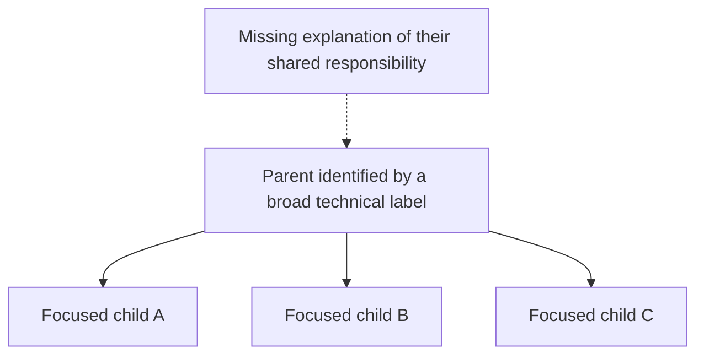
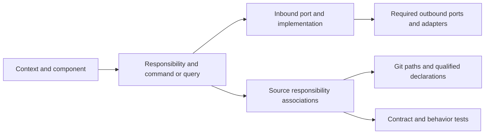

# ADR-0069 - Component Family Cohesion And Architectural Boundaries

**Related issue:** [#3850](https://github.com/dunay2/dvt/issues/3850)

## Context

A valid component tree can contain individually focused but unrelated children.
Shared tools, folders, teams or labels such as `CI`, `common` and `utils` do not
establish a shared architectural responsibility or faithful realization in code.

The discussion in [#3765](https://github.com/dunay2/dvt/issues/3765) used
`SYS-CI-GOVERNANCE-ROOT` as a motivating case: children include Web test selection,
Planning DB architecture operations and process lifetime concerns. This requires
composition review, without pre-approving a replacement hierarchy.

Existing component-engineering, SRP, hexagonal and command/query rules must be
connected to explicit family and implementation acceptance.

## Decision

### 1. Explicit architectural nature and ownership

Each component must have a declared nature, owning context or technical
capability, responsibility, reason to change, public boundary and exclusions.
Names, directory paths and `ROOT` suffixes cannot establish those semantics.

An aggregate additionally identifies its root, identity, protected invariants and
consistency boundary. Modules, services, adapters, composition roots and
organizational groupings must retain their actual nature. An architectural
parent is not implicitly an aggregate root or a bounded context.

### 2. Family cohesion and SRP must agree

For each parent, review must answer:

- What capability or responsibility does this parent own at its declared level?
- What part of that responsibility does each child fulfill?
- What meaningful conceptual relationship makes those children siblings?
- What responsibilities and components fall outside this family?

Each component, file, function and public contract must have a coherent concern
and one primary reason to change at its level. A parent coordinates focused
children; each child retains its own responsibility and reason to change.
Splitting files, shrinking functions or renaming a broad service does not prove
SRP. Unrelated policies require separate owners, not a coordinator hiding them.

Sibling relationships may follow a shared domain model, invariant, capability
or explicit application composition. Pairwise imports are not required. Shared
dependencies or frequent joint changes are supporting evidence, not proof of
cohesion. Creating dependencies to justify a family is forbidden.

### 3. Every grouping must earn its place

A family without a common responsibility requires regrouping or removal; renames
and file moves cannot justify it. Flatten categories introduced solely for one
child; genuine boundaries justify their independent identity. Reuse correct
contracts and retire obsolete ownership, relations and unused code through the
existing operations. More hierarchy is not an objective.

### 4. Commands, queries and ports expose the real boundary

Every externally observable intent must reuse a canonical command or query with
its owning context, DDD object or read model, inbound application port, result,
scope and negative paths, as required by command/query rail governance. Commands
own state-changing intent and return receipts or rejections; queries return read
models without changing domain state. A transport or adapter cannot introduce a
parallel intent, hidden command, or direct persistence shortcut around the rail.

Outbound ports declare the capabilities needed by the consuming application or
domain owner. Contracts are focused on that concern and its consumers; concrete
adapters implement them and composition roots supply dependencies. Domain policy
must remain independent of UI, transport and storage implementations. Review
checks actual dependency direction and interface segregation, not interface names.
Shared contracts retain their existing authority under ADR-0034 and ADR-0039.

### 5. Logical structure must resolve to physical implementation

Every implemented responsibility and rail must resolve to current Git files and
qualified declarations: port and type definitions, handlers or functions,
adapter implementations, composition wiring and tests, where applicable. The
reverse lookup must identify the owner and responsibility of each source file
and public entry, plus its rail when it implements observable intent. Unresolved
bindings, dead public entries and implementation without a governing owner fail
acceptance. Proposed behavior remains explicitly unimplemented until proven.

Use existing source-responsibility associations and their `implements`,
`delegates` and `verifies` roles, together with rail implementation references.
Validate paths, qualified symbols, ownership, supported declaration kinds and
test paths against the selected Git revision. Types and port interfaces must not
be recorded as executable functions. Renames and removals update or retire the
associations; stale references cannot pass because their former names survive.

Mappings may be many-to-one or one-to-many, while preserving SRP. Neither one
file per object nor a new rail per private helper is required. Helpers retain
their owner and governed source-binding coverage. Git owns physical inventory;
Planning DB owns semantic associations.

Implementation trace (port definitions also resolve to Git declarations):

### 6. Acceptance combines semantic review and mechanical evidence

Human review evaluates parent/child cohesion, SRP, sibling rationale, port and
rail boundaries, exclusions and actual implementation. Record the rationale and
reviewer identity. A score, small file or registered binding is not semantic
acceptance. Mechanical checks protect containment, source associations, declared
boundaries, dependency direction and prohibited cycles using existing mechanisms.

Creation or changes to parent, responsibility, nature, port, rail or public
boundary review the component, affected parents, their direct children and
relevant relation endpoints. Reparenting covers both old and new families;
affected ancestor responsibilities widen the scope. Report structural validity,
semantic acceptance and implementation evidence separately. Missing rationale,
unresolved ownership or a broken logical-to-source association prevents approval.

### 7. One authority and bounded validation

Planning DB owns architecture and governed evidence; Git owns physical source
facts; GitHub owns delivery work and review chronology under ADR-0061.

Reuse `RecordArchitectureComponent`, `ReviseGovernanceComponent` and existing
rail-recording/query operations under their actual contracts and admitted design.
Extend contracts only for a demonstrated gap; this ADR creates no new registry,
physical inventory, schema fields or duplicate commands.

Reuse dependency analysis and the changed-slice plan, with one snapshot and
deduplicated affected families. Shared rule or ownership-resolution changes widen
validation to their full affected scope. Input changes invalidate existing
receipts. Avoid global rescans per child and another unconditional CI job.

## Alternatives Considered

| Alternative                                                          | Reason for rejection                                                  |
| -------------------------------------------------------------------- | --------------------------------------------------------------------- |
| Rely on individual SRP and valid parent identifiers                  | Leaves unrelated siblings and arbitrary parents undetected.           |
| Require imports between all siblings                                 | Rewards coupling and rejects valid conceptual relationships.          |
| Infer acceptance from names, line counts or a numeric cohesion score | Confuses indicators with evidence of a domain or capability boundary. |
| Create a new registry, runner and full scan for every change         | Duplicates authority and increases validation cost.                   |

## Consequences

- Acceptance covers family, SRP, ports, rails and actual implementation together.
- Semantic review remains necessary alongside executable checks.
- Corrections are bounded; this ADR neither certifies the current tree nor
  authorizes a repository rewrite or another inventory/gate system.

## Adoption And Implementation Acceptance

Accepted by the repository user on 2026-11-11; acceptance is recorded in
[#3850](https://github.com/dunay2/dvt/issues/3850). This accepts the decision,
without claiming complete automated enforcement. Section 5 already reuses
`scripts/lib/component-source-responsibilities.cjs` to reject invalid binding
shapes, missing responsibility owners, mismatched ownership and missing qualified
source symbols. Its ADR-0000 trace covers those existing checks, not semantic
family acceptance. Further implementation requires an admitted design, GitHub
tracking and the following evidence:

1. Review of the motivating CI family before topology mutation, including SRP,
   actual ports, commands/queries, sibling rationale and physical source mapping.
2. Rejection of orphan/stale source bindings, missing port implementations or
   composition, hidden query writes and forbidden adapter/domain dependencies.
3. Contract/behavior proofs for valid and denied scope, invalid or stale inputs
   and dependency failure where applicable; renaming/removal must invalidate old
   bindings. A happy path or metadata snapshot alone is insufficient.
4. Review of both families on reparenting; rejection of unrelated siblings and
   acceptance of cohesive siblings without requiring pairwise imports.
5. Deduplicated, bounded checks with full affected scope for shared policy
   changes, and measured validation cost before and after.

## References

- [ADR-0034: Bounded context boundaries](./ADR-0034-bounded-context-boundaries-and-communication-rules.md).
- [ADR-0039: Hexagonal boundaries and SOLID](./ADR-0039-hexagonal-port-hardening-and-solid-remediation.md).
- [ADR-0061: Architecture authority](./ADR-0061-github-mvp-task-authority-and-planning-db-architecture-boundary.md).
- [Command and query rail governance](../architecture/command-query-rail-governance.md).
- [Component engineering invariants](../architecture/components/ci-governance/component-engineering-invariants.md).
- [Component source responsibility bindings](../architecture/components/ci-governance/component-engineering-record-component.md#atomic-source-responsibilities).
- [C4: Component definition](https://c4model.com/abstractions/component).
- [ArchUnit: Executable architectural rules](https://www.archunit.org/userguide/html/000_Index.html).
