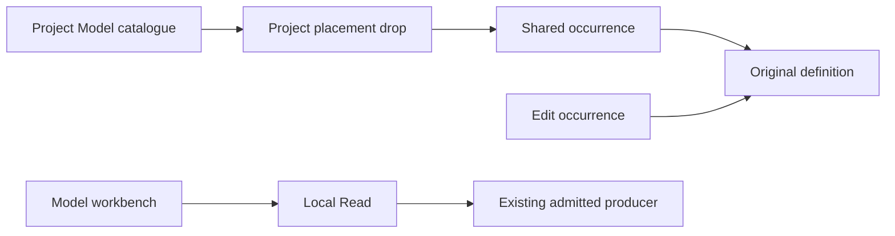
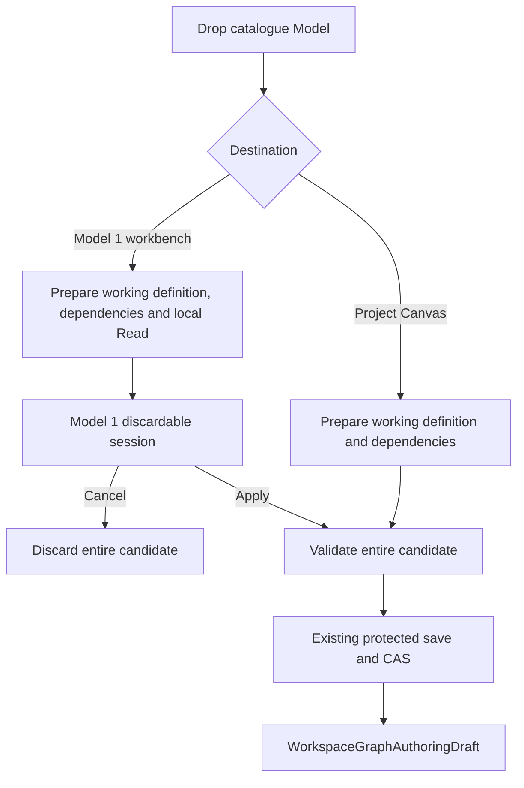

# ADR-0070 - Independent Model Working Copies And Contextual Composition

**Governing issue:** [#3950](https://github.com/dunay2/dvt/issues/3950).

## Context

Selecting a Model edits that Model. An author also needs independent copies for
experiments while retaining the original. Always treating a catalogue drop as a
new project placement prevents composition inside the Model currently open.

Current `WorkspaceGraphAuthoringDraft` occurrences use `definitionId` to share
configuration. Updating such an occurrence updates its definition. They are not
independent working copies. The existing duplicate command copies metadata and
reidentifies local semantic identities, but does not copy incoming dependencies
and can retain the original output destination and file authority.

The relational workbench already creates local Reads towards admitted producers.
A Read has its own relation/field identities and alias; the producer still owns
its operations. `inputAdditions` currently connects existing producers and cannot
atomically create a working definition, its dependencies and a consumer Read.

## Proposed decision

### Identity and ownership

Keep `WorkspaceGraphAuthoringDraft` as the aggregate and persistence boundary.
An independent working copy is a new native Model definition with its own node
identity and canonical Substrait document. It has no `definitionId` or
`sourceDefinitionId` pointing at the original. Existing shared occurrences retain
their existing meaning; do not silently reinterpret persisted references.

Reidentify local relation/field identities consistently, including authoring
ownership, nested fields, local lineage and the local side of `producerRef`
field mappings. Preserve external producer identities, external field identities
and shared connection references. Copy the actual admitted incoming dependency
context; copying metadata alone is insufficient.

Do not copy runtime status, metrics, compiled/Preview evidence, durable result
destinations or another Model's file authority. Use the supported unconfigured
authoring posture; do not invent an `ephemeral` configuration value where the
native authoring contract only admits explicit `table` or `view`.

All catalogue objects remain Models. Source is a Model facet, not an entity or
another catalogue. Connections remain shared project resources.

### Destination determines intent

| Gesture and destination                       | Result                                                                                                            |
| --------------------------------------------- | ----------------------------------------------------------------------------------------------------------------- |
| Click a catalogue Model                       | Select/open that actual Model; create nothing.                                                                    |
| Drop on project Canvas background             | Create and place an independent working definition.                                                               |
| Drop inside Model 1's semantic workbench      | Prepare an independent working definition and a local Read towards that copy inside Model 1; keep Model 1 active. |
| Connect that local Read to an operation input | Use the existing typed port, dependency and cycle admission.                                                      |

The drop preview names the destination and whether it will create a working copy
or add one to the open Model. Nested surfaces consume their accepted drop; it
must not bubble into a second project creation. Read-only, unavailable, ambiguous
context, cross-scope and unsupported-authority outcomes create nothing.

The working copy remains an admitted, navigable Model in the one catalogue.
There is no new hidden executable-definition flag. Inside Model 1, its Read is a
collapsed input: local properties edit alias and publication, while an explicit
open action navigates into the working copy to edit its operations. Do not label
the Read as an inline copy of those operations.

### Publication and restart

For workbench composition, preparation stays private until Apply. Publish the
new definition, its dependency edges, the consumer connection and the receiver's
document together through the existing candidate-session and protected save
boundary. Cancel, stale context, validation failure or CAS conflict must not
leave an orphan copy or partial edges. Validation of a private candidate cannot
grant authority or claim that a remote save was accepted.

Preserving the original and dragging it again provides a fresh experiment from
the original's current state. This decision introduces no persisted baseline,
history or reset command. It does not promise recovery of a historical original
revision. Updating an existing copy from a later original is also a different
intent. Neither inferred feature is required to implement independent copies.

File-backed Models require a real new file or an admitted conversion before an
independent-copy action becomes available. Retaining the original `path` or
file-model reference and changing node IDs does not establish independence.
Capability rejection must explain this; it must not silently create a linked
reference and present success as an independent copy.

### Application and physical boundaries

| Concern                     | Owner and existing rail                                            | Physical responsibility                                               |
| --------------------------- | ------------------------------------------------------------------ | --------------------------------------------------------------------- |
| Browse and select           | Model navigation / `InspectCanvasNode`, `SelectCanvasWorkbenchTab` | Explorer and navigation presentation.                                 |
| Prepare working definition  | Canvas authoring / `CreateCanvasNode`                              | Focused copy policy; no DOM, transport or output execution.           |
| Add copy to receiver        | Canvas authoring / `ConfigureCanvasDvtNode`                        | Composition candidate, typed input admission and discardable session. |
| Publish aggregate candidate | `ApplyWorkspaceGraphAuthoringCommand`, `SaveWorkspaceGraphDraft`   | Existing draft application port, repository and protected API CAS.    |
| Read and open producer      | Existing Model publication/navigation queries                      | Resolve the new definition, not the original.                         |

The pointer adapter resolves destination and sends an intent. Copy preparation
and composition admission have separate reasons to change. Neither belongs in a
universal factory, React component or HTTP route. Planning DB must admit the
affected component ownership, rail surfaces and negative proofs before code;
this ADR alone does not declare an implementation or replace that authority.

## Alternatives

- **Reuse shared occurrences:** rejected for working-copy creation because edits
  propagate to the original definition.
- **Reference the original from Model 1:** valid existing composition, but cannot
  satisfy the independent-copy gesture without explicitly choosing linked reuse.
- **Flatten copied operations into Model 1:** deferred as a different editing
  model. It requires operation decomposition, complete identity remapping and
  function/extension reconciliation. A navigable independent producer supplies
  composition without those additional semantics.
- **Persist a second complete baseline:** unnecessary for retaining the original
  and starting another experiment; adds snapshot authority and reset invariants.

## Required evidence before implementation acceptance

| Scenario                         | Opportunity and pattern                        | Required proof                                                                                                           |
| -------------------------------- | ---------------------------------------------- | ------------------------------------------------------------------------------------------------------------------------ |
| Native copy and subsequent edits | Hidden authority; Value Object and copy policy | Semantic equivalence, independent IDs, original unchanged, valid producer field remapping and copied dependency context. |
| Workbench drop                   | Boundary drift; application transaction        | Receiver stays active, one candidate, Apply/Cancel and no orphan nodes/edges.                                            |
| Destination arbitration          | Duplicate semantics; typed intent              | Nested drop is consumed once; click never creates; keyboard add uses the same admitted intent.                           |
| Denied or stale context          | Policy and protected port                      | Permission, scope, ambiguity, invalid authority, unavailable dependencies and CAS rejection publish nothing.             |
| File authority and output        | Separate authority boundaries                  | No shared-file fork claim, inherited durable destination or borrowed execution evidence.                                 |
| Save and reload                  | Aggregate / repository                         | Real contract roundtrip and browser workflow through the protected application.                                          |

Package tests, lint, types, architecture evidence and `pnpm verify:prepush` remain
required. A design record or unit-only copy test does not prove the drag workflow.

## References

- [ADR-0064: Substrait semantic authority](ADR-0064-substrait-semantic-reference-and-bounded-logical-profile.md).
- [ADR-0069: component cohesion and boundaries](ADR-0069-component-family-cohesion-and-architectural-boundaries.md).
- [Draft aggregate](../architecture/components/planner/workspace-authoring-draft-aggregate.md).
- [Draft persistence](../contracts/planner/workspace-graph-draft-persistence-v1.md).
- [Command/query governance](../architecture/command-query-rail-governance.md).
