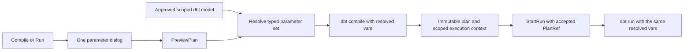

# ADR-0071 - Typed parameters for model execution

## Context

A Code user can compile a scoped dbt model and materialize its approved plan.
Today the editor identifies the revision and target. Two invocations of the same
revision can intentionally produce different rows, for example invoices through
different cutoff dates. A compiled plan must identify which values it uses.
[#3120](https://github.com/dunay2/dvt/issues/3120) owns typed run parameters and
[#2487](https://github.com/dunay2/dvt/issues/2487) owns invocation identity.


## Decision proposed for the Code editor

The selected model declares its business parameters in
`config.meta.dvt.run_parameters` in the admitted dbt project. Code presents the
declarations in one dialog reached from Compile or Run. Compile prepares the
plan. Run with parameters compiles the confirmed selection and starts only
after it receives the matching acceptance receipt. The dialog sends only
requested overrides. The API
loads the declaration for the exact model and accepted project revision using
the effective tenant, project, environment and target. Client labels, types,
defaults and scopes convey no authority. Unsupported declarations or overrides
block compilation with an actionable diagnostic. Models with no declarations
keep their existing compile and run behavior.



`PreviewPlan` owns admission. `mergeRunParameterDefinitions` merges the
declarations for the same executable model selection used by compilation.
Conflicting declarations for one variable must be rejected before execution
because dbt exposes one variable namespace for the invocation. Resolve only
declared scalar values, including explicit false and zero, and present their
effective values and provenance before compilation. A
missing required value prevents native compilation. Missing optional values
retain their declared omission semantics. Do not infer secret values from
environment variables, credential references or adapter settings. The full
precedence from #3120 is run override, environment override, project default,
then declaration default. In this file-backed cut, `defaultValue`,
`projectDefault` and `environmentDefaults` belong to the declared model
revision. The server indexes environment defaults by the effective authorized
environment. Text, integer, boolean and ISO calendar date are the initial
scalar types. Bounded string choices constrain text. An optional value can
declare an enable flag through `enabledBy` and its initial state through
`enabledByDefault`. Both the effective flag and the active values participate
in the admitted dbt variables.

Compute execution identity from the canonical result-affecting values. A
different value must invalidate accepted compilation and prevent reuse for a
different invocation. Equal values with different UI display order or source
have the same value identity. `DbtStepTypeConfig.parameterSetSha256` identifies
that effective provider input on each admitted plan node. `dbtInvocationSha256`
also binds the scope and target so a plan-store lookup cannot return a different
destination's evidence. The dialog can display the source of each effective
value separately from the value identity.
Persist the resolved provider input in the server-owned file Preview provenance
attached to the admitted plan. The public Preview command admits only overrides.
`StartRun` accepts the plan reference, verifies both hashes against the stored
scope and provenance, and projects the values into its typed dbt plugin context
through retries. A change of file revision, target, scope or parameters requires
fresh compilation.

The dbt adapter projects the resolved values through its native
[`var()` and `--vars` contract](https://docs.getdbt.com/docs/build/project-variables)
for both compilation and execution. Invoke the process using structured
arguments. Do not copy values or expanded argument vectors to logs or error
responses. This cut grants no procedure, arbitrary SQL or additional database
write privileges.

## Runnable dbt model

Save the following as `models/filtered_amounts.sql` in a PostgreSQL dbt project.
A parameterized model must be discoverable before the Code dialog has run.
The defaults in `var()` allow dbt to parse and inspect this example without
requiring a prior invocation.

```sql
{{ config(
    materialized='table',
    meta={'dvt': {'run_parameters': [
        {'name': 'minimum_amount', 'type': 'integer', 'defaultValue': 0,
         'enabledBy': 'use_minimum', 'enabledByDefault': false}
    ]}}
) }}

select amount
from (values (10), (20), (30)) as sample(amount)

where amount >= {{ var('minimum_amount', 0) }}

```

Compile or run once with the filter disabled. The relation contains 10, 20 and 30. Enable the filter and enter 20. The relation contains 20 and 30. An
independent dbt client can reproduce the second invocation with
`dbt run --select filtered_amounts --vars '{"use_minimum":true,"minimum_amount":20}'`.

## Consequences and validation

- Code can show the effective authorized values and let a user override them
  before explicit compilation. The historical context identifies the values
  admitted even if the file later changes.
- Tests must distinguish omission, required errors, false and zero. Invalid
  types, unknown names, stale model selections and cross-scope overrides fail
  before plan acceptance. A successful older compile cannot enable Run after an
  edit.
- Native dbt proof must compile and execute the same parameterized file at two
  effective values, verify changed output and retained invocation identity, and
  cover an existing model without parameters. Test redaction on provider failure.
- The Canvas SQL draft still uses its bounded read-only preview. Native
  Substrait binding and any further provider projections retain their separate
  work in #3120.
