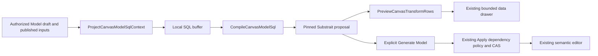

# PostgreSQL Model SQL Source

## Decision and authority

This is the design for [#3944](https://github.com/dunay2/dvt/issues/3944),
admitted as `GH-3944-MODEL-SQL-AUTHORING` and its wiring supplement in Planning DB.
The two queries now have actual implementation references and proof registrations
in Planning DB. Their implementation does not attest merge acceptance; the
governing issue and exact-candidate gates own that boundary.

Under ADR-0064, pinned Substrait and its identity sidecar remain the Model's
semantic authority. SQL is an editable source proposal. PostgreSQL AST nodes
are dialect syntax, not another relational IR. The existing Model draft is the
aggregate; an SQL buffer is local editor state, not another persisted aggregate.

## Boundaries and reasons to change

| Owner                                    | Responsibility and physical family                                          | Reason to change                                        |
| ---------------------------------------- | --------------------------------------------------------------------------- | ------------------------------------------------------- |
| `SYS-ADAPTERS-POSTGRES-MODEL-SQL-SOURCE` | Pure AST-to-Substrait mapping in `postgres-projection/src/sqlSource`        | Admitted PostgreSQL source constructs change            |
| `SYS-API-CANVAS-MODEL-SQL-AUTHORING`     | Protected context and compilation query objects in API application services | Model SQL query admission or currentness policy changes |
| `SYS-WEB-CANVAS-MODEL-SQL-AUTHORING`     | Buffer, explicit actions and presentation in `views/canvas/model-sql`       | SQL authoring interaction changes                       |

`ProjectCanvasModelSqlContext` reads the protected saved draft without requiring
an already executable target. It resolves connected Source publications and
native/file Model publications through their real authorities. The application
context and compilation ports separate this policy from HTTP, parsing and UI.

`CompileCanvasModelSql` reauthorizes and resolves the expected context, parses one
SELECT with the existing PostgreSQL parser, and proposes a complete canonical
document or diagnostics. It neither saves a graph nor executes rows.

`PreviewCanvasTransformRows` retains its strict saved-Model GET contract. Its
explicit SQL-draft POST variant recompiles the proposal against the protected
context, renders canonical SQL and uses the existing bounded read-only probe.
SQL never enters URLs. Execute calls neither Apply, save, Publisher nor Run.

Generate uses the existing `onApplyNodeDraft` command, dependency rejection,
autosave and revision CAS. No second persistence controller, raw-SQL execution
service, connection configuration or warehouse migration is introduced.

## Source and identity admission

SQL names refer to explicitly prepared logical Model inputs. Names are syntax;
Read occurrences, SourceRefs, producerRefs and FieldIds retain their real
identities. Unknown, ambiguous, stale, unauthorized and cross-connection inputs
fail closed. A similarly named physical table is not a fallback authority.

Context reads allocate no authoring identities. An explicit compilation proposal
reuses valid current occurrences and allocates opaque IDs for new occurrences
and operations. Output identity is retained only through a unique exact current
provenance mapping. Name, ordinal, SQL text and AST paths never mint identity.
The existing dependency policy rejects destructive output changes.

An empty or incomplete Model has an honest empty source state. Unknown published
types are not silently converted to strings. File producers remain external
publications with their existing file permission and compilation checks.

## Initial source profile

Admit direct field projections, stars in publication order, explicit aliases,
INNER/LEFT/RIGHT/FULL/CROSS joins with explicit ON, Boolean comparison and NULL
predicates, uncorrelated subqueries, sorting and bounded nonnegative Fetch.
Qualification, duplicate names, self joins, outer-join nullability, output sort
aliases/ordinals and PostgreSQL default NULL ordering require explicit proof.

Reject unsupported syntax as a whole: CTE, grouping, sets, windows, DISTINCT,
function calls, casts/coercions, correlated/lateral/USING/NATURAL/aliased joins,
parameters, writes and locking. Unsupported literal/native type meanings must
be diagnosed, not widened. Syntax validity does not imply representability.

## Presentation and currentness

Reuse the shared Monaco surface, visual tokens, resizable panels and existing
data table. The SQL pane opens between the semantic canvas and data drawer;
the semantic Workbench stays mounted. One toolbar exposes Validate, Execute
and Generate Model. There is no nested tab stack or automatic query on typing.

The SQL disclosure follows the [W3C Disclosure pattern](https://www.w3.org/WAI/ARIA/apg/patterns/disclosure/):
the button's expanded state and controlled section agree, and the retained
section is hidden while collapsed. Its draft remains mounted and its data portal
belongs to the external drawer. The workspace's focused layout hook controls
resizing; the template remains passive.

Only one owner publishes into the data host at a time. Buffer, scope, Model or
input changes invalidate compilation receipts and mark retained rows stale.
Late responses cannot replace a newer buffer or context. Concurrent unapplied
visual edits block SQL generation. The existing Model navigation decision
coordinates apply/discard/stay for both editors and preserves rejected drafts.
Apply is a separate command phase: editing is locked while it runs, cancellation
uses its existing signal, and its actual acknowledgement survives the revision
change caused by that command. A restricted Read keeps its canonical field
ordinals while the logical SQL seed omits unpublished fields. Row dependencies
on an unpublished field reject the seed; no NULL filler or renamed identity is
introduced. Preview provenance is intersected with the actual canonical producer
closure, including transitive external producers.
The owning Model workspace synchronously blocks visual authoring while SQL Apply
is pending. The canvas remains mounted and becomes read-only/inert; cancellation
does not release that exclusion until the command settles. Namespace currentness
includes names, plugin/kind/role, placement references, path and metadata, so
renaming or rebinding an input invalidates visible receipts without rewriting
the user's SQL.

## Required proof

Contracts must reject forged context/provenance, unbounded SQL/rows and SQL in
the saved-Model DTO. Compiler tests cover supported constructs, identities and
whole-query rejection. A disposable native PostgreSQL oracle compares logical
source SQL with canonical rendering, including types, ordering, duplicates and
NULLs. API proof must show authorization, stale context and zero writes on
Execute. Browser proof covers validation, data, generation, navigation and
keyboard access on the actual integrated UI. Standard package checks, ARC,
governance refresh, prepush and exact-head PR acceptance remain required.
