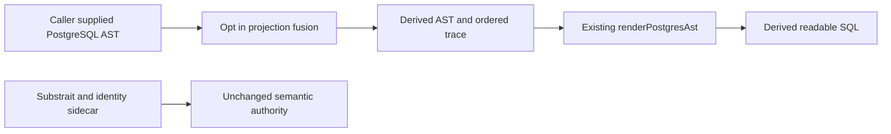

# PostgreSQL SQL Presentation

The existing `SYS-ADAPTERS-POSTGRES-PROJECTION` package owns this opt-in
presentation query. Substrait and its stable relation/field identities remain
the semantic authority under ADR-0064. SQL ASTs and rendered SQL are derived
syntax; simplification grants no execution capability.

## Authority and scope

The prospective [integration design](https://github.com/dunay2/dvt/issues/3781#issuecomment-6699410642)
and native design `GH-3783-PROJECTION-FUSION-INTEGRATION-V2` govern this cut.
`SimplifyPostgresSqlPresentation` is a pure query over a caller-supplied
`PostgresAstNode`; it returns a derived AST and an ordered rule trace.
The caller retains its tenant/project authorization and admitted source scope.
The package does not read a catalog, sample rows, mutate state, compile dbt,
execute SQL or change Planner/Engine behavior.

## One bounded rule

The first rule removes transparent direct-column SELECT wrappers. Binding is
scoped to the removed subquery alias and preserves output names and order.
One-step and bounded fixed-point modes share that rule and traversal. The input
AST is never mutated. Alias capture, ambiguous or unsupported bindings,
computed projections and semantic barriers must prevent unsafe rewrites.
An invalid or exhausted fixed-point bound is an explicit error rather than a
false success. Rendering reuses the existing pgsql-deparser adapter and its
failure contract.

The query is opt in. Existing projection and execution rendering defaults stay
unchanged. PostgreSQL native differential evidence must compare the original
and derived outputs, including duplicate and NULL behavior. A smaller rendered
SELECT count is not proof of physical optimization.

## Validation and remaining work

Package tests must exercise the real deparser and real Substrait projection
fixtures, in addition to negative scope/barrier cases, determinism, idempotence
and original-AST preservation. Provider differential evidence uses a disposable
database on the existing PostgreSQL service and retires it afterwards; it must
not bootstrap the user's warehouse.

Manual SQL parsing and its admitted AST contract remain in #3782; converged
manual input and UI integration remain in #3784 and #3786. This package-level
cut does not claim those product journeys complete.

The first native PostgreSQL comparison covered nested renaming with NULL and
duplicates, INNER/LEFT/RIGHT/FULL JOIN and canonical Substrait JOIN/CROSS/SET.
All eight scenarios retained output names and returned an empty bidirectional
EXCEPT ALL difference. The nested three-SELECT fixture became one SELECT;
the canonical generated plans retained their semantic barriers and each lost
one transparent wrapper. The [issue journal](https://github.com/dunay2/dvt/issues/3783#issuecomment-6699540690)
records commands, counts, scope and limitations. This evidence is semantic
comparison, not an execution-latency or physical-optimization claim.
