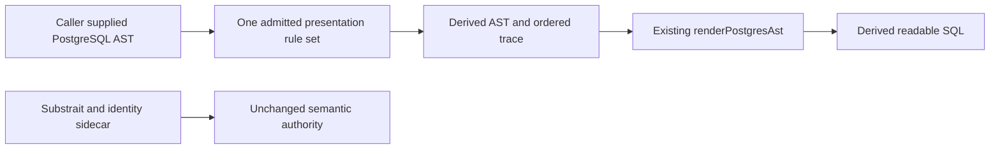

# PostgreSQL SQL Presentation

The existing `SYS-ADAPTERS-POSTGRES-PROJECTION` package owns this opt-in
presentation query. Substrait and its stable relation/field identities remain
the semantic authority under ADR-0064. SQL ASTs and rendered SQL are derived
syntax; simplification grants no execution capability.

## Authority and scope

The existing [query authority](https://github.com/dunay2/dvt/issues/3781#issuecomment-6699410642)
and prospective [ordered-rule design](https://github.com/dunay2/dvt/issues/3787#issuecomment-6700898834)
(`GH-3787-SQLREAD-ORDERED-RULES`) govern this cut.
`SimplifyPostgresSqlPresentation` is a pure query over a caller-supplied
`PostgresAstNode`; it returns a derived AST and an ordered rule trace.
The caller retains its tenant/project authorization and admitted source scope.
The package does not read a catalog, sample rows, mutate state, compile dbt,
execute SQL or change Planner/Engine behavior.

## One Admitted Rule Set

The [R1–R6 design](https://github.com/dunay2/dvt/issues/3787#issuecomment-6700898834)
extends the same query through `rewritePostgresSqlOnce` and
`simplifyPostgresSqlAst`. Both return an immutable derived AST, ordered rewrite
trace and an explicit retained diagnostic when admission fails. The old fusion
module and its renderer wrapper are retired; `renderPostgresAst` remains the
only renderer. The parser already used by `parsePostgresTransformSqlStructure`
supplies the same PostgreSQL syntax representation as the Substrait projector.

R1 admits the complete candidate and resolves references in their owning SELECT
scope before any rewrite. Callers supply `resolvedColumns` for known scalar
columns of each resolved schema/table. Comparisons and literal builtin casts
also require `scalarSemantics: 'pg_catalog'`, reflecting the caller's native or
canonical resolution for that scope. These inputs do not validate permissions,
types, operators or execution readiness. The original candidate still needs the
existing governed provider preflight. Missing, duplicate, unknown, ambiguous,
external and whole-row bindings retain the entire original AST, including
otherwise simplifiable siblings. Repeated alias spelling in distinct scopes is
valid; a global name replacement is not scope resolution.

The admitted profile contains direct-column projections, resolved base inputs,
transparent subqueries, INNER/CROSS joins, pure Boolean/null predicates and
resolved builtin scalar comparisons. Existing projector literals may retain
their builtin scalar casts. Per-row casts, functions, arithmetic, aggregates,
windows, DISTINCT, sorting, limits, grouping, sets, CTE, correlation, LATERAL,
USING/NATURAL/aliased joins and outer joins are retained as complete candidates.
No scalar type or portable relational model is inferred from AST shape.

The ordered transformations are:

- R2 fuses transparent projections, preserving names, ordinals and admitted
  filters through lexical substitution.
- R3 moves one AND term into one transparent input through INNER/CROSS only.
  OR is never distributed; a whole OR term moves only when it has one input
  owner. Unresolved or potentially effectful expressions do not move.
- R4 prunes unused subquery outputs using SELECT, WHERE and JOIN ON references.
  It retains the relation and at least one output when rows affect multiplicity.
- R5 removes a transparent wrapper over a base input, retaining the outer alias
  and rebinding fields and admitted filters. All owning-scope references become
  qualified so exposing additional base columns cannot introduce ambiguity.

R6 shares one deterministic postorder scheduler and that R2/R3/R4/R5 priority.
It performs one atomic rewrite per step and runs until a true fixed point.
Invalid or exhausted bounds fail explicitly. Resolution metadata compiles once
per call; changed candidates are rebound once, rather than once per rule. Syntax
admission bounds depth and node count. Wrappers disappear, unused output counts
shrink, and pushdown crosses existing boundaries without creating new ones;
the engine cannot report a truncated run as complete.

PostgreSQL syntax bindings are ephemeral views of the admitted AST, never a
second DVT semantic IR. Other dialects would be target adapters from canonical
Substrait with their own native proofs; PostgreSQL rules do not certify Oracle
or Snowflake compatibility.

The query is opt in. Existing projection and execution rendering defaults stay
unchanged. PostgreSQL native differential evidence must compare the original
and derived outputs, including duplicate and NULL behavior. A smaller rendered
SELECT count is not proof of physical optimization.

## Validation and product boundary

Package tests must exercise the real deparser and real Substrait projection
fixtures, in addition to negative scope/barrier cases, determinism, idempotence
and original-AST preservation. Provider differential evidence uses a disposable
database on the existing PostgreSQL service and retires it afterwards; it must
not bootstrap the user's warehouse.

The maintained provider suite is `apps/api/test/integration/sqlReadProof`.
With `DVT_PG_URL` set to the existing loopback service, it leases and disposes a
database, reads the actual scalar catalog, and runs 326 native cases: 36 manual
scenarios plus three canonical Substrait shapes across eight datasets, nine
valid-but-wrong oracle controls, three invalid-reference retentions and two
oracle failure-propagation checks. Five additional tests check result metadata.
The matrix covers empty relations, NULLs, duplicate rows, crossed names and
deterministic generated data. It compares every intermediate rewrite as well as
the fixed point with bidirectional `EXCEPT ALL`, output names/ordinals, native
type OIDs, size and typmod; ordered retained scenarios also compare row order.
Invalid SQL and failed connections propagate instead of counting as successful
negative controls. A run without `DVT_PG_URL` skips the provider suite and does
not constitute native evidence.

The existing manual parser and canonical projector converge at this same query
in the proof. Neither is duplicated. Canonical JOIN/CROSS fixtures reduce to one
SELECT; SET and the other semantic barriers retain the complete original AST.
This proves bounded semantic equivalence, not lower execution latency or a
physical PostgreSQL optimization. The earlier [first-rule evidence](https://github.com/dunay2/dvt/issues/3783#issuecomment-6699540690)
remains provenance for the merged first cut.

Application wiring of readable SQL and its original/derived display remains
the separate product journey in #3784/#3786. This cut changes no Preview/Run,
dbt compilation or UI behavior and does not certify general SQL, arbitrary
types, operators or dialects.
