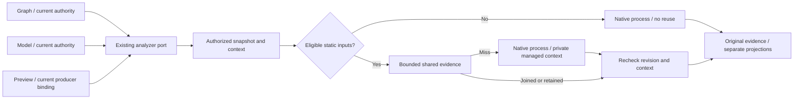
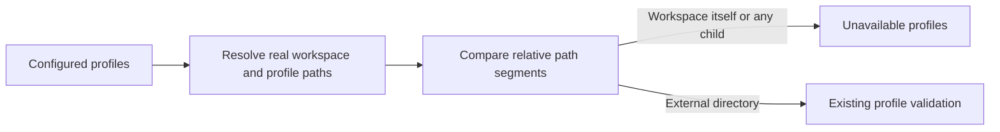

# Native dbt project analysis

`SYS-API-DBT-ANALYZER` implements the existing `IDbtProjectAnalyzerPort` and
`IDbtProjectSourceRevisionReader`. It owns isolated native analysis and bounded
reuse of eligible native parse and compile evidence. Authorization, Canvas authority, writes, graph
projection, selected-model selection and execution admission retain their owners.

Governing sources: [ADR-0060](../../../adr/ADR-0060-dbt-project-authoring-authority.md),
the [command/query rule](../../command-query-rail-governance.md), and the
[prospective design and test matrix](https://github.com/dunay2/dvt/issues/3747#issuecomment-6550249113).
Planning DB owns the exact responsibilities, files, symbols and rail relations
under `GH-3747-DBT-PARSE-ANALYSIS-REUSE`, extended by the
[static compilation reuse design](https://github.com/dunay2/dvt/issues/3747#issuecomment-6644101801)
and `GH-3747-STATIC-DBT-COMPILE-REUSE`.

The focused decomposition and compile-target context follow
[the prospective slice](https://github.com/dunay2/dvt/issues/3872) and native
design `GH-3872-DBT-ANALYZER-TARGET-CONTEXT`. The request module owns its internal
runtime contract; collaborators do not depend on the facade's configuration type.

## Existing rails and boundaries

| Owner                                                    | Responsibility                                                               |
| -------------------------------------------------------- | ---------------------------------------------------------------------------- |
| `ProjectDbtGraphFromFiles` / `DbtProjectGraphProjection` | Current file authority, graph and current connection capabilities            |
| `AnalyzeSelectedDbtModel` / `DbtProjectAnalysis`         | Current file authority and selected-resource projection                      |
| `DbtCliProjectAnalyzer`                                  | Application port facade, configured runtime and request observation          |
| `dbtAnalysisRequest`                                     | Authorized snapshot/reuse lifecycle and sole private-directory cleanup owner |
| `dbtSnapshotAnalysis`                                    | Native process execution and validated manifest projection                   |
| `dbtAnalysisResult`                                      | Consistent analysis evidence and revision construction                       |
| Context and eligibility collaborators                    | Effective input identity and safe reuse admission                            |
| `DbtAnalysisReuse`                                       | Bounded sharing of in-flight work and valid results                          |

Graph, selected-model and model-producer consumers call the same adapter instance through the existing application
port. Their authorization, binding, connection and CAS checks remain independent
on every request. An analysis grants no permission.

## Validity and lifecycle

Identity includes tenant/project/environment, canonical directory, requested root,
complete executable source revision, exact managed profile bytes and sanitized
effective environment, operation kind, compile target and normalized compile selectors. Parse
evidence cannot satisfy a compile request; different model selections cannot
share a compiled result. The existing source policy includes configuration and
project dependencies. An open file hash alone is insufficient.

Compile operations may supply an optional `targetName`. The adapter passes it as
native `--target` and includes it in the context identity: two requested targets
cannot share compiled evidence. Omitting it retains the configured native default.
Parse operations do not accept this compile-only option. This extends the internal
port input; it does not create another connection configuration or authoring authority.

Python, dbt and installed runtime dependencies are immutable for the API runtime
generation. Upgrades require restart/recomposition, discarding retained analyses.
Hot installation replacement is unsupported; launcher timestamps and TTLs do not
establish library identity. Retention is neither persistent nor cross-process.

Eligible execution reads a private copy of the profile bytes used in its identity.
Managed profiles resolve outside the workspace by path segments, after `realpath`.
A child named `..profiles` is still workspace-controlled: a leading pair of dots
alone is not a parent-directory segment. The workspace itself and every real child
are rejected; external managed directories retain their existing support.

After shared work or a retained lookup, source and context are checked again.
Changed or unreadable inputs produce an unavailable analysis, never stale success.
Only valid eligible native results are retained. Original `analyzedAt` and `analysisSha256`
are preserved. Isolated caller copies prevent corruption of later reads. Entry
and serialized-result-byte limits bound retention; eviction causes fresh work.
Invalid, unavailable and rejected work releases its pending entry.

## Conservative eligibility

Every snapshot file is examined, including ownerless files and project
dependencies. SQL may contain complete literal `ref` and `source` expressions,
using the existing semantic-region recognizer. Other files and managed profiles
must contain no Jinja. Python, blocks, macros, unknown expressions and incomplete
delimiters bypass reuse while retaining full native analysis support.

YAML can decode backslash escapes into Jinja delimiters after this raw-source
check. Therefore `.yml` and `.yaml` files (case-insensitive), including managed
profiles, bypass reuse whenever they contain a backslash. This deliberately
conservative rule covers keys and values without adding a YAML parser or claiming
to validate decoded configuration. Plain YAML remains eligible; escaped YAML
retains normal native analysis support. SQL keeps the literal-reference policy.

Eligibility is not dependency analysis or SQL validation: the native manifest
remains authoritative. Volatile Jinja context can alter parse-time attributes;
see [dbt project parsing](https://docs.getdbt.com/reference/parsing). Eligible
static compilation uses the same bounded evidence mechanism. Dynamic inputs
always execute natively; a miss still uses an isolated native process with full
parsing. Warehouse results are never retained here: every Preview queries current
rows after its current authority, producer and connection checks.

## Observation and validation

Numeric request/snapshot/process/projection durations, source counts, operation,
status and reuse disposition go to the existing logger. SQL, profiles, environment
values, credentials and private context fingerprints do not. Timing values are
diagnostics, not pass thresholds.

Tests cover repeated/concurrent requests, scope/root separation, secondary-file,
profile and environment changes, in-flight drift, dynamic bypass, operation and
selector separation, shared static compilation,
failures/recovery, bounded retention and caller mutation. Composition and route
tests preserve independent authority, including successful reads followed by
revocation. Real proof uses an isolated synthetic project and the native runner:
cold/warm, concurrent fresh-instance calls and a relevant source change. Compare
actual process counts, identities and measured durations before and after.

Adapter tests are grouped by process, identity, snapshot and diagnostics behavior;
reuse tests separate concurrency, invalidation and compilation. The same assertions
and native process interactions remain required. Authorization, Preview selection
and execution admission remain with their existing application owners.
