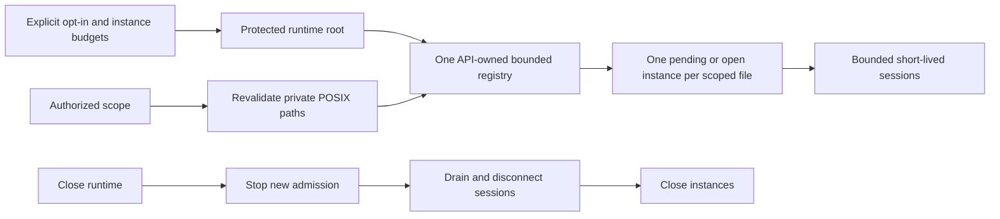

# API DuckDB Local Data Runtime

The accepted boundary is [#3389](https://github.com/dunay2/dvt/issues/3389), with
the [preimplementation rationale](https://github.com/dunay2/dvt/issues/3389#issuecomment-6124698831)
and operated design `GH-3389-BOUNDED-NATIVE-FOUNDATION`. This infrastructure
foundation is not LOCAL Preview, source acquisition, an SQL application port or
an execution-readiness claim.

## Ownership And Operational Rail

`InitializeLocalDataRuntime` is an internal command owned by
`WorkspaceLocalDataRuntime`, composed and closed by
`buildProtectedRuntimeModule`. Its input is operator-admitted configuration;
its resource scope is the existing `WorkspaceStorageScope`. Native handles and
SQL remain in API infrastructure. No HTTP adapter is added. Product commands
remain with their existing application owners; future callers must perform
current authorization before requesting a scoped session (#3392). Scope hashing
is a storage identity, never authorization.

## Resource And Storage Invariants

Disabled configuration performs no local-data I/O or native-driver import.
Enabled startup requires an operator-provisioned, service-owned POSIX mode-0700
root distinct from authoring storage. Enabled Windows mode rejects explicitly:
POSIX checks do not prove Windows ACL privacy. This is not an OS sandbox against
the service UID, host administrator or mount administrator.

Each scope owns `scopes/<existing scope hash>/workspace.duckdb`, its WAL when
present, and a private `temp/` spill directory. Paths, ancestors, existing DB/WAL
entry types, symlinks and hardlinks are checked at native-open boundaries.
Corrupt or unreadable files produce a sanitized rejection, never silent deletion
or replacement. Native file creation remains protected by the private parent;
existing files are not blindly chmod-repaired. The single API process owns the
writable instance: this is not a distributed multi-writer guarantee.

Pending opens count toward the workspace limit and simultaneous same-scope
requests share one instance promise. Concurrent sessions have a separate global
admission limit. Exceeding either rejects rather than creating an unbounded
queue. Failed opens release their registry slot; every session disconnects on
success or failure. Shutdown stops admission first, drains all admitted work and
then closes instances idempotently. Shared spill directories are not removed by
session cleanup; retention and GC remain #3398.

Memory, threads, temporary directory and maximum spill are fixed per instance.
They are not independent per-session quotas or hard RSS limits. Deployment
process/container RSS and disk limits remain the final host resource boundary.
External access, automatic extension installation/loading, unsigned/community
extensions and persistent secrets are disabled; configuration is locked. No
secret or row data is logged by this boundary.

## Verification And Limits

| Invariant                                | Package proof                                          | Negative / architecture proof                                                                                                                              |
| ---------------------------------------- | ------------------------------------------------------ | ---------------------------------------------------------------------------------------------------------------------------------------------------------- |
| Explicit configuration and private scope | `localDataEnv.test.ts`, `duckDbLocalDataPaths.test.ts` | invalid budgets, overlap, missing roots, scope, link/type/permission rejection and honest unsupported Windows boundary                                     |
| Native ownership and lifecycle           | `DuckDbLocalDataRuntime.test.ts`                       | real concurrent ownership, workspace/session limits, failed-open capacity, drain, rejection after close, persistent reopen and temporary-session isolation |
| Native security settings                 | same native test                                       | locked budgets, denied external access/extensions, corrupt bytes preserved, existing DB/WAL validation                                                     |
| Infrastructure-only native boundary      | `duckDbLocalDataRuntime.architecture.test.ts`          | no Web/Planner/Engine dependency, product raw-SQL/native port, or HTTP route; composition owns shutdown                                                    |

Native smoke runs the actual Vitest tests on a supported POSIX host, not a
rewritten test copy. The exact npm pin is `@duckdb/node-api@1.5.6-r.1`, with the
matching native binding recorded by the package-manager-generated lockfile.
Upgrades require rerunning native/security/lifecycle fixtures and dependency
review. See the [official Neo API](https://duckdb.org/docs/current/clients/node_neo/overview),
[configuration reference](https://duckdb.org/docs/current/configuration/overview)
and [security guidance](https://duckdb.org/docs/current/operations_manual/securing_duckdb/overview).

Dataset manifests and promotion (#3391/#3393), current use-case authorization
(#3392), acquisition (#3394), admitted semantic execution (#3395), retention
(#3398) and LIVE/LOCAL UI (DAM1) remain separate responsibilities. Foundation
tests and resource availability do not declare any of those features READY.
