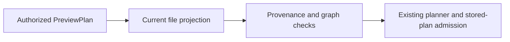
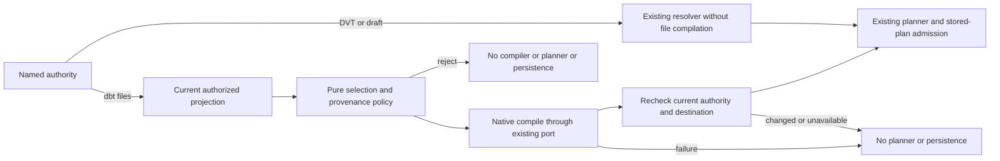

# Execution selection admission

`SYS-API-EXECUTION-SELECTION-ADMISSION` owns admission of the selection supplied
to the existing `PreviewPlan` command. It is an application policy under
`SYS-API-APPLICATION-SERVICES`, not an aggregate or a bounded context.

The governing design is `GH-3876-DBT-PREVIEW-COMPILE-ADMISSION`, admitted from
[the prospective slice](https://github.com/dunay2/dvt/issues/3876). Its existing
rail authority is [GH-2784](https://github.com/dunay2/dvt/issues/3115#issuecomment-6378435979):
`PreviewPlanUseCase`, through `IPlansPort.previewPlan` and `POST /plans/preview`.
`PreviewExecutionPlan` is a distinct cataloged intent; it is not an alias for
this command. Planning DB owns component identities, relations and source bindings.

Governing rules are [ADR-0060](../../../adr/ADR-0060-dbt-project-authoring-authority.md),
[ADR-0061](../../../adr/ADR-0061-github-mvp-task-authority-and-planning-db-architecture-boundary.md)
and [command/query governance](../../command-query-rail-governance.md).

## Boundary and responsibilities

| Collaborator            | Owned decision                                                                |
| ----------------------- | ----------------------------------------------------------------------------- |
| Authority router        | Dispatch the named file, protected DVT or graph-draft authority               |
| File-selection resolver | Sequence current read, validation, compilation and recheck                    |
| Pure selection policy   | Compare provenance, complete destination identity and canonical graph         |
| Compilation gate        | Require matching native evidence and nonblank SQL for every selected resource |

The router exposes `ResolveAuthorizedPreviewSelectionService.execute` to the
existing `PreviewPlanUseCase`. It returns admitted planner input or an explicit
selection rejection. It does not build or persist a plan.

Outbound dependencies remain `ProjectDbtGraphFromFilesUseCase.execute` and
`IDbtProjectAnalyzerPort.analyze`. The native analyzer owns snapshots, process
execution, validated analysis and eligible reuse. The resolver owns the narrow
contract consumed by its router; pure policies do not import types from that
router. There is no shared types bucket or second command service.

The composition root supplies the same analyzer instance already used by graph
and selected-model queries. HTTP composition, analyzer mechanics, planner
algorithms, stored-plan admission and Run binding validation keep their existing
owners. Integration and unit tests retain their test ownership, with explicit
validation associations to this policy.

## Rationale and transition

The former file path validated one authoritative projection and could proceed
without native compilation evidence:

A valid parse does not prove that the selected models compile. Compilation is
asynchronous, so admission must also reject changes made while it is running:

## Invariants

- Use the authenticated tenant, project and environment for every authority read
  and compilation request. A selection grants no authorization.
- File selections must be explicit and match the provenance resource set.
- Compare Canvas/root, source and analysis revisions, dbt version, freshness,
  capability and complete execution target through existing target equality.
- Reject altered browser graph semantics, missing executable resources or
  dependencies before invoking the compiler. Preserve deterministic ID ordering.
- Compile selected file identities with the validated server target. Browser
  credentials and partial connection identities cannot select another target.
- Require valid analysis for the same root, source revision, adapter and dbt
  version, with the expected resource kind and nonblank compiled SQL for each
  selected resource. Parse-only evidence cannot admit execution.
- Re-read authority after compilation. Source, authority or destination drift
  and unavailable reads reject before planner or persistence.
- Protected DVT and graph-draft selections do not invoke the file compiler or
  fall back to another authority. Preserve their current rejection behavior.

The second read bounds the compilation consistency window; it is not an atomic
lock. Existing plan admission and Run binding validation remain required.

## Validation

Unit tests preserve existing routing, graph ordering and provenance cases. They
exercise compilation failures, missing SQL and resource identities, wrong native
evidence, connection-only drift before compilation and drift during compilation.
Boundary tests compose the real Preview use case and assert that rejected
selections invoke neither planner nor persistence.

The existing PostgreSQL integration retains protected DVT plan persistence,
replay and the real missing-capability rejection, with zero file-compiler calls.
Native analyzer target isolation is validated by its own component. Package
tests, lint, types/build, native architecture validation, prepush and required
hosted checks remain mandatory; mocked unit responses do not replace native proof.
