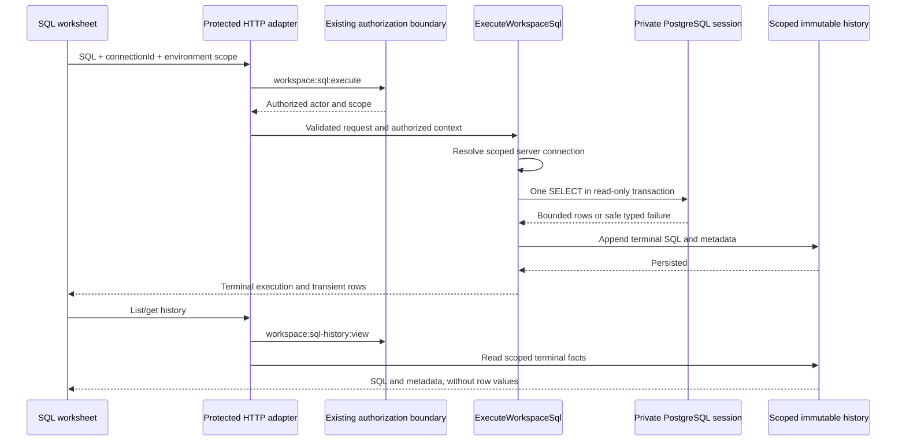

# Independent SQL worksheet execution and history

Planning DB owns `SYS-API-SQL-WORKSHEET`, its contract child
`SYS-CONTRACTS-SQL-WORKSHEET`, and the `GH-3951-INDEPENDENT-SQL-WORKSHEET`
mechanization. The prospective rationale and current/solution diagrams are in
[#3951](https://github.com/dunay2/dvt/issues/3951#issuecomment-7148049698).
ADR-0058, ADR-0061, ADR-0069, command/query rail governance and Fowler opportunity
planning governance govern this boundary.

## Intent and authority

`ExecuteWorkspaceSql` executes unsaved SQL against one selected warehouse
connection. `ListWorkspaceSqlExecutions` and `GetWorkspaceSqlExecution` read
completed execution facts independently of project files, Canvas and Git.
Conversion to a model is a separate explicit authoring action; execution never
creates a model or saves a project file.

The HTTP adapter derives actor and tenant/project/environment from existing
authentication and authorization. Request bodies cannot supply credentials,
principal identities, filesystem paths or model authority. The catalog resolves
the selected connection inside that authorized scope; only its private
credential reference reaches the provider adapter. SQL and history permissions
are distinct and do not follow from Run permission. Existing users receive
neither permission implicitly. Newly created project owners receive the explicit
actions through the existing onboarding policy.

## Execution and persistence

The initial provider is PostgreSQL. The existing PostgreSQL parser policy admits
exactly one SELECT, rejecting DML, modifying CTEs, SELECT INTO and locking clauses
before credential resolution. A dedicated connection runs a read-only
transaction with a 3000 ms statement deadline. Default output is 100 rows,
maximum 1000; reading one additional row establishes truncation. Array-mode rows
preserve duplicate output column names by position. Display serialization reuses
the existing PostgreSQL cell and type projection.

The worksheet accepts SQL text without a prepared-statement parameter map. Its
adapter rejects PostgreSQL `ParamRef` nodes in the validated user AST before
credential resolution or warehouse client IO. A string literal such as `'$1'`
remains ordinary SQL data. The wrapper binds its own row limit through `$1` and
`values: [limit + 1]` in the extended query protocol; it does not interpolate the
request limit into SQL. The shared structural parser policy remains unchanged.
Authorization, catalog lookup and terminal `sql_invalid` history retain their
existing command lifecycle.

`sqlWorksheetStatementPolicy.ts` owns request-field validation, shared parser
admission, AST parameter checks and safe diagnostics. The existing
`PostgresWorkspaceSqlExecutor` calls that policy once and owns credential
resolution, the bound query and the read-only session lifecycle.

Terminal states are `succeeded` and `failed`; browser loading state is transient.
History contains original SQL, selected public connection reference/name, actor,
timestamps, elapsed duration, limit, row count, truncation, column metadata and
safe failure details. It contains no result row values or credentials. Every
successful response follows persistence of its terminal facts. Storage failure
returns service unavailable rather than an unrecorded success.

The local adapter stores immutable records under
`<workspaceFilesRoot>/.dvt/sql-worksheet-history/scopes/<scope-hash>/`. It reuses
the existing workspace file adapter's create-only compare-and-swap and atomic
replacement. Exact replay is harmless; another payload cannot replace an
execution. This namespace is outside project files and Git history. Deployment
must preserve this configured storage volume to retain query history.

Opaque execution IDs order records by reverse completion time, a connection
fingerprint and a random nonce. Cursor validation binds the workspace and
connection filter, verifies the referenced record and preserves paging when
newer executions arrive. Directory selection retains at most one page plus one
candidate in memory. Corrupt records and unsafe filesystem entries fail closed;
only the existing atomic writer's exact transient filename is ignored.

## Local development and proof

The existing local auth bootstrap adds the two explicit SQL actions to the
selected development principal's signed session and tenant grant. External OIDC
is preserved. Activation of an already running stack requires its canonical
bootstrap lifecycle because token scopes are captured when that process starts;
refreshing an old process does not reload the action list. The existing seed
operation replaces the selected principal's grant, so operators must preserve
its intended scope and actions when provisioning. Other principals are untouched.

Contract tests reject malformed identities, authority injection, inconsistent
results and persisted row values. Application and HTTP tests distinguish execute
and history authorization. Real filesystem tests cover restart, immutability,
concurrent append, paging, foreign cursors and corrupt evidence. The PostgreSQL
integration proof creates and disposes its own `dvt_proof_*` database and temporary
storage; it verifies a signed local session, real SELECT results, write rejection,
deadline failure and unchanged grants for another principal. It never uses the
live application database as a test target.
