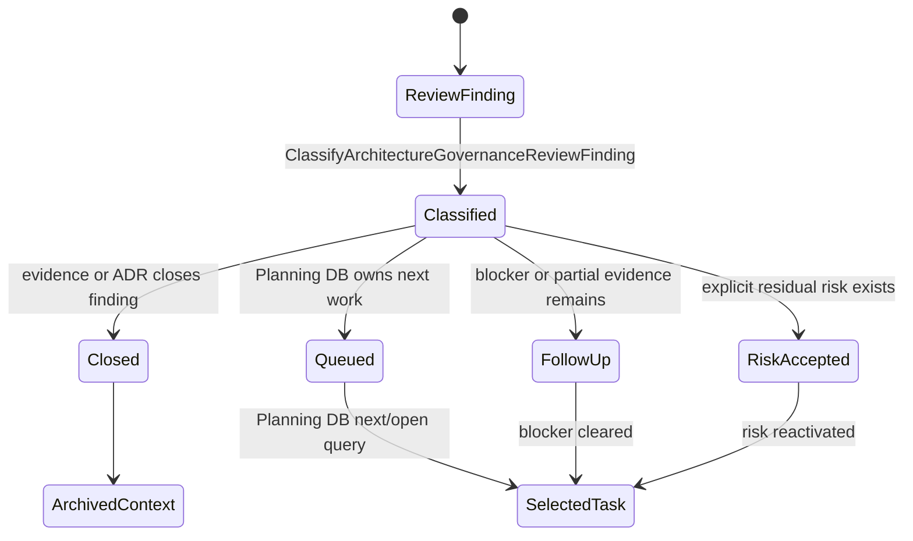
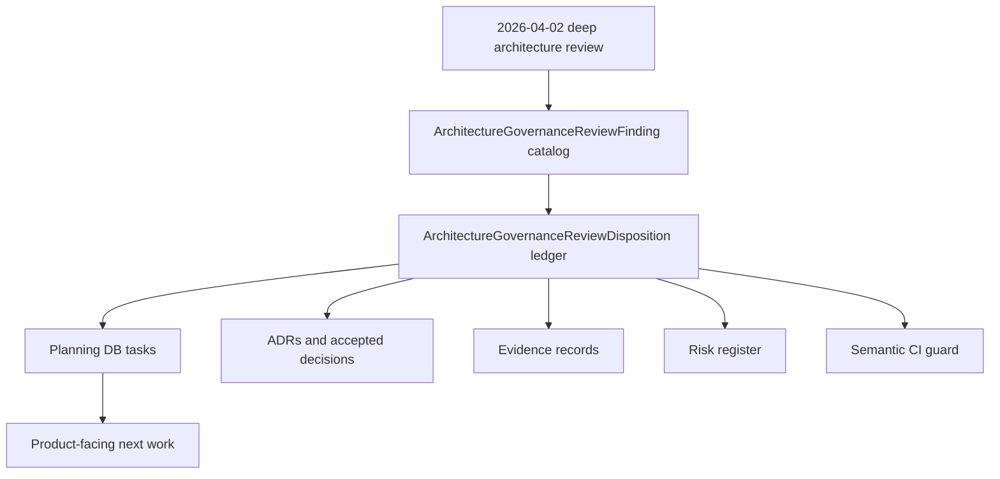
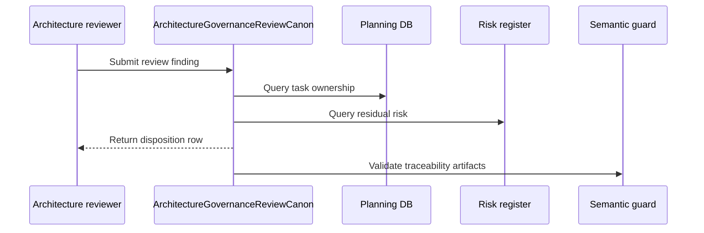

# Architecture Governance Review Canon Component

> Owned concern: this component owns architecture review canonization semantics:
> finding classification, disposition recording, traceability validation, and
> product-relevant follow-up selection.

## Public API

- `ClassifyArchitectureGovernanceReviewFinding(input)`: classifies a review
  finding as closed, queued, blocked, follow-up, risk-accepted, or candidate
  promotion.
- `RecordArchitectureGovernanceReviewDisposition(input)`: records the canonical
  task, ADR, evidence, risk, or planning owner for a finding.
- `ValidateArchitectureGovernanceReviewTraceability(input)`: validates that the
  review, plan, component guide, user stories, canonical Fowler mechanization,
  and semantic guard name the same ownership model.

## Invariants

- `GD-REV-ARCH-GOV-CANON` is a canonization task, not a runtime hardening task.
- A review finding cannot be considered actionable until it has one current
  owner: Planning DB task, ADR, evidence record, risk entry, or explicit
  risk-accepted disposition.
- Product-facing backlog rows must stay visible when architecture review prose
  also contains platform hygiene.
- Closed findings must point to closure evidence or status; stale review prose
  cannot reopen work by implication.
- The semantic guard must fail if the high-value findings lose disposition
  coverage.

## Transitions

## Consumers

- Architecture stewards use the component to convert principal/staff review
  findings into governed disposition rows.
- Product planners use the disposition matrix to separate product value from
  platform hygiene.
- Reviewers use the traceability policy to verify whether a finding is still
  open or already closed.
- Agents use the component after context compaction to continue from Planning
  DB state instead of guessing from historical review text.

## Command And Query Rail

<!-- markdownlint-disable MD060 -->

| Rail                                               | Type    | Owner                                  | Surface                                 |
| -------------------------------------------------- | ------- | -------------------------------------- | --------------------------------------- |
| `ClassifyArchitectureGovernanceReviewFinding`      | query   | Architecture review finding catalog    | Plan, guide, semantic test              |
| `RecordArchitectureGovernanceReviewDisposition`    | command | Architecture review disposition ledger | Disposition matrix and review note      |
| `ValidateArchitectureGovernanceReviewTraceability` | query   | Review traceability policy             | CI guard, component guide, user stories |

<!-- markdownlint-enable MD060 -->

## Semantic Fitness Function

`tools/ci/architecture-governance-review-canon.test.mjs` validates that:

- the plan, guide, stories, review note, and canonical Fowler mechanization
  tokens exist together;
- the command/query rails are named consistently;
- P0/P1/P2 findings from the deep review have explicit disposition rows;
- the component guide exposes public API, invariants, transitions, consumers,
  rails, diagrams, and the semantic guard.

The test protects semantic traceability. It does not claim that queued product
work is implemented.

## Diagrams

## Related Docs

- [Architecture Governance Review Canon User Stories](architecture-governance-review-canon-component.md#section-architecture-governance-review-canon-user-stories)
- [Architecture Governance Review Canon Plan 2026-05-24](../../../planning/proposals/mandatory/governance-and-docs/architecture-governance-review-canon-plan-20260524.md)
- [Deep Technical Architectural Review 2026-04-02](../../../planning/reviews/architecture-and-governance/20260402-deep-architectural-review.md)
- [Architecture Governance Review Mailbox Analysis](https://github.com/dunay2/dvt/blob/2df68680de46b9104282a58fd203a7eef551ca38/buzon/20260524-codex-fowler-architecture-governance-review-canon.md)

## Architecture Governance Review Canon User Stories

### Story 1 - Architecture steward maps a blocker to an existing task

As an architecture steward, I want every blocker from an active architecture
review mapped to an existing GitHub issue, ADR, evidence record, or risk
entry so that I do not create a duplicate backlog from review prose.

Acceptance:

- Given a review finding is already closed by task evidence, the disposition row
  names `Closed` and links the owner.
- Given a review finding still has product value, the disposition row names the
  queued GitHub issue.
- Given a finding has only residual uncertainty, the disposition row names the
  risk entry instead of opening an implementation task.

### Story 2 - Product planner distinguishes product value from platform hygiene

As a product planner, I want architecture review work separated into
product-facing value and platform hygiene so that I can choose cost attribution,
projection invalidation, or pilot work ahead of low-product-value security
settings.

Acceptance:

- Cost attribution remains a queued product task because it enables billing and
  finance visibility.
- Projector event-driven invalidation remains queued because it enables scale
  and backpressure closure.
- Already closed runtime hardening rows do not appear as new product tasks.

### Story 3 - Reviewer verifies drift is intentional

As a reviewer, I want drift between the 2026-04-02 review and current task state
called out explicitly so that stale review recommendations are not treated as
fresh blockers.

Acceptance:

- Closed rows name closure tasks or evidence.
- Follow-up rows name why closure is incomplete.
- Risk-accepted rows name the residual risk and reactivation condition.

### Story 4 - Agent continues from the planning DB

As an agent, I want the review canon, component guide, and semantic guard to
point me back to Planning DB state so that context compaction does not make me
restart review triage from scratch.

Acceptance:

- The plan names `GD-REV-ARCH-GOV-CANON`.
- The guide names the three command/query rails.
- The semantic test fails when high-value findings lose disposition coverage.

> Acceptance scope status: Active. Owner: Architecture / Docs / Planning.
