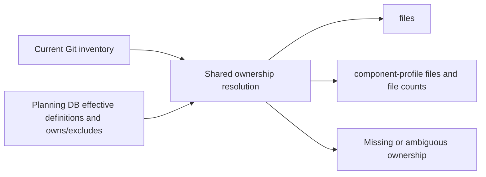
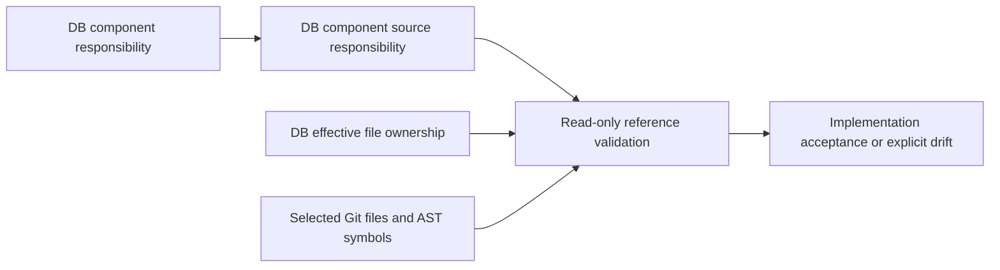
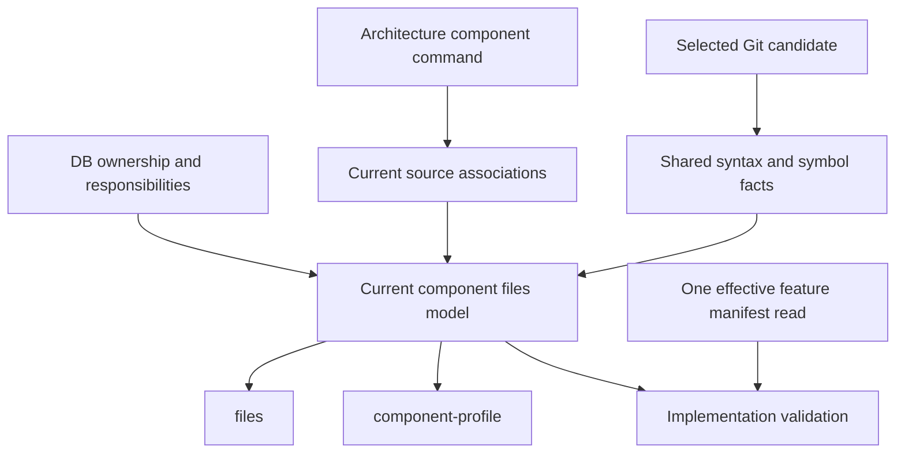
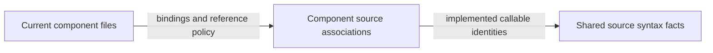
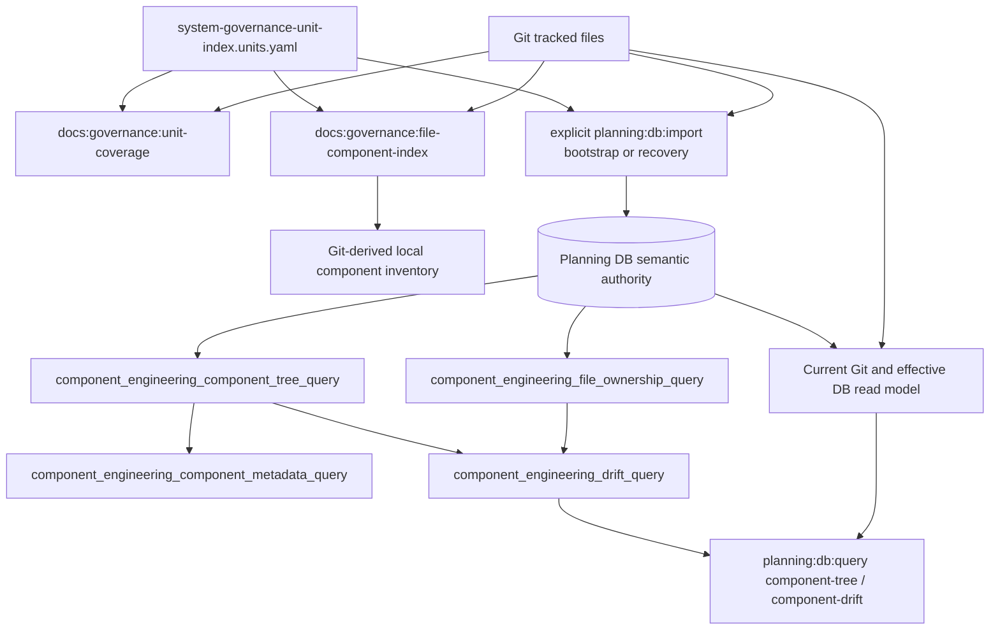

# Component Engineering Record Component

## Purpose

Owned concern: expose repository component structure as a falsifiable,
DB-backed engineering record.

This component combines current Git files with Planning DB component definitions
and responsibilities. The model is recursive: a component may contain child
components, and each file needs one unambiguous owner. An admitted feature or an
old imported file row does not prove current file ownership.

## Current file query

`ReadComponentFiles` is the existing query rail in the component-engineering
context. Its application surfaces are `planning:db:query files` and the file
section of `component-profile`. It is a repository-local operator query; it
does not expose tenant data or perform writes.

`component-tree` and the non-frontend profile header and children also consume
that current snapshot. They must include DB-created components even when no
imported hierarchy row exists. Counts are derived before filtering or paging;
ambiguous files remain visible in every affected ancestor. The integrity adapter
combines DB semantic findings with physical component paths checked against Git,
replacing the imported snapshot's path-existence findings. A file path and a
directory boundary are both valid; a missing path remains a finding.

CI bootstrap must build `@dvt/crypto` before loading the schema command, its
first consumer. This prerequisite belongs to the existing Planning DB action;
each workflow caller consumes the same ordering.

Git supplies physical existence through the existing candidate reader. An
explicit `GIT_HEAD` selects that commit; otherwise the reader includes the
current worktree, excluding deleted and ignored untracked paths. Planning DB
supplies effective component definitions, parent relations, responsibilities,
and ownership patterns, including local overrides. The existing ownership
matcher interprets those patterns; local YAML is not an alternative authority.

Both surfaces resolve the same inventory before filtering or limiting results.
Files removed from the selected Git inventory disappear. A current file with no
owner or multiple owners is reported explicitly, never silently omitted or
assigned by an alphabetical tie-break. A matching descendant owns the file in
preference to its ancestor; competing unrelated owners remain ambiguous. A
component filter includes conflicts involving that component, with candidate
identities visible. Missing Git or DB evidence rejects the query. Profile
descendant counts include these unresolved files and expose a separate ambiguous
count; direct ownership counts do not claim them as owned. Frontend
profiles retain their explicit frontend identities while excluding absent files.

This read does not import, rebuild, refresh or persist a file inventory. It does
not certify the separate code-symbol query or complete semantic evidence merely
because an ownership pattern matches. Component responsibility and evidence
reconciliation remains a distinct operation through the existing DB commands.

Negative acceptance covers newly tracked files absent from imported inventory,
deleted paths, excluded paths, ambiguous owners, invalid parent relations, and
unavailable Git/DB evidence. A temporary Git repository exercises actual file
changes; live DuckDB paths verify the operator query against the existing DB.

## Atomic source responsibilities

DB bindings connect concrete code to canonical responsibilities. The
current model has component responsibilities and rail symbols, but neither
association alone proves which responsibility a symbol implements.

`architecture.component_source_responsibility` holds the current associations,
independently of feature manifests or validator lifecycle. Each binding
contains `responsibilityId`, `componentId` (the file owner), `path`, `symbol`,
`role`, and nonempty `testPaths`. The responsibility ID references
`architecture.component_responsibility`; its action text and semantic owner
are read there, never copied into a new semantic dictionary. Paths and qualified
symbols reference the selected Git inventory. A binding is a current semantic
association, not a stored copy of code, a physical inventory, or a history.

Roles are `implements`, `delegates`, and `verifies`. An implementation must belong
to the responsibility's owning component. Delegation or verification can cross
that boundary explicitly. Several symbols may collaborate on one responsibility;
sharing its ID is not itself proof of duplicated logic. Conversely, different IDs
cannot prove different semantics: that remains a code review question.

`RecordArchitectureComponent` accepts `--source-bindings` as a JSON array and
`--expected-bindings-hash` for optimistic concurrency. Supplying it replaces that
component's complete current set; omission preserves the set. An empty array
explicitly removes it. The writer locks the component, checks the digest of the
current normalized set and validates referenced responsibilities before replacing
rows in the same transaction as the existing component command and audit.
Foreign keys prevent orphaned component or responsibility references. The
`implements` role requires the responsibility owner to match the file component.
Delegation and verification may name another responsibility owner explicitly.
No feature command owns these associations. Git retains source history; the
existing command audit is not a source inventory.

`ReviseGovernanceComponent` corrects an existing definition under admitted design
scope and expected revision. `--cq-rails` and `--ddd-owner` correct the current
values. `--remove-reason-to-change`, `--remove-non-goal`, and `--remove-public-api`
remove exact superseded values; the existing `--reason-to-change`, `--non-goal`,
and `--public-api` add their replacements.
Unknown removals fail rather than silently retaining stale semantics. The command
audits these deltas and preserves unrelated metadata, ownership and source
bindings. An identical replay compares the stored command input, excluding only
its derived `resultingDefinition`; changed request fields remain conflicts.
No new component identity or inventory import is needed for a semantic
correction. Reasons name the concrete lifecycle, policy or contract that changes;
non-goals identify another owner's concern. Physical `excludes` patterns govern
file ownership; dependency direction is enforced separately by the existing root
dependency-cruiser gate.

The pilot covers five files: `buildLocalDataCaptureRuntime.ts`,
`readLocalDataGenerationMetadataUseCase.ts`, `DuckDbGenerationStore.ts`,
`duckDbGenerationMetadata.ts`, and `DuckDbLocalDataRuntime.ts`. It records their
composition, authorization, capture/write, metadata integrity, and native
lifecycle responsibilities, rather than declaring the metadata query to be
their entire behavior. The component identities remain
`SYS-API-RUNTIME-COMPOSITION`, `SYS-API-APPLICATION-SERVICES`, and
`SYS-API-INFRASTRUCTURE`. Product rails and executable behavior are unchanged.

Responsibilities and evidence associations remain in the DB. Source files do
not carry generated responsibility headers, IDs, descriptions, or test catalogs.
There is no header generator, parser, or synchronization command. Ordinary code
comments explain local decisions when useful. Test paths are declared evidence
references; their presence does not claim execution, assertions, or semantic
coverage.

| Rail                                         | Kind / owner                                     | Application and adapter surface                              | Scope and authorization                                                                   | Negative acceptance                                                                          |
| -------------------------------------------- | ------------------------------------------------ | ------------------------------------------------------------ | ----------------------------------------------------------------------------------------- | -------------------------------------------------------------------------------------------- |
| `RecordArchitectureComponent`                | Command / Architecture component                 | Existing `planning:db:operate architecture-component record` | Repository operator, admitted design, actor and expected binding-set digest               | Invalid binding, wrong owner, unknown responsibility, stale digest, concurrent replacement   |
| `ValidateFeatureMechanizationImplementation` | Command / Repository feature mechanization guard | Existing `check-feature-mechanization.cjs --implementation`  | Read-only current candidate or explicit `GIT_HEAD`; existing local DB acceptance boundary | Missing symbol or evidence path, unknown responsibility, ambiguous owner, unavailable DB/Git |

The mandatory file set comes from DB bindings. A source file without any
responsibility comment passes when its references are valid. AST resolution
recognizes actual declarations, including qualified class methods, not names
inside strings or comments. Deleting or renaming a referenced symbol, file, or
test without reconciling the DB fails validation. Missing or conflicting
authority fails closed. Validation never rewrites code or rebuilds the DB.

Pure contract tests run without DB in CI. Fresh acceptance against the existing
DB remains local and records exact base/head, as required by the current
single-team acceptance boundary. No CI artifact is a replacement DB authority.

### Atomic responsibility planning matrix

| Scenario                  | Opportunity          | Fowler pattern              | DDD owner                              | Command/query rail                           | Implementation surfaces                                                           | Unit or package test                                     | Architecture test                                | User-flow test                      | Out of scope                                            |
| ------------------------- | -------------------- | --------------------------- | -------------------------------------- | -------------------------------------------- | --------------------------------------------------------------------------------- | -------------------------------------------------------- | ------------------------------------------------ | ----------------------------------- | ------------------------------------------------------- |
| Admit current bindings    | Hidden authority     | Explicit domain association | Architecture component                 | `RecordArchitectureComponent`                | Current schema, existing writer, binding policy and focused tests                 | Replacement, malformed input, digest rejection           | Foreign keys and one canonical RESP definition   | Real PostgreSQL command transaction | SQL engine migration, history, global reconciliation    |
| Keep one semantic record  | Duplicate semantics  | Remove duplicated data      | ComponentEngineeringRecord             | `ValidateFeatureMechanizationImplementation` | Pure reference validator, DB/Git reader; remove header CLI and generated comments | Valid bindings pass without comments                     | Component and responsibility identity checks     | Real five-file read-only validation | Product refactoring and repository-wide rollout         |
| Reject stale declarations | Test-only confidence | Fail-closed policy          | Repository feature mechanization guard | `ValidateFeatureMechanizationImplementation` | Existing checker, routing, focused tests                                          | Missing symbol or evidence; code unchanged by validation | Explicit SHA and unavailable-authority rejection | Local exact-candidate gate          | Browser suites or claiming semantic duplicate detection |

### Shared evidence and simplification plan

GH-3699 admits the following implementation order. The target boundary is:

`files` and the file section of `component-profile` expose the same typed
`responsibility_bindings`, including canonical description, qualified symbol,
role and declared test paths. Empty bindings mean no association has been
declared; they do not certify complete semantic coverage. The model exposes
reference errors, and the implementation gate rejects those errors. Missing DB
authority is an error, not an empty successful result.
The `files` query rejects invalid references before filtering or paging, so a
deleted bound path cannot disappear behind an apparently successful empty result.
The component profile retains the full diagnostic list for repair.

One invocation resolves one Git candidate and shares its inventory and source
contents. DB reads for implementation acceptance share one read-only,
repeatable-read transaction and one effective manifest read. The current file
model reads architecture associations directly; it does not read feature
manifests. The gate owns orchestration, pure policies own validation, and DB
adapters own SQL and connection lifetimes.

Symbol consumers share parsing and qualified identities. Their selection
policies remain explicit: feature admission selects changed declarations,
responsibility validation selects implemented symbols, and duplicate detection
selects comparable nonempty bodies. Source comments and strings cannot invent
symbols. This does not claim that syntactically different code has different
responsibilities or that matching bodies necessarily justify a refactor.

The existing repository command catalog classifies the responsibility validator
as documentation governance and shared syntax facts as CI tooling. Its coverage
test runs once for changes to any command file recognized by the catalog's own
path predicate, or to the package command declarations. Unknown tools still fail
closed; this introduces neither a second classifier nor a blanket helper rule.

Schema and binding-set digests use the existing `@dvt/crypto` primitives. The
tooling crypto contract owns one shared input predicate used by its scan, local
selection and CI routing. A governed source change selects that exact contract
locally, unless its complete test file is already selected. The existing
executable CI contract lane must also run before merge. Source admission alone
does not prove this dependency rule.

Feature metadata updates preserve omitted fields, but explicit replacement of
the current manifest must replace obsolete collections rather than union them
back into existence. Replacement requires an expected revision and retains the
existing validation, authorization and idempotency checks.

| Scenario                             | Opportunity             | Fowler pattern       | DDD owner                     | Command/query rail                          | Implementation surfaces                                             | Unit or package test                                           | Architecture test                                  | User-flow test                                              | Out of scope                           |
| ------------------------------------ | ----------------------- | -------------------- | ----------------------------- | ------------------------------------------- | ------------------------------------------------------------------- | -------------------------------------------------------------- | -------------------------------------------------- | ----------------------------------------------------------- | -------------------------------------- |
| Decouple source associations from CI | Boundary drift          | Move field / Gateway | Architecture component        | `RecordArchitectureComponent`               | Current schema, schema command, component writer and binding policy | Hash conflict, duplicate, wrong owner, unknown reference       | SQL foreign keys and atomic replacement            | Real PostgreSQL transaction and preserved 24 pilot bindings | Product source behavior                |
| Read one architecture model          | Duplicate semantics     | Shared read model    | ComponentEngineeringRecord    | `ReadComponentFiles`                        | Current file query, CLI rendering, implementation gate              | Same bindings in file/profile, absent and invalid evidence     | One Git candidate and one DB snapshot per gate     | Live pilot query                                            | DB engine replacement                  |
| Derive one set of syntax facts       | Duplicate semantics     | Extract function     | Repository source model       | Existing validation and code-symbol queries | Shared AST module and the three consumers                           | Classes, methods, overloads, aliases, comments, invalid syntax | Consumer policies use shared identities            | Selected Git commit validation                              | Semantic equivalence inference         |
| Replace obsolete feature metadata    | Responsibility overload | Extract policy       | Feature mechanization catalog | `RecordFeatureMechanizationRail`            | Existing writer, pure merge policy, focused tests                   | Replacement, omitted fields, stale revision, replay            | No second writer or SQL path                       | Existing command regression                                 | Rewrite of unrelated operator commands |
| Route purposeful checks once         | Duplicate semantics     | Remove dead code     | Local validation plan         | `ValidateChangedFiles`                      | Existing routing and contract tests                                 | Affected consumer suites selected once                         | Retired modules and flags have no active consumers | Prepush and exact-base/head DB gate                         | Broad browser suites                   |

Schema additions follow ADR-0063's explicit current-schema addition contract.
The first cut moves the 24 current pilot associations in one transaction and
removes their obsolete manifest field. No query or gate accepts a fallback to
that old location after the cut. Subsequent retirement of a feature rail cannot
erase component responsibility associations.

### Governance mechanism ownership

The mechanisms also use the current component model. Their owners are children
of the existing CI governance grouping in the ownership tree:

- `SYS-CI-COMPONENT-ASSOCIATIONS` owns association persistence and reference
  policy. SQL changes and association invariants belong here.
- `SYS-CI-CURRENT-COMPONENT-FILES` owns the current Git/DB file projection and
  ownership resolution. It consumes association authority without writing it.
- `SYS-CI-SOURCE-FACTS` owns shared syntax, declaration and module-reference
  facts. Consumer-specific selection policies remain with their consumers.

These boundaries describe existing implementations with different reasons to
change. They do not introduce wrappers, move files, or add command/query rails.
The exact files, callable responsibilities, test references and dependency
relations remain in Planning DB. The API pilot retains its existing associations.
The CI grouping is an ownership ancestor, not an invented executable module.

Acceptance queries the real current file/profile models, preserves the API
association digests and checks each declared source reference. Existing tests
exercise ambiguous ownership, invalid bindings and transaction rejection. The
source-facts test covers valid literal module references as well as quoted,
commented and computed nonreferences. No query or syntax test certifies semantic
uniqueness across the repository.

## Governing Sources

- `AGENTS.md`
- `docs/planning/status/governance-document-rule-inventory.md`
- `docs/architecture/command-query-rail-governance.md`
- `docs/architecture/fowler-opportunity-planning-governance.md`
- `docs/planning/status/db-surface-inventory.md`
- `docs/planning/status/system-governance-unit-taxonomy-20260501.md`
- `docs/planning/status/system-governance-unit-index.units.yaml`
- `docs/architecture/components/ci-governance/component-engineering-invariants.md`
- `docs/adr/adr-0055-planning-db-canonical-operational-source.md`

## Public API

| Surface                                                             | Type    | Contract                                                                |
| ------------------------------------------------------------------- | ------- | ----------------------------------------------------------------------- |
| `pnpm docs:governance:unit-coverage`                                | command | Validates unit hierarchy, parent closure, and exact file ownership      |
| `pnpm docs:governance:file-component-index`                         | command | Generates local file/component inspection artifacts                     |
| `pnpm planning:db:import`                                           | command | Explicitly rebuilds projections for bootstrap or recovery               |
| `pnpm planning:db:query component-tree --component <component_id>`  | query   | Reads recursive component hierarchy rows                                |
| `pnpm planning:db:query component-drift --component <component_id>` | query   | Reads mechanical component engineering drift rows                       |
| `component_engineering_component_tree_query`                        | view    | DB-first component tree with parent, direct, and descendant file counts |
| `component_engineering_file_ownership_query`                        | view    | DB-first file-to-leaf-component ownership rows                          |
| `component_engineering_component_metadata_query`                    | view    | Derived semantic metadata and missing-metadata gaps                     |
| `component_engineering_drift_query`                                 | view    | Drift codes for unresolved parent, missing children, and non-leaf files |

## Invariants

- Every tracked file has exactly one owning unit.
- Every file owned by a component tree resolves to the deepest component in
  that file's unit path.
- `component` may parent `component`; this is the Composite pattern applied to
  governance units.
- `childrenRequired: true` means the component must contain at least one child
  component before architecture closure is claimed.
- Canonical components declare owned concern, public API, invariants,
  transitions, and consumers in the unit manifest.
- Query rails read existing DB semantic authority without importing it as a
  side effect. Git-owned physical inventory is read and validated from Git.
- A stale or unavailable DB query fails closed. Projection reconstruction is an
  explicit bootstrap or recovery operation, never routine inspection.
- Component engineering rules must be DB-backed; a Markdown invariant is not
  complete until the planning query store exposes its catalog row, evaluation
  state, drift code, and remediation metadata.
- Generated `system-governance-*` files stay local inspection artifacts, not
  manual review surfaces.

## Transitions

| Transition                        | Trigger                                       | Required checks                                                              |
| --------------------------------- | --------------------------------------------- | ---------------------------------------------------------------------------- |
| Root component becomes composite  | Broad component owns unrelated implementation | Add child components, set root `childrenRequired: true`, rerun unit coverage |
| Child component becomes canonical | Docs, tests, contracts, and owners agree      | Add semantic metadata and run governance refresh                             |
| File moves between components     | Source/test/doc path is renamed or extracted  | Update owns/excludes and regenerate the Git-derived file index               |
| Query reads stale authority       | Governance source hash differs from DB        | Fail closed; reconcile through its declared command with reviewed evidence   |
| Drift is detected                 | DB view emits a drift row                     | Fix manifest, docs, tests, or component split before closeout                |
| Query rail changes                | New DB view/query behavior is added           | Update DB surface inventory, tests, current schema and rail declaration      |

## Consumers

- Repository agents using planning and governance rails.
- CI docs governance checks.
- Architecture reviewers comparing component intent with real files.
- Planning DB query users inspecting `component-tree` and `component-drift`.
- Feature mechanization guards validating changed-file scope.

## Engine Pilot

The first real slice is `SYS-RUNTIME-ENGINE-CORE`. It is no longer treated as a
flat component that owns `packages/@dvt/engine/**`. It is an assembly with
children for package surface, adapters, application services, workflow use
cases, contracts, lifecycle core, ports, security, runtime services,
start-run orchestration, run control, maintenance, state, outbox,
determinism utilities, and architecture tests.

Plan-ref policy files remain owned by `SYS-PLANSTORE-ENGINE-FETCH`, so the
engine component tree reflects the cross-domain reality instead of hiding it.

## Topology

## Engine Component Tree

```mermaid
flowchart TB
  Root["SYS-RUNTIME-ENGINE-CORE"]
  Package["SYS-RUNTIME-ENGINE-PACKAGE-SURFACE"]
  Adapters["SYS-RUNTIME-ENGINE-ADAPTERS"]
  App["SYS-RUNTIME-ENGINE-APPLICATION"]
  UseCases["SYS-RUNTIME-ENGINE-WORKFLOW-USE-CASES"]
  Contracts["SYS-RUNTIME-ENGINE-CONTRACTS"]
  Core["SYS-RUNTIME-ENGINE-CORE-LIFECYCLE"]
  Ports["SYS-RUNTIME-ENGINE-DOMAIN-PORTS"]
  Security["SYS-RUNTIME-ENGINE-SECURITY"]
  Services["SYS-RUNTIME-ENGINE-RUNTIME-SERVICES"]
  StartRun["SYS-RUNTIME-ENGINE-START-RUN"]
  Control["SYS-RUNTIME-ENGINE-RUN-CONTROL"]
  Maintenance["SYS-RUNTIME-ENGINE-RUN-MAINTENANCE"]
  State["SYS-RUNTIME-ENGINE-STATE"]
  Outbox["SYS-RUNTIME-ENGINE-OUTBOX"]
  Utils["SYS-RUNTIME-ENGINE-DETERMINISM-UTILS"]
  Arch["SYS-RUNTIME-ENGINE-ARCHITECTURE-TESTS"]

  Root --> Package
  Root --> Adapters
  Root --> App
  Root --> UseCases
  Root --> Contracts
  Root --> Core
  Root --> Ports
  Root --> Security
  Root --> Services
  Root --> StartRun
  Root --> Control
  Root --> Maintenance
  Root --> State
  Root --> Outbox
  Root --> Utils
  Root --> Arch
```

## Drift Codes

| Code                                 | Meaning                                             | Typical fix                                     |
| ------------------------------------ | --------------------------------------------------- | ----------------------------------------------- |
| `unresolved_parent`                  | A component row references a parent missing in tree | Fix manifest parent or import/generator mapping |
| `children_required_without_children` | A composite candidate has no child component rows   | Add real children or remove the requirement     |
| `file_without_leaf_component`        | A file maps to a non-leaf or missing component      | Move ownership to the deepest component         |

## Fowler Comparison

Mature systems keep architecture as an executable model, not a wiki-only
inventory. This component moves the repository toward that posture:

- Composite replaces a flat component list, so assemblies are explicit.
- Query rails replace local file checks as the inspection API.
- Semantic metadata turns "component" from a label into an owned concern.
- Drift rows make boundary decay visible before PR closeout.

## Component Engineering Record User Stories

### Scope

These stories cover the composite component hierarchy, leaf file ownership,
semantic component metadata, and DB-first drift query rails introduced for the
engine pilot.

| ID         | Story                                                                   | Acceptance criteria                                                                                                                                                                                   | Negative case                                                                                   |
| ---------- | ----------------------------------------------------------------------- | ----------------------------------------------------------------------------------------------------------------------------------------------------------------------------------------------------- | ----------------------------------------------------------------------------------------------- |
| US-CER-001 | As an architecture reviewer, I inspect the engine component tree.       | `pnpm planning:db:query component-tree --component SYS-RUNTIME-ENGINE-CORE` returns the selected component; `--children-of` selects its children from effective DB definitions and current Git files. | Query fails if current Git evidence or effective DB authority is unavailable.                   |
| US-CER-002 | As a repo agent, I move an engine file into a nested component.         | `docs:governance:file-component-index` assigns the file to the deepest component in its unit path.                                                                                                    | A file mapped to the parent assembly emits `file_without_leaf_component`.                       |
| US-CER-003 | As a maintainer, I split a broad component into children.               | The parent may have `level: component` children, and unit coverage accepts the hierarchy.                                                                                                             | The guard rejects unresolved parents and invalid parent levels.                                 |
| US-CER-004 | As a reviewer, I need component intent, not just filenames.             | Canonical components declare owned concern, public API, invariants, transitions, and consumers.                                                                                                       | A canonical component missing semantic metadata fails unit coverage.                            |
| US-CER-005 | As an operator, I need drift through a query rail.                      | `pnpm planning:db:query component-drift --component <id>` returns DB drift rows.                                                                                                                      | Unknown query names and unparameterized filters fail in tests.                                  |
| US-CER-006 | As an architect, I compare docs with implementation.                    | Component guide names public API, invariants, transitions, consumers, and diagrams.                                                                                                                   | Docs-only claims are not accepted without schema/query/test support.                            |
| US-CER-007 | As a planner, I need feature scope to be governed.                      | Feature mechanization manifest lists changed scripts, docs, schema, and guards.                                                                                                                       | Implementation files outside allowed surfaces fail `docs:feature-mechanization:implementation`. |
| US-CER-008 | As a reviewer, I need cross-domain ownership to remain visible.         | Engine plan-ref files stay owned by `SYS-PLANSTORE-ENGINE-FETCH`.                                                                                                                                     | The engine root must not reclaim plan-store-owned plan-ref files through a broad glob.          |
| US-CER-009 | As a CI maintainer, I need generated indexes to remain local artifacts. | `governance:refresh` refreshes Git-derived local projections without importing or rebuilding Planning DB.                                                                                             | Manual edits to generated `system-governance-*` files are not a valid fix.                      |
| US-CER-010 | As a future component owner, I need a reusable local guide.             | New component splits reuse the same API/invariant/transition/consumer structure.                                                                                                                      | Creating component IDs as retroactive labels without planned ownership remains invalid.         |

### TDD Coverage

| Cycle          | Red signal                                                              | Green implementation                                                                           |
| -------------- | ----------------------------------------------------------------------- | ---------------------------------------------------------------------------------------------- |
| Current schema | Required component views or constraints are missing                     | Declare component tree, file ownership, metadata, and drift in the current schema              |
| Query rails    | `component-tree` and `component-drift` are unknown queries              | Add known query names, readers, builders, and CLI dispatch                                     |
| Semantic guard | Component parent and missing metadata cases are not validated correctly | Allow component-to-component parentage and require metadata for canonical components           |
| Leaf ownership | Nested engine file resolves to parent component                         | Assign componentUnit to the last component in the unit path                                    |
| Engine pilot   | Engine root owns all package files directly                             | Split `SYS-RUNTIME-ENGINE-CORE` into child components and keep plan-ref cross-domain ownership |

> Acceptance scope status: Review. Owner: Engineering / CI Governance / Architecture.
