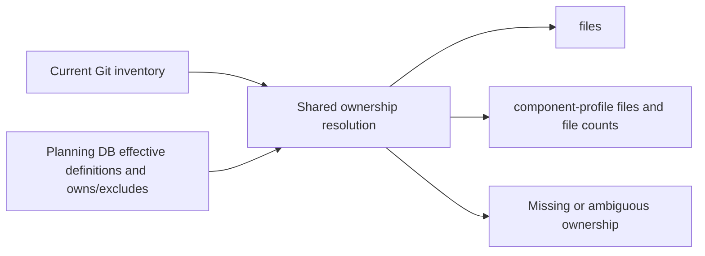
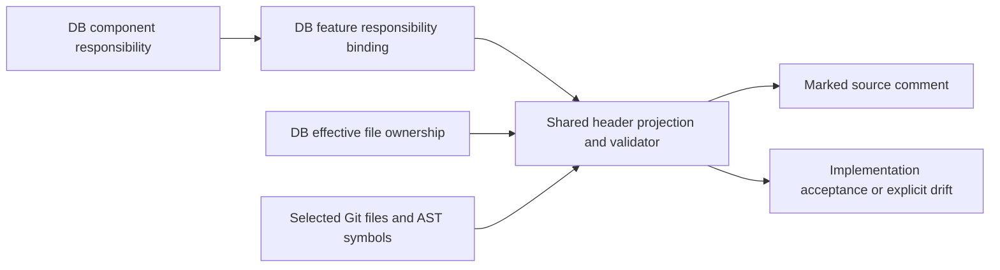
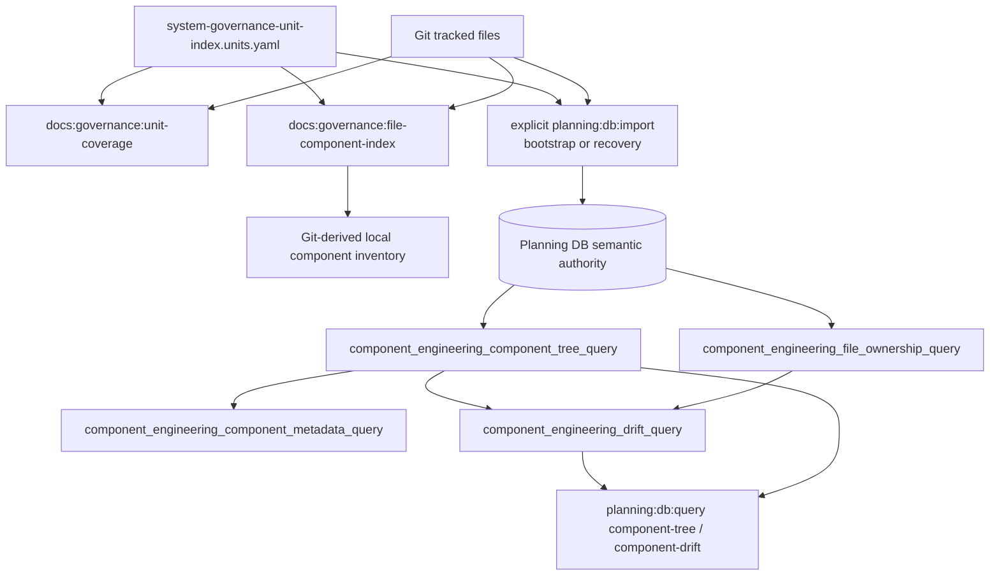

# Component Engineering Record Component

## Purpose

Owned concern: expose repository component structure as a falsifiable,
DB-backed engineering record.

This component combines current Git files with Planning DB component definitions
and responsibilities. The model is recursive: a component may contain child
components, and each file needs one unambiguous owner. An admitted feature or an
old imported file row does not prove current file ownership.

## Current file query

`ReadComponentFiles` is the existing query rail in the component-engineering
context. Its application surfaces are `planning:db:query files` and the file
section of `component-profile`. It is a repository-local operator query; it
does not expose tenant data or perform writes.

Git supplies physical existence through the existing candidate reader. An
explicit `GIT_HEAD` selects that commit; otherwise the reader includes the
current worktree, excluding deleted and ignored untracked paths. Planning DB
supplies effective component definitions, parent relations, responsibilities,
and ownership patterns, including local overrides. The existing ownership
matcher interprets those patterns; local YAML is not an alternative authority.

Both surfaces resolve the same inventory before filtering or limiting results.
Files removed from the selected Git inventory disappear. A current file with no
owner or multiple owners is reported explicitly, never silently omitted or
assigned by an alphabetical tie-break. A matching descendant owns the file in
preference to its ancestor; competing unrelated owners remain ambiguous. A
component filter includes conflicts involving that component, with candidate
identities visible. Missing Git or DB evidence rejects the query. Profile
descendant counts include these unresolved files and expose a separate ambiguous
count; direct ownership counts do not claim them as owned. Frontend
profiles retain their explicit frontend identities while excluding absent files.

This read does not import, rebuild, refresh or persist a file inventory. It does
not certify the separate code-symbol query or complete semantic evidence merely
because an ownership pattern matches. Component responsibility and evidence
reconciliation remains a distinct operation through the existing DB commands.

Negative acceptance covers newly tracked files absent from imported inventory,
deleted paths, excluded paths, ambiguous owners, invalid parent relations, and
unavailable Git/DB evidence. A temporary Git repository exercises actual file
changes; live DuckDB paths verify the operator query against the existing DB.

## Atomic source responsibilities

Source declarations connect concrete code to canonical responsibilities. The
current model has component responsibilities and rail symbols, but neither
association alone proves which responsibility a symbol implements.

`responsibilityBindings` extends the existing feature manifest. Each binding
contains `responsibilityId`, `componentId` (the file owner), `path`, `symbol`,
`role`, and nonempty `testPaths`. The responsibility ID references
`architecture.component_responsibility`; its action text and semantic owner
are read there, never copied into a new semantic dictionary. Paths and qualified
symbols reference the selected Git inventory. A binding is a current semantic
association, not a stored copy of code, a physical inventory, or a history.

Roles are `implements`, `delegates`, and `verifies`. An implementation must belong
to the responsibility's owning component. Delegation or verification can cross
that boundary explicitly. Several symbols may collaborate on one responsibility;
sharing its ID is not itself proof of duplicated logic. Conversely, different IDs
cannot prove different semantics: that remains a code review question.

`RecordFeatureMechanizationRail` accepts `--responsibility-bindings` as a JSON
array. Supplying it replaces that rail's complete current set; omission preserves
the set. Updating an existing set requires the expected revision. An empty array
explicitly removes it. Invalid shape, duplicate bindings and stale revisions
fail before a write. There is no automatic import or backup catalog. Git retains
source history; existing command audit is not a source inventory.

The pilot covers five files: `buildLocalDataCaptureRuntime.ts`,
`readLocalDataGenerationMetadataUseCase.ts`, `DuckDbGenerationStore.ts`,
`duckDbGenerationMetadata.ts`, and `DuckDbLocalDataRuntime.ts`. It records their
composition, authorization, capture/write, metadata integrity, and native
lifecycle responsibilities, rather than declaring the metadata query to be
their entire behavior. The component identities remain
`SYS-API-RUNTIME-COMPOSITION`, `SYS-API-APPLICATION-SERVICES`, and
`SYS-API-INFRASTRUCTURE`. Product rails and executable behavior are unchanged.

The generated block uses `@component`, repeated `@responsibility` IDs and action
text, role tags naming qualified symbols, and `@test` paths. The dedicated
`@sourceResponsibilities` marker delimits the block; existing documentation and
executable content are preserved. Tests are declared evidence references. Their
presence does not claim execution, assertions, or semantic coverage.

| Rail                                         | Kind / owner                                     | Application and adapter surface                                       | Scope and authorization                                                                             | Negative acceptance                                                                                                           |
| -------------------------------------------- | ------------------------------------------------ | --------------------------------------------------------------------- | --------------------------------------------------------------------------------------------------- | ----------------------------------------------------------------------------------------------------------------------------- |
| `RecordFeatureMechanizationRail`             | Command / PlanningDbFeatureMechanizationCatalog  | Existing `planning:db:operate feature-mechanization record`           | Repository operator, explicit actor and expected revision for replacement                           | Invalid binding, conflicting duplicate, stale revision                                                                        |
| `SynchronizeComponentSourceHeaders`          | Command / ComponentEngineeringRecord             | `synchronizeComponentSourceHeaders`; `pnpm architecture:headers:sync` | Explicit repository-local write of admitted source comments; DB read only; no commit or publication | Missing authority, unknown responsibility, wrong owner, invalid symbol, unsafe path, malformed marker, concurrent file change |
| `ValidateFeatureMechanizationImplementation` | Command / Repository feature mechanization guard | Existing `check-feature-mechanization.cjs --implementation`           | Read-only current candidate or explicit `GIT_HEAD`; existing local DB acceptance boundary           | Missing/deleted header, text drift, missing evidence path, ambiguous owner, unavailable DB/Git                                |

The mandatory file set comes from DB bindings, not from discovering comments.
Deleting the entire header therefore fails validation. AST resolution recognizes
actual declarations, including qualified class methods, not names inside strings
or comments. Missing or conflicting authority fails closed. Synchronization first
validates the complete plan, then changes only marked comments; a second run has
no changes. It must not repair malformed declarations by deleting unknown code.
Read-only validation never synchronizes as a side effect.

Pure contract tests run without DB in CI. Fresh acceptance against the existing
DB remains local and records exact base/head, as required by the current
single-team acceptance boundary. No CI artifact is a replacement DB authority.

### Atomic responsibility planning matrix

| Scenario                  | Opportunity          | Fowler pattern                     | DDD owner                              | Command/query rail                           | Implementation surfaces                                          | Unit or package test                                | Architecture test                                | User-flow test                           | Out of scope                                            |
| ------------------------- | -------------------- | ---------------------------------- | -------------------------------------- | -------------------------------------------- | ---------------------------------------------------------------- | --------------------------------------------------- | ------------------------------------------------ | ---------------------------------------- | ------------------------------------------------------- |
| Admit current bindings    | Hidden authority     | Explicit domain association        | Feature mechanization catalog          | `RecordFeatureMechanizationRail`             | Existing writer and focused tests                                | Replacement, malformed input, revision rejection    | One canonical RESP definition                    | CLI integration against existing DB      | SQL engine migration, history, global reconciliation    |
| Explain each pilot file   | Documentation drift  | Shared projection through gateways | ComponentEngineeringRecord             | `SynchronizeComponentSourceHeaders`          | Pure parser/projector, DB/Git reader, sync CLI, five TS comments | Qualified AST symbols, preservation and idempotence | Component and responsibility identity checks     | Real five-file sync and no-op second run | Product refactoring and repository-wide rollout         |
| Reject stale declarations | Test-only confidence | Fail-closed policy                 | Repository feature mechanization guard | `ValidateFeatureMechanizationImplementation` | Existing checker, routing, focused tests                         | Deleted block, stale text, missing symbol/evidence  | Explicit SHA and unavailable-authority rejection | Local exact-candidate gate               | Browser suites or claiming semantic duplicate detection |

## Governing Sources

- `AGENTS.md`
- `docs/planning/status/governance-document-rule-inventory.md`
- `docs/architecture/command-query-rail-governance.md`
- `docs/architecture/fowler-opportunity-planning-governance.md`
- `docs/planning/status/db-surface-inventory.md`
- `docs/planning/status/system-governance-unit-taxonomy-20260501.md`
- `docs/planning/status/system-governance-unit-index.units.yaml`
- `docs/architecture/components/ci-governance/component-engineering-invariants.md`
- `docs/adr/adr-0055-planning-db-canonical-operational-source.md`

## Public API

| Surface                                                             | Type    | Contract                                                                |
| ------------------------------------------------------------------- | ------- | ----------------------------------------------------------------------- |
| `pnpm docs:governance:unit-coverage`                                | command | Validates unit hierarchy, parent closure, and exact file ownership      |
| `pnpm docs:governance:file-component-index`                         | command | Generates local file/component inspection artifacts                     |
| `pnpm planning:db:import`                                           | command | Explicitly rebuilds projections for bootstrap or recovery               |
| `pnpm planning:db:query component-tree --component <component_id>`  | query   | Reads recursive component hierarchy rows                                |
| `pnpm planning:db:query component-drift --component <component_id>` | query   | Reads mechanical component engineering drift rows                       |
| `component_engineering_component_tree_query`                        | view    | DB-first component tree with parent, direct, and descendant file counts |
| `component_engineering_file_ownership_query`                        | view    | DB-first file-to-leaf-component ownership rows                          |
| `component_engineering_component_metadata_query`                    | view    | Derived semantic metadata and missing-metadata gaps                     |
| `component_engineering_drift_query`                                 | view    | Drift codes for unresolved parent, missing children, and non-leaf files |

## Invariants

- Every tracked file has exactly one owning unit.
- Every file owned by a component tree resolves to the deepest component in
  that file's unit path.
- `component` may parent `component`; this is the Composite pattern applied to
  governance units.
- `childrenRequired: true` means the component must contain at least one child
  component before architecture closure is claimed.
- Canonical components declare owned concern, public API, invariants,
  transitions, and consumers in the unit manifest.
- Query rails read existing DB semantic authority without importing it as a
  side effect. Git-owned physical inventory is read and validated from Git.
- A stale or unavailable DB query fails closed. Projection reconstruction is an
  explicit bootstrap or recovery operation, never routine inspection.
- Component engineering rules must be DB-backed; a Markdown invariant is not
  complete until the planning query store exposes its catalog row, evaluation
  state, drift code, and remediation metadata.
- Generated `system-governance-*` files stay local inspection artifacts, not
  manual review surfaces.

## Transitions

| Transition                        | Trigger                                       | Required checks                                                              |
| --------------------------------- | --------------------------------------------- | ---------------------------------------------------------------------------- |
| Root component becomes composite  | Broad component owns unrelated implementation | Add child components, set root `childrenRequired: true`, rerun unit coverage |
| Child component becomes canonical | Docs, tests, contracts, and owners agree      | Add semantic metadata and run governance refresh                             |
| File moves between components     | Source/test/doc path is renamed or extracted  | Update owns/excludes and regenerate the Git-derived file index               |
| Query reads a stale projection    | Governance source hash differs from DB        | Fail closed; reconstruct only through explicit bootstrap/recovery            |
| Drift is detected                 | DB view emits a drift row                     | Fix manifest, docs, tests, or component split before closeout                |
| Query rail changes                | New DB view/query behavior is added           | Update DB surface inventory, tests, migration, and plan manifest             |

## Consumers

- Repository agents using planning and governance rails.
- CI docs governance checks.
- Architecture reviewers comparing component intent with real files.
- Planning DB query users inspecting `component-tree` and `component-drift`.
- Feature mechanization guards validating changed-file scope.

## Engine Pilot

The first real slice is `SYS-RUNTIME-ENGINE-CORE`. It is no longer treated as a
flat component that owns `packages/@dvt/engine/**`. It is an assembly with
children for package surface, adapters, application services, workflow use
cases, contracts, lifecycle core, ports, security, runtime services,
start-run orchestration, run control, maintenance, state, outbox,
determinism utilities, and architecture tests.

Plan-ref policy files remain owned by `SYS-PLANSTORE-ENGINE-FETCH`, so the
engine component tree reflects the cross-domain reality instead of hiding it.

## Topology

## Engine Component Tree

```mermaid
flowchart TB
  Root["SYS-RUNTIME-ENGINE-CORE"]
  Package["SYS-RUNTIME-ENGINE-PACKAGE-SURFACE"]
  Adapters["SYS-RUNTIME-ENGINE-ADAPTERS"]
  App["SYS-RUNTIME-ENGINE-APPLICATION"]
  UseCases["SYS-RUNTIME-ENGINE-WORKFLOW-USE-CASES"]
  Contracts["SYS-RUNTIME-ENGINE-CONTRACTS"]
  Core["SYS-RUNTIME-ENGINE-CORE-LIFECYCLE"]
  Ports["SYS-RUNTIME-ENGINE-DOMAIN-PORTS"]
  Security["SYS-RUNTIME-ENGINE-SECURITY"]
  Services["SYS-RUNTIME-ENGINE-RUNTIME-SERVICES"]
  StartRun["SYS-RUNTIME-ENGINE-START-RUN"]
  Control["SYS-RUNTIME-ENGINE-RUN-CONTROL"]
  Maintenance["SYS-RUNTIME-ENGINE-RUN-MAINTENANCE"]
  State["SYS-RUNTIME-ENGINE-STATE"]
  Outbox["SYS-RUNTIME-ENGINE-OUTBOX"]
  Utils["SYS-RUNTIME-ENGINE-DETERMINISM-UTILS"]
  Arch["SYS-RUNTIME-ENGINE-ARCHITECTURE-TESTS"]

  Root --> Package
  Root --> Adapters
  Root --> App
  Root --> UseCases
  Root --> Contracts
  Root --> Core
  Root --> Ports
  Root --> Security
  Root --> Services
  Root --> StartRun
  Root --> Control
  Root --> Maintenance
  Root --> State
  Root --> Outbox
  Root --> Utils
  Root --> Arch
```

## Drift Codes

| Code                                 | Meaning                                             | Typical fix                                     |
| ------------------------------------ | --------------------------------------------------- | ----------------------------------------------- |
| `unresolved_parent`                  | A component row references a parent missing in tree | Fix manifest parent or import/generator mapping |
| `children_required_without_children` | A composite candidate has no child component rows   | Add real children or remove the requirement     |
| `file_without_leaf_component`        | A file maps to a non-leaf or missing component      | Move ownership to the deepest component         |

## Fowler Comparison

Mature systems keep architecture as an executable model, not a wiki-only
inventory. This component moves the repository toward that posture:

- Composite replaces a flat component list, so assemblies are explicit.
- Query rails replace local file checks as the inspection API.
- Semantic metadata turns "component" from a label into an owned concern.
- Drift rows make boundary decay visible before PR closeout.

## Component Engineering Record User Stories

### Scope

These stories cover the composite component hierarchy, leaf file ownership,
semantic component metadata, and DB-first drift query rails introduced for the
engine pilot.

| ID         | Story                                                                   | Acceptance criteria                                                                                                                 | Negative case                                                                                   |
| ---------- | ----------------------------------------------------------------------- | ----------------------------------------------------------------------------------------------------------------------------------- | ----------------------------------------------------------------------------------------------- |
| US-CER-001 | As an architecture reviewer, I inspect the engine component tree.       | `pnpm planning:db:query component-tree --component SYS-RUNTIME-ENGINE-CORE` returns the root and child rows after migration/import. | Query fails if the tree view migration is missing.                                              |
| US-CER-002 | As a repo agent, I move an engine file into a nested component.         | `docs:governance:file-component-index` assigns the file to the deepest component in its unit path.                                  | A file mapped to the parent assembly emits `file_without_leaf_component`.                       |
| US-CER-003 | As a maintainer, I split a broad component into children.               | The parent may have `level: component` children, and unit coverage accepts the hierarchy.                                           | The guard rejects unresolved parents and invalid parent levels.                                 |
| US-CER-004 | As a reviewer, I need component intent, not just filenames.             | Canonical components declare owned concern, public API, invariants, transitions, and consumers.                                     | A canonical component missing semantic metadata fails unit coverage.                            |
| US-CER-005 | As an operator, I need drift through a query rail.                      | `pnpm planning:db:query component-drift --component <id>` returns DB drift rows.                                                    | Unknown query names and unparameterized filters fail in tests.                                  |
| US-CER-006 | As an architect, I compare docs with implementation.                    | Component guide names public API, invariants, transitions, consumers, and diagrams.                                                 | Docs-only claims are not accepted without migration/query/test support.                         |
| US-CER-007 | As a planner, I need feature scope to be governed.                      | Feature mechanization manifest lists changed scripts, docs, migrations, and guards.                                                 | Implementation files outside allowed surfaces fail `docs:feature-mechanization:implementation`. |
| US-CER-008 | As a reviewer, I need cross-domain ownership to remain visible.         | Engine plan-ref files stay owned by `SYS-PLANSTORE-ENGINE-FETCH`.                                                                   | The engine root must not reclaim plan-store-owned plan-ref files through a broad glob.          |
| US-CER-009 | As a CI maintainer, I need generated indexes to remain local artifacts. | `governance:refresh` regenerates/imports local projections without committing generated fan-out.                                    | Manual edits to generated `system-governance-*` files are not a valid fix.                      |
| US-CER-010 | As a future component owner, I need a reusable local guide.             | New component splits reuse the same API/invariant/transition/consumer structure.                                                    | Creating component IDs as retroactive labels without planned ownership remains invalid.         |

### TDD Coverage

| Cycle          | Red signal                                                               | Green implementation                                                                           |
| -------------- | ------------------------------------------------------------------------ | ---------------------------------------------------------------------------------------------- |
| Migration      | No `032_component_engineering_composite_hierarchy.sql` and missing views | Add component tree, file ownership, metadata, and drift views                                  |
| Query rails    | `component-tree` and `component-drift` are unknown queries               | Add known query names, readers, builders, and CLI dispatch                                     |
| Semantic guard | Component parent and missing metadata cases are not validated correctly  | Allow component-to-component parentage and require metadata for canonical components           |
| Leaf ownership | Nested engine file resolves to parent component                          | Assign componentUnit to the last component in the unit path                                    |
| Engine pilot   | Engine root owns all package files directly                              | Split `SYS-RUNTIME-ENGINE-CORE` into child components and keep plan-ref cross-domain ownership |

> Acceptance scope status: Review. Owner: Engineering / CI Governance / Architecture.
