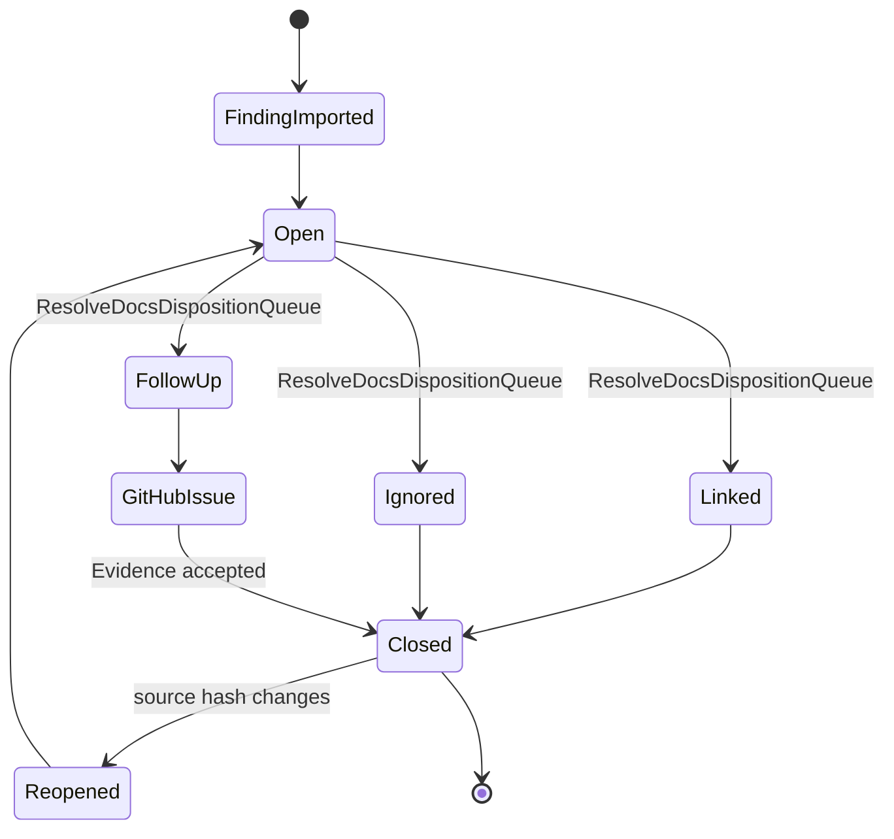
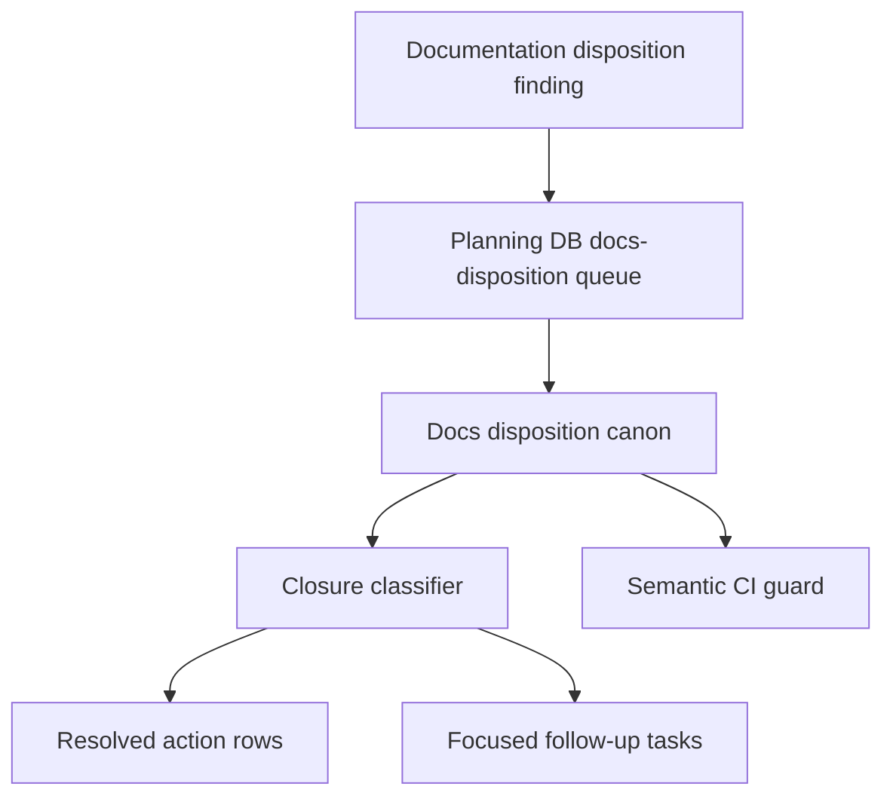

# Docs Disposition Canon Component

> Owned concern: this component owns semantic closure for active Draft,
> Superseded, and task-like identifier documentation findings, and audited
> canonical-source relocation, through the Planning DB docs-disposition rail.

## Public API

- `ResolveDocsDispositionQueue(input)`: records a disposition action resolution
  with actor, referenced evidence, source hash, and status.
- `ClassifyDocsDispositionClosure(input)`: classifies a finding as open,
  linked, ignored, reopened, or requiring a focused follow-up.

### Canonical component-guide relocation

The [GH-3747 contract](https://github.com/dunay2/dvt/issues/3747#issuecomment-6476202219)
extends the same `ResolveDocsDispositionQueue` command with explicit kind
`canonical_document_relocation`. Its native implementation must satisfy this
contract before operators use that mode. Existing finding-based commands retain
their input, default idempotency keys and source requirements.

Relocation reads real registered source and target documents; it does not invent
a disposition finding. The strict `canonicalSource` input names `sourceCommit`,
`retirementCommit`, `expectedSourceContentSha256`, `targetCommit`, `targetPath`,
`targetAnchors`, `expectedTargetContentSha256` and `expectedResolutionSha256`.
The imported-origin blob must match the old source hash. The separate retirement
commit proves removal, and the current committed target must be tracked, clean,
regular, registered and contain the verified anchors. Its governed fingerprint
must match the target blob. An old imported origin need not equal the parent of
the retirement commit.

Use the existing resolution and operation tables. The stable resolution identity
is kind plus old path with no reference text; store the target and Git provenance
in structured `raw_resolution`. Require exact full-overlay hash CAS or explicit
`absent`. A concurrent stale caller, conflicting target, bad source, bad anchor
or failed audit must not leave a partial resolution. Exact completed-command
replay returns its existing result without another write; a changed proof or
target under the same key rejects.

Canonical relocation is a one-hop mapping. A document that is the target of an
effective linked relocation cannot itself be relocated: after A points to B,
B cannot point to C while that incoming mapping remains effective. Detect
incoming mappings with the same scope, source identity and source hash rules
as the read projection; an unavailable incoming-mapping fact also rejects.
Serialize canonical mapping changes with one
transaction-level advisory mutex and use explicit READ COMMITTED isolation so
a waiting writer observes the preceding commit. Reject without changing
overlays or audit history; ordinary finding resolution retains its transaction
behavior. Exact completed-command replay retains its existing result.

`ListDocumentationLifecycleFacts` exposes the old document's effective
superseded state and canonical target. Feature-mechanization readers use
`effective_component_guides`, preserving original array order and cardinality.
Imported status, raw manifests and source hashes remain history. The
`doc_disposition_document_query` is explicitly an imported-facts surface, not
the effective lifecycle authority. A later legitimate target edit does not
reactivate the retired source; target identity and provenance freshness remain
separate facts.

Deploy only the two reviewed read projections through the explicit schema mode
governed by [ADR-0063](../../../adr/ADR-0063-planning-db-current-schema-rebuild.md#explicit-replacement-of-documentation-read-projections).
Disposition commands do not deploy schema, import or rebuild authority. Real
isolated PostgreSQL tests must prove effective consultation, source/target/CAS
rejections, concurrency, replay, rollback and complete preservation of unrelated
physical rows and historical declarations.

## Invariants

- Planning DB is the operational queue for docs disposition findings.
- A status inventory is evidence and triage input; it is not an execution queue.
- Draft and Superseded labels are not enough to move ADRs, closeouts, or
  evidence documents without owner and backlink checks.
- Task-like identifiers are classified by semantic family before any planning
  task is created.
- Docs, component guide, user stories, canonical Fowler mechanization, and
  semantic test must name the same command/query rails.

## Transitions

## Consumers

- Documentation maintainers use the classification before moving or rewriting
  active documents.
- Planning stewards use the closure state to avoid duplicate tasks and stale
  status-board work.
- Architecture reviewers use the component to distinguish real active findings
  from historical IDs, rails, user stories, and invariants.
- Governance operators use the semantic test to ensure status snapshots do not
  become hidden workboards.

## Command And Query Rail

| Rail                             | Type    | Owner                               | Surface                              |
| -------------------------------- | ------- | ----------------------------------- | ------------------------------------ |
| `ResolveDocsDispositionQueue`    | command | Docs disposition canon aggregate    | Planning DB operation and audit log  |
| `ClassifyDocsDispositionClosure` | query   | Docs disposition closure read model | Component guide and semantic CI test |

## Semantic Fitness Function

`tools/ci/docs-disposition-canon.test.mjs` validates that the canon plan,
component guide, user stories, documentation-governance domain, and canonical
Fowler mechanization tokens name the same semantic rails. It also rejects the
retired May status snapshots and their former Git-owned catalog entry, while
requiring the existing DB-owned resolution overlay and command/query rails.

It validates disposition ownership and DB-first closure rather than only
checking generated index freshness.

## Component Grouping

## Related Docs

- [Docs Disposition Canon User Stories](docs-disposition-canon-component.md#section-docs-disposition-canon-user-stories)
- [Docs Disposition Canon Plan 2026-05-24](../../../planning/proposals/mandatory/governance-and-docs/docs-disposition-canon-plan-20260524.md)
- [Docs Disposition Mailbox Analysis](https://github.com/dunay2/dvt/blob/2df68680de46b9104282a58fd203a7eef551ca38/buzon/20260524-codex-fowler-docs-disposition-canon.md)

## Docs Disposition Canon User Stories

### Documentation Maintainer

As a Documentation maintainer, I need Draft and Superseded findings to route
through Planning DB disposition state so that I do not move ADRs, closeouts, or
evidence documents based only on frontmatter labels.

Acceptance:

- Draft closeouts show linked disposition unless owner/evidence review reopens
  the action.
- Obsolete proposals are retired only by focused follow-up with owner and
  backlink evidence. Their history remains in Git.
- The Planning DB query reports the closure posture, not a dated inventory.

### Planning Steward

As a Planning steward, I need docs disposition actions to be open, linked,
ignored, or follow-up-owned in one query rail so that status prose cannot become
a second workboard.

Acceptance:

- `planning:db:query docs-disposition --resolution open` is the open-work
  source.
- `GD-DOC-DISPOSITION-CANON` records semantic closure instead of creating
  duplicate child tasks.
- New findings are reopened through Planning DB.

### Architecture Reviewer

As an Architecture reviewer, I need task-like identifiers to be classified by
semantic family so that rails, user stories, invariants, ADRs, and risk IDs are
not mistaken for missing planning tasks.

Acceptance:

- Unknown task-like IDs can be linked to non-task governance families.
- Real active review findings can still become GitHub issues.
- The component guide documents the classification invariant.

### Governance Operator

As a Governance operator, I need an executable semantic test for disposition
closure so that future docs refreshes do not reintroduce hidden backlog drift.

Acceptance:

- The semantic test validates plan, guide, stories, and domain page together.
- Retired inventories cannot return as files or canonical catalog sources; the
  existing DB resolution owner remains required.
- The test names `ResolveDocsDispositionQueue` and
  `ClassifyDocsDispositionClosure`.
- `pnpm verify:prepush` includes the changed docs and guard.

> Acceptance scope status: Active. Owner: Architecture / Docs / Planning.

## Independent Risk Record Colocation

A physical Markdown risk document may contain independent current records in explicit
`risk-record-v1` three- or four-backtick fences (matching the closing delimiter). Each fence retains complete source frontmatter
and narrative, including its own nonempty `id`, `title`, and `status`. A unique
`risk-<lowercase-id>` HTML anchor identifies the record. Colocation neither closes
a risk nor merges its owners, severity, probability, mitigation, or acceptance.

The shared `scripts/lib/risk-document-records.cjs` parser rejects malformed,
unsupported, truncated, unidentified, or unanchored records. The existing Git risk
debt collector emits one item per risk ID and still rejects duplicates or missing
physical governance ownership. The existing risk index generator links each record
anchor. Physical source paths remain valid governance-file identities; the optional
`rawDebt.sourceFragment` records the section. No new DB schema, import, queue,
query rail, or runtime contract is introduced. Legacy malformed standalone sources
remain separate instead of gaining silent normalization through relocation.
