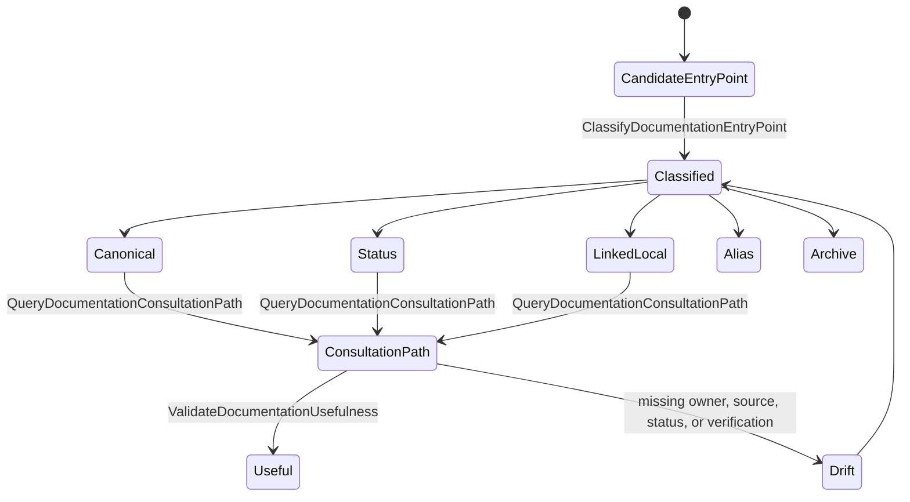
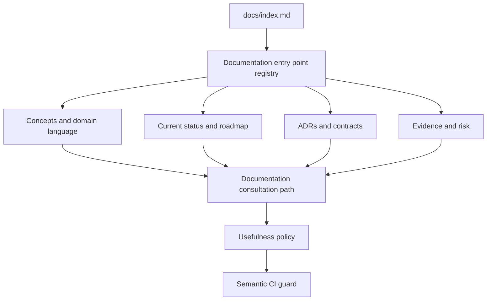
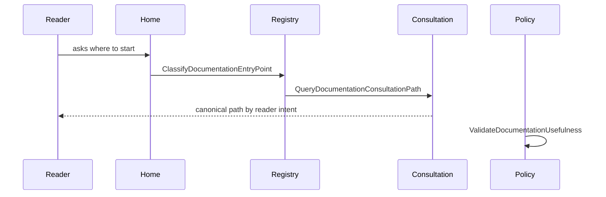

# Documentation Usability Canon Component

> Owned concern: this component owns documentation consultation semantics:
> entry-point classification, reader path resolution, and usefulness validation.

## Public API

- `ClassifyDocumentationEntryPoint(input)`: classifies active documentation as
  canonical, status, local reference, alias, archive, evidence, risk, or
  operational runbook.
- `QueryDocumentationConsultationPath(input)`: returns the canonical path a
  reader should follow for concepts, current status, decisions, contracts,
  evidence, package ownership, or workflow guidance.
- `ValidateDocumentationUsefulness(input)`: validates that governed docs remain
  useful, discoverable, owned, and traceable beyond syntax and link health.

## Invariants

- `docs/index.md` is the consultation entry point; hidden active sections must
  not become parallel start pages.
- Roadmap, status, historical assessment, evidence, and risk are different
  reader intents and must not share ambiguous entry-point semantics.
- Package and app docs are either canonical, linked-local, or reference-only;
  important but unpublished docs are drift.
- `ValidateDocumentationUsefulness` cannot pass when a governed docs change
  removes the reader path to concepts, status, decisions, contracts, or
  verification.
- Docs, proposal, component guide, user stories, canonical Fowler
  mechanization, and semantic test must name the same rails.

## Transitions

## Consumers

- New contributors use consultation paths to find what DVT is, where status
  lives, and which docs govern a workflow.
- Documentation maintainers use entry-point classification before moving,
  aliasing, or archiving active docs.
- Architecture reviewers use usefulness invariants to distinguish IA fixes from
  cosmetic navigation changes.
- Governance operators use the semantic guard to prevent docs changes that pass
  markdown checks while regressing consultation.

## Command And Query Rail

| Rail                                 | Type  | Owner                                 | Surface                              |
| ------------------------------------ | ----- | ------------------------------------- | ------------------------------------ |
| `ClassifyDocumentationEntryPoint`    | query | Documentation entry point registry    | Proposal, domain note, semantic test |
| `QueryDocumentationConsultationPath` | query | Documentation consultation read model | Component guide and user stories     |
| `ValidateDocumentationUsefulness`    | query | Documentation usefulness policy       | CI guard and future docs checks      |

## Semantic Fitness Function

`tools/ci/documentation-usability-canon.test.mjs` validates that the canon
plan, component guide, user stories, documentation-governance domain, original
usability proposal, and canonical Fowler mechanization tokens exist together
and name the same rails.

The test protects consultation semantics and usefulness ownership, not only
markdown syntax or link validity.

## Component Grouping

## Related Docs

- [Documentation Usability Canon User Stories](documentation-usability-canon-component.md#section-documentation-usability-canon-user-stories)
- [Documentation Usability Canon Plan 2026-05-24](../../../planning/proposals/mandatory/governance-and-docs/documentation-usability-canon-plan-20260524.md)
- [Documentation Usability Mailbox Analysis](https://github.com/dunay2/dvt/blob/2df68680de46b9104282a58fd203a7eef551ca38/buzon/20260524-codex-fowler-documentation-usability-canon.md)

## Documentation Usability Canon User Stories

> Owned concern: this story set covers consultation-path scenarios governed by
> `ClassifyDocumentationEntryPoint`, `QueryDocumentationConsultationPath`, and
> `ValidateDocumentationUsefulness`.

### Stories

| Persona                  | Story                                                                                                                                                      | Acceptance                                                                                                                                   |
| ------------------------ | ---------------------------------------------------------------------------------------------------------------------------------------------------------- | -------------------------------------------------------------------------------------------------------------------------------------------- |
| New contributor          | As a new contributor, I want one path from home to concepts, status, roadmap, and governing decisions so I can answer basic orientation questions quickly. | `QueryDocumentationConsultationPath` returns canonical entry points for concept, status, roadmap, decision, and contract questions.          |
| Documentation maintainer | As a documentation maintainer, I want active docs classified by reader intent before changing navigation.                                                  | `ClassifyDocumentationEntryPoint` records canonical, status, local-reference, alias, archive, evidence, risk, or runbook semantics.          |
| Architecture reviewer    | As an architecture reviewer, I want docs usability reviewed as an architecture concern, not only a markdown concern.                                       | `ValidateDocumentationUsefulness` fails when a governed docs change removes owner, status, source, code, test, or verification traceability. |
| Governance operator      | As a governance operator, I want CI to guard consultation usefulness so fragmented docs do not return silently.                                            | The semantic guard verifies all canon artifacts name the same rails and component API.                                                       |

### Scenario Coverage

### Negative Scenarios

- A roadmap-like document cannot become a competing roadmap of record without
  `ClassifyDocumentationEntryPoint`.
- A package doc cannot remain important but unpublished without a linked-local
  or canonical entry point.
- `ValidateDocumentationUsefulness` fails when a governed docs change preserves
  links but removes the reader path to status, decisions, code, tests, or
  evidence.
- Alias and archive pages must not become primary consultation paths.

> Acceptance scope status: Active. Owner: Docs / Architecture / Platform.
