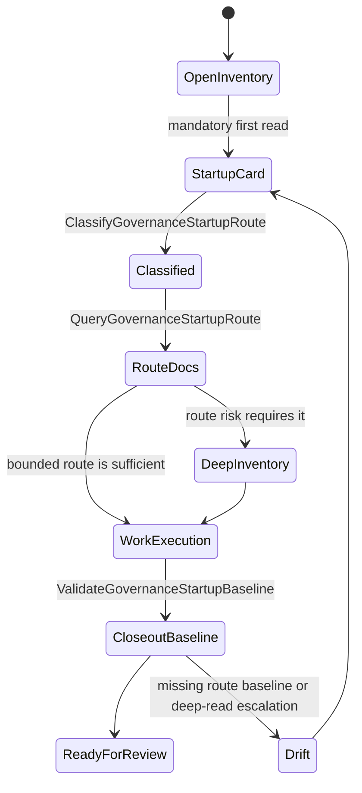
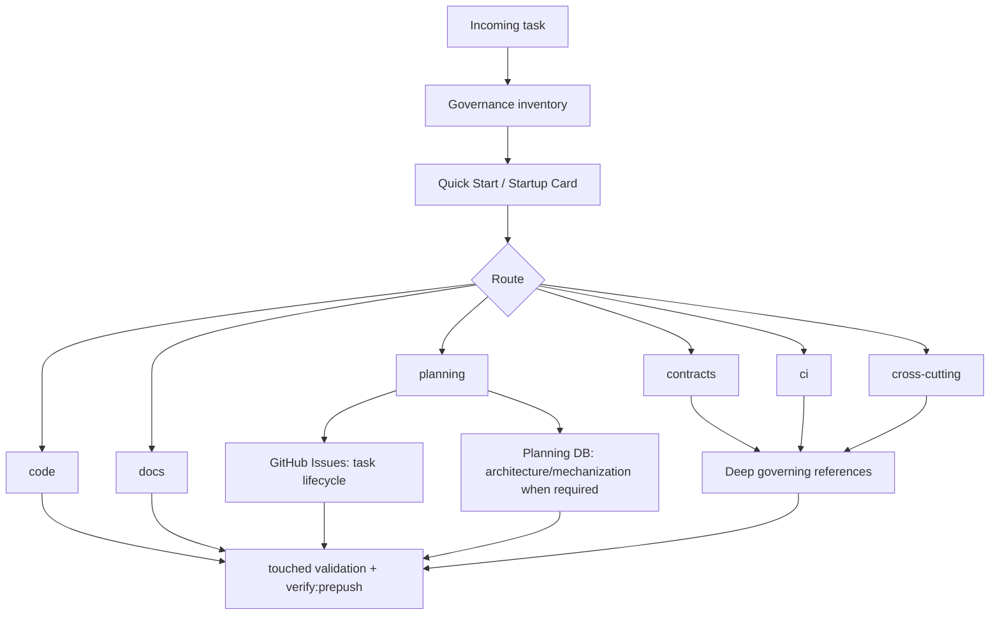

# Governance Startup Card Canon Component

> Owned concern: this component owns governance startup route semantics:
> task classification, next-document routing, and minimum validation baseline
> selection.

## Public API

- `ClassifyGovernanceStartupRoute(input)`: classifies a work request as `code`,
  `docs`, `planning`, `contracts`, `ci`, or `cross-cutting`.
- `QueryGovernanceStartupRoute(input)`: returns the canonical documents to open
  next and states when the deep inventory is required.
- `ValidateGovernanceStartupBaseline(input)`: validates that closeout uses the
  route-specific minimum baseline plus `pnpm verify:prepush`.

## Invariants

- The mandatory first document remains
  `docs/planning/status/governance-document-rule-inventory.md`.
- The startup card must route before deep catalog reading; it must not replace
  the deeper inventory.
- Every route must name the next documents, deep-read condition, and minimum
  validation baseline.
- `contracts`, `ci`, and `cross-cutting` routes always require deeper reading.
- GitHub Issues owns task lifecycle, priority, blockers, acceptance, evidence,
  and closure for executable work.
- Planning DB owns architecture, capabilities, relationships, command/query
  rails, feature mechanization, and governed evidence; it is not a task tracker.
- Generated workboards, local lane files, and task-row projections are not
  active lifecycle authorities.
- No second active governance inventory or startup note may own the same
  product intent.
- Docs, proposal, component guide, user stories, canonical Fowler
  mechanization, and semantic test must name the same rails and authority split.

## Transitions

## Consumers

- Bounded-task contributors use the startup card to select governing docs
  without paying full inventory cost for local docs or code work.
- Cross-cutting implementers use deep-read escalation rules before touching
  multiple contexts or public boundaries.
- Planning operators use the planning route to keep task lifecycle in GitHub
  Issues and use Planning DB only when architecture or mechanization changes.
- PR reviewers use this component to evaluate whether a governance startup
  change preserved route semantics instead of only preserving markdown shape.

## Command And Query Rail

| Rail                                | Type  | Owner                      | Surface                              |
| ----------------------------------- | ----- | -------------------------- | ------------------------------------ |
| `ClassifyGovernanceStartupRoute`    | query | Documentation governance   | Inventory startup card               |
| `QueryGovernanceStartupRoute`       | query | Documentation governance   | AI work protocol and component guide |
| `ValidateGovernanceStartupBaseline` | query | Governance validation / CI | Semantic architecture test           |

## Semantic Fitness Function

`tools/ci/startup-card-canon.test.mjs` validates that the canon plan, component
guide, user stories, original router plan, documentation-governance domain, and
canonical Fowler mechanization tokens all retain the same rails. It also checks
that the active inventory still lists every route: `code`, `docs`, `planning`,
`contracts`, `ci`, and `cross-cutting`; that task lifecycle routes to GitHub
Issues rather than retired workboards or Planning DB task rows; and that active
entrypoints do not link retired planning paths.

## Current State Diagram

## Future Change Rule

Any future route addition, removal, authority change, or validation-baseline
change must update the canon plan, component guide, user stories, domain index,
original router plan, and `tools/ci/startup-card-canon.test.mjs` in the same
slice.

## Governance Startup Card Canon User Stories

> Owned concern: scenario coverage for governance startup routing, including
> success, degraded, and negative paths.

### Bounded-task contributor

As a bounded-task contributor, I want
`ClassifyGovernanceStartupRoute` to map a small docs or code slice to the right
route so that I can open the inventory startup card, the route-specific
documents, and the AI work protocol without reading unrelated deep catalog
sections.

Acceptance:

- `docs` routes name `docs/index.md` or the relevant docs entry point.
- `code` routes name the relevant ADR, contract, or current status when needed.
- `ValidateGovernanceStartupBaseline` requires `pnpm verify:prepush`.

### Cross-cutting implementer

As a cross-cutting implementer, I want `QueryGovernanceStartupRoute` to require
deep inventory reading when my work touches public boundaries, contracts,
multiple packages, CI, or planning posture so that startup speed does not weaken
governance for risky changes.

Acceptance:

- `cross-cutting`, `contracts`, and `ci` routes always escalate to deep reading.
- The card does not create a second governance inventory.
- The closeout evidence names the governing sources actually used.

### Planning operator

As a planning operator, I want task lifecycle to route through GitHub Issues and
architecture/mechanization work to route through Planning DB so that status,
ownership and evidence do not drift into generated markdown or parallel local
workboards.

Acceptance:

- The planning route points to the governing GitHub Issue, the GitHub MVP issue
  workflow, the governance inventory, and the AI work protocol as applicable.
- Task claim, priority, status, blockers, evidence and closure are recorded in
  GitHub Issues; Planning DB is not used as a task tracker.
- Architecture, capability, relation and command/query-rail changes use the
  existing Planning DB rails when governance requires them.
- Generated planning views are refreshed through generators, not hand edits.

### PR reviewer

As a PR reviewer, I want `ValidateGovernanceStartupBaseline` to fail when a
startup-card change removes a route, omits a baseline, or leaves the component
guide/user stories out of sync so that semantic startup routing is reviewed as a
contract, not formatting.

Acceptance:

- The architecture test checks all six route names.
- The canon plan, component guide, user stories, mailbox, domain doc, and
  original router plan name the same rails.
- No stub, placeholder, or parallel startup-note surface is added.

### Negative Scenarios

- If a route exists in the inventory but lacks a minimum validation baseline,
  the change is not acceptable.
- If a future doc describes a separate startup process for the same intent, it
  must be folded into this component or archived as historical context.
- If a slice changes startup governance but skips `pnpm verify:prepush`, the
  slice is not ready.

> Acceptance scope status: Active. Owner: Docs / Architecture / Delivery.
