# Local Changed Files Gate Component

## Purpose

The Local Changed Files Gate owns the repository-wide answer to one operational
question: which files must the local gates validate before a branch can be
called ready?

The component exists because mature delivery systems do not let each lint,
docs, type-check, or governance script invent a different interpretation of
"changed". The local worktree is authoritative before a commit exists, so the
gate must include merge-base diff, staged files, unstaged tracked files, and
untracked non-ignored files.

## Governing Sources

- `AGENTS.md`
- `docs/planning/status/governance-document-rule-inventory.md`
- `docs/guides/ai-work-protocol.md`
- `docs/guides/testing-and-ci-capabilities.md`
- `docs/architecture/command-query-rail-governance.md`
- `docs/architecture/fowler-opportunity-planning-governance.md`
- `docs/planning/proposals/mandatory/governance-and-docs/local-changed-files-gate-hardening-plan-20260503.md`
- `docs/adr/ADR-0053-file-state-fingerprint-governance.md`

## Owned Concern

Owned concern: provide the canonical local changed-file read model and keep all
changed-file gates consuming that read model rather than raw, script-local git
queries.

The component does not own:

- package-specific lint, type-check, or test semantics;
- product feature behavior;
- GitHub Actions scheduling;
- generated governance file contents beyond changed-file admission;
- contract, engine, planner, or adapter ARC policy decisions.

## Push Readiness And Merge Acceptance

`verify:prepush` proves local push readiness. It invokes the existing
`RunChangedSliceVerification` rail with `--push-readiness`; the plan still owns
the complete changed-file frontier, static checks, affected tests, applicable
fresh Planning DB validation and complete browser-plan admission. It does not
attest hosted browser acceptance. Explicit `test:web:changed` and ordinary
`verify:changed` retain complete local execution.

Previously an ordinary Web change executed its browser scenarios locally and
then repeated those scenarios in the required hosted Test Suite:

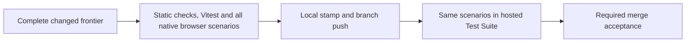

The new boundary delegates common browser scenarios while retaining declared
host-specific evidence and conservative full execution for native infrastructure:

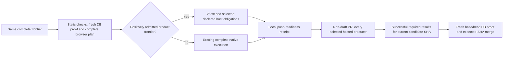

The focused Web policy admits Web product/source surfaces, documents
and known governance companions. Native runners, Cypress configuration/node
adapters, the Vitest router/catalog/configuration (`apps/web/vitest/` and root
`vitest*.ts`), process/database lifetime, toolchain/root-policy changes, unknown
or unclassified companions retain the existing full command. These test-selection
and execution inputs retain full proof both alone and mixed with product edits.
Unsupported local platforms also retain full execution. This is an operational validation boundary,
not proof that all unannotated browser behavior is portable.
New host-specific product expectations require explicit review and a catalog
declaration before their local execution can be reduced.

The single `cypress.catalog.json` inventory additionally declares the selected
Windows-specific Monaco clipboard obligation under `nativePlatforms.win32`.
The existing router admits every consumer before filtering the readiness
execution. A Windows readiness run retains that spec whenever it belongs to the
complete plan; Linux executes the common scenarios through the required hosted
workflow. macOS keeps complete local execution; this slice adds no unexecuted
macOS acceptance claim. Infrastructure changes retain the complete native proof.

The catalog parser validates platform references against admitted merge-time
consumers. Read-only historical witnesses with the former four-array shape are
projected only inside the witness parser; membership retention still applies.
Removal of an existing native obligation rejects, and changed platform metadata
cannot qualify as a harmless controlled-spec addition. No second inventory is
introduced.

Only the outer prepush command writes receipt version 2, with
`purpose: local-push-readiness`, after every selected outer step succeeds.
`verify:changed` never writes that receipt. This prevents a later traceability
failure from leaving an inner partial-success stamp. Old receipts and receipts
with another purpose do not match. Existing exact Git input identities,
validation levels and deadline/cleanup rules remain in force. The receipt also
binds the effective host platform: a shared checkout cannot reuse Linux evidence
to omit Windows obligations. Native vetoes precede hosted-only reduction too.
ADR-0000 is
selected from the existing canonical traceability relevance signal.

| Scenario                           | Owner / rail                                                     | Required evidence                                                                     |
| ---------------------------------- | ---------------------------------------------------------------- | ------------------------------------------------------------------------------------- |
| Ordinary admitted Web change       | ChangedSliceVerificationPlan / BuildChangedSliceVerificationPlan | Same Vitest plan, complete browser admission, selected host obligation                |
| Native/toolchain/unknown companion | Same policy and execution rail                                   | Existing full local proof, including native platform behavior                         |
| Any later local gate failure       | Prepush receipt owner                                            | Failure preserved; no new success receipt                                             |
| Hosted acceptance                  | TestSuiteEvidenceResult / ValidateTestSuiteEvidenceResult        | Non-draft current-head PR, successful required aggregates and every selected producer |
| Source or base/head moves          | Existing Git and DB authorities                                  | Invalidate/repeat evidence; fresh implementation validation before merge              |

`pr:checks` remains a diagnostic summary, not an acceptance receipt: its current
empty/skipped/draft behavior cannot prove browser success. Closeout reads the
current PR head and required checks from GitHub, rejects missing, failed,
cancelled, pending or skipped required aggregates, and merges only the expected
head. GitHub ruleset 17240734 remains active and strict; no rule is relaxed.

The performance target is a measured 50% reduction of the complete ordinary
developer loop. Report local duration, retained native proof, hosted duration,
queue time and total runner cost separately. A faster missing-prerequisite
failure or a plan-only comparison is not a successful-path speedup measurement.

## Public API

| API                                               | Owner                                | Responsibility                                                                |
| ------------------------------------------------- | ------------------------------------ | ----------------------------------------------------------------------------- |
| `listLocalChangedFiles(options)`                  | `scripts/git-local-changes.cjs`      | Returns the canonical `LocalChangedFileSet` for changed-only local gates.     |
| `resolveDiffBaseRefs(options)`                    | `scripts/git-local-changes.cjs`      | Resolves the base refs used for branch diff detection.                        |
| `resolveIterationComparison(options)`             | `scripts/git-local-changes.cjs`      | Resolves the explicit ancestor base and observed head to commit identities.   |
| `readLocalNameStatusDiff(base, head, git)`        | `check-governance-changed-files.cjs` | Returns name-status records for governance fingerprint validation.            |
| `readUntrackedNameStatus(git)`                    | `check-governance-changed-files.cjs` | Converts untracked files into added name-status records.                      |
| `validateFeatureImplementationManifests(options)` | `check-feature-mechanization.cjs`    | Validates that real diff files and added symbols match feature manifests.     |
| `node scripts/check-changed.cjs`                  | changed lint/format gate             | Applies lint and format checks to the canonical changed-file set.             |
| `node scripts/verify-changed.cjs`                 | changed-slice verification gate      | Plans and runs fast changed-only checks plus scoped planning DB/self tests.   |
| `node scripts/type-check-prepush.cjs`             | pre-push type-check scope selector   | Selects no-op, affected workspace, or root type-check from changed files.     |
| `pnpm docs:governance:changed-files:check`        | governance changed-files command     | Validates changed files against accepted governance indexes and fingerprints. |
| `pnpm docs:feature-mechanization:implementation`  | feature mechanization implementation | Validates allowed surfaces, forbidden surfaces, symbols, and Cypress rules.   |

## Command And Query Rails

| Rail                                | Type    | DDD owner                      | Application port                     | Adapter surface              | Negative tests                                                                 |
| ----------------------------------- | ------- | ------------------------------ | ------------------------------------ | ---------------------------- | ------------------------------------------------------------------------------ |
| `ListLocalChangedFiles`             | query   | `LocalChangedFileSet`          | local changed-file query rail        | git CLI adapter              | Empty branch diff still returns staged, unstaged, and untracked files.         |
| `ValidateChangedFiles`              | command | `ChangedFileValidationGate`    | changed-file validation command rail | lint/docs/governance scripts | Added files missing governance ownership fail closed.                          |
| `SelectPrepushTypecheckScope`       | query   | `PrepushTypecheckScope`        | pre-push type-check scope query rail | package manager scripts      | Root graph changes select root type-check; non-TS changes do not fake success. |
| `BuildChangedSliceVerificationPlan` | query   | `ChangedSliceVerificationPlan` | changed-slice verification plan      | package manager scripts      | Docs-only changes do not run full governance scans.                            |
| `RunChangedSliceVerification`       | command | `ChangedSliceVerificationGate` | changed-slice verification command   | package manager scripts      | Failed subchecks stop the plan immediately.                                    |

## DDD Objects

| Object                         | Kind       | Invariants                                                                  |
| ------------------------------ | ---------- | --------------------------------------------------------------------------- |
| `LocalChangedFileSet`          | read model | Unique POSIX paths from branch, staged, unstaged, and untracked sources.    |
| `ChangedFileValidationGate`    | policy     | A changed file is either governed and validated or rejected.                |
| `PrepushTypecheckScope`        | read model | Type-check scope is derived from file ownership, not from human choice.     |
| `ChangedSliceVerificationPlan` | read model | Fast local validation steps are derived from the changed-file set.          |
| `ChangedSliceVerificationGate` | policy     | The fast gate may skip full scans only when `verify:prepush` remains final. |
| `FeatureImplementationGuard`   | policy     | Real diff surfaces and symbols must match feature mechanization manifests.  |

## Invariants

- A local pre-push pass must not skip because the branch has no commit ahead of
  `origin/main`.
- Untracked non-ignored files are part of local readiness.
- Staged and unstaged tracked files are part of local readiness.
- Name-only changed-file consumers must call `listLocalChangedFiles()`.
- The governance fingerprint gate may own name-status parsing because it needs
  added, modified, deleted, and renamed semantics.
- The feature mechanization guard validates actual changed files against
  `allowedImplementationSurfaces` and `forbiddenImplementationSurfaces`.
- Cypress specs changed by a feature must not intercept or directly seed
  `/workspace/graph/draft` when the governing feature forbids that path.
- No script may downgrade a failed local changed-file state into a silent no-op.
- `verify:changed` is an iteration helper, not a replacement for the full
  `verify:prepush` closeout gate.
- Any skipped full-scan behavior must remain covered by `verify:prepush`.
- Governance and feature-mechanization admission precede the complete changed-file
  lint/format check. That check runs once before every affected test step, including
  provider and browser acceptance; the forbidden-tracked-file check remains last.
- Reordering validation does not change the selected commands, their arguments,
  test classification, environment isolation or receipt identity. Any failed step
  preserves its failure status, stops all later steps and produces no success stamp.
- The canonical plan marks test steps explicitly, including package-script
  aliases. `executeCommandPlan` removes Git's repository-local environment
  variables only from those child processes. Git itself supplies the variable
  names through `git rev-parse --local-env-vars`; fixtures and their real Git
  reads must not inherit the hook caller's repository, index or object store.
- Isolation clones the environment without changing the parent. Comparison
  inputs such as `GIT_BASE` and `GIT_HEAD` remain available. Ordinary docs,
  lint, type-check and feature-validation steps retain their original Git
  environment, including an explicitly selected index. Isolation does not
  change test selection, hooks or production query behavior.

## Transitions

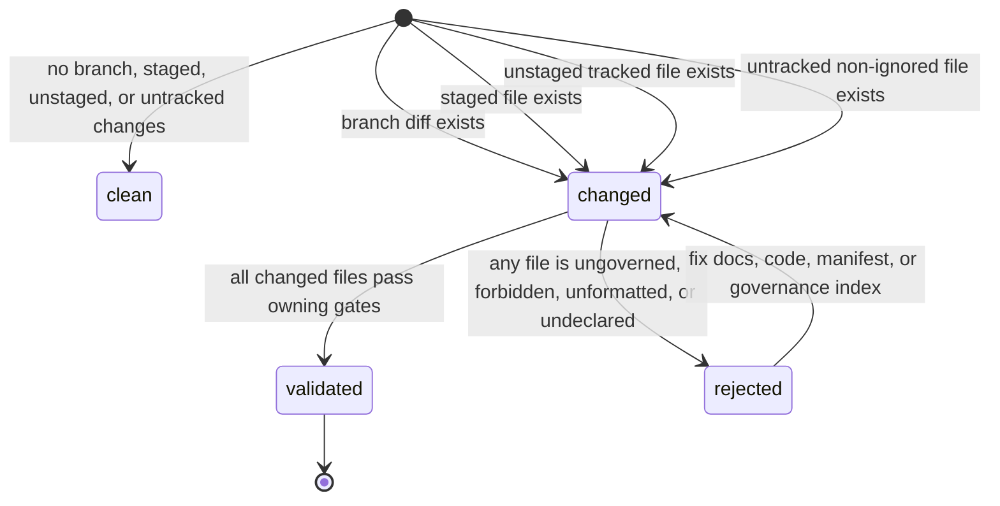

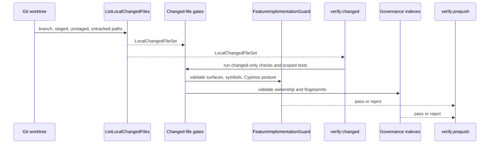

## Consumers

### Changed-slice component ownership

`SYS-CI-CHANGED-SLICE-VERIFICATION` owns exactly
`scripts/local-validation-plan.cjs` and `scripts/verify-changed.test.cjs` beneath
the existing CI governance root. Descendant ownership takes precedence over the
ancestor glob. The component separates plan composition
(`BuildChangedSliceVerificationPlan`) from process execution
(`RunChangedSliceVerification`): the query derives complete, ordered validation
obligations; the command executes the supplied plan with test-environment
isolation and failure propagation. Their atomic responsibilities and current
function-to-test associations live in Planning DB.

The existing prepush tests remain evidence for prepush planning without moving
their file ownership. The component guards component-source associations by
selecting their existing contract tests when the associated inputs change;
it does not own the DB writer or the association policy. The required-test and
guard relation records describe these existing behaviors.

### Changed-slice execution order

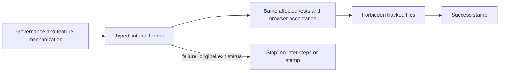

`BuildChangedSliceVerificationPlan` owns this ordering; neither the executor nor
individual checks invent another plan. Failing static validation is detected
before expensive tests, without reducing the successful run's coverage or changing
the `--committed-tests` path. The existing integrated failure test exercises
`main` through `executeVerifyChangedPlan`, not a synthetic successful executor.

### Local validation responsibility boundaries

The validation plan is a read model, not an operating-system executor or a test
ownership catalog. The previous module mixed those concerns in 971 lines. Its
162-entry routing table repeated 46 test self references, 36 adjacent source/test
pairs and 63 routes into three existing parent suites, alongside 17 actual
cross-file exceptions. Repeating that physical inventory makes removed files and
new responsibilities difficult to review.

| Owner module                                   | Concrete responsibility                                                                                                                                 |
| ---------------------------------------------- | ------------------------------------------------------------------------------------------------------------------------------------------------------- |
| `scripts/local-validation-plan.cjs`            | Compose mechanical admission, selected tests and final checks in order; classify complete prepush obligations.                                          |
| `scripts/lib/changed-test-selection.cjs`       | Select affected tests once using canonical file/command scope, existing adjacent tests and explicit cross-owner relations; explain CI-tools selection.  |
| `scripts/lib/local-web-validation-policy.cjs`  | Assign complete, hosted-only or push-readiness Web execution from the same frontier and retain native-host obligations.                                 |
| `scripts/lib/local-test-coverage.cjs`          | Read the existing bounded literal package aggregates and the three canonical parent-suite memberships; remove only test executions they actually cover. |
| `scripts/lib/local-validation-plan-values.cjs` | Construct and describe immutable steps, normalize paths and enforce consistent step identities.                                                         |
| `scripts/lib/local-validation-executor.cjs`    | Await bounded child execution and cleanup, propagate deadlines/failures and report observed results.                                                    |
| `scripts/lib/prepush-validation-stamp.cjs`     | Compute exact Git input identity and read, match or write the existing acceptance receipt.                                                              |

The CLI adapters import these concrete owners directly. Relocated functions are
removed from the old module and CLI exports; compatibility facades, duplicate
implementations and import barrels are not retained. Describing a plan never
loads its process executor. `verify:changed` owns no receipt operation; outer
prepush alone authorizes writing local readiness after the whole plan succeeds.

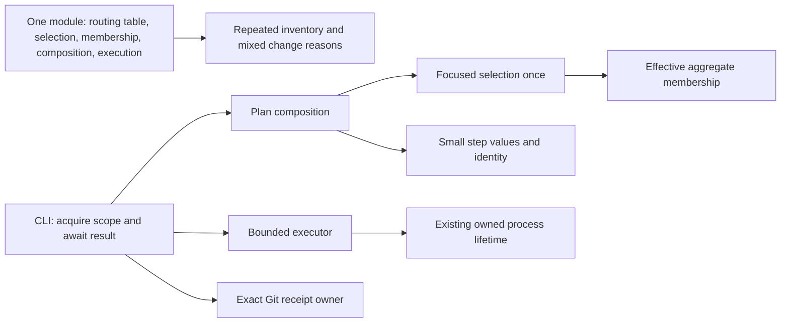

Known repository-command ownership plus a real adjacent test replaces repeated
source/test pairs. A changed test selects itself. Application files and unknown
command owners do not acquire inferred adjacent routes. The three existing
query, operate and code-status parent suites remain the authority for their
declared child contracts; their membership must be proven rather than inferred
from an unrelated directory name. Keep the 17 cross-file exceptions explicit.
Deleted production sources retain their existing test obligation when the test
still exists. An unprovable required route rejects or broadens conservatively;
absence must not become an empty successful selection.

This is a documented conservative superset, not an exact-parity claim. The
before frontier covers every tracked path, mixed scopes and virtual source
deletions. The known-owner/adjacent rule has 23 reviewed existing candidates;
two schema tests are already covered by their package aggregate, leaving 21
additional effective suites. Each is selected only when its corresponding
source changes, not on every iteration. No old effective obligation may vanish.
The allowed differences are those reviewed additions, moved contract suites,
removal of dead branches and exact duplicate execution, and visible rejection
of conflicting step identities.

The same ID and identical command/arguments/test kind deduplicate. Reusing an ID
for a different execution rejects the plan; it must not silently discard a
contract merely because two files share a basename. CI-tool selection is computed
once, not repeated and hidden by this deduplication. Aggregate coverage uses the
existing literal `node --test` semantics, not a general shell parser, scheduler
or second test-member catalog. The existing `test:verify-prepush` delegate keeps
the moved validation contracts in its complete test coverage.

Tests follow these responsibilities: selection and exceptions, effective
membership and no lost coverage, composition order, value identity, actual
process lifetime, exact Git receipts, and CLI awaiting/no-stamp behavior. Move
the existing assertions and real fixtures with their contract; do not duplicate
the production routing table as a test oracle. One-off before/after semantic
comparison is evidence for this refactor, while focused regression tests protect
the enduring boundary cases. These boundaries reuse the existing command/query
rails and acceptance rules; they add no scheduler, cache or parallel authority.

### Hosted adapter validation

`ClassifyChangedCiScope` owns the `hostedWebTestAdapter` classification for the
Test Suite workflow and shared native-browser preparation action.
`BuildChangedSliceVerificationPlan` consumes that classification rather than
maintaining another list of their paths. These adapters run on GitHub's Linux
workers; executing the application in Windows does not execute their YAML/Bash.

Previously, either adapter selected the complete local Web command as well as
its required hosted execution:

The local plan now selects `test:web:changed --phase=vitest` when at least one
hosted adapter changed and every accompanying input is positively known to be
compatible: documentation or a command accepted by the existing governance
tooling classifier, without a root-policy or runtime-fanout obligation. Shared
Web/runtime inputs, root build or CI-policy inputs, other workflow adapters/configs,
and unclassified files retain the complete Web command. Absence of a command
classification is not evidence that an input is safe to exclude.

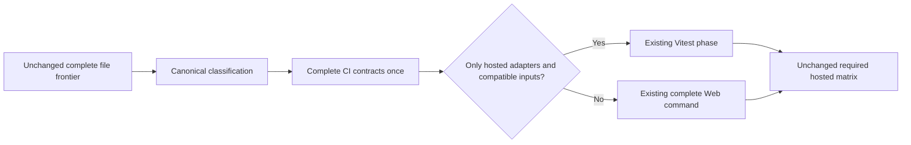

This is separation of adapter and runtime responsibilities, not an iteration
waiver. Git comparison, independent gates, execution, receipts and hosted
selection remain unchanged. The local receipt proves its local obligations;
the required hosted aggregate must independently accept the same candidate.
No result cache, new runner, scope override or filtered diff is introduced.

| Scenario                  | Opportunity         | Fowler pattern           | DDD owner                               | Command/query rail                  | Implementation surfaces                | Unit/package proof                                                                                    | Architecture proof                        | User-flow proof                          | Out of scope                           |
| ------------------------- | ------------------- | ------------------------ | --------------------------------------- | ----------------------------------- | -------------------------------------- | ----------------------------------------------------------------------------------------------------- | ----------------------------------------- | ---------------------------------------- | -------------------------------------- |
| Hosted adapter only       | Duplicate execution | Adapter boundary         | Existing changed-slice plan             | `BuildChangedSliceVerificationPlan` | Canonical classifier and selector      | CI contracts once, preserved Vitest phase and ordering                                                | Existing actual-workflow matrix contracts | Required hosted candidate                | New scheduler or test suppression      |
| Adapter plus shared input | Boundary drift      | Conservative composition | Same plan                               | `ClassifyChangedCiScope`            | Same owners                            | Runtime, root policy and unknown companions retain full; input order/duplicates do not change outcome | Original complete frontier retained       | Existing complete selected browser proof | Minimal routing of mixed changes       |
| Missing hosted evidence   | Hidden authority    | Fail-closed acceptance   | Existing Test Suite evidence read model | `ValidateTestSuiteEvidenceResult`   | Existing required aggregate, unchanged | Existing failed/skipped/missing result negatives                                                      | Required main ruleset and matrix coverage | Candidate hosted execution               | Changing protection or nightly cadence |

### Explicit iteration scope

`node scripts/verify-changed.cjs --iteration-base=<commit-ref>` requests partial
feedback since an explicit ancestor commit. It reuses `ListLocalChangedFiles`,
`BuildChangedSliceVerificationPlan` and `RunChangedSliceVerification`; it adds
neither an acceptance rail nor a second changed-file reader. The default command,
`--committed-tests` and `verify:prepush` retain their complete existing obligations
and success-stamp semantics.

The canonical Git adapter resolves the requested base and observed `HEAD` to
commit identities at the repository root and proves ancestry. Its optional strict
read path rejects missing or invalid refs, unknown shallow ancestry and every
failed branch, index, worktree or untracked read. It does not substitute another
base or accept caller filters that narrow this frontier. The result contains the
union of changes after the resolved base, staged changes, unstaged changes and
untracked non-ignored files. Child checks receive the resolved `GIT_BASE` and an
empty `GIT_HEAD`, preserving their local-worktree behavior; the observed head is
reported separately rather than presented as an immutable acceptance snapshot.

The strict query takes the resolved base/head identities, verifies that `HEAD`
still matches the observation and rechecks ancestry before acquisition. NUL-delimited
paths preserve spaces and Unicode. Disabling rename coalescing exposes both old
and new paths, and deletions remain part of the frontier. Strict Git reads remove
foreign repository/index context while ordinary acceptance query defaults remain
unchanged.

Before execution, the command reports that frontier, the observed base/head and
the reasons for CI-tool selection. It explicitly identifies the result as partial
feedback: no native browser acceptance, no global Planning DB validation and no
delivery acceptance. This mode cannot write a prepush success stamp. It runs the
existing changed-file mechanical checks and selected tests, with Web restricted
to its existing Vitest phase. It omits the global native implementation projection,
inventory and integrity checks; their final acceptance obligation is unchanged.
Selected Planning DB contract tests retain their real fixture and aggregate
semantics. No filtered authority is substituted for the complete projection.

Isolated documentation CLI fixtures copy the explicit dependency closure of the
real changed-file reader, including its Git environment helper. They create each
destination parent directory before copying. The production reader keeps its
normal dependency structure; fixtures must exercise the real modules rather than
omit a dependency or substitute a fake implementation.

The comparison must describe the same repository frontier throughout selection
and execution. Ambient `GIT_BASE` or `GIT_HEAD` values cannot override the explicit
iteration request. The runner uses the actual repository root, not an incidental
caller working directory. This mode does not persist per-check state, reuse
acceptance results or cache a previous pass.

### CI tooling composition feedback

The existing repository-file scope and repository-command catalog classify
configuration and script ownership; the planner reuses them rather than adding
another path catalog. Canonical workflow, root-build and CI-policy configuration
inputs, including known or uncatalogued CI JSON/YAML/TOML, require the complete
CI-tools contracts. Production commands in the CI tooling,
developer workflow or runtime-root domains require the existing complete
`pnpm test:ci-tools` suite. Unknown production command ownership broadens to that
suite, so an incomplete classification cannot silently select no contracts.
Changed CI test files alone, unrelated documentation and application sources
retain the existing focused routes. Application package/configuration files do
not become root composition inputs merely because their basename matches one.

The complete CI-tools suite runs once after static admission and before Web tests.
When selected, it replaces the partial `tools/ci` test commands that the suite
already owns; adjacent script tests and other obligations remain. Selection
reasons name the triggering paths and the relevant composition category. The
existing suite owns its members, so the planner never duplicates its membership
catalog. This catches workflow/package-script contracts during local feedback,
including contracts that cross module boundaries and are absent from an adjacent
test selection.

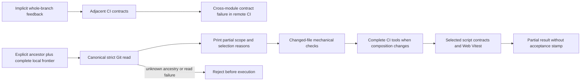

The rationale is to reduce the feedback comparison scope without redefining
delivery acceptance, and to spend the existing CI-tools test cost early when
composition changes can invalidate distant contracts. A passing iteration cannot
authorize merge. `verify:prepush` still validates the final complete candidate,
including global native authority and browser obligations. Focused tests prove
strict acquisition, complete local frontiers, rejection of narrowed/unknown input,
complete-versus-partial suite deduplication, retained script obligations, explicit
selection reasons and the absence of an iteration stamp. Default and committed
mode regression tests protect their unchanged contracts.

### Complete Planning DB test coverage

`BuildChangedSliceVerificationPlan` composes direct tests and the existing
Planning DB package scripts by their effective test files. `package.json` owns
the aggregate members; the planner does not maintain a second member catalog.
Every current-schema change requires both the schema contract and the current
schema policy contract, including when either test is already selected directly.

The full Planning DB aggregate absorbs only obligations it actually covers.
The current-schema aggregate absorbs its covered direct tests. Tests outside an
aggregate remain selected, including a member removed from a broader package
script. A selected test executes once; deduplication does not remove an obligation
merely because another command has a similar name. Existing canonical query and
operate entrypoints continue to cover their declared test shards.

Only the two existing plain `node --test` package scripts with explicit test-file
arguments are admitted as aggregate coverage. Missing, malformed, repeated or
nonliteral members reject planning. Filtered commands retain their own execution
semantics. This changes plan composition, not test bodies, browser selection,
the isolated executor, fail-fast behavior or success-stamp identity.

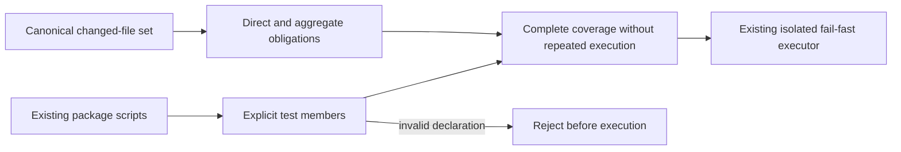

`scripts/lib/local-test-coverage.test.cjs` proves the actual aggregate membership, schema
and policy completeness, mixed direct/aggregate deduplication and retention of
uncovered tests. The executor contract tests in
`scripts/lib/local-validation-executor.test.cjs` preserve test-environment
isolation and failure; the CLI tests retain failure without a success stamp.

### Changed-file lint execution

`ValidateChangedFiles` keeps one canonical changed-file inventory and the same
strict ESLint config, warnings-as-errors policy, ignored-file behavior, and
Prettier check. The lint adapter may reuse one ESLint process across that
inventory; it must not replace the canonical type-aware rules with the faster
pre-commit config. On Windows, passing every changed path through a command
line is not a safe substitute for process reuse because command length is
bounded. The adapter must report any lint warning or error and fail closed if
ESLint cannot initialize or lint a file.

The web source and test scope inherits the canonical TypeScript unused-declaration
rule. It must not disable that rule locally or maintain a second unused-symbol
scanner. Its architecture test submits valid and invalid source to the actual
ESLint configuration: unused local values and imports are rejected, while used
public exports and effectful calls remain admitted. This is declaration-level
evidence, not proof that every exported module is reachable at runtime. Dynamic
registries and side-effect-only imports require dependency and behavior review.

The static gate separately rejects exact-body duplication candidates for changed
production web files. It reuses the code-symbol inventory over current Git contents,
including untracked files supplied by `ListLocalChangedFiles`, without refreshing
Planning DB. Compiler tokens and their syntax-kind nesting preserve literal contents
and statement boundaries while ignoring formatting and comments. Only bodies with
two or more statements and counterparts in another
production file are reported; test/support files and trivial wrappers are excluded.

Each reported group identifies all counterpart locations. Any group rejects the
static gate with a nonzero exit status; there is no warning-only mode or allowlist.
Identical syntax does not prove semantic interchangeability, so rejection does not
authorize automatic refactoring across unrelated responsibilities. Source acquisition
and syntax failures also reject validation. A successful scan is not a repository-wide duplicate-free or
dead-code-free assertion. Styles and unused declarations retain their independent
blocking checks. The focused duplicate-report and symbol-inventory tests are routed
by the existing local-verification plan.

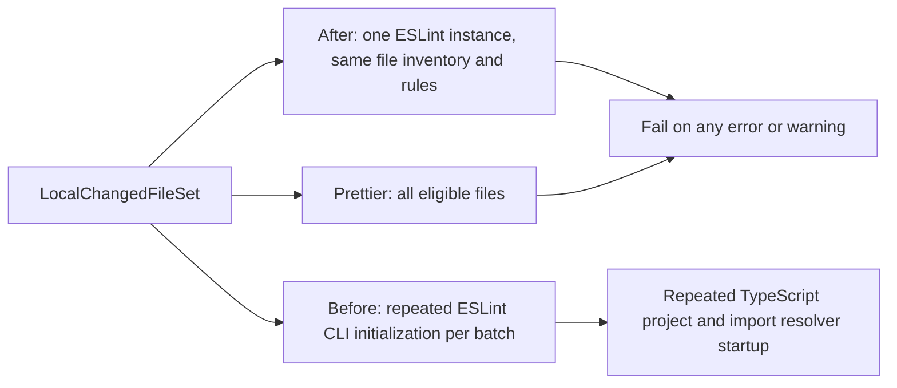

The performance comparison uses the same changed-file set before and after.
It records wall time, number of linted files, and a deliberate warning/error
failure case. Faster execution alone is insufficient if any of those checks
or the Prettier gate disappear.

- `scripts/check-changed.cjs` consumes `ListLocalChangedFiles` for changed-only
  lint and format checks.
- `scripts/verify-changed.cjs` consumes `ListLocalChangedFiles` to plan the
  fast changed-slice verification command without running global governance
  scans for docs-only work.
- `scripts/type-check-prepush.cjs` consumes `ListLocalChangedFiles` to select
  the pre-push type-check scope.
- `scripts/lint-markdown-changed.cjs` and
  `scripts/format-markdown-changed.cjs` consume `ListLocalChangedFiles` for
  changed Markdown checks.
- `scripts/fix-changed.cjs` consumes `ListLocalChangedFiles` for the local
  autofix surface.
- `scripts/qa-artifact-check.cjs` consumes `ListLocalChangedFiles` to keep QA
  evidence checks scoped to real local work.
- `scripts/validate-arc-evidence-frontmatter.cjs` consumes
  `ListLocalChangedFiles` for changed evidence and risk docs.
- `scripts/check-markdown-locations.cjs`, `tools/docs/check-filenames.ts`, and
  `tools/docs/check-frontmatter.ts` consume `ListLocalChangedFiles` for changed
  docs governance.
- `scripts/check-governance-changed-files.cjs` owns name-status parsing for
  add, delete, rename, and fingerprint semantics while keeping local worktree
  inclusion aligned with this component.
- `scripts/check-feature-mechanization.cjs` consumes the changed-file set when
  validating implementation manifests.

## User Stories

| Story            | Scenario                                                   | Acceptance criteria                                                                  | Negative coverage                                                            |
| ---------------- | ---------------------------------------------------------- | ------------------------------------------------------------------------------------ | ---------------------------------------------------------------------------- |
| `US-CI-LCFG-001` | As an agent, I create a new source file before committing. | `verify:prepush` sees the untracked file and validates governance/feature ownership. | The gate fails if the file is outside `allowedImplementationSurfaces`.       |
| `US-CI-LCFG-002` | As an agent, I edit a tracked file without staging it.     | Changed-only lint, docs, and type-check routing see the unstaged path.               | The gate does not report "No changed files".                                 |
| `US-CI-LCFG-003` | As an agent, I stage a file after lint-staged changes it.  | The staged path remains in the local changed-file set.                               | The gate fails if generated governance indexes are stale.                    |
| `US-CI-LCFG-004` | As a reviewer, I receive a PR after local validation.      | Local gates and CI use the same readiness semantics for changed files.               | Added symbols fail when missing from feature mechanization manifests.        |
| `US-CI-LCFG-005` | As a maintainer, I add a new changed-only gate.            | The new gate consumes `listLocalChangedFiles()` instead of raw git diff logic.       | Architecture coverage fails if the gate invents a separate name-only query.  |
| `US-CI-LCFG-006` | As an agent, I need a fast preflight while iterating.      | `verify:changed` runs changed-only checks and scoped DB/self tests.                  | Docs-only changes do not run full governance scans or claim prepush closure. |

## Test Coverage

### Complete prepush Git evidence

The existing `RunChangedSliceVerification` command retains its exact successful
validation fingerprint: committed, staged, unstaged, untracked and upstream
evidence, resolved commit identities and validation mode. Its Git adapter reads
the complete output within a bounded 32 MiB buffer, matching the existing
feature-mechanization Git evidence reader. The implicit Node 1 MiB default is
insufficient for genuine large documentation-retirement diffs.

This changes acquisition capacity, not identity or admission. No deletion is
filtered out; no patch is truncated; no stamp format or hash algorithm changes.
Unavailable Git evidence or output beyond the bounded budget still fails closed
before a successful stamp can be written.

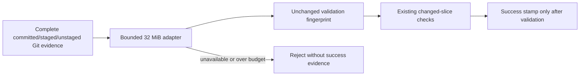

`scripts/lib/prepush-validation-stamp.test.cjs` exercises a real Git deletion patch exceeding
1 MiB, complete-byte fingerprint parity and a tail-byte mutation beyond the old
limit. Existing tests retain invalid-reference, Git-failure, mode, upstream and
worktree invalidation coverage. The bounded design and acceptance obligations
are governed by issue #3004; this correction does not close its global scope.

- `scripts/git-local-changes.test.cjs` proves local changed-file query semantics
  and this component guide.
- `scripts/check-changed.test.cjs` proves whole-inventory ESLint execution,
  warnings-as-errors, and failure when ESLint cannot run.
- `scripts/check-governance-changed-files.test.cjs` proves name-status local
  change inclusion for governance fingerprints.
- `scripts/check-feature-mechanization.test.cjs` proves implementation-surface,
  symbol, forbidden-surface, and Cypress draft-boundary validation.
- `scripts/lib/changed-test-selection.test.cjs` proves focused test selection;
  `scripts/local-validation-plan.test.cjs` proves composition and check order.
- `scripts/lib/local-validation-executor.test.cjs` proves bounded fail-fast
  execution. `scripts/verify-changed.test.cjs` retains CLI awaiting, failure and
  no-stamp integration coverage.
- `pnpm docs:feature-mechanization:implementation` proves changed files stay
  inside planned implementation rails.
- `pnpm verify:prepush` proves the full local readiness gate.

## Mature-System Comparison

Mature systems normally centralize change detection behind one query and let
individual gates decide only what to validate, not what changed. This component
matches that model:

- `LocalChangedFileSet` is the canonical read model;
- lint, docs, type-check, QA, and feature mechanization scripts are consumers;
- governance fingerprint validation owns its richer name-status adapter;
- feature mechanization turns planned surfaces into executable guardrails.

The anti-pattern avoided here is script-local `git diff` scattering. Scattering
lets one gate skip untracked files while another catches them, producing false
green local readiness.

## Drift Watch

- Do not add a new changed-only script that shells out to raw `git diff
--name-only` instead of consuming `listLocalChangedFiles()`.
- Do not use `HEAD~1` as the primary local readiness base when an upstream,
  `origin/main`, or `main` ref exists.
- Do not treat untracked files as outside readiness just because CI cannot see
  them before they are committed.
- Do not loosen feature mechanization checks to get `verify:prepush` green.
- Do not classify a file as governed only in generated status if the owning
  component doc and feature manifest still disagree.
