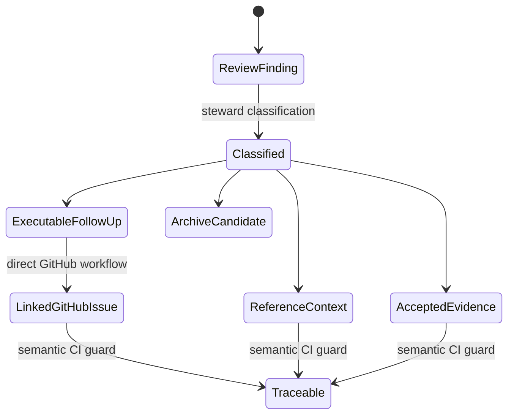
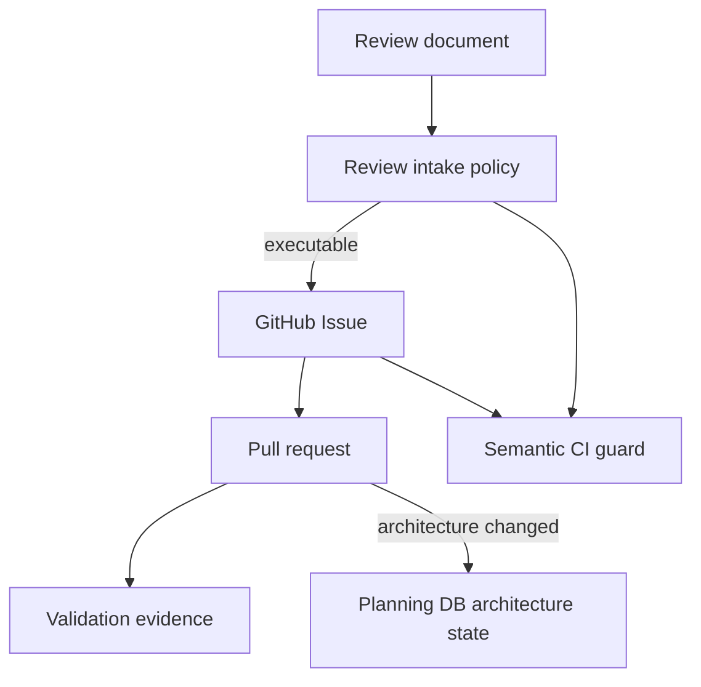
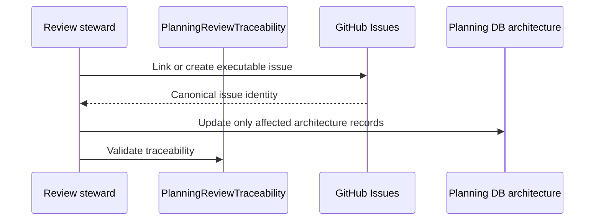

# Planning Review Canon Component

> Owned concern: validate that executable review findings link to the single
> GitHub Issues MVP backlog without owning task lifecycle.

## Public API

- `tools/ci/planning-review-canon.test.mjs` validates that executable review
  findings link to GitHub Issues and that local documents do not become a
  parallel task registry.

## Invariants

- Review documents are intake and rationale, not task lifecycle authority.
- GitHub Issues is the only MVP task and lifecycle authority.
- This component never creates, claims, updates, or closes task state.
- Planning DB is used only when a finding changes architecture components,
  capabilities, relationships, command/query rails, feature mechanization, or
  governance evidence.
- Review filenames follow `review-naming-policy.md`.

## Transitions

## Consumers

- Review stewards classify review rows and link executable findings to existing
  or newly created GitHub Issues.
- Product operators select the next MVP slice from GitHub.
- Reviewers use the semantic CI guard to detect local parallel backlogs.
- Architecture maintainers update Planning DB only for architecture or
  mechanization changes caused by the issue.

## Command And Query Boundary

No repository command/query rail is declared for this fitness check. It is a
repository policy assertion, not an application query or read model. Task
lifecycle is performed directly through the GitHub Issues product boundary.

## Semantic Fitness Function

`tools/ci/planning-review-canon.test.mjs` validates that review intake has a
component guide, user stories, governing workflow, and one implemented query.
It prevents a regression where review or sprint documents become an executable
backlog or direct agents to Planning DB task commands.

## Diagrams

## Related Docs

- [Planning Review Canon User Stories](planning-review-canon-component.md#section-planning-review-canon-user-stories)
- [GitHub MVP Issue Workflow](../../../planning/state/github-mvp-issue-workflow.md)
- [ADR-0061](../../../adr/ADR-0061-github-mvp-task-authority-and-planning-db-architecture-boundary.md)
- [Review Naming Policy](../../../planning/reviews/review-naming-policy.md)

## Planning Review Canon User Stories

### Story 1 - Review Steward Links Executable Work To GitHub

As a review steward, I want findings that require execution linked to GitHub
Issues so that task identity and lifecycle have one authority.

Acceptance:

- A finding with no execution need remains reference context.
- A finding with execution need links to an existing issue or creates one
  directly in GitHub.
- The review document records the issue link but does not own lifecycle state.

### Story 2 - Sprint Operator Avoids A Parallel Backlog

As a sprint operator, I want local planning documents to remain context rather
than a second backlog so that issue status cannot drift.

Acceptance:

- GitHub Issues is the canonical MVP execution queue.
- Local documents may describe rationale, architecture, and evidence.
- Assignment, status, blockers, dependencies, and closure remain GitHub-owned.

### Story 3 - Reviewer Checks Naming And Linkage Drift

As a reviewer, I want review filenames and executable findings checked against
canonical policy so that review material remains discoverable and actionable.

Acceptance:

- Review filenames follow `YYYYMMDD-<topic>-review.md`.
- Review rows distinguish reference material from executable follow-up.
- Executable follow-up names a GitHub Issue.

### Story 4 - Agent Selects The Next MVP Issue From GitHub

As an agent, I want continuation to inspect the active GitHub MVP epic and its
open issues so that the next task comes from current product state.

Acceptance:

- The GitHub MVP issue workflow is the governing task procedure.
- The component guide names only the implemented traceability query rail.
- The semantic test rejects database-owned delivery-task commands and local lane
  authority; GitHub issue commands remain the accepted task path.

> Acceptance scope status: Active. Owner: Product / Architecture / Docs.
