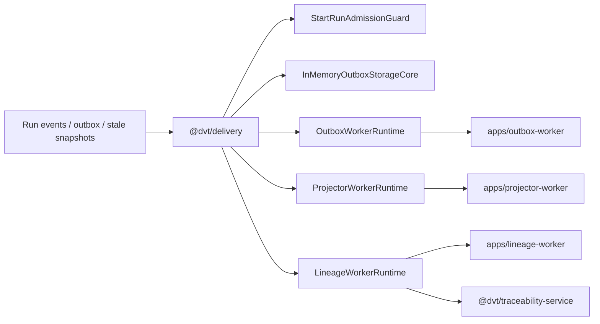

# @dvt/delivery

`@dvt/delivery` is the runtime library for downstream delivery concerns.

It provides the worker-facing primitives that drain outbox records, rebuild read
models, emit lineage, and support admission or retention helpers without moving
that behavior back into the engine or API layers.

## Current Responsibilities

- host the outbox worker runtime;
- own reusable in-memory outbox claim, retry, dead-letter, replay, shard, and
  tenant/run ordering semantics for local and test adapters;
- host projector and lineage runtimes;
- provide delivery-side helpers such as the admission guard and lineage
  observer;
- keep delivery behavior reusable across multiple worker composition roots.

## Interface Map

## Code Anchors

- [index.ts](../../../../packages/@dvt/delivery/src/index.ts)
- [OutboxWorkerRuntime.ts](../../../../packages/@dvt/delivery/src/application/OutboxWorkerRuntime.ts)
- [InMemoryOutboxStorageCore.ts](../../../../packages/@dvt/delivery/src/testing/InMemoryOutboxStorageCore.ts)
- [ProjectorWorkerRuntime.ts](../../../../packages/@dvt/delivery/src/application/ProjectorWorkerRuntime.ts)
- [LineageWorkerRuntime.ts](../../../../packages/@dvt/delivery/src/application/LineageWorkerRuntime.ts)
- [StartRunAdmissionGuard.ts](../../../../packages/@dvt/delivery/src/backpressure/StartRunAdmissionGuard.ts)

## Current Posture

This is a real library component with runtime authority over downstream event
handling. It is no longer just a placeholder around worker apps.

## Planned Delta

- keep `S05` closed as accepted envelope hardening and continue lineage seam
  work under `S07` and `S11`;
- keep retention and purge coordination explicit as delivery policy evolves.
- keep worker runtimes reusable without hiding operational ownership in the
  library surface.

## Component Guides

- [In-Memory Outbox Storage Component](./in-memory-outbox-storage-component.md)
- [In-Memory Outbox Storage User Stories](in-memory-outbox-storage-component.md#section-in-memory-outbox-storage-user-stories)
- [Projector Event-Driven Invalidation Component](./projector-event-driven-invalidation-component.md)
- [Projector Event-Driven Invalidation User Stories](projector-event-driven-invalidation-component.md#section-projector-event-driven-invalidation-user-stories)

## Historical Deep Dives

- [DDD Structure](../../domain-delivery.md#section-delivery-ddd)
- [Sequence diagram and flow](../../domain-delivery.md#section-delivery-sequence)
- [Constraints and invariants](../../domain-delivery.md#section-delivery-constraints)
- [Functionalities](../../domain-delivery.md#section-delivery-functional)
