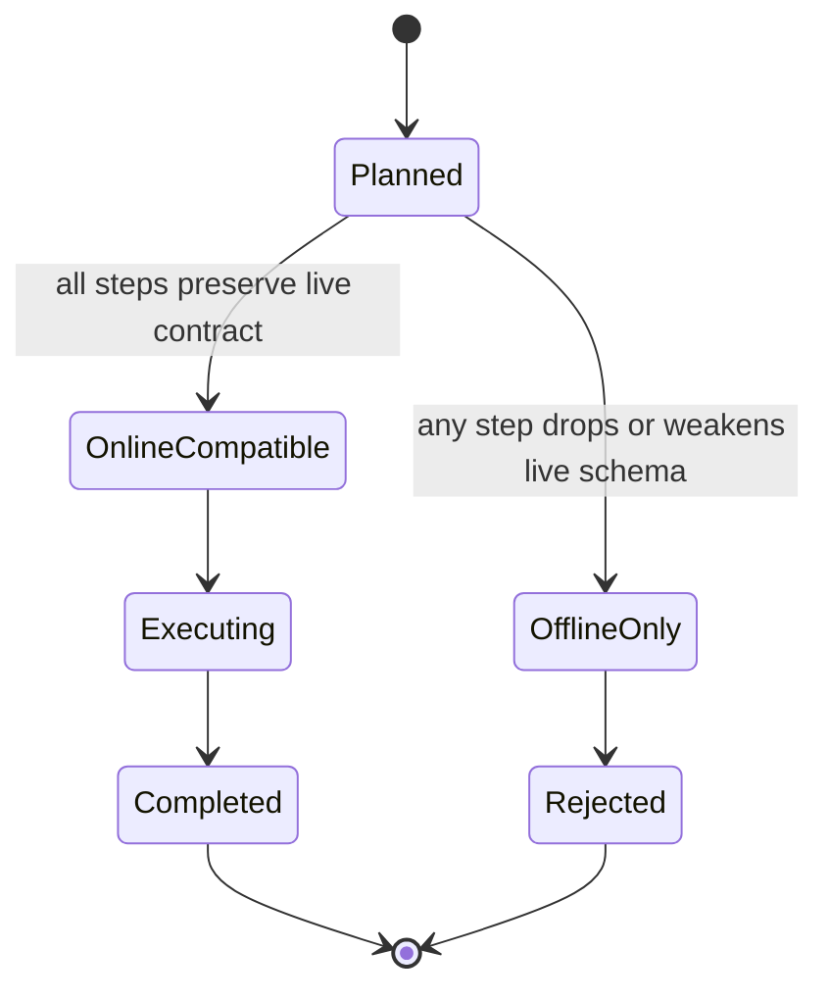
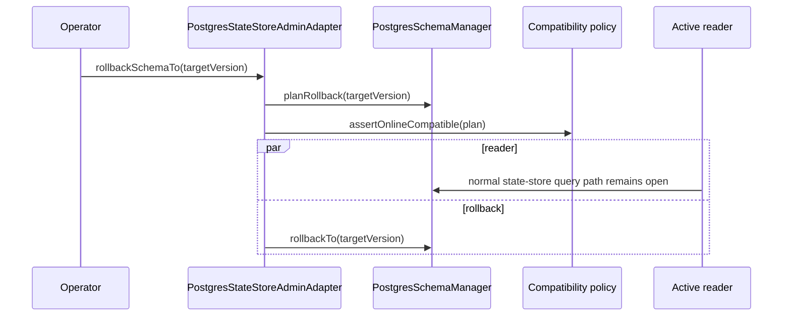
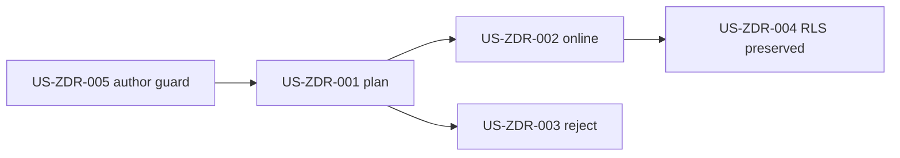

# Postgres schema rollback zero-downtime component

## Owned Concern

Owns PostgreSQL state-store schema rollback availability. A rollback may execute
without session maintenance mode, without setting `hasActiveClients=false`, only
when `PostgresSchemaRollbackCompatibilityPolicy` accepts every planned step.

## Public API

| API                                    | Kind    | Owner                            | Contract                                                   |
| -------------------------------------- | ------- | -------------------------------- | ---------------------------------------------------------- |
| `planSchemaRollback(targetVersion)`    | query   | `PostgresStateStoreAdminAdapter` | Returns target, current version, steps, and compatibility. |
| `rollbackSchemaTo(targetVersion)`      | command | `PostgresStateStoreAdminAdapter` | Executes only online-compatible rollback plans.            |
| `PostgresSchemaManager.planRollback()` | query   | `PostgresSchemaManager`          | Builds ordered rollback plan from applied migrations.      |
| `PostgresSchemaManager.rollbackTo()`   | command | `PostgresSchemaManager`          | Runs reverse steps under the schema advisory lock.         |

## Invariants

- Compatibility is derived from migration-step semantics, not active clients.
- Online-compatible rollback does not call `withMaintenanceMode()`.
- Offline-only rollback fails before DDL executes.
- Rollbacks that drop live columns, including retry-lineage metadata, are
  offline-only.
- Rollbacks that rebuild lineage outbox pending indexes with blocking DDL are
  offline-only.
- Rollback remains a concrete Postgres adapter admin command, not an engine port.
- RLS hardening rollback reapplies current policy and never downgrades isolation.

## Transitions



## Consumers

| Consumer                          | Relationship                                  |
| --------------------------------- | --------------------------------------------- |
| Operators / deployment automation | Calls planning and rollback commands.         |
| Runtime state-store clients       | Continue normal reads during compatible work. |
| `PostgresSchemaManager`           | Owns migration facts and DDL execution.       |

## Diagrams



## Architecture Guard

```text
pnpm --filter @dvt/adapter-postgres test -- test/PostgresSchemaRollbackZeroDowntime.architecture.test.ts
```

<a id="section-schema-rollback-zero-downtime-user-stories"></a>

## Postgres schema rollback zero-downtime user stories

### US-ZDR-001: Plan rollback compatibility

As an operator, I can inspect reverse steps and their online/offline class before
execution. Unknown or unapplied targets fail closed.

### US-ZDR-002: Online-compatible rollback with active reads

As an operator, compatible rollback proceeds while active readers keep acquiring
clients. The schema advisory lock still serializes schema lifecycle commands.

### US-ZDR-003: Destructive rollback rejection

As an operator, destructive plans are rejected before DDL with
`SCHEMA_ROLLBACK_REQUIRES_OFFLINE_COMPATIBILITY`, including the incompatible
migration version.

Acceptance examples:

- Rolling back `core_011_retry_lineage_columns` is rejected because it drops
  retry lineage columns from `run_metadata`.
- Rolling back `core_012_lineage_outbox_retry_schedule` or
  `core_013_lineage_outbox_claim_timeout` is rejected because the rollback
  rebuilds lineage outbox pending indexes with blocking DDL.

### US-ZDR-004: Tenant isolation hardening is not downgraded

As a platform owner, RLS hardening rollback reapplies current tenant policy and
does not disable row-level security for tenant-owned online state tables.

### US-ZDR-005: Future migration authors classify compatibility

As a maintainer, architecture and behavior tests fail when rollback
compatibility, docs, and implementation drift.



> Acceptance scope status: Accepted. Owner: State Store / Adapter Postgres.
