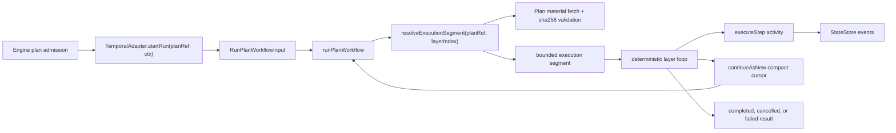
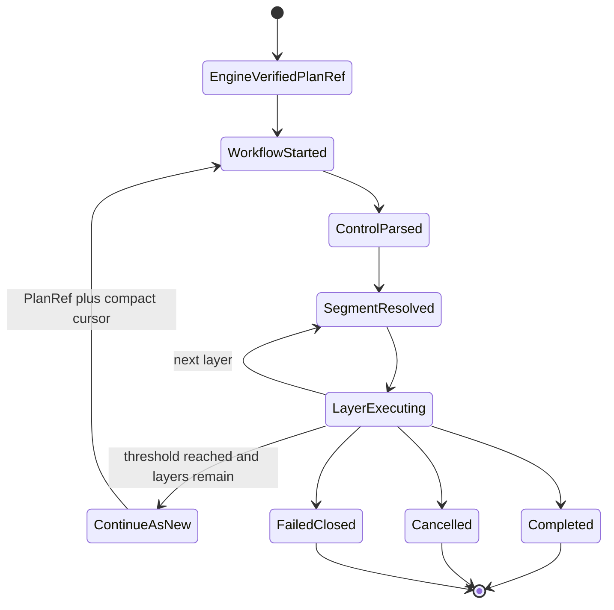
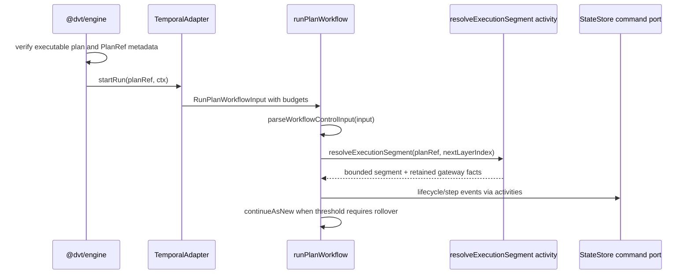
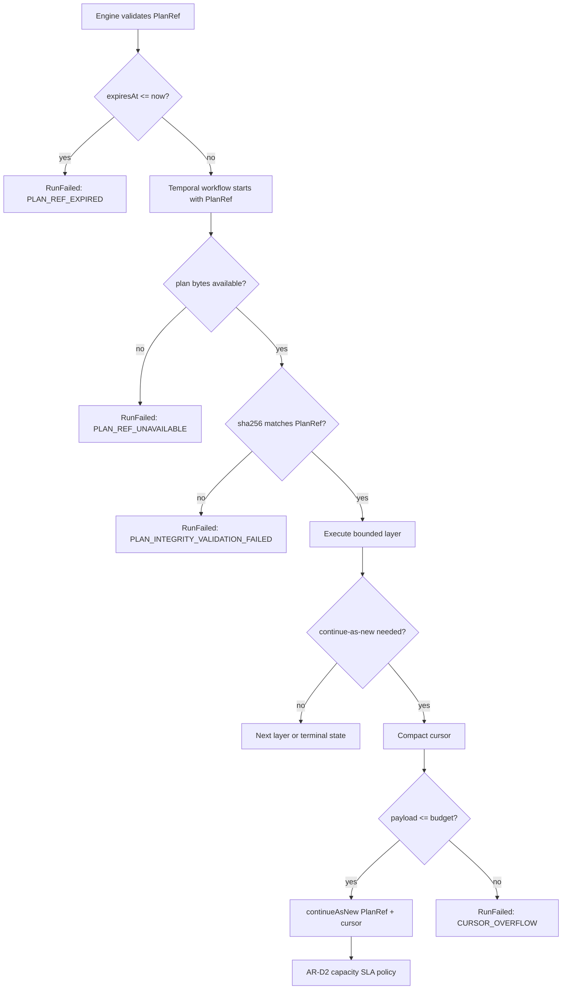

# Temporal PlanRef workflow boundary component

This local component guide documents the Temporal workflow boundary that
executes an engine-approved `PlanRef` without moving the full execution plan
through Temporal durable input.

Use this guide with:

- [Temporal adapter spec](./temporal-adapter-spec.md)
- [Temporal DBT worker plugin profile](./temporal-dbt-worker-plugin-profile.md)
- [Temporal PlanRef capacity SLA](./temporal-planref-capacity-sla.md)
- [Temporal PlanRef drained cutover runbook](../../../../../runbooks/temporal-planref-drained-cutover-20260427.md)
- [Temporal worker DBT plugin runtime runbook](../../../../../runbooks/temporal-worker-dbt-plugin-runtime-20260414.md)
- [Temporal PlanRef workflow boundary user stories](temporal-planref-workflow-boundary.md#section-temporal-planref-workflow-boundary-user-stories)
- [ADR-0001 Temporal integration test policy](../../../../../adr/adr-0001-temporal-integration-test-policy.md)
- [ADR-0003 execution model](../../../../../adr/adr-0003-execution-model.md)
- [ADR-0046 execution plan definition and run execution policy separation](../../../../../adr/adr-0046-execution-plan-definition-and-run-execution-policy-separation.md)
- [ADR-0047 runtime-owned realized lifecycle](../../../../../adr/adr-0047-runtime-owned-realized-lifecycle-for-signal-driven-transitions.md)
- [ADR-0052 PlanRef continuation safety](../../../../../adr/adr-0052-planref-continuation-safety.md)

## Owned concern

The component owns one concern:

- run the Temporal interpreter workflow from an immutable `PlanRef`, a resolved
  run context, explicit rollover budgets, and a compact cursor while preserving
  DVT lifecycle and execution semantics outside provider state

It does **not** own:

- engine start-run approval
- executable-plan authoring
- provider-independent lifecycle truth
- business retry or recovery workflows
- direct StateStore mutation outside activities
- executor-specific plugin installation or DBT runtime packaging

## Public API

- `TemporalAdapter.startRun(planRef, ctx)`
  Adapter entrypoint that receives the already-approved immutable pointer and
  resolved execution context from engine dispatch.
- `runPlanWorkflow(input: RunPlanWorkflowInput)`
  Temporal workflow entrypoint. It parses control input, resolves a bounded
  execution segment through activities, executes deterministic layer loops, and
  returns a canonical `RunPlanWorkflowResult`.
- `RunPlanWorkflowInput`
  Durable workflow input. The public input is `PlanRef plus compact cursor`:
  `planRef: WorkflowPlanRef`, `ctx: WorkflowCtx`,
  `maxContinueAsNewPayloadBytes: number`,
  `continueAsNewAfterLayerCount: number`, and optional
  `cursor?: WorkflowExecutionCursor`.
- `resolveExecutionSegment({ planRef, layerIndex })`
  Activity port that fetches and verifies plan material before projecting one
  bounded execution layer plus compact gateway retention metadata.
- `executeStep(...)`
  Activity port that performs provider side effects for one step and returns
  canonical step outcome/evidence.
- `emitEvent(...)`
  Activity port that emits DVT lifecycle and step events through the StateStore
  command boundary.
- `TEMPORAL_MAX_START_PAYLOAD_BYTES`
  Start payload admission guard configured before workflow start.
- `TEMPORAL_MAX_CONTINUE_AS_NEW_PAYLOAD_BYTES`
  Continue-as-new payload guard evaluated before rollover.
- `TEMPORAL_CONTINUE_AS_NEW_AFTER_LAYERS`
  Layer threshold injected into workflow input. `0` is allowed only as an
  explicit local diagnostic or incident rollback value.
- `evaluateTemporalPlanRefCapacitySla(input)`
  Pure AR-D2 policy that classifies configured rollover, payload, and PlanRef
  retention budgets against the production capacity profile.

## Invariants

- The full `ExecutionPlan` MUST NOT cross the workflow-start or
  continue-as-new durable input boundary.
- `RunPlanWorkflowInput.continueAsNewAfterLayerCount` is required; missing
  rollover budget input fails before execution.
- Continue-as-new state contains `PlanRef plus compact cursor` only: next layer,
  gateway decisions, compact dependency facts, skipped step ids, processed
  control-signal ids, and latest result evidence.
- Runtime segment resolution re-fetches plan material by `PlanRef` and verifies
  bytes against `PlanRef.sha256` before any step execution.
- A `PlanRef` whose `expiresAt` is at or before the integrity-validator clock
  fails closed as `PLAN_REF_EXPIRED` before plan bytes are fetched or a
  provider segment is resolved.
- Plan artifact absence during segment resolution is reported as
  `PLAN_REF_UNAVAILABLE`; continuation failures caused by cursor payload budget
  overflow are reported as `CURSOR_OVERFLOW`.
- Workflow code remains deterministic; all provider side effects and StateStore
  writes go through activities.
- A resolved layer records every confirmed step outcome in plan order before
  settling a run-level failure. A failed sibling must not hide later completed
  or failed siblings. The first failure in plan order supplies the existing
  run-failure diagnostic; only one `RunFailed` is emitted and no later layer
  executes.
- Step evidence remains on `StepCompleted` events. `latestResultEvidence` is a
  compact success summary, not a collection of publications, and failed runs
  do not gain success-only global materialization evidence.
- Changing layer event order requires the existing drained-cutover procedure.
  Replay of new histories does not prove old and new worker lines can consume
  the same active histories. Integration does not authorize a service restart,
  data reset, or an undrained deployment.
- Gateway dependency facts must be present when future gateway decisions depend
  on them; missing facts fail closed instead of inventing provider state.
- `continueAsNewAfterLayerCount > 0` with pending layers triggers rollover
  before Temporal history becomes the hidden storage layer.
- `continueAsNewAfterLayerCount = 0` disables rollover only when an operator has
  made that risk explicit outside large-DAG readiness.
- Production readiness for rollover, maximum workflow history size, maximum
  segment count, payload budget, and `PlanRef retention` is governed by
  [Temporal PlanRef capacity SLA](./temporal-planref-capacity-sla.md).
- The DBT plugin runtime remains outside this component. Its step-kind registry
  is composed by the Temporal worker DBT profile, not by the PlanRef workflow or
  the core activity registry.

## Transitions

1. Engine validates executable plan bytes, metadata, and canonical `planId`.
2. Engine dispatches `TemporalAdapter.startRun(planRef, ctx)`.
3. Adapter starts `runPlanWorkflow` with explicit payload and rollover budgets.
4. Workflow parses control input before resolving the first segment.
5. Activity resolves the bounded segment for `ctrl.nextLayerIndex`.
6. Workflow executes deterministic layer orchestration.
7. Activities emit lifecycle and step events through DVT StateStore ports.
8. Workflow either resolves the next segment, continues as new with compact
   cursor state, completes, cancels, or fails closed.

## Consumers

- `@dvt/engine` dispatches provider runs after engine-owned plan verification.
- `TemporalAdapter.startRun` converts the provider adapter call into a Temporal
  workflow start.
- `apps/api provider-adapter factory` composes the protected API runtime with
  the Temporal provider adapter.
- `apps/temporal-worker runtime host` registers workflow and activity
  implementations for execution.
- StateStore command ports consume emitted lifecycle and step events.
- Operational runbooks consume the same invariants for drained cutover,
  threshold rollback, and payload-size incident handling.
- Adapter tests and architecture tests consume this guide as a semantic fitness
  function.

## Component map

| Module                                    | Owned concern                                                                        |
| ----------------------------------------- | ------------------------------------------------------------------------------------ |
| `RunPlanWorkflow.ts`                      | Temporal PlanRef workflow orchestration entrypoint                                   |
| `runPlanWorkflow.types.ts`                | Workflow public API contracts and runtime state model                                |
| `runPlanWorkflow.state.ts`                | Workflow control input parsing and cursor hydration                                  |
| `workflowCursorHelpers.ts`                | Compact continue-as-new cursor construction and payload guard                        |
| `executionSegmentResolver.ts`             | PlanRef execution-segment projection from canonical plans                            |
| `runPlanWorkflow.layers.ts`               | Deterministic workflow layer-loop orchestration                                      |
| `runPlanWorkflow.layerHelpers.ts`         | Layer selection and continue-as-new decision helpers                                 |
| `runPlanWorkflow.layerResults.ts`         | Layer result application and gateway fact retention                                  |
| `runPlanWorkflow.stepExecution.ts`        | Per-layer step activity execution orchestration                                      |
| `runPlanWorkflow.activities.ts`           | Temporal activity proxy binding for workflow ports                                   |
| `runPlanWorkflow.lifecycle.ts`            | Workflow bootstrap, terminal, failure, and rollover outcomes                         |
| `runPlanWorkflow.cancellation.ts`         | Runtime-owned cancellation lifecycle settlement                                      |
| `runPlanWorkflow.signals.ts`              | Runtime control-signal registration and dedupe state                                 |
| `workflowGatewayHelpers.ts`               | Gateway dependency validation and fact lookup                                        |
| `workflowArtifactHelpers.ts`              | Execution artifact payload interpretation                                            |
| `workflowControlSignalRetentionPolicy.ts` | Bounded retention policy for control-signal dedupe ids across workflow continuation  |
| `workflowFailureReasonPolicy.ts`          | Governed workflow failure reason classification from runtime error evidence          |
| `workflowRuntimePayloadHelpers.ts`        | Runtime event payload shaping                                                        |
| `temporalPlanRefCapacitySlaPolicy.ts`     | Evaluate Temporal PlanRef workflow budgets against governed production capacity SLAs |
| `workflowErrorHelpers.ts`                 | Workflow-safe error-message normalization                                            |
| `workflowInputParsingHelpers.ts`          | Deterministic workflow input primitive parsing                                       |

## Diagrams

## Drift guards

- `packages/@dvt/adapter-temporal/test/workflow-component-semantics.architecture.test.ts`
  asserts each workflow module declares an exact `@ownedConcern`.
- The same test asserts this guide contains the public API, invariants,
  transitions, consumers, component map, and diagrams.
- Adapter behavioral tests still prove negative runtime behavior:
  missing rollover input fails, payload budgets are enforced, gateway facts fail
  closed, hash drift rejects execution, and continue-as-new advances layer
  progress without carrying the full plan.
- `workflowControlSignalRetentionPolicy.ts` keeps only the recent bounded
  control-signal id window in cursor state so adversarial or long-lived
  pause/resume/cancel traffic cannot make continue-as-new payloads grow without
  limit.

## Temporal PlanRef workflow boundary user stories

These stories cover the AR-D PlanRef workflow boundary from engine dispatch
through Temporal continuation and failure settlement.

### Actors

- Runtime operator: needs distinct terminal reasons for incidents.
- Engine caller: expects plan admission to reject expired pointers before
  provider dispatch.
- Temporal worker: executes bounded segments without durable full-plan input.
- StateStore consumer: reads DVT lifecycle events as the source of truth.

### Story coverage matrix

- `US-TPW-001`: expired PlanRef at validation boundary. Outcome:
  `PLAN_REF_EXPIRED`. Primary test:
  `packages/@dvt/engine/test/contracts/engine.test.ts`.
- `US-TPW-002`: plan bytes unavailable during segment resolution. Outcome:
  `PLAN_REF_UNAVAILABLE`. Primary test:
  `workflowRuntimePayloadHelpers.test.ts`.
- `US-TPW-003`: continue-as-new cursor exceeds payload budget. Outcome:
  `CURSOR_OVERFLOW`. Primary test: `workflow-continue-as-new.test.ts`.
- `US-TPW-004`: control signals exceed retention window. Outcome: retain only
  bounded recent ids. Primary test: `workflow-continue-as-new.test.ts`.
- `US-TPW-005`: component docs drift from executable semantics. Outcome:
  architecture fitness test goes red. Primary test:
  `workflow-component-semantics.architecture.test.ts`.
- `US-TPW-006`: production capacity profile is violated. Outcome:
  explicit SLA violation codes. Primary test:
  `temporalPlanRefCapacitySlaPolicy.test.ts`.
- `US-TPW-007`: resolved plan bytes do not match `PlanRef.sha256`. Outcome:
  fail closed before step execution. Primary tests: `activities.test.ts` and
  `runPlanWorkflow.layers.order.test.ts`.

### User stories

#### US-TPW-001 - Expired PlanRef is rejected before dispatch

As an engine caller, I want an expired `PlanRef` to fail before fetching plan
bytes or dispatching to a provider, so that DVT never executes a stale
execution pointer.

Acceptance:

- `PlanRef.expiresAt <= clock.nowIsoUtc()` fails as `PLAN_REF_EXPIRED`.
- The fetcher is not called for expired pointers.
- The error remains visible to lifecycle failure mapping.

#### US-TPW-002 - Missing plan bytes are visible as pointer unavailability

As a runtime operator, I want missing plan material to surface as
`PLAN_REF_UNAVAILABLE`, so that artifact-retention incidents are not hidden as
generic workflow failures.

Acceptance:

- Missing plan bytes map to `PLAN_REF_UNAVAILABLE`.
- Known fetcher evidence such as `PLAN_BYTES_NOT_REGISTERED` and
  `PLAN_FETCH_UNAVAILABLE` maps to the same governed reason.
- The workflow failure payload can still include the original message for
  operations evidence.

#### US-TPW-003 - Cursor overflow is not reported as generic workflow failure

As a runtime operator, I want continue-as-new payload overflow to surface as
`CURSOR_OVERFLOW`, so that rollover capacity incidents can be routed to AR-D2
threshold work instead of plan-artifact or step-runtime triage.

Acceptance:

- The cursor is compacted before payload-size validation.
- A payload that still exceeds the budget fails closed.
- The failure reason is `CURSOR_OVERFLOW`.

#### US-TPW-004 - Control-signal dedupe history remains bounded

As the Temporal workflow runtime, I want only a recent bounded control-signal id
window in cursor state, so that long-lived pause/resume/cancel traffic does not
turn Temporal input into an append-only store.

Acceptance:

- The recent retention window is deterministic.
- Retention keeps insertion order for the retained ids.
- The maximum retained id count is governed by the workflow retention policy.

#### US-TPW-005 - Architecture documentation remains executable

As a maintainer, I want the component guide, mailbox analysis, user stories, and
owned-concern module headers to be checked by tests, so that future changes do
not silently drift from the PlanRef boundary design.

Acceptance:

- The component guide publishes public API, invariants, transitions, consumers,
  component map, and diagrams.
- The mailbox review records Fowler analysis, antipatterns, remediation, and
  teachings.
- The architecture test fails if the docs or semantic module ownership are
  removed.

#### US-TPW-006 - Production capacity is evaluated before large-DAG readiness

As a runtime operator, I want the Temporal PlanRef workflow budget to be checked
against the governed [capacity SLA](temporal-planref-capacity-sla.md), so that
diagnostic overrides are not mistaken for a production-ready scale posture.

Acceptance:

- Non-zero `continueAsNewAfterLayerCount`, bounded continue-as-new payload, and
  sufficient `PlanRef retention` evaluate as `production_ready`.
- `continueAsNewAfterLayerCount = 0` evaluates as
  `CONTINUE_AS_NEW_DISABLED` for production profiles.
- A rollover payload budget greater than the start payload budget evaluates as
  `CONTINUE_AS_NEW_PAYLOAD_EXCEEDS_START_BUDGET`.
- `PlanRef retention` shorter than expected workflow duration plus profile
  safety margin evaluates as `PLAN_REF_RETENTION_TOO_SHORT`.
- Segment count, layer count, workflow-history event count, and
  workflow-history byte estimates above the profile evaluate as explicit
  profile maximum violations.

#### US-TPW-007 - PlanRef hash drift fails closed before side effects

As a runtime operator, I want hash mismatches between resolved plan bytes and
`PlanRef.sha256` to fail before any step activity executes, so integrity drift
cannot produce provider side effects.

Acceptance:

- Resolved bytes that do not match `PlanRef.sha256` fail as
  `PLAN_INTEGRITY_VALIDATION_FAILED`.
- Segment resolution does not return executable steps after hash mismatch.
- No step execution activity is called after integrity failure.

### Scenario diagram

### Traceability

- ADR: `docs/adr/adr-0052-planref-continuation-safety.md`
- Component guide:
  `docs/architecture/components/engine/adapters/temporal/temporal-planref-workflow-boundary.md`
- Capacity SLA:
  `docs/architecture/components/engine/adapters/temporal/temporal-planref-capacity-sla.md`

> Acceptance scope status: Active. Owner: Runtime / Temporal / Architecture.
