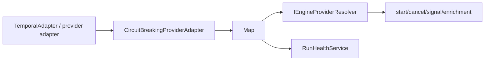
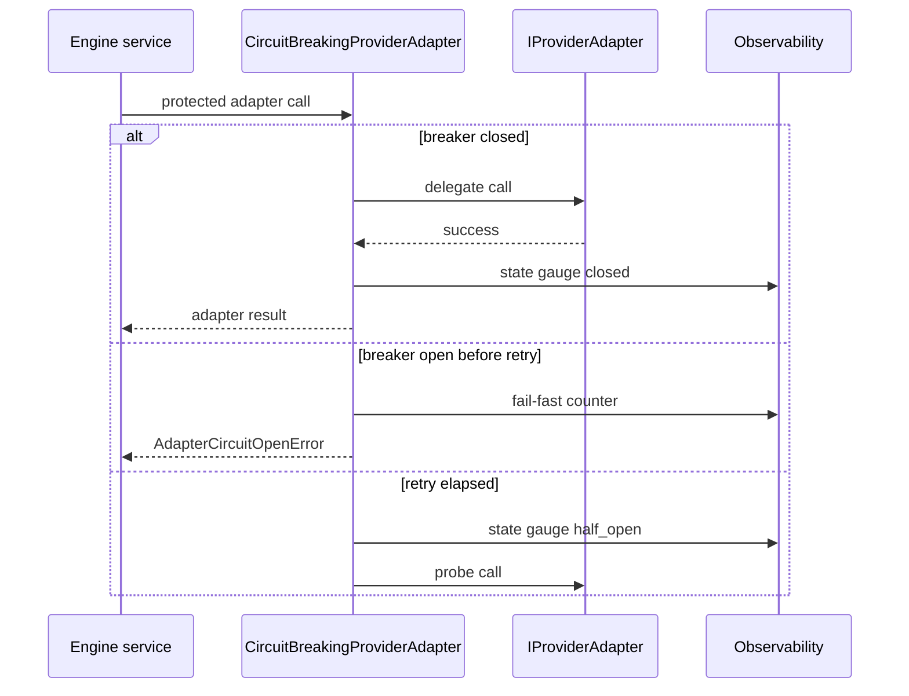
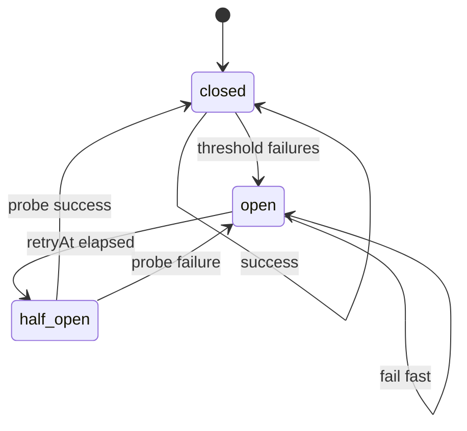

# Engine Adapter Circuit Breaker Component

## Purpose

This component owns engine-side fail-fast protection for provider adapter calls.
It closes `AR-C5` by adding a circuit breaker at the `IProviderAdapter`
boundary rather than scattering outage logic across start, cancel, signal, and
enrichment services.

## Public API

The API is local to `@dvt/engine` and production composition.

| Surface                               | Owner         | Role                                                               |
| ------------------------------------- | ------------- | ------------------------------------------------------------------ |
| `CircuitBreakingProviderAdapter`      | `@dvt/engine` | Decorates one `IProviderAdapter` with closed/open/half-open state. |
| `buildCircuitBreakingAdapterRegistry` | `@dvt/engine` | Wraps a provider registry once for composition roots.              |
| `getAdapterCircuitBreakerSnapshot`    | `@dvt/engine` | Reads breaker posture without widening `IProviderAdapter`.         |
| `AdapterCircuitOpenError`             | `@dvt/engine` | Fail-fast error raised when calls are rejected while open.         |
| `HealthStatus.components[].breaker`   | `@dvt/engine` | Health read model carrying provider breaker posture.               |

## Invariants

- The breaker decorates provider calls; it MUST NOT synthesize canonical run
  lifecycle events or statuses.
- `startRun`, `cancelRun`, `signal`, and `getProviderStatusView` are breaker
  protected.
- `signalSemanticsVersions`, `capabilities`, and `estimateRunRef` remain local
  metadata reads and do not transition breaker state.
- Open state fails fast without invoking the delegate adapter.
- Half-open state permits a probe; success closes the breaker and failure opens
  it again.
- Half-open probe execution is single-flight; concurrent protected calls fail
  fast until the probe resolves.
- Production composition injects the engine clock. Standalone construction uses
  a live process clock so an opened breaker can still reach the retry window.
- Metrics are best-effort and never mask adapter or breaker errors.
- Health exposes breaker posture as operational state, not lifecycle truth.

## Transitions

| Transition                | From        | To          | Rule                                                               |
| ------------------------- | ----------- | ----------- | ------------------------------------------------------------------ |
| failure threshold reached | `closed`    | `open`      | Consecutive protected call failures meet the configured threshold. |
| retry window elapsed      | `open`      | `half_open` | The next protected call is allowed as a probe.                     |
| probe succeeds            | `half_open` | `closed`    | Consecutive failures reset to zero.                                |
| probe fails               | `half_open` | `open`      | Retry window is renewed.                                           |
| fail fast                 | `open`      | `open`      | Delegate is not invoked before `retryAtEpochMs`.                   |

## Consumers

- `apps/api/src/application/services/WorkflowEngineFactory.ts`
- `packages/@dvt/engine/src/services/RunHealthService.ts`
- `packages/@dvt/engine/test/adapters/CircuitBreakingProviderAdapter.test.ts`
- `packages/@dvt/engine/test/architecture/adapterCircuitBreaker.architecture.test.ts`

## Diagrams

## Drift Guards

- `adapterCircuitBreaker.architecture.test.ts` imports the breaker API and
  validates fail-fast semantics, protected registry composition, and health
  posture behavior.
- `WorkflowEngineFactory.test.ts` prevents production composition from exposing
  raw runtime adapters without breaker posture.
- Unit tests prove open-state fail-fast behavior and half-open transitions.
- Feature mechanization and docs sync validate the plan, component guide, user
  stories, mailbox analysis, evidence, and risk surfaces.

## Related Records

- [AR-C5 plan](../../../../planning/proposals/mandatory/runtime-and-contracts/ar-c5-adapter-circuit-breaker-plan-20260512.md)
- [AR-C5 user stories](adapter-circuit-breaker-component.md#section-adapter-circuit-breaker-user-stories)
- [Fowler mailbox analysis](https://github.com/dunay2/dvt/blob/2df68680de46b9104282a58fd203a7eef551ca38/buzon/20260512-codex-fowler-ar-c5-adapter-circuit-breaker-analysis-and-remediation.md)

## Engine Adapter Circuit Breaker User Stories

### Stories

| ID             | Persona                | Goal                                                  | Acceptance                                                                                                                 |
| -------------- | ---------------------- | ----------------------------------------------------- | -------------------------------------------------------------------------------------------------------------------------- |
| `US-AR-C5-001` | Runtime operator       | Avoid timeout pileups during adapter outages          | After repeated protected adapter failures, the breaker opens and later calls fail fast without invoking the adapter.       |
| `US-AR-C5-002` | Engine maintainer      | Keep provider outage policy in one semantic component | Start, cancel, signal, and enrichment calls go through `CircuitBreakingProviderAdapter`, not per-service breaker branches. |
| `US-AR-C5-003` | Runtime operator       | See breaker posture in health output                  | `IRunHealthService.healthCheck()` reports `closed`, `open`, or `half_open` posture for adapter components.                 |
| `US-AR-C5-004` | Observability consumer | Track breaker transitions                             | The breaker emits state gauges and fail-fast counters with provider and operation labels.                                  |
| `US-AR-C5-005` | Engine maintainer      | Recover without restart after a transient outage      | After the retry window elapses, a half-open successful probe closes the breaker.                                           |
| `US-AR-C5-006` | Architecture reviewer  | Prevent timeout-only regression                       | A semantic guard imports the breaker API and validates fail-fast, protected composition, and health posture behavior.      |

### Negative Scenarios

| Scenario                         | Expected result                                                                             | Test                                     |
| -------------------------------- | ------------------------------------------------------------------------------------------- | ---------------------------------------- |
| Open breaker receives `startRun` | Throws `AdapterCircuitOpenError` and does not call delegate `startRun`.                     | `CircuitBreakingProviderAdapter.test.ts` |
| Half-open probe fails            | Breaker returns to open and renews retry timing.                                            | `CircuitBreakingProviderAdapter.test.ts` |
| Adapter metadata is read         | `capabilities`, `estimateRunRef`, and `signalSemanticsVersions` do not alter breaker state. | `CircuitBreakingProviderAdapter.test.ts` |
| Health reads an open breaker     | Component status includes breaker posture and remains explicit about adapter liveness.      | `CircuitBreakingProviderAdapter.test.ts` |

### Scenario Coverage Matrix

| Story          | Unit test | Architecture guard | Documentation   |
| -------------- | --------- | ------------------ | --------------- |
| `US-AR-C5-001` | yes       | yes                | component guide |
| `US-AR-C5-002` | yes       | yes                | component guide |
| `US-AR-C5-003` | yes       | yes                | component guide |
| `US-AR-C5-004` | yes       | yes                | component guide |
| `US-AR-C5-005` | yes       | yes                | component guide |
| `US-AR-C5-006` | N/A       | yes                | plan and guide  |

> Acceptance scope status: Active. Owner: Architecture / Engine / Runtime Safety.
