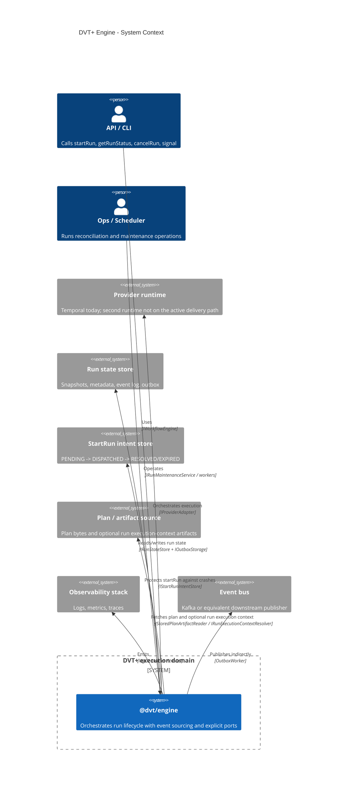
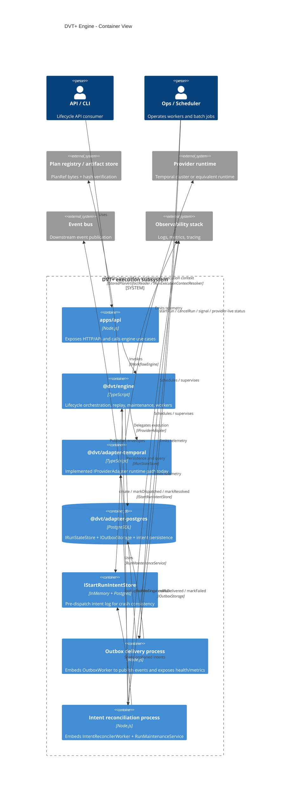
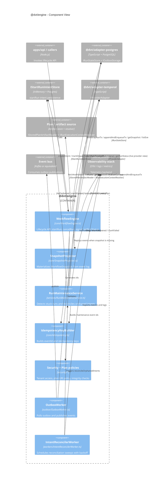
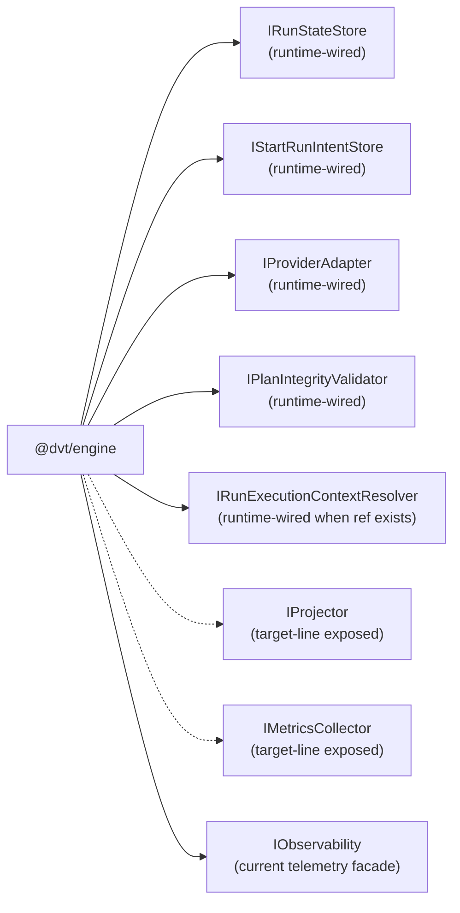
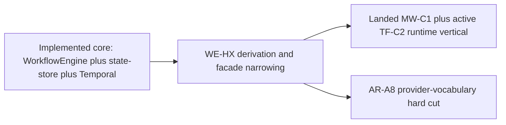
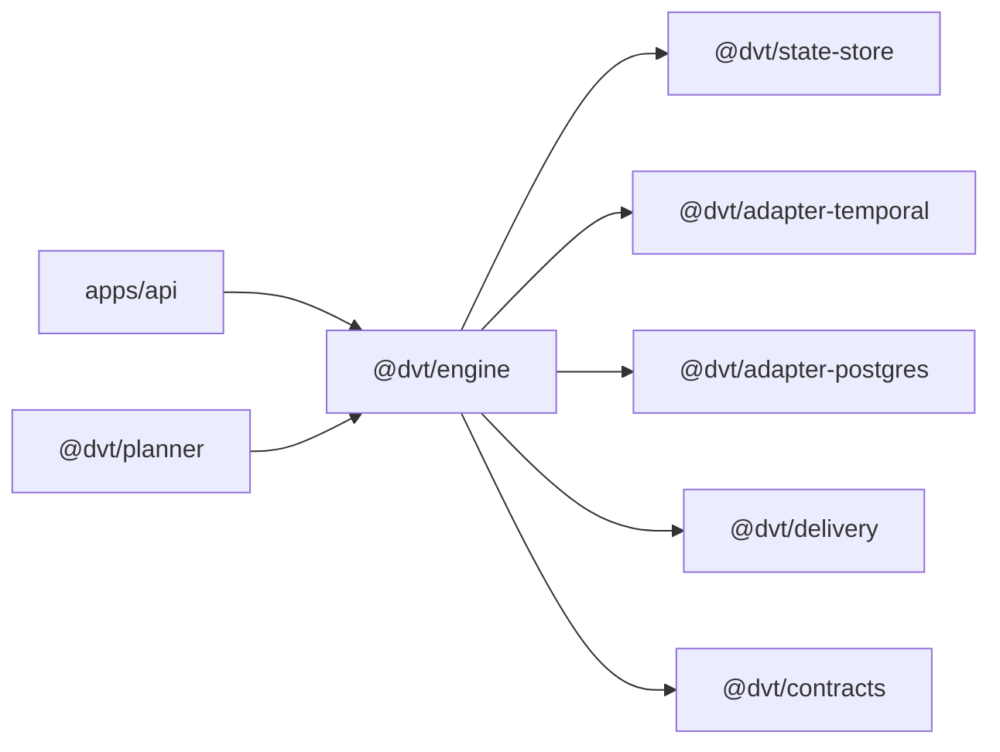

# Engine C4 Architecture

**Last reviewed**: 2026-04-10  
**Scope**: Logical architecture of `@dvt/engine` and direct collaborators.  
**Note**: C4 containers are logical/runtime boundaries. `@dvt/engine` is a TypeScript library embedded by processes such as `apps/api`, reconciler workers, and outbox workers.

**Primary sources**:

- [WorkflowEngine.ts](../../../../packages/@dvt/engine/src/core/WorkflowEngine.ts)
- [SnapshotProjector.ts](../../../../packages/@dvt/engine/src/core/SnapshotProjector.ts)
- [StartRunApplicationService.ts](../../../../packages/@dvt/engine/src/application/StartRunApplicationService.ts)
- [RunMaintenanceService.ts](../../../../packages/@dvt/engine/src/services/RunMaintenanceService.ts)
- [IntentReconcilerWorker.ts](../../../../packages/@dvt/engine/src/workers/IntentReconcilerWorker.ts)
- [IRunStateStore.ts](../../../../packages/@dvt/engine/src/ports/IRunStateStore.ts)
- [IStartRunIntentStore.ts](../../../../packages/@dvt/engine/src/ports/IStartRunIntentStore.ts)
- [IProviderAdapter.ts](../../../../packages/@dvt/engine/src/adapters/IProviderAdapter.ts)
- [IPlanIntegrityValidator.ts](../../../../packages/@dvt/engine/src/ports/IPlanIntegrityValidator.ts)
- [IRunExecutionContextResolver.ts](../../../../packages/@dvt/engine/src/ports/IRunExecutionContextResolver.ts)
- [IProjector.ts](../../../../packages/@dvt/engine/src/ports/IProjector.ts)
- [IMetricsCollector.ts](../../../../packages/@dvt/engine/src/metrics/IMetricsCollector.ts)
- [ADR-0029](../../../adr/ADR-0029-run-maintenance-service.md)
- [ADR-0030](../../../adr/ADR-0030-pre-dispatch-intent-log.md)

## 1. Context View



## 2. Container View



## 3. Component View



## 4. Declared Port Surface

The C4 runtime views above emphasize deployed interactions. The table and
diagram below capture the broader declared southbound surface: seven exposed
ports, of which five are runtime-wired in the current delivery path and two
remain intentionally exposed as target-line seams even though they do not yet
map to a dedicated deployed runtime boundary.



| Port                           | Current posture       | Notes                                                           |
| ------------------------------ | --------------------- | --------------------------------------------------------------- |
| `IRunStateStore`               | `runtime-wired`       | Canonical persistence/query seam                                |
| `IStartRunIntentStore`         | `runtime-wired`       | Crash-consistency seam                                          |
| `IProviderAdapter`             | `runtime-wired`       | Provider runtime seam                                           |
| `IPlanIntegrityValidator`      | `runtime-wired`       | Plan integrity gate using the artifacts-owned reader            |
| `IRunExecutionContextResolver` | `runtime-wired`       | Conditional start-run seam                                      |
| `IProjector`                   | `target-line exposed` | Declared seam; mainline still uses `SnapshotProjector` directly |
| `IMetricsCollector`            | `target-line exposed` | Declared seam; mainline still injects `IObservability`          |

`IObservability` is the current telemetry facade in the shipped runtime. It is
shown for runtime truthfulness, but it is not part of the seven-port inventory.

## 5. Reading Notes

- `WorkflowEngine` is the lifecycle boundary and should not own plan bytes or runtime internals.
- `SnapshotProjector` is still in-process; no standalone projector service yet.
- `RunMaintenanceService` centralizes maintenance behavior from ADR-0029 and ADR-0030.
- `@dvt/adapter-postgres` now covers state store, outbox, and persistent intent store (`PostgresStartRunIntentStore`).
- `OutboxWorker` and `IntentReconcilerWorker` are operational components that embed `@dvt/engine`.

## 6. Complementary Diagrams

For domain model, state machines, detailed sequences (signal, cancel,
reconciliation, outbox), and package dependency graphs see
[Implementation Architecture Diagrams](../../../diagrams/implementation-architecture-diagrams.md).

## 7. Current delivery posture

This C4 view is structural. For delivery sequencing, use
[Engine Roadmap](../roadmap/engine-phases.md) and the governing GitHub issues.



| Area                                        | Current posture                    | Code evidence                                                                                                   | Current projection                                                                                              |
| ------------------------------------------- | ---------------------------------- | --------------------------------------------------------------------------------------------------------------- | --------------------------------------------------------------------------------------------------------------- |
| Engine lifecycle core                       | Implemented                        | `WorkflowEngine`, `SnapshotProjector`, `RunMaintenanceService`, broad tests                                     | Keep hardening under `WE-HX`, not a new MVP phase                                                               |
| Postgres state, outbox, and read-model path | Implemented                        | `@dvt/adapter-postgres`, delivery runtime, projector/read-model ownership in current docs                       | Already absorbed into mainline; no longer a future engine roadmap claim                                         |
| Temporal runtime adapter                    | Implemented with ongoing hardening | `@dvt/adapter-temporal`, `RunPlanWorkflow`, `StepActivityDispatcher`, baseline and DBT integration coverage     | Continue hardening via `WE-HX` and `AR-C*`                                                                      |
| Compatibility facade and ownership seams    | In progress                        | `workflow-engine-subsystem-context.md`, `workflow-engine-target-architecture.v1.md`, `StartRunProtocol.v1.md`   | Close `WE-HX-0..3`, then `WE-HX-5..6`                                                                           |
| Provider-vocabulary truthfulness            | Closed under `AR-A8`               | Provider typing, fake stubs, capability matrices, and active docs now expose only implemented runtime providers | Require an ADR-backed contract line, real adapter package, and conformance suite before adding a second runtime |
| Object-file PostgreSQL loading vertical     | Implemented                        | Object-file Temporal plugin, `PostgresObjectFileLoadingCapability`, and service-backed CI proof                 | Keep the bounded loader separate from transformation compilation                                                |

## 8. Current sequencing

1. close the remaining `WE-HX` derivation waves so the engine boundary is
   truthful and easier to evolve;
2. keep the `AR-A8` provider-vocabulary hard cut enforced while future-provider
   work stays out of active runtime typing;
3. keep object-file PostgreSQL loading on its bounded plugin/capability path;
   transformation authoring proceeds through the Substrait semantic authority.

<a id="section-core"></a>

<a id="section-core--engine-core"></a>

## Engine Core

<a id="section-core--purpose"></a>

### Purpose

Summarizes the shipped `@dvt/engine` core surface inside the component map.
Normative architecture, contracts, and target decomposition live under this
component tree, while end-to-end lifecycle flow lives under
`docs/architecture/system/subsystems/`.

<a id="section-core--responsibilities"></a>

### Responsibilities

- workflow lifecycle orchestration
- command and signal semantics
- snapshot projection and read-model updates
- authorization and runtime policy enforcement through explicit seams
- coordination of provider-facing execution from engine-owned contracts

<a id="section-core--canonical-references"></a>

### Canonical references

- [Canonical engine index](../index.md)
- [WorkflowEngine subsystem context](workflow-engine-subsystem-context.md)
- [WorkflowEngine target architecture v1](workflow-engine-target-architecture.v1.md)
- [WorkflowEngine boundary ownership component](workflow-engine-boundary-ownership-component.md)
- [WorkflowEngine boundary ownership user stories](workflow-engine-boundary-ownership-component.md#section-workflow-engine-boundary-ownership-user-stories)
- [Canonical C4 architecture](c4-engine.md)
- [Distributed consistency model](../../../system/distributed-consistency-model.md)
- [Execution semantics](../contracts/engine/ExecutionSemantics.v1.md)
- [Workflow engine contract](../contracts/engine/IWorkflowEngine.v1.md)

<a id="section-core--current-code-anchors"></a>

### Current code anchors

- `packages/@dvt/engine/src/core/WorkflowEngine.ts`
- `packages/@dvt/engine/src/core/WorkflowEngineCoreService.ts`
- `packages/@dvt/engine/src/application/StartRunApplicationService.ts`
- `packages/@dvt/engine/src/ports/IPlanIntegrityValidator.ts`
- `packages/@dvt/engine/src/security/RunAccessPolicy.ts`

<a id="section-core--navigation"></a>

### Navigation

- [Engine component home](../index.md)
- [Adapters](../adapters/index.md)
- [Workflows](c4-engine.md#section-workflows)
- [Security](../security/index.md)
- [Operations](../ops/index.md)
- [Contracts](../contracts/index.md)
- [Capabilities](../contracts/capabilities/index.md)
- [Canonical C4 architecture](c4-engine.md)

<a id="section-workflows"></a>

<a id="section-workflows--engine-workflows"></a>

## Engine Workflows

<a id="section-workflows--purpose"></a>

### Purpose

Summarizes workflow-centric references for the engine component map.

<a id="section-workflows--canonical-workflow-references"></a>

### Canonical workflow references

- [WorkflowEngine subsystem context](workflow-engine-subsystem-context.md)
- [Run events contract](../contracts/engine/RunEvents.v1.md)
- [Signals and auth](../contracts/engine/SignalsAndAuth.v1.md)
- [Workflow engine interface](../contracts/engine/IWorkflowEngine.v1.md)
- [Execution semantics](../contracts/engine/ExecutionSemantics.v1.md)

<a id="section-workflows--current-code-anchors"></a>

### Current code anchors

- `packages/@dvt/engine/src/application/StartRunApplicationService.ts`
- `packages/@dvt/engine/src/core/WorkflowEngineCoreService.ts`
- `packages/@dvt/adapter-temporal/src/workflows/RunPlanWorkflow.ts`
- `packages/@dvt/adapter-temporal/src/activities/stepActivities.ts`

<a id="section-workflows--navigation"></a>

### Navigation

- [Engine component home](../index.md)
- [Core](c4-engine.md#section-core)
- [Adapters](../adapters/index.md)
- [Security](../security/index.md)
- [Operations](../ops/index.md)
- [Contracts](../contracts/index.md)
- [Capabilities](../contracts/capabilities/index.md)
- [Canonical C4 architecture](c4-engine.md)

<a id="section-domain-execution"></a>

```yaml
title: Execution Domain
status: Active
owner: Architecture / Docs
last_reviewed: 2026-05-14
```

<a id="section-domain-execution--execution-domain"></a>

## Execution Domain

This domain owns runtime lifecycle semantics once a run begins.

It covers engine behavior, start-run coordination, access policy, state-store
contracts, and provider or persistence adapters behind those contracts.

<a id="section-domain-execution--scope"></a>

### Scope

- `@dvt/engine`
- `@dvt/state-store`
- `@dvt/adapter-temporal`
- `@dvt/adapter-postgres`

<a id="section-domain-execution--current-interactions"></a>

### Current Interactions



<a id="section-domain-execution--current-responsibilities"></a>

### Current Responsibilities

- own lifecycle transitions, idempotency, and run-access policy;
- coordinate start-run and maintenance flows;
- apply runtime facts into snapshots and persistent state;
- translate DVT-owned semantics into Temporal and Postgres IO through adapters.

<a id="section-domain-execution--code-anchors"></a>

### Code Anchors

- [WorkflowEngine.ts](../../../../../packages/@dvt/engine/src/core/WorkflowEngine.ts)
- [WorkflowEngineCoreService.ts](../../../../../packages/@dvt/engine/src/core/WorkflowEngineCoreService.ts)
- [StartRunApplicationService.ts](../../../../../packages/@dvt/engine/src/application/StartRunApplicationService.ts)
- [PostgresStateStoreRuntime.ts](../../../../../packages/@dvt/adapter-postgres/src/PostgresStateStoreRuntime.ts)
- [TemporalAdapter.ts](../../../../../packages/@dvt/adapter-temporal/src/TemporalAdapter.ts)

<a id="section-domain-execution--current-posture"></a>

### Current Posture

The runtime exists and is actively used. The current work is execution
hardening, modularization, and ownership cleanup, not a greenfield execution
model rewrite. Start-run metadata now persists a single discriminated
`providerRef` identity and the shared trace-context seam lives under
`@dvt/engine/core/lifecycle`.

<a id="section-domain-execution--queued-delta"></a>

### Queued Delta

- `S02`: split state-store responsibilities more cleanly.
- `S03`: extract start-run coordination without moving runtime authority out of
  the engine.
- `TF-C2`: finish the remaining runtime-vertical acceptance on top of the
  landed executor payload and caller-visible runtime-evidence slices.
- `DHM`: continue DDD or hexagonal modularization without widening
  composition-root leakage.

<a id="section-domain-execution--domain-rules"></a>

### Domain Rules

- DVT owns lifecycle semantics; providers implement IO behind ports.
- State-store boundaries remain explicit even when Postgres currently satisfies
  several roles at once.
- Delivery may consume execution outputs, but it must not redefine execution
  state transitions.

<a id="section-domain-execution--related-pages"></a>

### Related Pages

- [Engine](../index.md)
- [DVT Component Map](../../../component-map.md)
- [System Delivery Status](../../../system-delivery-status.md)
- [Execution Runtime planning view](../../../../planning/domains/execution-runtime.md)
