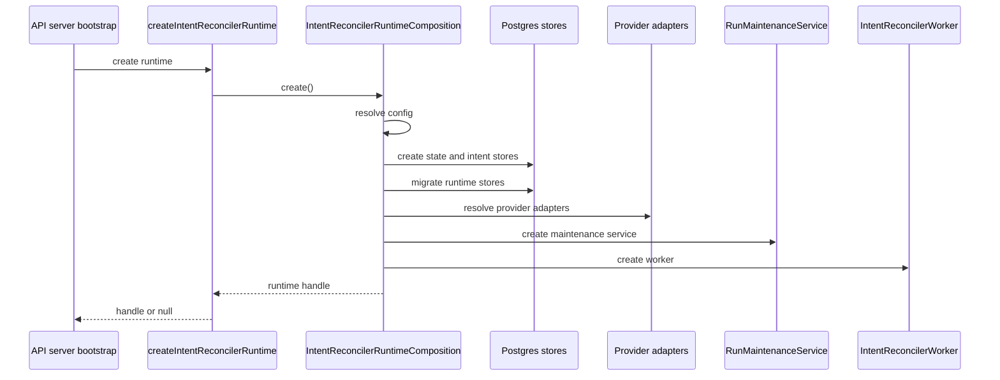
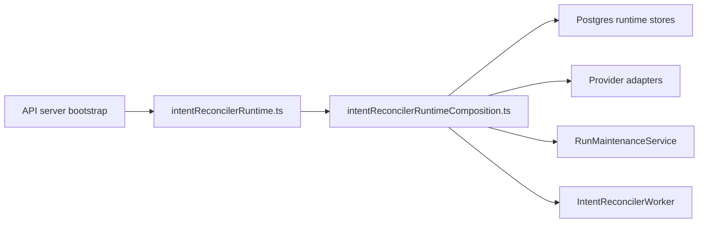

# Intent Reconciler Runtime Composition Component

## Owned Concern

The intent reconciler runtime composition component owns API-side assembly of
the background intent reconciliation runtime. It is a composition-root object,
not an engine domain service.

The component is intentionally split into two local modules:

- `intentReconcilerRuntime.ts` owns the public facade and exported handle types.
- `intentReconcilerRuntimeComposition.ts` owns concrete Postgres, provider,
  maintenance, worker, and handle assembly.

## Public API

`createIntentReconcilerRuntime(env, logger, observability, healthHooks)` remains
the caller-facing API. It delegates runtime assembly to
`IntentReconcilerRuntimeComposition` and returns an
`IntentReconcilerRuntimeHandle` or `null` when the runtime is disabled.

`createIntentReconcilerRuntimeComposition(env, logger, observability,
healthHooks)` is an internal factory used by the facade. Its returned object
exposes only `create()`.

## Invariants

- Config resolution happens before any store, adapter, maintenance, or worker
  is created.
- Store creation happens before runtime store migration.
- Adapter resolution happens after store role binding and before maintenance
  service creation.
- Maintenance service creation happens before worker creation.
- Runtime handle publication happens after worker creation.
- Concrete Postgres and provider adapter binding remains in `apps/api`.
- `@dvt/engine` receives ports and services; it does not read runtime env
  values for this assembly path.
- The public facade must not import adapter-postgres, engine runtime services,
  provider factories, state-store role binding, or database pool helpers.

## Command Rail

The internal command rail is `IntentReconcilerRuntimeComposition`. It performs a
startup side effect by creating runtime infrastructure and a background worker.
It does not expose a public HTTP command.

## Startup Sequence

## Module Boundary

## Consumers

- `apps/api/src/server.ts` starts and stops the returned handle.
- `apps/api/src/runtime/reconcilerRuntimeLifecycle.ts` wraps runtime creation
  with health state transitions.
- Existing health routes observe the resulting reconciler health state; they do
  not own runtime assembly.
- `apps/api/src/runtime/intentReconcilerRuntimeComposition.ts` is the only local
  runtime module that owns concrete reconciler startup assembly.

## Negative Scenarios

- Disabled runtime returns `null` and logs the disabled state.
- Missing `DATABASE_URL` returns `null` and logs a warning.
- Unsupported provider names fail closed during config parsing.
- Empty resolved adapter maps throw `INTENT_RECONCILER_NO_PROVIDER_ADAPTERS`.
- A facade edit that reintroduces concrete startup assembly fails the
  architecture guard.

## Intent Reconciler Runtime Composition User Stories

### US-DHM-WS2-001: Preserve ordered runtime startup

As an operator, I need the intent reconciler runtime to start in a predictable
order so migrations, adapters, maintenance reconciliation, and worker startup do
not race each other.

Acceptance criteria:
config resolution precedes store creation, store migration precedes adapter
resolution, adapter resolution precedes maintenance service creation, and worker
creation precedes handle publication.

### US-DHM-WS2-002: Keep concrete bindings in the API composition root

As an engine maintainer, I need concrete Postgres and provider adapter
construction to stay in `apps/api` so `@dvt/engine` remains a port-driven
runtime package.

Acceptance criteria:
the runtime composition object binds Postgres stores and provider adapters;
engine services receive ports and do not read environment values for this path.

### US-DHM-WS2-003: Preserve fail-closed runtime behavior

As an operator, I need disabled, unavailable, or unsupported reconciler runtime
configuration to fail closed rather than publish a partially wired background
worker.

Acceptance criteria:
disabled runtime and missing database URL return `null`, unsupported provider
names throw, and an empty adapter map throws
`INTENT_RECONCILER_NO_PROVIDER_ADAPTERS`.

### US-DHM-WS2-004: Keep the public runtime facade thin

As an API maintainer, I need the exported runtime factory to remain a stable
facade so caller contracts are not coupled to concrete Postgres, provider,
maintenance, or worker assembly.

Acceptance criteria:
`intentReconcilerRuntime.ts` exports the runtime handle contract and delegates
to `intentReconcilerRuntimeComposition.ts`; the facade does not import
adapter-postgres, engine runtime services, database pool helpers, provider
factories, or state-store role binding.

### Negative Scenarios

- No background worker starts when the runtime is disabled.
- No runtime handle is published before adapters and maintenance service exist.
- No provider-specific runtime behavior is moved into `@dvt/engine`.
- No concrete startup assembly is reintroduced into the public facade.

### Scenario Coverage Matrix

| Story            | Implementation surface                                       | Validation                                              |
| ---------------- | ------------------------------------------------------------ | ------------------------------------------------------- |
| `US-DHM-WS2-001` | `IntentReconcilerRuntimeComposition`                         | Planning DB component profile and `dvt-api` typecheck   |
| `US-DHM-WS2-002` | `intentReconcilerRuntime.ts`                                 | Planning DB dependency evidence and `dvt-api` typecheck |
| `US-DHM-WS2-003` | `createIntentReconcilerRuntime` and existing bootstrap tests | `server.test.ts`                                        |
| `US-DHM-WS2-004` | `intentReconcilerRuntime.ts` facade                          | `server.test.ts` and Planning DB component profile      |

> Acceptance scope status: Draft. Owner: API / Engine / Architecture.
