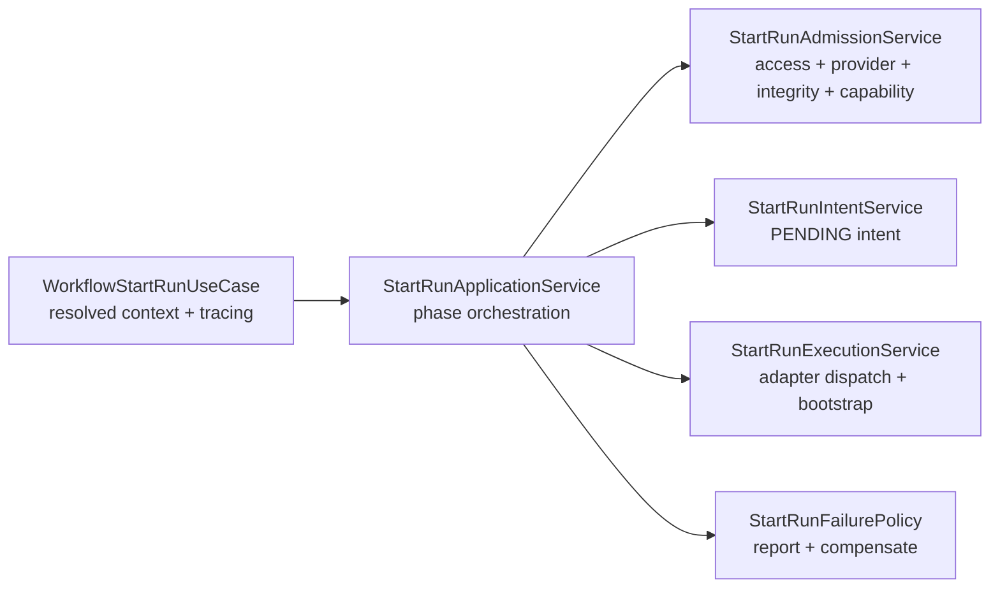
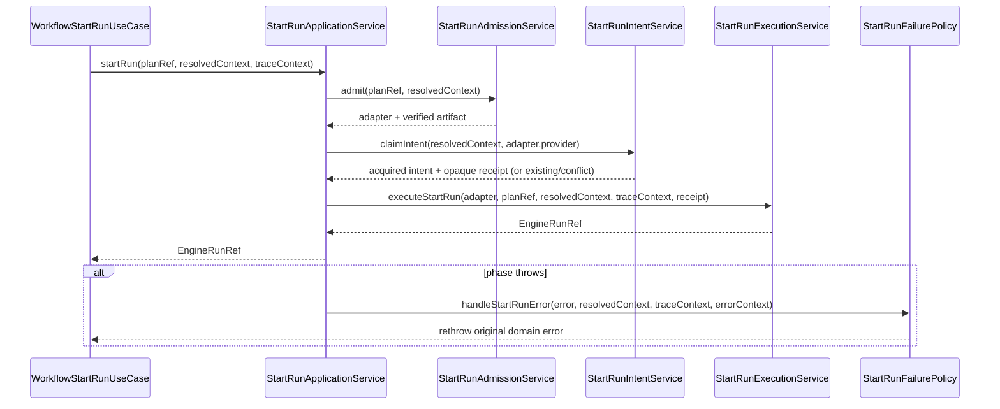
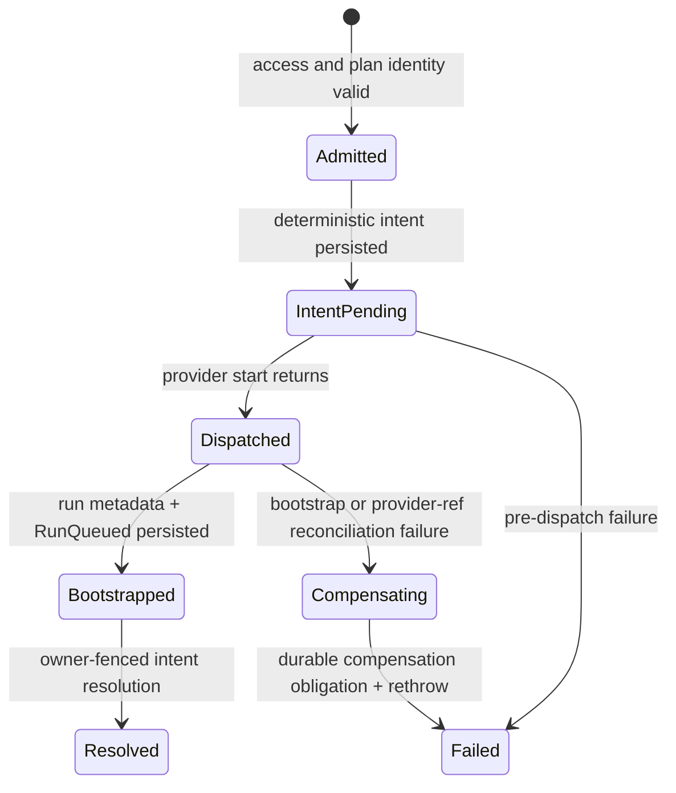

# Start-Run Application Decomposition Component

```component-doc-contract
componentId: WE-HX-3-START-RUN-DECOMPOSITION
commandRails:
  - IWorkflowEngine.startRun
publicApi:
  - StartRunApplicationService
  - StartRunAdmissionService
  - StartRunIntentService
  - StartRunExecutionService
  - StartRunFailurePolicy
requiredSemantics:
  - public-api
  - invariants
  - transitions
  - consumers
  - diagrams
diagramPack: docs/architecture/components/engine/architecture/start-run-application-decomposition-diagrams.md
```

## Purpose

The current ownership, observation-only recovery and hard-cut rules are normative
in [StartRunProtocol](../contracts/engine/StartRunProtocol.v1.md) and
[ADR-0030](../../../../adr/ADR-0030-pre-dispatch-intent-log.md).
No reconciliation path automatically redispatches an unknown start.

This component owns the internal `@dvt/engine` start-run application flow after
the `WorkflowEngine` facade has normalized public inputs and built the
start-run trace context.

The component does not define a new public contract. It decomposes the existing
`IWorkflowEngine.startRun(planRef, context)` protocol into reviewable phase
owners for admission, provider/capability resolution, intent creation, dispatch,
and failure policy.

## Public API

The API is local to the engine package.

| Surface                      | Owner         | Role                                                                                            |
| ---------------------------- | ------------- | ----------------------------------------------------------------------------------------------- |
| `StartRunApplicationService` | `@dvt/engine` | Orchestrates the phase services and preserves caller-visible behavior.                          |
| `StartRunAdmissionService`   | `@dvt/engine` | Coordinates pre-dispatch admission, provider resolution, plan integrity, and capability checks. |
| `StartRunIntentService`      | `@dvt/engine` | Acquires deterministic pre-dispatch intents with exclusive receipts.                            |
| `StartRunExecutionService`   | `@dvt/engine` | Dispatches to the provider adapter and bootstraps run state.                                    |
| `StartRunFailurePolicy`      | `@dvt/engine` | Chooses guarded failure writes; delegates diagnostic transport.                                 |
| `StartRunEventFactory`       | `@dvt/engine` | Builds deterministic run metadata and lifecycle event inputs.                                   |
| `StartRunValidationPolicy`   | `@dvt/engine` | Validates tenant, plan reference, run identity, duplicates, and capabilities.                   |

## Invariants

- `StartRunApplicationService` sequences phases but does not implement phase
  rules directly.
- Admission and integrity complete before intent creation.
- Intent creation happens before provider dispatch.
- Provider dispatch stays inside `StartRunExecutionService`.
- Failure emission is guarded by persisted run metadata and intent state.
- `StartRunIntentService` derives intent identity from canonical start-run
  idempotency inputs and never generates a fresh random intent id.
- `StartRunAdmissionService` uses `ScopedPlanRef` for artifact integrity so
  plan materialization remains tenant/project/environment scoped.
- No public `IWorkflowEngine` or `StartRunBoundary` contract changes are made by
  this decomposition.

## Transitions

| Transition             | From                         | To                           | Rule                                                                                    |
| ---------------------- | ---------------------------- | ---------------------------- | --------------------------------------------------------------------------------------- |
| normalized start       | `WorkflowStartRunUseCase`    | `StartRunApplicationService` | Facade adaptation is complete before application flow.                                  |
| pre-dispatch admission | `StartRunApplicationService` | `StartRunAdmissionService`   | Validate access, duplicate run, provider, integrity, capability, and execution context. |
| intent creation        | `StartRunApplicationService` | `StartRunIntentService`      | Persist `PENDING` intent before provider side effects.                                  |
| dispatch               | `StartRunApplicationService` | `StartRunExecutionService`   | Execute provider start and bootstrap run state.                                         |
| failure handling       | `StartRunApplicationService` | `StartRunFailurePolicy`      | Report and compensate without fabricating success.                                      |

## Consumers

- `packages/@dvt/engine/src/application/StartRunApplicationService.ts`
- `packages/@dvt/engine/src/application/workflow-engine-use-cases/WorkflowStartRunUseCase.ts`
- `packages/@dvt/engine/test/services/StartRunApplicationService.test.ts`
- `packages/@dvt/engine/test/services/StartRunApplicationDecomposition.test.ts`
- `apps/api/src/application/services/WorkflowEngineFactory.ts`, through
  `buildWorkflowEngineFacade`

## User Stories

- [Start-run application decomposition user stories](start-run-application-decomposition-component.md#section-start-run-application-decomposition-user-stories)
- [Fowler WE-HX-3 mailbox analysis](https://github.com/dunay2/dvt/blob/2df68680de46b9104282a58fd203a7eef551ca38/buzon/20260512-codex-fowler-we-hx-3-start-run-decomposition-analysis-and-remediation.md)

## Diagrams







## Drift Guards

- `packages/@dvt/engine/test/architecture/startRunApplicationDecomposition.architecture.test.ts`
  fails if `StartRunApplicationService` regrows direct provider resolution,
  plan integrity, or intent creation implementation.
- The same guard requires every start-run phase module touched by WE-HX-3 to
  declare an `@ownedConcern` header.
- `packages/@dvt/engine/test/services/StartRunApplicationDecomposition.test.ts`
  proves the dedicated intent and admission services own behavior, not only
  file shape.

<a id="section-start-run-application-decomposition-user-stories"></a>

## Start-Run Application Decomposition User Stories

### Stories

#### US-WE-HX-3-001: Pre-dispatch admission

As an engine maintainer, I want start-run admission to be owned by a dedicated
phase service so access, duplicate-run checks, provider resolution, plan
integrity, capability checks, and run-execution-context admission can be tested
without invoking provider dispatch.

Acceptance:

- admission receives `PlanRef` and `ResolvedRunContext`
- admission returns the selected adapter and verified artifact
- provider dispatch is not called during admission
- plan artifact access uses `ScopedPlanRef`

#### US-WE-HX-3-002: Deterministic intent creation

As an operations engineer, I want intent creation to be isolated so crash
restarts derive the same pre-dispatch intent id and never create a second active
intent for the same run.

Acceptance:

- `StartRunIntentService` derives `intentId` through `IdempotencyKeyBuilder`
- `IStartRunIntentStore.claimIntent` is called before dispatch
- repeated acquisition returns existing state without a receipt; it cannot dispatch

#### US-WE-HX-3-003: Dispatch isolation

As a provider adapter owner, I want dispatch and bootstrap behavior to remain in
`StartRunExecutionService` so adapter start, provider-ref reconciliation,
bootstrap, and compensation are not reimplemented by the application
coordinator.

Acceptance:

- `StartRunApplicationService` calls `executeStartRun(...)`
- bootstrap behavior remains in `StartRunExecutionService`
- `StartRunCompensation` persists the compensation obligation; maintenance observes and confirms its terminal result

#### US-WE-HX-3-004: Failure policy isolation

As a reliability reviewer, I want start-run failure handling to stay behind a
policy object so the system does not emit lifecycle facts for runs that never
completed bootstrap.

Acceptance:

- failures route through `StartRunFailurePolicy.handleStartRunError`
- `RunFailed` emission remains guarded by persisted metadata and intent state
- observability failures do not mask the domain error

#### US-WE-HX-3-005: Semantic architecture guard

As an architecture reviewer, I want an automated guard that verifies ownership
semantics instead of only checking exports so future refactors cannot quietly
move provider resolution, plan integrity, or intent creation back into the
application coordinator.

Acceptance:

- the architecture test checks forbidden implementation details in
  `StartRunApplicationService`
- the architecture test requires module `@ownedConcern` headers
- the architecture test requires this component guide, stories, mailbox review,
  closeout, and diagrams

### Negative Scenarios

| Scenario                               | Expected behavior                                                                     | Guard                                                        |
| -------------------------------------- | ------------------------------------------------------------------------------------- | ------------------------------------------------------------ |
| invalid tenant access                  | reject before plan integrity or provider dispatch                                     | `StartRunAdmissionService` sequencing test                   |
| invalid plan identity                  | reject before intent creation and dispatch                                            | `StartRunAdmissionService` and existing plan integrity tests |
| unsupported provider capability        | reject before intent creation and dispatch                                            | `StartRunAdmissionGuard.assertExecutionPolicyAllowed`        |
| duplicate run id                       | reject before intent creation and dispatch                                            | `StartRunValidationPolicy` via admission                     |
| intent-store active conflict           | reject before provider dispatch                                                       | `StartRunIntentService` plus store contract                  |
| bootstrap failure after provider start | persist compensation required, rethrow; resolve only on positive terminal observation | `StartRunExecutionService` existing tests                    |
| observability sink failure             | continue or rethrow the domain error, never hide it                                   | existing start-run service tests                             |

### Scenario Coverage Matrix

| Story            | Code owner                  | Primary test                                            | Architecture guard                                      |
| ---------------- | --------------------------- | ------------------------------------------------------- | ------------------------------------------------------- |
| `US-WE-HX-3-001` | `StartRunAdmissionService`  | `StartRunApplicationDecomposition.test.ts`              | `startRunApplicationDecomposition.architecture.test.ts` |
| `US-WE-HX-3-002` | `StartRunIntentService`     | `StartRunApplicationDecomposition.test.ts`              | `startRunApplicationDecomposition.architecture.test.ts` |
| `US-WE-HX-3-003` | `StartRunExecutionService`  | existing `StartRunApplicationService` / execution tests | `startRunApplicationDecomposition.architecture.test.ts` |
| `US-WE-HX-3-004` | `StartRunFailurePolicy`     | existing failure-policy behavior tests                  | `startRunApplicationDecomposition.architecture.test.ts` |
| `US-WE-HX-3-005` | architecture tests and docs | `startRunApplicationDecomposition.architecture.test.ts` | same                                                    |

> Acceptance scope status: Active. Owner: Architecture / Engine.
