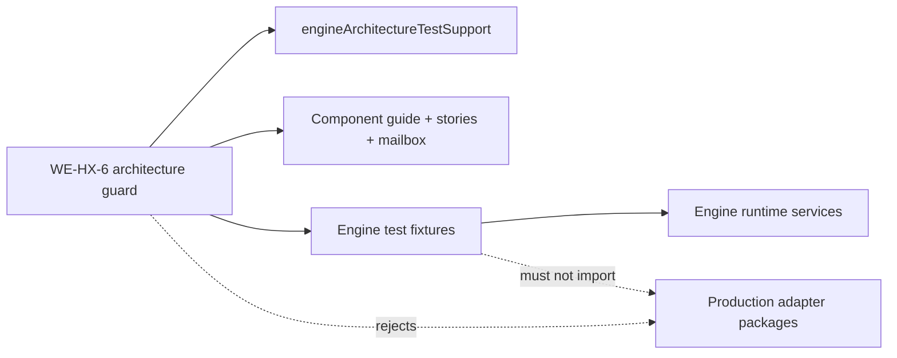
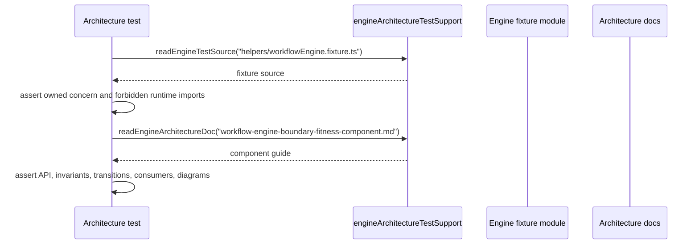
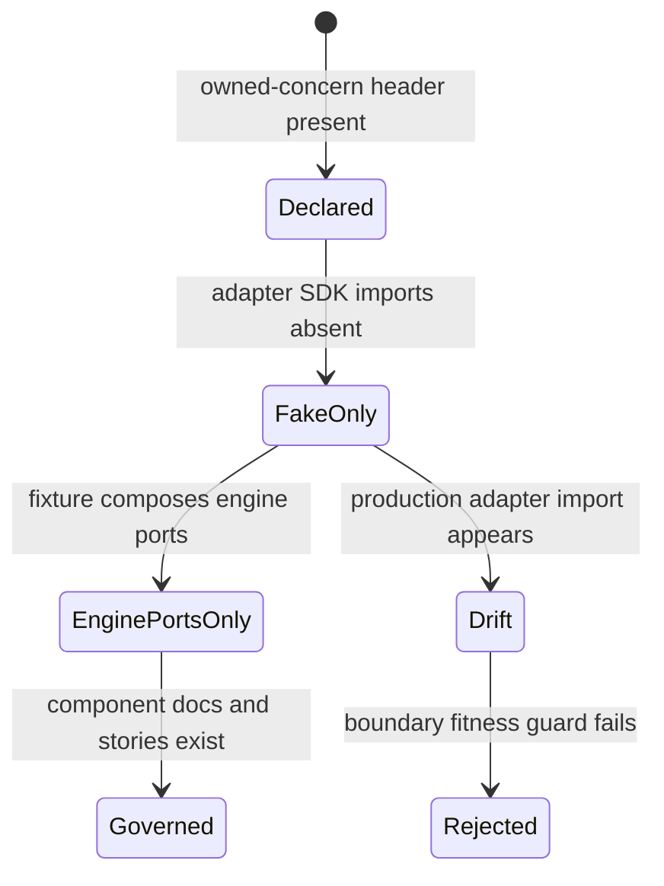

# WorkflowEngine Boundary Fitness Component

## Purpose

This component owns the `WE-HX-6` boundary-fitness model for `@dvt/engine`.
It keeps test doubles, architecture guards, and local component documentation
aligned with the runtime boundary decomposition completed by `WE-HX-3` through
`WE-HX-5`.

## Public API

The API is test-local to the engine package.

| Surface                                                  | Owner                     | Role                                                                                                    |
| -------------------------------------------------------- | ------------------------- | ------------------------------------------------------------------------------------------------------- |
| `engineArchitectureTestSupport.ts`                       | Engine architecture tests | Shared readers and semantic assertions for source, test, and architecture docs.                         |
| `workflowEngineBoundaryFitness.architecture.test.ts`     | Engine architecture tests | Fitness function that validates fixture ownership, documentation coverage, and forbidden runtime bleed. |
| `createWorkflowEngineFixture`                            | Engine test helpers       | Composes a `WorkflowEngine` with in-memory stores and fake provider adapters.                           |
| `makeTemporalAdapter`                                    | Engine test helpers       | Builds a temporal-shaped fake `IProviderAdapter`; it is not the production Temporal adapter.            |
| `bootstrapQueuedRun` / `appendRunStarted` / `makeRunRef` | Engine test helpers       | Creates persisted run lifecycle setup for engine tests.                                                 |
| `WorkflowEngine.helpers.ts`                              | Engine facade tests       | Provides facade-level helper vocabulary for plan refs, contexts, observability, clocks, and events.     |

## Invariants

- Test doubles may satisfy engine-owned ports, but must not import production
  adapter packages or provider SDKs.
- Engine fixtures must not call DB migration, API composition root, Temporal
  worker, or environment-provider selection code.
- Fake provider adapters must preserve `IProviderAdapter` semantics without
  becoming an adapter implementation.
- Architecture tests must use shared support for source and documentation
  discovery when the support covers the needed behavior.
- Each fixture module must declare an owned-concern header near the top of the
  file.
- Boundary-fitness docs, user stories, mailbox analysis, proposal
  mechanization, evidence, and risk records must stay in the same slice.

## Transitions

| Transition                      | From                     | To                                             | Rule                                                                                  |
| ------------------------------- | ------------------------ | ---------------------------------------------- | ------------------------------------------------------------------------------------- |
| architecture guard reads source | Architecture test        | `readEngineSource` / `readEngineTestSource`    | Use shared test support instead of local path readers.                                |
| architecture guard reads docs   | Architecture test        | `readEngineArchitectureDoc` / `readRepoSource` | Use shared test support so docs paths remain consistent.                              |
| test creates engine facade      | Unit or integration test | `createWorkflowEngineFixture`                  | Compose engine-owned ports and in-memory stores only.                                 |
| test needs provider behavior    | Unit or integration test | `makeTemporalAdapter` fake                     | Implement `IProviderAdapter` without importing production Temporal adapter code.      |
| future fixture expands          | Test helper module       | Owned-concern header and WE-HX-6 guard         | New runtime or adapter imports are rejected unless the component guide changes first. |

## Consumers

- `packages/@dvt/engine/test/architecture/workflowEngineBoundaryFitness.architecture.test.ts`
- `packages/@dvt/engine/test/architecture/workflowEngineProviderTelemetrySeams.architecture.test.ts`
- `packages/@dvt/engine/test/architecture/workflowEngineSemanticClosure.architecture.test.ts`
- `packages/@dvt/engine/test/core/*.test.ts`
- `packages/@dvt/engine/test/services/*.test.ts`
- Engine reviewers validating boundary-drift and duplicate-semantics risks.

## Diagrams

## Drift Guards

- `workflowEngineBoundaryFitness.architecture.test.ts` fails if fixture modules
  lose their owned-concern headers.
- The same guard fails if engine test doubles import production adapter packages,
  Temporal SDKs, DB migration code, API composition roots, or environment
  provider selection code.
- The guard fails if recent WE-HX architecture tests reintroduce local
  source/doc reader duplication instead of shared support.
- The guard requires this component guide, the user stories, and the Fowler
  mailbox analysis to keep code and documentation aligned.

## Related Records

- [WE-HX-6 user stories](workflow-engine-boundary-fitness-component.md#section-workflow-engine-boundary-fitness-user-stories)
- [WE-HX-5 provider and telemetry seams](./workflow-engine-provider-telemetry-seams-component.md)
- [WorkflowEngine target architecture](./workflow-engine-target-architecture.v1.md)

## WorkflowEngine Boundary Fitness User Stories

### Stories

| Story            | User                     | Need                                                                   | Acceptance                                                                                                                                         |
| ---------------- | ------------------------ | ---------------------------------------------------------------------- | -------------------------------------------------------------------------------------------------------------------------------------------------- |
| `US-WE-HX-6-001` | Engine reviewer          | Understand the Fowler analysis behind the boundary-fitness slice       | The mailbox record names mature-system comparison, antipatterns, repetition, opportunity, drift, and applied fixes.                                |
| `US-WE-HX-6-002` | Engine maintainer        | Read a local component guide before changing fixtures                  | The component guide documents API, invariants, transitions, consumers, diagrams, and drift guards.                                                 |
| `US-WE-HX-6-003` | Test author              | Use fake provider behavior without accidentally invoking real adapters | Fixture modules are guarded against adapter packages, provider SDKs, DB migration code, API composition roots, and environment-provider selection. |
| `US-WE-HX-6-004` | Architecture-test author | Avoid copy-pasting source and documentation readers                    | Recent WE-HX architecture tests import `engineArchitectureTestSupport.ts` for shared readers and assertions.                                       |
| `US-WE-HX-6-005` | Reviewer                 | See semantic ownership at module entry                                 | Engine test helper modules declare short owned-concern headers.                                                                                    |
| `US-WE-HX-6-006` | Architect                | Prevent structural-only confidence                                     | The boundary-fitness guard checks documentation, fixture semantics, forbidden runtime bleed, and repetition removal.                               |
| `US-WE-HX-6-007` | Release owner            | Trace the slice from requirement to evidence                           | Proposal, component docs, user stories, architecture test, ARC evidence, risk record, and closeout cite the same WE-HX-6 intent.                   |

### Negative Scenarios

- A fixture imports `@dvt/adapter-temporal`, `@dvt/adapter-postgres`,
  `@temporalio/*`, API runtime composition, DB migration code, or
  `ENGINE_PROVIDER` selection.
- A recent WE-HX architecture test defines its own `TEST_ROOT`,
  `ENGINE_ROOT`, `REPO_ROOT`, `readEngineSource`, or `readRepoSource`.
- The fake temporal provider fixture is treated as the production Temporal
  adapter.
- The architecture guard only checks that a barrel is thin and does not check
  fixture ownership, forbidden imports, documentation, and stories.
- Docs claim boundary-fitness work is complete while the component guide,
  stories, mailbox analysis, evidence, or risk record is missing.

### Scenario Coverage Matrix

| Scenario                                  | Guard                                                | Unit or package proof                                                                                                 |
| ----------------------------------------- | ---------------------------------------------------- | --------------------------------------------------------------------------------------------------------------------- |
| Fixture-owned concern headers             | `workflowEngineBoundaryFitness.architecture.test.ts` | Engine test suite compiles the fixtures.                                                                              |
| Forbidden runtime imports in test doubles | `workflowEngineBoundaryFitness.architecture.test.ts` | Existing engine tests continue using fake providers and in-memory stores.                                             |
| Shared architecture support reuse         | `workflowEngineBoundaryFitness.architecture.test.ts` | `workflowEngineProviderTelemetrySeams.architecture.test.ts` and `workflowEngineSemanticClosure.architecture.test.ts`. |
| Component docs and story coverage         | `workflowEngineBoundaryFitness.architecture.test.ts` | `pnpm docs:feature-mechanization:implementation`.                                                                     |
| ARC traceability                          | ARC docs validation                                  | `GIT_BASE=origin/main GIT_HEAD=HEAD node tools/ci/arc-check.mjs`.                                                     |

### Requirement Trace

| Requirement                                                         | Decision                                             | Design                                                                        | Contract                                       | Code                                                                                 | Test                                                  | Runtime evidence                              |
| ------------------------------------------------------------------- | ---------------------------------------------------- | ----------------------------------------------------------------------------- | ---------------------------------------------- | ------------------------------------------------------------------------------------ | ----------------------------------------------------- | --------------------------------------------- |
| Test doubles must not become hidden runtime adapters.               | Existing adapter decisions stay behind engine ports. | Fixture modules declare owned concerns and forbid production adapter imports. | `IProviderAdapter` fake implementation only.   | `workflowEngine.fixture.ts`, `runLifecycle.fixture.ts`, `WorkflowEngine.helpers.ts`. | `workflowEngineBoundaryFitness.architecture.test.ts`. | ARC evidence and closeout for WE-HX-6.        |
| Architecture guards must validate semantics, not only thin barrels. | Use semantic architecture fitness functions.         | Shared support reads source/docs and asserts ownership.                       | `engineArchitectureTestSupport.ts` helper API. | `engineArchitectureTestSupport.ts`.                                                  | `workflowEngineBoundaryFitness.architecture.test.ts`. | Docs feature-mechanization and prepush gates. |

> Acceptance scope status: Active. Owner: Architecture / Engine.
