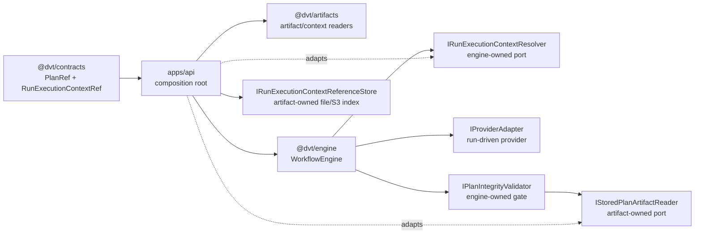
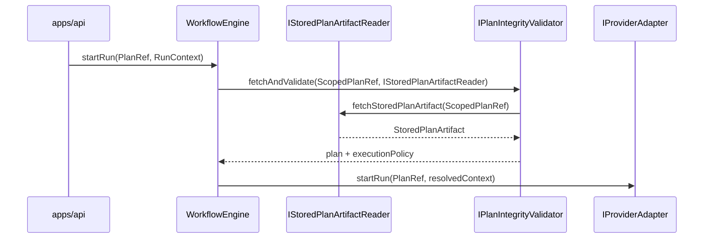
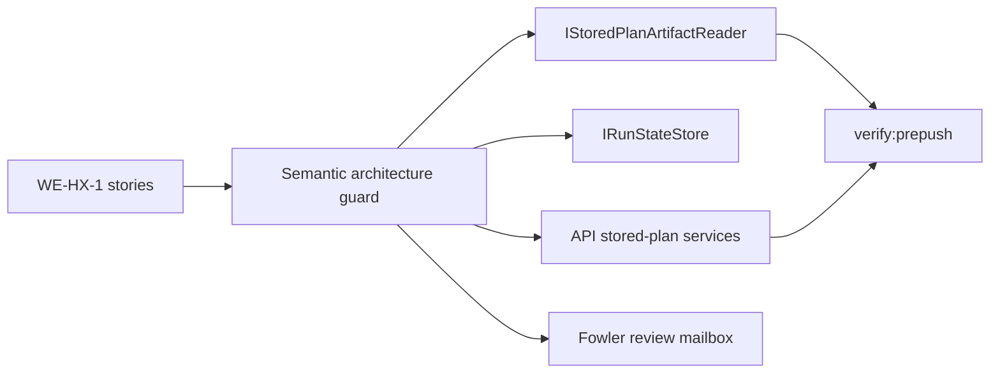

# WorkflowEngine Boundary Ownership Component

## Purpose

This component freezes the external ownership map for the `WorkflowEngine`
subsystem. It defines which package owns the shared reference shapes, which
package owns engine use-case ports, and where composition roots adapt artifact
readers into engine needs.

## Public API

| Surface                              | Canonical owner                                                  | Public role                                                                                        |
| ------------------------------------ | ---------------------------------------------------------------- | -------------------------------------------------------------------------------------------------- |
| `PlanRef`                            | `@dvt/contracts`                                                 | Shared immutable plan reference and integrity metadata.                                            |
| `RunExecutionContextRef`             | `@dvt/contracts`                                                 | Shared immutable reference to plugin/runtime execution context.                                    |
| `IStoredPlanArtifactReader`          | `@dvt/artifacts/src/ports/IStoredPlanArtifactStore.ts`           | Artifact-owned port that materializes executable plan bytes from `ScopedPlanRef`.                  |
| `IPlanIntegrityValidator`            | `@dvt/engine/src/ports/IPlanIntegrityValidator.ts`               | Engine-owned integrity gate abstraction for start-run and recovery preflight.                      |
| `IRunExecutionContextResolver`       | `@dvt/engine/src/ports/IRunExecutionContextResolver.ts`          | Engine-owned resolver need for admission-time context materialization.                             |
| `IRunExecutionContextReader`         | `@dvt/artifacts`                                                 | Artifact-owned reader implementation seam for context payloads.                                    |
| `IRunExecutionContextReferenceStore` | `@dvt/artifacts/src/ports/IRunExecutionContextReferenceStore.ts` | Artifact-owned immutable run-to-reference index for status and recovery across file and S3 stores. |

`@dvt/artifacts` exports `StoredPlanArtifact` and
`IStoredPlanArtifactReader`. `@dvt/engine` exports only
`IPlanIntegrityValidator` for the integrity gate it owns.

## Invariants

- `PlanRef` and `RunExecutionContextRef` are shared serializable contracts, not
  engine behavior ports.
- `IStoredPlanArtifactReader` belongs to `@dvt/artifacts` because executable
  plan bytes are artifact materialization behavior, not engine lifecycle
  behavior.
- `IPlanIntegrityValidator` belongs to `@dvt/engine` because it owns the
  dispatch-time invariant that fetched bytes and metadata match the scoped
  `PlanRef`.
- Artifact storage, context reading and immutable run-to-reference indexing
  belong to `@dvt/artifacts`. S3 context publication is not complete until the
  same run identity can reload that reference for status and recovery.
- `IRunStateStore` must not publish plan-fetching or artifact-reader
  responsibilities.
- Provider adapters receive an engine-approved `PlanRef`; they do not decide
  start-run integrity admission.
- `@dvt/engine` must not import concrete artifact adapters, planner services, or
  provider runtime implementations.

## Transitions

| Transition            | From                                       | To                           | Rule                                                                   |
| --------------------- | ------------------------------------------ | ---------------------------- | ---------------------------------------------------------------------- |
| `PlanRef` admitted    | API/composition root                       | `WorkflowEngine.startRun`    | Engine normalizes and validates the shared reference.                  |
| plan artifact fetched | `IStoredPlanArtifactReader` implementation | `PlanIntegrityValidator`     | Engine-owned integrity validator receives bytes plus execution policy. |
| adapter dispatch      | engine start-run service                   | `IProviderAdapter.startRun`  | Dispatch occurs only after plan bytes and metadata match `PlanRef`.    |
| context resolved      | `IRunExecutionContextResolver`             | run-context admission policy | Required only when the plan declares plugin/runtime context needs.     |

## Consumers

- `packages/@dvt/engine/src/application/StartRunApplicationService.ts`
- `packages/@dvt/engine/src/application/RecoverRunApplicationService.ts`
- `packages/@dvt/engine/src/security/planIntegrity.ts`
- `apps/api/src/application/services/WorkflowEngineFactory.ts`
- `apps/api/src/application/services/StoredExecutablePlanResolver.ts`
- `packages/@dvt/artifacts/src/ports/IStoredPlanArtifactStore.ts`
- `packages/@dvt/artifacts/src/ports/IRunExecutionContextReader.ts`
- `packages/@dvt/artifacts/src/ports/IRunExecutionContextReferenceStore.ts`

## User Stories

Executable user stories for this component live in
[WorkflowEngine boundary ownership user stories](workflow-engine-boundary-ownership-component.md#section-workflow-engine-boundary-ownership-user-stories).
They cover the engine-owned plan artifact reader, state-store separation,
API artifact-shape reuse, documentation invariants, and negative drift
scenarios.

## Diagrams

## Drift Guards

- `packages/@dvt/engine/test/architecture/workflowEngineBoundaryOwnership.architecture.test.ts`
  fails if plan artifact reading returns to `IRunStateStore`.
- The same test fails if a duplicate adapter-local or engine-local
  `IPlanFetcher` file returns.
- The test requires this guide to keep public API, invariants, transitions,
  consumers, diagrams, and drift guards visible together.

## WorkflowEngine Boundary Ownership User Stories

### Purpose

These stories make the `WE-HX-1` boundary executable. They cover the vertical
scenarios where contracts, engine, artifacts, and API composition roots meet
around `PlanRef`, `RunExecutionContextRef`, plan artifact reading, and run-state
persistence.

### User Stories

#### US-WE-HX-1-001: fetch plan artifacts through the artifacts-owned port

As an engine maintainer, I want start-run and recovery to depend on an
artifacts-owned `IStoredPlanArtifactReader`, so executable plan
materialization remains in one canonical package while the engine owns only the
dispatch integrity rule.

Acceptance criteria:

- `IStoredPlanArtifactReader` and `StoredPlanArtifact` live in
  `packages/@dvt/artifacts/src/ports/IStoredPlanArtifactStore.ts`.
- `IPlanIntegrityValidator` lives in
  `packages/@dvt/engine/src/ports/IPlanIntegrityValidator.ts`.
- `StartRunApplicationService` and `RecoverRunApplicationService` import the
  plan artifact reader from `@dvt/artifacts`.
- Fetch and validation calls require `ScopedPlanRef`.
- No engine-local `IPlanFetcher` or API-local stored-plan port exists.

#### US-WE-HX-1-002: keep run-state persistence free of plan artifact concerns

As an architect, I want `IRunStateStore` to own only run-state persistence and
lifecycle event payloads, so plan bytes cannot drift back into the state-store
boundary.

Acceptance criteria:

- `IRunStateStore.ts` does not declare `IStoredPlanArtifactReader`,
  `IPlanIntegrityValidator`, or `StoredPlanArtifact`.
- State-store read, write, and maintenance ports remain focused on run
  metadata, events, snapshots, retries, and maintenance.
- A semantic architecture test fails when plan artifact reader symbols return
  to the state-store module.

#### US-WE-HX-1-003: reuse one stored plan artifact shape across API validation

As an API maintainer, I want stored-plan validation to reuse the engine-owned
`StoredPlanArtifact` shape, so the API does not create a second equivalent
artifact DTO for the same plan-integrity seam.

Acceptance criteria:

- API services import `IStoredPlanArtifactReader` and `StoredPlanArtifact`
  from `@dvt/artifacts`.
- API validation calls `fetchStoredPlanArtifactForValidation(ScopedPlanRef)`.
- `apps/api/src/application/ports/storedPlan.ts` does not exist.
- The API does not redeclare `StoredPlanArtifact`.

#### US-WE-HX-1-004: keep boundary documentation and module concerns aligned

As a reviewer, I want every boundary module touched by `WE-HX-1` to state its
owned concern and link to local component docs, so future refactors preserve
semantic encapsulation instead of relying on file placement alone.

Acceptance criteria:

- The component guide lists public API, invariants, transitions, consumers,
  user stories, diagrams, and drift guards.
- The Fowler review records the system-level analysis, mature-system
  comparison, antipatterns, repetitions, drift, and future lessons.
- Touched engine modules start with a short `@ownedConcern` docblock.
- The architecture guard validates docs and module concern ownership together.

### Negative Scenarios

- A future change that adds stored-plan artifact reading back to
  `IRunStateStore.ts` fails the architecture guard.
- A future change that recreates `packages/@dvt/engine/src/adapters/IPlanFetcher.ts`
  fails the architecture guard.
- A future change that redeclares `StoredPlanArtifact` in `apps/api` fails the
  architecture guard.
- A future change that removes the local user-story document or Fowler review
  fails the architecture guard.
- A future change that removes the `@ownedConcern` header from a touched
  boundary module fails the architecture guard.

### Scenario Coverage Matrix

| Story            | Primary code                                                            | Primary guard                                          |
| ---------------- | ----------------------------------------------------------------------- | ------------------------------------------------------ |
| `US-WE-HX-1-001` | `packages/@dvt/artifacts/src/ports/IStoredPlanArtifactStore.ts`         | `workflowEngineBoundaryOwnership.architecture.test.ts` |
| `US-WE-HX-1-002` | `packages/@dvt/engine/src/ports/IRunStateStore.ts`                      | `workflowEngineBoundaryOwnership.architecture.test.ts` |
| `US-WE-HX-1-003` | `apps/api/src/application/services/StoredPlanExecutabilityValidator.ts` | `workflowEngineBoundaryOwnership.architecture.test.ts` |
| `US-WE-HX-1-004` | local docs and touched engine module owned-concern docblocks            | `workflowEngineBoundaryOwnership.architecture.test.ts` |

### TDD Traceability

Red case:

- the guard failed while this story document, the Fowler review, module
  docblocks, and API artifact-shape reuse were missing.

Green case:

- add the stories and review;
- add module-owned concern headers;
- reuse the artifacts-owned `StoredPlanArtifact` shape from API validation;
- rerun the guard and affected package validation.

> Acceptance scope status: Active. Owner: Architecture / Engine / Artifacts / API.
