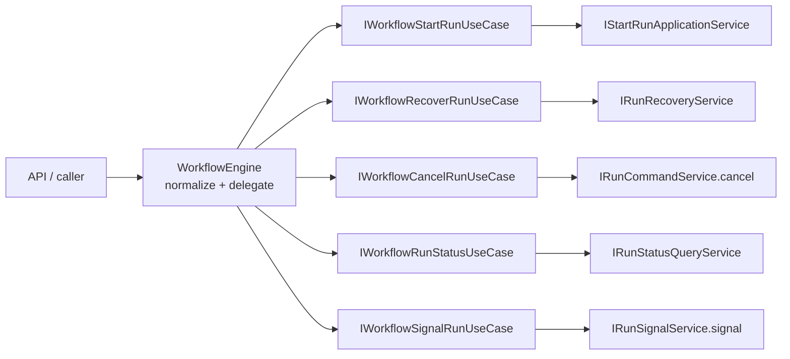
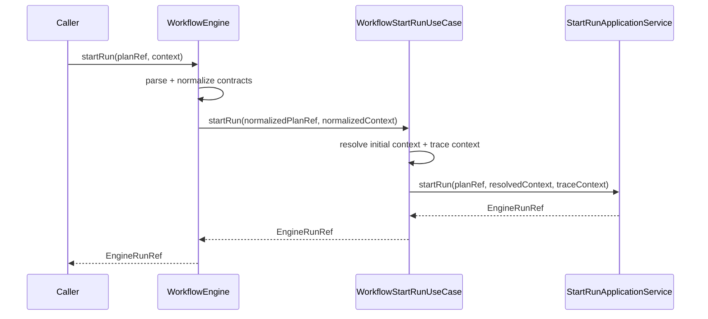
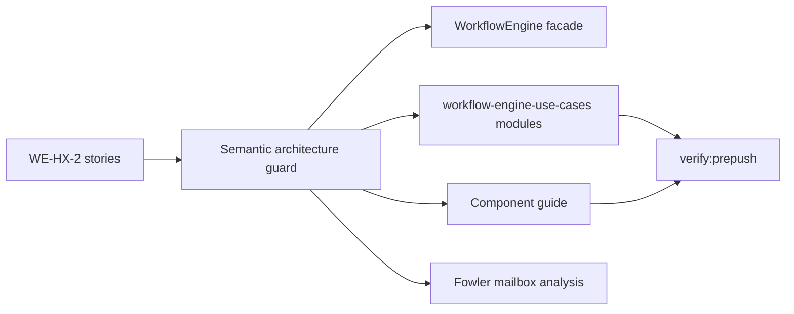

# WorkflowEngine Facade Use-Cases Component

## Purpose

This component owns the hardcut delegation seam between the public
`IWorkflowEngine` command/query boundary and the internal application services
that perform execution behavior.

## Public API

| Surface                       | Owner         | Role                                                                   |
| ----------------------------- | ------------- | ---------------------------------------------------------------------- |
| `IWorkflowStartRunUseCase`    | `@dvt/engine` | Receives normalized `PlanRef` and `RunContext`, then runs start logic. |
| `IWorkflowRecoverRunUseCase`  | `@dvt/engine` | Delegates governed recovery to the recovery application service.       |
| `IWorkflowCancelRunUseCase`   | `@dvt/engine` | Delegates cancellation to the run command service.                     |
| `IWorkflowRunStatusUseCase`   | `@dvt/engine` | Delegates canonical status reads to the query service.                 |
| `IWorkflowSignalRunUseCase`   | `@dvt/engine` | Delegates runtime signals to the run signal service.                   |
| `buildWorkflowEngineUseCases` | `@dvt/engine` | Composition helper for wiring facade-facing use cases.                 |

## Local Modules

| Module                           | Owned concern                                   |
| -------------------------------- | ----------------------------------------------- |
| `types.ts`                       | facade-facing use-case contracts and shape      |
| `WorkflowStartRunUseCase.ts`     | resolved context, tracing, and start delegation |
| `WorkflowRecoverRunUseCase.ts`   | recovery command delegation                     |
| `WorkflowCancelRunUseCase.ts`    | cancellation command delegation                 |
| `WorkflowSignalRunUseCase.ts`    | canonical signal command delegation             |
| `WorkflowRunStatusUseCase.ts`    | canonical status read delegation                |
| `buildWorkflowEngineUseCases.ts` | internal-service to use-case composition        |
| `index.ts`                       | local component API export                      |

## Invariants

- `WorkflowEngine` owns public contract parsing and normalization only.
- `WorkflowEngine` delegates to facade-facing use cases, not low-level
  application or control service names.
- `WorkflowStartRunUseCase` owns resolved-context construction and start-run
  tracing because those are execution-use-case concerns, not facade concerns.
- `IWorkflowEngine` is the current command plus canonical status read boundary.
- Enrichment and health remain outside `IWorkflowEngine`.

## Transitions

| Transition       | From             | To                            | Rule                                              |
| ---------------- | ---------------- | ----------------------------- | ------------------------------------------------- |
| `startRun` input | `WorkflowEngine` | `IWorkflowStartRunUseCase`    | Input is parsed and normalized before delegation. |
| start tracing    | start use case   | `IStartRunApplicationService` | Trace/span behavior stays outside the facade.     |
| recovery input   | `WorkflowEngine` | `IWorkflowRecoverRunUseCase`  | Recovery command is parsed before delegation.     |
| cancel command   | `WorkflowEngine` | cancel use case               | Cancel behavior stays in the run command service. |
| signal command   | `WorkflowEngine` | signal use case               | Signal behavior stays in the run signal service.  |
| status query     | `WorkflowEngine` | `IWorkflowRunStatusUseCase`   | Canonical read remains separate from enrichment.  |

## Consumers

- `packages/@dvt/engine/src/core/WorkflowEngine.ts`
- `packages/@dvt/engine/src/core/buildWorkflowEngineFacade.ts`
- `apps/api/src/application/services/WorkflowEngineFactory.ts`
- `packages/@dvt/engine/test/helpers/workflowEngine.fixture.ts`
- direct integration tests that construct `buildWorkflowEngineFacade`

## Scenarios And Review

- [Workflow engine facade use-case user stories](workflow-engine-facade-use-cases-component.md#section-workflow-engine-facade-use-cases-user-stories)

## Diagrams

## Drift Guards

- `packages/@dvt/engine/test/architecture/workflowEngineFacadeUseCases.architecture.test.ts`
  fails if `WorkflowEngine` regrows direct tracing, observability span handling,
  direct application-service dependencies, or direct control-service
  dependencies.
- The same guard requires this component guide to keep API, invariants,
  transitions, consumers, user stories, mailbox analysis, diagrams, and drift
  guards together.

## WorkflowEngine Facade Use-Case User Stories

### Purpose

These stories make `WE-HX-2` executable. They cover the vertical scenarios where
API callers, the public `IWorkflowEngine` facade, facade-facing use cases, and
internal engine services meet.

### User Stories

#### US-WE-HX-2-001: start a verified run through a thin facade

As an API caller, I want `WorkflowEngine.startRun()` to parse public inputs and
delegate to a start-run use case, so tracing, resolved-context construction, and
application-service execution do not live in the public facade.

Acceptance criteria:

- `WorkflowEngine` parses and normalizes `PlanRef` plus `RunContext`.
- `WorkflowEngine` delegates to `IWorkflowStartRunUseCase`.
- `WorkflowStartRunUseCase` owns `ResolvedRunContext` creation, trace context,
  span status, exception recording, and `IStartRunApplicationService.startRun`.
- The facade does not import `IObservability`, `buildTraceContext`, or
  `IStartRunApplicationService`.

#### US-WE-HX-2-002: recover a run through a recovery use case

As an operator, I want `recoverRun()` to remain part of the public engine
contract while delegating recovery behavior to a focused recovery use case, so
recovery orchestration can evolve without changing the facade.

Acceptance criteria:

- `WorkflowEngine` parses the recovery command before delegation.
- `WorkflowEngine` delegates to `IWorkflowRecoverRunUseCase`.
- `WorkflowRecoverRunUseCase` calls `IRunRecoveryService.recoverRun`.
- Recovery service imports do not return to `WorkflowEngine`.

#### US-WE-HX-2-003: control a run through command-specific use cases

As a runtime maintainer, I want `cancelRun()` and `signal()` to route through
separate facade-facing use cases and separate runtime services, so cancel and
signal behavior remain isolated from contract parsing and from each other.

Acceptance criteria:

- `cancelRun()` delegates to `IWorkflowCancelRunUseCase`.
- `signal()` delegates to `IWorkflowSignalRunUseCase`.
- `WorkflowCancelRunUseCase` and `WorkflowSignalRunUseCase` are separate
  modules with separate owned concerns.
- `WorkflowCancelRunUseCase` depends on `IRunCommandService`.
- `WorkflowSignalRunUseCase` depends on `IRunSignalService`.
- `WorkflowEngine` does not import `IRunControlService`.

#### US-WE-HX-2-004: read canonical run status through a query use case

As a product surface, I want `getRunStatus()` to remain a canonical read while
delegating query behavior to a focused use case, so provider enrichment cannot
leak back into `IWorkflowEngine`.

Acceptance criteria:

- `getRunStatus()` delegates to `IWorkflowRunStatusUseCase`.
- `WorkflowRunStatusUseCase` calls `IRunStatusQueryService.getStatus`.
- `IWorkflowEngine` does not expose enrichment.
- `WorkflowEngine` does not import `IRunStatusQueryService`.

#### US-WE-HX-2-005: review semantic encapsulation mechanically

As a reviewer, I want the facade-use-case component to carry local docs,
stories, mailbox analysis, and module-owned concern headers, so future changes
cannot pass by keeping only a thin barrel while semantics drift.

Acceptance criteria:

- The component guide lists public API, invariants, transitions, consumers,
  diagrams, and drift guards.
- The Fowler mailbox analysis records mature-system comparison, improved
  patterns, antipatterns, grouping, repetitions, opportunities, lessons, and
  doc/code drift.
- Every module in `workflow-engine-use-cases/` starts with `@ownedConcern`.
- The semantic architecture test fails when docs, stories, mailbox review, or
  module owned-concern headers disappear.

### Negative Scenarios

- A future change that reintroduces `IObservability`, `buildTraceContext`, span
  handling, or `IStartRunApplicationService` into `WorkflowEngine` fails the
  architecture guard.
- A future change that reintroduces `IRunRecoveryService`,
  `IRunControlService`, or `IRunStatusQueryService` into `WorkflowEngine` fails
  the architecture guard.
- A future change that collapses the component back into
  `application/WorkflowEngineUseCases.ts` fails the architecture guard.
- A future change that removes the local user-story document or Fowler mailbox
  analysis fails the architecture guard.
- A future change that removes a module `@ownedConcern` header from the facade
  or use-case component fails the architecture guard.

### Scenario Coverage Matrix

| Story            | Primary code                                                                | Primary guard                                       |
| ---------------- | --------------------------------------------------------------------------- | --------------------------------------------------- |
| `US-WE-HX-2-001` | `WorkflowEngine.ts`, `WorkflowStartRunUseCase.ts`                           | `workflowEngineFacadeUseCases.architecture.test.ts` |
| `US-WE-HX-2-002` | `WorkflowEngine.ts`, `WorkflowRecoverRunUseCase.ts`                         | `workflowEngineFacadeUseCases.architecture.test.ts` |
| `US-WE-HX-2-003` | `WorkflowCancelRunUseCase.ts`, `WorkflowSignalRunUseCase.ts`                | `workflowEngineFacadeUseCases.architecture.test.ts` |
| `US-WE-HX-2-004` | `WorkflowRunStatusUseCase.ts`                                               | `workflowEngineFacadeUseCases.architecture.test.ts` |
| `US-WE-HX-2-005` | component guide, user stories, mailbox review, owned-concern module headers | `workflowEngineFacadeUseCases.architecture.test.ts` |

### TDD Traceability

Red case:

- the guard failed while the component was still a monolithic
  `WorkflowEngineUseCases.ts`, the facade lacked an `@ownedConcern` line, and
  local user stories plus mailbox review were missing.

Green case:

- split facade use cases into a local component folder;
- add module-owned concern headers;
- add the stories and Fowler mailbox analysis;
- rerun the guard and affected package validation.

> Acceptance scope status: Active. Owner: Architecture / Engine / API.
