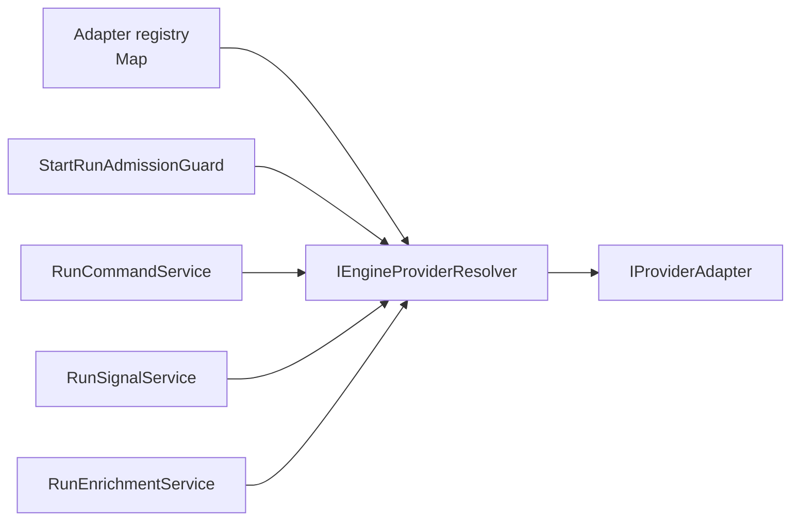
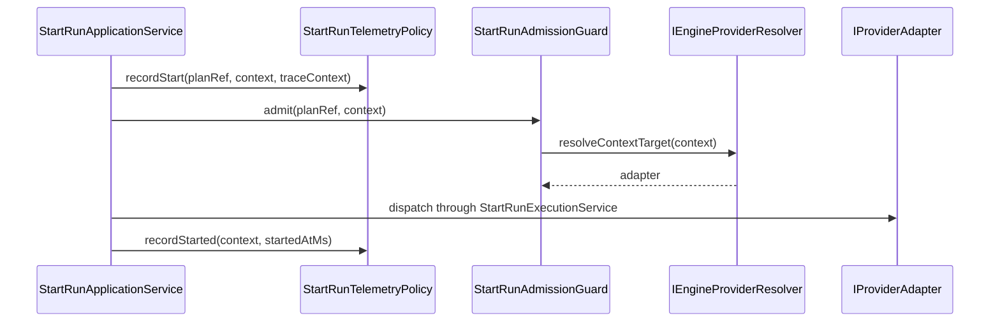
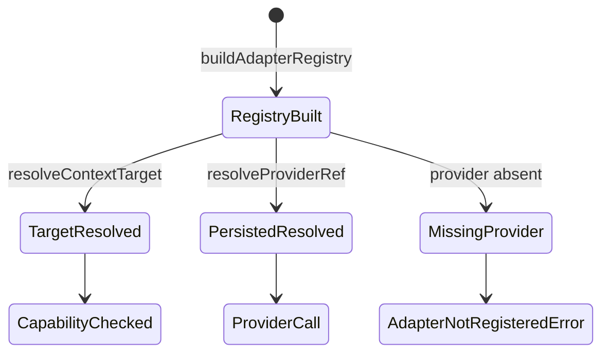

# WorkflowEngine Provider And Telemetry Seams Component

## Purpose

This component owns the internal provider-resolution seam and the start-run
telemetry policy seam for `@dvt/engine`. It closes `WE-HX-5` by removing raw
provider lookup and coordinator-owned start-run telemetry from the recently
decomposed engine paths.

## Public API

The API is local to the engine package.

| Surface                           | Owner         | Role                                                                        |
| --------------------------------- | ------------- | --------------------------------------------------------------------------- |
| `IEngineProviderResolver`         | `@dvt/engine` | Resolves target and persisted provider ids to registered provider adapters. |
| `MapBackedEngineProviderResolver` | `@dvt/engine` | Adapter-map implementation used by current composition roots.               |
| `buildAdapterRegistry`            | `@dvt/engine` | Builds the provider adapter registry and rejects duplicate providers.       |
| `pickDefaultAdapter`              | `@dvt/engine` | Applies current startup provider selection rules.                           |
| `StartRunTelemetryPolicy`         | `@dvt/engine` | Emits start-run start/success telemetry and builds canonical metric tags.   |

## Invariants

- Provider lookup is performed through `IEngineProviderResolver`, not repeated
  raw `Map.get` calls in runtime command, signal, enrichment, or admission
  services.
- Provider resolution maps missing providers to `AdapterNotRegisteredError`.
- Provider resolver inputs distinguish target provider resolution from
  persisted provider-ref resolution.
- Start-run telemetry failures never change start-run behavior.
- `StartRunApplicationService` orchestrates start-run phases but does not own
  metric names, metric tags, or start/success telemetry emission.
- Failure telemetry remains in `StartRunFailurePolicy` because it is coupled to
  failure compensation and guarded `RunFailed` emission.

## Transitions

| Transition                | From                               | To                        | Rule                                                                 |
| ------------------------- | ---------------------------------- | ------------------------- | -------------------------------------------------------------------- |
| target provider lookup    | `StartRunAdmissionGuard`           | `IEngineProviderResolver` | Resolve `ResolvedRunContext.targetAdapter` before capability checks. |
| persisted provider lookup | command/signal/enrichment services | `IEngineProviderResolver` | Resolve `RunMetadata.providerRef.provider` before provider calls.    |
| start telemetry           | `StartRunApplicationService`       | `StartRunTelemetryPolicy` | Emit non-blocking start log before phase execution.                  |
| success telemetry         | `StartRunApplicationService`       | `StartRunTelemetryPolicy` | Emit non-blocking counter and latency after successful dispatch.     |

## Consumers

- `packages/@dvt/engine/src/application/StartRunAdmissionGuard.ts`
- `packages/@dvt/engine/src/application/StartRunApplicationService.ts`
- `packages/@dvt/engine/src/services/runControl/RunCommandService.ts`
- `packages/@dvt/engine/src/services/runControl/RunSignalService.ts`
- `packages/@dvt/engine/src/services/RunEnrichmentService.ts`
- `packages/@dvt/engine/test/architecture/workflowEngineProviderTelemetrySeams.architecture.test.ts`

## Diagrams

## Drift Guards

- `workflowEngineProviderTelemetrySeams.architecture.test.ts` fails if command,
  signal, enrichment, or admission services regain raw adapter-map lookup.
- The same guard fails if `StartRunApplicationService` regains direct start-run
  start/success telemetry emission.
- The guard also requires this guide, the user stories, mailbox analysis, and
  owned-concern module headers.

## Related Records

- [WE-HX-5 user stories](workflow-engine-provider-telemetry-seams-component.md#section-workflow-engine-provider-telemetry-seams-user-stories)

## WorkflowEngine Provider And Telemetry Seams User Stories

### Stories

| Story            | User              | Need                                       | Acceptance                                                                                            |
| ---------------- | ----------------- | ------------------------------------------ | ----------------------------------------------------------------------------------------------------- |
| `US-WE-HX-5-001` | Engine maintainer | Resolve providers through one named seam   | Admission, command, signal, and enrichment paths use `IEngineProviderResolver`.                       |
| `US-WE-HX-5-002` | Runtime operator  | Missing providers fail consistently        | Missing target or persisted providers throw `AdapterNotRegisteredError`.                              |
| `US-WE-HX-5-003` | Engine maintainer | Keep telemetry out of start-run decisions  | `StartRunApplicationService` delegates start/success telemetry to `StartRunTelemetryPolicy`.          |
| `US-WE-HX-5-004` | SRE               | Preserve telemetry visibility              | Start-run start, success count, and latency metrics keep their current names and tags.                |
| `US-WE-HX-5-005` | Architect         | See semantic ownership before reading code | Provider and telemetry modules declare owned-concern docblocks.                                       |
| `US-WE-HX-5-006` | Reviewer          | Detect drift mechanically                  | The architecture test validates docs, stories, mailbox, docblocks, provider seam, and telemetry seam. |

### Negative Scenarios

- `StartRunAdmissionGuard` reads directly from `adapters.get`.
- Runtime command, signal, or enrichment services import a generic lifecycle
  helper to resolve providers instead of using `IEngineProviderResolver`.
- `StartRunApplicationService` emits start-run success metrics directly.
- Provider lookup throws generic errors for registered-provider misses.
- Docs claim provider/telemetry standardization is complete while component
  guide, stories, or mailbox analysis are missing.

### Scenario Coverage Matrix

| Scenario                        | Guard                                                       | Unit or package proof                            |
| ------------------------------- | ----------------------------------------------------------- | ------------------------------------------------ |
| Shared provider resolver seam   | `workflowEngineProviderTelemetrySeams.architecture.test.ts` | `providerSelection.test.ts`                      |
| Start-run telemetry policy seam | `workflowEngineProviderTelemetrySeams.architecture.test.ts` | `StartRunApplicationService.test.ts`             |
| Missing provider semantics      | `workflowEngineProviderTelemetrySeams.architecture.test.ts` | `providerSelection.test.ts`                      |
| Documentation alignment         | `workflowEngineProviderTelemetrySeams.architecture.test.ts` | `pnpm docs:feature-mechanization:implementation` |

> Acceptance scope status: Active. Owner: Architecture / Engine.
