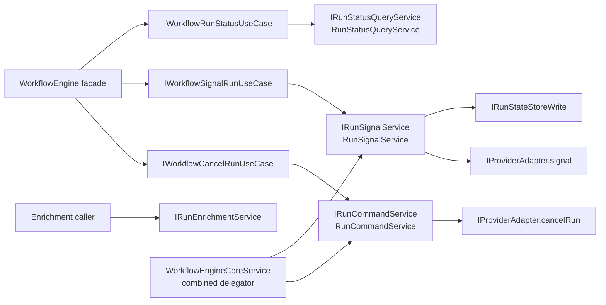
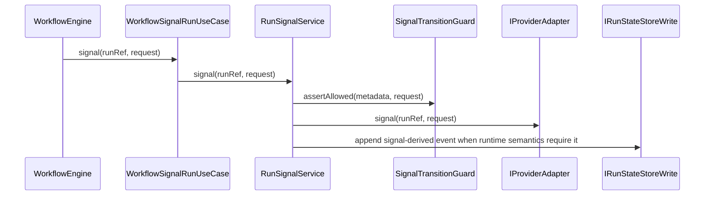

# WorkflowEngine Runtime Path Decomposition Component

## Purpose

This component owns the internal runtime-control split for the engine facade.
It treats the public `IWorkflowEngine` surface as the current command/query
boundary while separating cancel commands, runtime signals, canonical status
queries, and provider-backed enrichment into dedicated paths.

## Public API

| Surface                     | Owner         | Role                                                             |
| --------------------------- | ------------- | ---------------------------------------------------------------- |
| `IRunCommandService`        | `@dvt/engine` | Cancel-command role port.                                        |
| `IRunSignalService`         | `@dvt/engine` | Runtime-signal role port.                                        |
| `RunCommandService`         | `@dvt/engine` | Authorizes, resolves metadata, dispatches cancel, records spans. |
| `RunSignalService`          | `@dvt/engine` | Validates transition, dispatches signal, emits events.           |
| `WorkflowEngineCoreService` | `@dvt/engine` | Pure combined run-control delegator.                             |
| `WorkflowEngineCoreDeps`    | `@dvt/engine` | Command and signal role-service constructor contract.            |
| `buildRunControlService`    | `@dvt/engine` | Compatibility helper for an already-composed delegator.          |
| `buildRunCommandService`    | `@dvt/engine` | Composition helper for cancel-command wiring.                    |
| `buildRunSignalService`     | `@dvt/engine` | Composition helper for runtime-signal wiring.                    |
| `RunStatusQueryService`     | `@dvt/engine` | Canonical run-status query path.                                 |
| `IRunEnrichmentService`     | `@dvt/engine` | Provider-backed enrichment outside `IWorkflowEngine`.            |

## Invariants

- `RunCommandService` must not own signal transition rules or emit
  signal-derived lifecycle events.
- `RunSignalService` must not own cancel-command dispatch.
- `WorkflowEngineCoreService` is a combined run-control delegator only; it
  delegates to command and signal services and does not own adapter dispatch,
  transition mapping, dependency-bag translation, or concrete service
  construction.
- `WorkflowEngineCoreService` constructor inputs must stay semantic: only
  `IRunCommandService` and `IRunSignalService` cross the wrapper boundary.
- Facade-facing cancel and signal use cases depend on separate command and
  signal ports.
- Query and enrichment paths remain outside the combined runtime-control
  delegator.

## Transitions

<!-- markdownlint-disable MD060 -->

| Transition     | From                           | To                       | Rule                                              |
| -------------- | ------------------------------ | ------------------------ | ------------------------------------------------- |
| cancel command | `IWorkflowCancelRunUseCase`    | `IRunCommandService`     | Parse at facade, execute through command service. |
| signal command | `IWorkflowSignalRunUseCase`    | `IRunSignalService`      | Parse at facade, execute through signal service.  |
| status query   | `IWorkflowRunStatusUseCase`    | `IRunStatusQueryService` | Query path remains status-read only.              |
| enrichment     | API or caller-specific surface | `IRunEnrichmentService`  | Provider enrichment remains outside facade.       |

<!-- markdownlint-enable MD060 -->

## Consumers

- `apps/api/src/application/services/WorkflowEngineFactory.ts`
- `apps/api/test/integration/plannerEngineContract.test.ts`
- `packages/@dvt/engine/src/application/workflow-engine-use-cases/*`
- `packages/@dvt/engine/src/core/WorkflowEngineCoreService.ts`
- `packages/@dvt/engine/test/helpers/workflowEngine.fixture.ts`

## Diagrams

## Drift Guards

- `workflowEngineRuntimePathDecomposition.architecture.test.ts` fails if
  `WorkflowEngineCoreService` regrows adapter dispatch, signal transition
  mapping, signal-derived event emission, concrete runtime-service imports, or
  concrete runtime-service construction.
- `WorkflowEngineCoreService.test.ts` keeps cancel and signal runtime behavior
  green while the implementation moves behind dedicated services.

## WorkflowEngine Runtime Path Decomposition User Stories

### Purpose

These stories make `DHM-WS4` executable. They cover the residual runtime-control
split after facade, start-run, status-query, recovery, and enrichment work had
already moved to dedicated seams.

### User Stories

#### US-DHM-WS4-001: cancel through a command service

As an engine maintainer, I want cancel behavior to run through
`IRunCommandService`, so cancel authorization, metadata lookup, adapter dispatch,
timeout handling, and observability can change without touching signal logic.

Acceptance criteria:

- `WorkflowCancelRunUseCase` depends on `IRunCommandService`.
- `RunCommandService` calls `IProviderAdapter.cancelRun`.
- `RunCommandService` does not import `SignalTransitionGuard`.
- `WorkflowEngineCoreService` delegates cancel instead of implementing it.

#### US-DHM-WS4-002: signal through a signal service

As a runtime maintainer, I want signal behavior to run through
`IRunSignalService`, so signal parsing, transition validation, adapter dispatch,
idempotency, and signal-derived event emission stay in one signal-specific path.

Acceptance criteria:

- `WorkflowSignalRunUseCase` depends on `IRunSignalService`.
- `RunSignalService` owns `SignalTransitionGuard`.
- `RunSignalService` calls `IProviderAdapter.signal`.
- `RunSignalService` preserves the existing fail-closed `RETRY_RUN` and invalid
  transition behavior.

#### US-DHM-WS4-003: keep combined run-control without keeping mixed ownership

As a composition-root maintainer, I want `buildRunControlService` to expose one
combined delegator while new wiring uses dedicated command and signal services.

Acceptance criteria:

- `buildRunControlService` returns an `IRunControlService` from already-composed
  role services.
- `WorkflowEngineCoreService` is a pure combined delegator over command and
  signal services.
- Production factory wiring gives facade use cases separate command and signal
  services.
- `IWorkflowEngine` remains the current command/query boundary.

#### US-DHM-WS4-004: prevent hidden construction in the compatibility wrapper

As an engine architecture reviewer, I want the runtime-control compatibility
wrapper to reject concrete collaborator construction, so the wrapper cannot
become a second composition root.

Acceptance criteria:

- `WorkflowEngineCoreService` imports only command/signal role interfaces for
  runtime-control delegation.
- `WorkflowEngineCoreService` does not instantiate `RunCommandService` or
  `RunSignalService`.
- `WorkflowEngineCoreService` constructor inputs are semantic role services,
  not state stores, adapter maps, policies, clocks, or observability bags.
- The architecture guard fails if concrete construction returns to the wrapper.

### Negative Scenarios

- A future change that puts `adapter.cancelRun` back in
  `WorkflowEngineCoreService` fails the architecture guard.
- A future change that puts `adapter.signal`, `SignalTransitionGuard`, or
  signal-derived event emission back in `WorkflowEngineCoreService` fails the
  architecture guard.
- A future change that collapses facade cancel and signal use cases back to a
  single `IRunControlService` dependency fails the architecture guard.
- A future change that removes this component guide or story file fails the
  architecture guard.
- A future change that imports or constructs concrete runtime services from
  `WorkflowEngineCoreService` fails the architecture guard.

### Scenario Coverage Matrix

| Story            | Primary code                                                               | Primary guard                                                 |
| ---------------- | -------------------------------------------------------------------------- | ------------------------------------------------------------- |
| `US-DHM-WS4-001` | `RunCommandService.ts`, `WorkflowCancelRunUseCase.ts`                      | `workflowEngineRuntimePathDecomposition.architecture.test.ts` |
| `US-DHM-WS4-002` | `RunSignalService.ts`, `WorkflowSignalRunUseCase.ts`, core service tests   | `WorkflowEngineCoreService.test.ts`                           |
| `US-DHM-WS4-003` | `WorkflowEngineCoreService.ts`, `WorkflowEngineFactory.ts`, engine fixture | `workflowEngineRuntimePathDecomposition.architecture.test.ts` |
| `US-DHM-WS4-004` | `WorkflowEngineCoreService.ts`, engine fixture                             | `workflowEngineRuntimePathDecomposition.architecture.test.ts` |

> Acceptance scope status: Active. Owner: Architecture / Engine.
