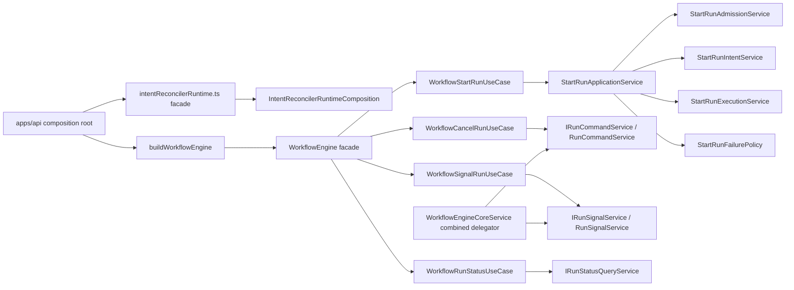
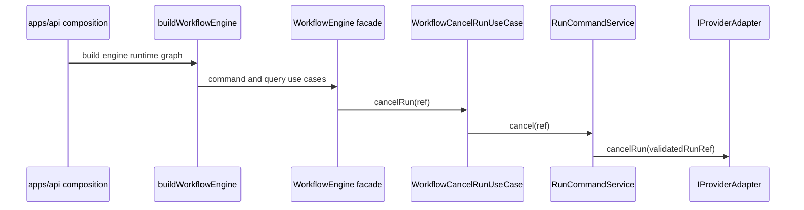
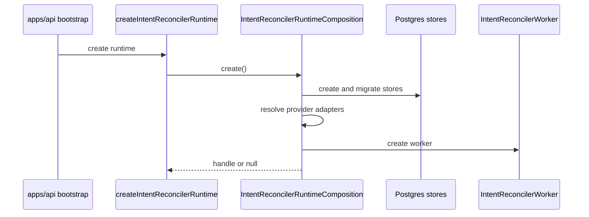

# WorkflowEngine Semantic Closure Component

## Purpose

This component record closes the DHM modularization stream for the current
`WorkflowEngine` runtime architecture. It does not add a public product API.
It explains the owned concerns that now exist across API composition, engine
facade use cases, start-run phases, runtime command/signal services, and the
remaining combined run-control delegator.

The record exists so a maintainer can answer why each seam exists, which public
or local contract it satisfies, which transitions it owns, which consumers use
it, and which tests prove the shape has not drifted.

## Public API

| Surface                                                             | Package       | Role                                                                   |
| ------------------------------------------------------------------- | ------------- | ---------------------------------------------------------------------- |
| `buildWorkflowEngine(config)`                                       | `apps/api`    | Production composition root for the engine runtime graph.              |
| `createWorkflowEngine(deps, buildEngine?)`                          | `apps/api`    | Test seam for injecting a facade builder without production wiring.    |
| `createIntentReconcilerRuntime(env, logger, observability, hooks?)` | `apps/api`    | API-side background reconciler runtime factory.                        |
| `IWorkflowEngine.startRun`                                          | `@dvt/engine` | Public facade command for start-run.                                   |
| `IWorkflowEngine.cancelRun`                                         | `@dvt/engine` | Public facade command for cancel.                                      |
| `IWorkflowEngine.signal`                                            | `@dvt/engine` | Public facade command for canonical runtime signals.                   |
| `IWorkflowEngine.getRunStatus`                                      | `@dvt/engine` | Public facade query for canonical status reads.                        |
| `IRunCommandService.cancel`                                         | `@dvt/engine` | Internal role-interface command for cancel dispatch.                   |
| `IRunSignalService.signal`                                          | `@dvt/engine` | Internal role-interface command for signal dispatch and derived facts. |
| `buildRunControlService`                                            | `@dvt/engine` | Compatibility helper for an already-composed run-control delegator.    |

## Invariants

- `apps/api` owns concrete runtime composition for Postgres stores, provider
  adapters, background worker lifecycle, and engine graph assembly.
- `@dvt/engine` owns runtime semantics through ports and application/domain
  services, not through environment parsing or direct infrastructure creation.
- `WorkflowEngineCoreService` is a combined run-control delegator only.
- `WorkflowEngineCoreService` accepts command and signal role services only; it
  does not construct concrete runtime services.
- Cancel behavior stays in `RunCommandService`.
- Signal transition validation, adapter dispatch, idempotency, and
  signal-derived lifecycle facts stay in `RunSignalService`.
- Start-run admission, intent creation, execution dispatch, and failure policy
  stay in named start-run phase owners.
- Documentation and architecture tests must name the same owners.

## Transitions

| Transition           | From                         | To                                   | Rule                                                                                                      |
| -------------------- | ---------------------------- | ------------------------------------ | --------------------------------------------------------------------------------------------------------- |
| runtime construction | API bootstrap                | `buildWorkflowEngine`                | API composition binds concrete stores, policies, services, and facade use cases.                          |
| reconciler startup   | API bootstrap                | `IntentReconcilerRuntimeComposition` | Resolve config, create stores, migrate stores, resolve adapters, create maintenance, then publish handle. |
| start-run command    | `WorkflowStartRunUseCase`    | `StartRunApplicationService`         | Facade normalizes context and tracing, then delegates the application command.                            |
| start-run phase      | `StartRunApplicationService` | start-run phase services             | Admission precedes intent, intent precedes provider dispatch, failure policy handles errors.              |
| cancel command       | `WorkflowCancelRunUseCase`   | `IRunCommandService`                 | Use case delegates cancel semantics to the command role interface.                                        |
| signal command       | `WorkflowSignalRunUseCase`   | `IRunSignalService`                  | Use case delegates signal semantics to the signal role interface.                                         |
| combined run-control | `WorkflowEngineCoreService`  | command/signal services              | The combined delegator preserves one control entry while behavior is delegated.                           |
| status query         | `WorkflowRunStatusUseCase`   | `IRunStatusQueryService`             | Read path stays separate from command lifecycle mutation.                                                 |

## Consumers

- `apps/api/src/server.ts`
- `apps/api/src/runtime/intentReconcilerRuntime.ts`
- `apps/api/src/runtime/intentReconcilerRuntimeComposition.ts`
- `apps/api/src/application/services/WorkflowEngineFactory.ts`
- `apps/api/test/integration/plannerEngineContract.test.ts`
- `packages/@dvt/engine/src/application/workflow-engine-use-cases/*`
- `packages/@dvt/engine/src/application/StartRunApplicationService.ts`
- `packages/@dvt/engine/src/services/startRun/*`
- `packages/@dvt/engine/src/services/runControl/*`
- `packages/@dvt/engine/src/core/WorkflowEngineCoreService.ts`
- `packages/@dvt/engine/test/architecture/workflowEngineSemanticClosure.architecture.test.ts`

## Component Grouping

| Component group          | Owned concern                                             | Main files                                                                             |
| ------------------------ | --------------------------------------------------------- | -------------------------------------------------------------------------------------- |
| API runtime composition  | Concrete runtime graph assembly                           | `WorkflowEngineFactory.ts`, `intentReconcilerRuntimeComposition.ts`                    |
| API runtime facade       | Stable reconciler factory and handle contract             | `intentReconcilerRuntime.ts`                                                           |
| Facade adaptation        | Translate public facade calls into use-case ports         | `workflow-engine-use-cases/*`                                                          |
| Start-run command phases | Admission, deterministic intent, dispatch, failure policy | `services/startRun/*`                                                                  |
| Runtime control commands | Cancel and signal role-interface implementations          | `services/runControl/*`, `domain/IRunCommandService.ts`, `domain/IRunSignalService.ts` |
| Run-control delegation   | Combined cancel/signal delegation                         | `WorkflowEngineCoreService.ts`, `buildRunControlService`                               |
| Governance guard         | Semantic ownership and documentation drift detection      | `workflowEngineSemanticClosure.architecture.test.ts`                                   |

## Current-State Diagram

## Runtime Sequence

## Drift Guards

- `workflowEngineSemanticClosure.architecture.test.ts` checks owned concern
  headers on the API composition, API runtime facade, reconciler composition,
  run-control, command, signal, and facade composition seams.
- The same guard checks that runtime semantics have not moved back into
  `WorkflowEngineCoreService`.
- The guard checks that `intentReconcilerRuntime.ts` remains a facade and that
  Postgres/provider/worker assembly stays in
  `intentReconcilerRuntimeComposition.ts`.
- The guard checks this component guide, the DHM-WS6 user stories, the Fowler
  mailbox analysis, and the closeout record.
- Existing WS2, WS3, and WS4 architecture tests remain the focused guards for
  their local seams.

## WorkflowEngine Semantic Closure User Stories

### Purpose

These stories make DHM-WS6 executable. They cover the final semantic closure
needed after the WS2 runtime composition, WS3 start-run decomposition, and WS4
runtime path decomposition slices.

### User Stories

#### US-DHM-WS6-001: declare owned concern headers

As an engine maintainer, I need each composition, run-control, command, and
signal module to declare its owned concern so review can detect misplaced
runtime authority before reading the full implementation.

Acceptance criteria:

- `intentReconcilerRuntime.ts` declares API-side runtime facade ownership.
- `intentReconcilerRuntimeComposition.ts` declares concrete API-side runtime
  composition ownership.
- `WorkflowEngineFactory.ts` declares API engine runtime composition ownership.
- `WorkflowEngineCoreService.ts` declares combined run-control delegator
  ownership.
- command and signal role ports declare role-interface ownership.

#### US-DHM-WS6-002: keep composition roots outside engine semantics

As an architecture reviewer, I need concrete Postgres and provider assembly to
stay in `apps/api` so the engine remains port-driven.

Acceptance criteria:

- API runtime composition may create Postgres stores, provider adapters,
  maintenance services, and workers.
- The public reconciler runtime facade delegates to
  `intentReconcilerRuntimeComposition.ts` and does not import concrete stores,
  providers, maintenance services, or workers.
- `@dvt/engine` modules must not read API env values for the reconciler
  runtime.
- `WorkflowEngineCoreService` must not import reconciler runtime assembly.

#### US-DHM-WS6-003: keep run-control delegation semantic

As a runtime maintainer, I need `WorkflowEngineCoreService` to expose combined
run-control delegation without regaining cancel or signal behavior.

Acceptance criteria:

- cancel dispatch remains in `RunCommandService`.
- signal validation, dispatch, and signal-derived event emission remain in
  `RunSignalService`.
- `WorkflowEngineCoreService` delegates cancel and signal calls only.

#### US-DHM-WS6-004: provide a complete local component record

As a new contributor, I need one local component record that explains public
API, invariants, transitions, consumers, diagrams, and drift guards for the
closed DHM stream.

Acceptance criteria:

- The component guide contains public API, invariants, transitions, consumers,
  component grouping, current-state diagram, runtime sequence, and drift
  guards.
- The guide references current code surfaces rather than historical lanes.

#### US-DHM-WS6-005: validate semantics rather than barrel thinness

As a maintainer, I need an architecture guard that fails when ownership moves
to the wrong component even if exports still compile.

Acceptance criteria:

- The guard checks owned concern headers.
- The guard checks forbidden authority in `WorkflowEngineCoreService`.
- The guard checks local component docs, user stories, mailbox analysis, and
  closeout evidence.

#### US-DHM-WS6-006: keep runtime facade and composition split aligned

As an API runtime maintainer, I need the DHM semantic closure guard to model
the current facade/composition split so a future refactor cannot satisfy the
old guard by putting concrete runtime assembly back into the facade.

Acceptance criteria:

- `intentReconcilerRuntime.ts` only exposes the public factory and handle
  contract.
- `intentReconcilerRuntimeComposition.ts` owns Postgres store creation,
  migrations, provider resolution, maintenance service creation, and worker
  creation.
- Component docs and stories name both surfaces instead of collapsing them into
  one composition module.

### Negative Scenarios

- A future edit removes owned concern headers from composition or runtime
  control modules.
- A future edit moves signal transition validation back into
  `WorkflowEngineCoreService`.
- A future edit puts API-side reconciler store/provider assembly into engine
  core code.
- A future edit puts concrete reconciler assembly back into
  `intentReconcilerRuntime.ts`.
- A future edit updates code without updating the semantic closure guide or
  story coverage.
- A future edit only proves barrel thinness and misses semantic authority.

### Scenario Coverage Matrix

| Story            | Primary surface                                                      | Validation                                                                                                          |
| ---------------- | -------------------------------------------------------------------- | ------------------------------------------------------------------------------------------------------------------- |
| `US-DHM-WS6-001` | API and engine module headers                                        | `workflowEngineSemanticClosure.architecture.test.ts`                                                                |
| `US-DHM-WS6-002` | `intentReconcilerRuntime.ts`, `WorkflowEngineCoreService.ts`         | `workflowEngineSemanticClosure.architecture.test.ts`                                                                |
| `US-DHM-WS6-003` | `RunCommandService`, `RunSignalService`, `WorkflowEngineCoreService` | `workflowEngineRuntimePathDecomposition.architecture.test.ts`, `workflowEngineSemanticClosure.architecture.test.ts` |
| `US-DHM-WS6-004` | semantic closure component guide                                     | `workflowEngineSemanticClosure.architecture.test.ts`, docs governance gates                                         |
| `US-DHM-WS6-005` | semantic closure architecture guard                                  | `workflowEngineSemanticClosure.architecture.test.ts`                                                                |
| `US-DHM-WS6-006` | reconciler runtime facade and composition split                      | `workflowEngineSemanticClosure.architecture.test.ts`, API `server.test.ts`, Planning DB component profile           |

> Acceptance scope status: Active. Owner: Architecture / Engine.
