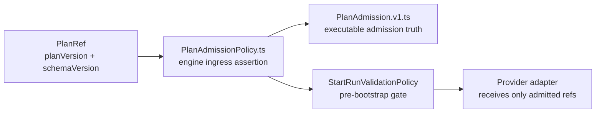
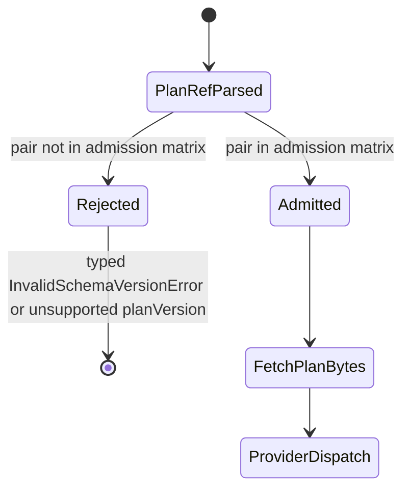
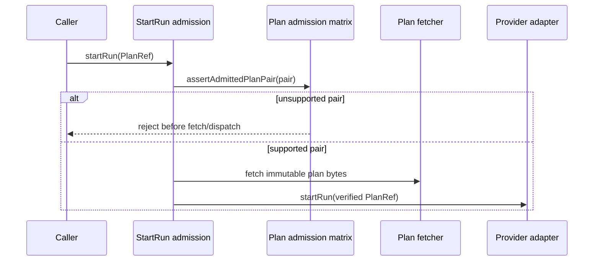
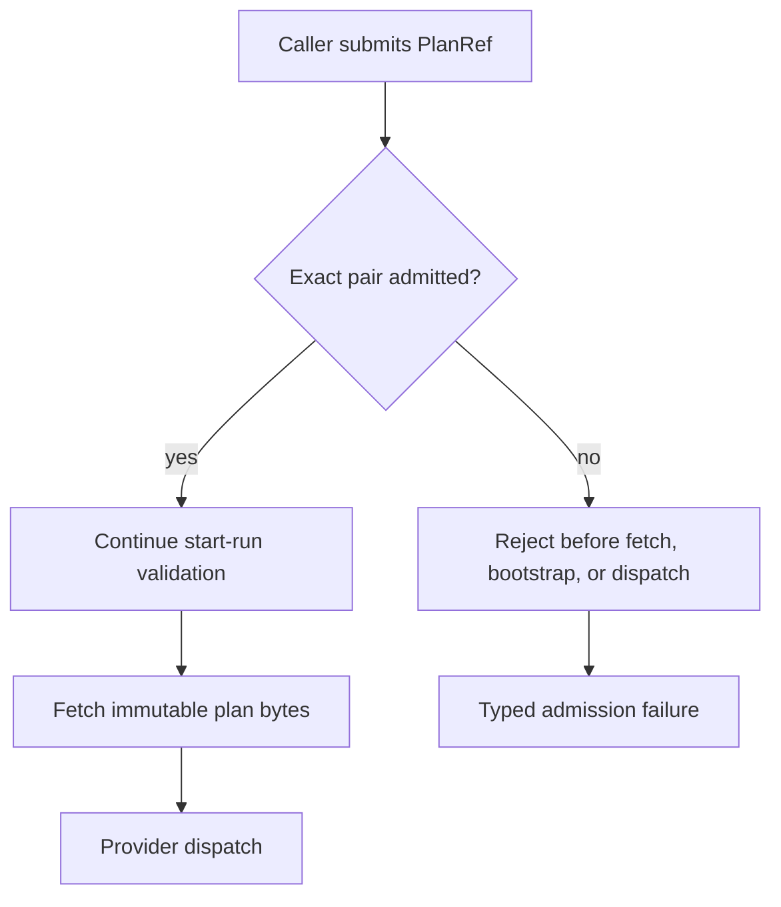

# Plan Admission Matrix

This component note defines how start-run admission binds `planVersion` and
`schemaVersion` before the engine fetches plan bytes or dispatches to a
provider.

## Owned Concern

The admission matrix owns the executable answer to this question:

> Can this runtime admit the `PlanRef` pair
> `(planVersion, schemaVersion)`?

It is a current-admission surface. It does not own plan hashing, plan storage,
adapter execution, or planner emission policy. Those remain governed by
ADR-0012, ADR-0017, ADR-0036, and the planner contract pack.

## Public API

Code surface:

- `packages/@dvt/contracts/src/contracts/planner/PlanAdmission.v1.ts`
- `packages/@dvt/engine/src/contracts/PlanAdmissionPolicy.ts`
- `packages/@dvt/engine/src/contracts/PlanSchemaVersionPolicy.ts`

Exports:

- `SUPPORTED_EXECUTION_PLAN_ADMISSION_PAIRS`
- `EXECUTION_PLAN_ADMISSION_MATRIX`
- `EXECUTION_PLAN_ADMISSION_REGISTRY`
- `isAdmittedExecutionPlanPair(planVersion, schemaVersion)`
- `assertAdmittedPlanPair({ planVersion, schemaVersion })`
- `assertSupportedPlanSchemaVersion({ planVersion, schemaVersion })`
- `UnsupportedPlanVersionError`

Current admitted pair:

| `planVersion` | `schemaVersion` | Status    |
| ------------- | --------------- | --------- |
| `1.0`         | `1.0`           | `current` |

## Component Map

- `PlanAdmission.v1.ts`: publish the executable admitted pair registry.
- `PlanAdmissionPolicy.ts`: convert undeclared pairs into engine ingress fail
  and plan-version rejection.
- `PlanSchemaVersionPolicy.ts`: expose the schema-version admission language
  consumed by start-run preconditions while delegating to the matrix.
- `StartRunValidationPolicy`: invoke admission before run creation or dispatch.
- `@dvt/plan-verifier`: verify runtime admission for adapter-side plan
  integrity.
- Contract tests: prove positive and negative pair behavior.
- Architecture fitness tests: guard semantic documentation and naming drift.

## Invariants

- Start-run admission MUST reject any undeclared
  `(planVersion, schemaVersion)` pair before adapter dispatch.
- During development, `planVersion` is fixed to `1.0`; no other plan-version
  literal is an active example or admitted value.
- A valid `planVersion` does not make an unknown `schemaVersion` executable.
- A valid `schemaVersion` does not make an unknown `planVersion` executable.
- `schemaVersion = 1.future` is unsupported.
- The engine MUST NOT use a broad `v1.*` prefix rule as runtime admission
  truth.
- Older plan/schema pairs remain undeclared unless they are the active pair.

## Transitions

## Runtime Sequence

## Diagrams

The component map shows ownership boundaries. The transition and sequence
diagrams show the runtime order: parse the `PlanRef`, assert the pair, then
fetch plan bytes and dispatch only after admission succeeds.

## Consumers

- `StartRunValidationPolicy` uses the engine policy before run creation.
- `@dvt/contracts` tests guard the canonical matrix surface.
- Engine start-run tests guard negative admission and no-dispatch behavior.

## User Stories

The executable story set lives in
[Plan admission user stories](plan-admission-matrix.md#section-plan-admission-user-stories). The stories
cover the current admitted pair, unsupported future schema, older schema,
unknown plan version, blank inputs, no-dispatch behavior, and documentation
drift.

## Drift Guards

- `plan-admission-matrix.contract.test.ts` validates admitted and rejected
  pair behavior.
- `plan-admission-matrix.architecture.test.ts` validates local component
  documentation, owned-concern docblocks, user stories, mailbox analysis, and
  retired naming.
- `planVersionAdmission.architecture.test.ts` validates that shared verifier
  helpers use admission rather than semver compatibility.
- `WorkflowEngine.test.ts` validates unsupported schema rejection before
  provider dispatch.
- ARC-2 evidence and risk records must change with any contract or engine
  admission change.

## Hard-Cut Change Rule

Replacing the active pair requires a deliberate bounded change:

1. Keep `planVersion = 1.0` as the single development plan-version line.
2. Extend the schema/contract definition if `schemaVersion` changes.
3. Replace the admitted pair in `EXECUTION_PLAN_ADMISSION_MATRIX`.
4. Add negative and positive tests proving old, future, and malformed pairs
   reject.
5. Update ARC-2 evidence and risk entries for contract or engine changes.

## Plan Admission User Stories

These stories define the executable scenarios for the `ExecutionPlan`
`planVersion` and `schemaVersion` admission boundary.

### Scope

The plan admission component answers one question before plan fetch, run
creation, or provider dispatch:

> Is this exact `(planVersion, schemaVersion)` pair admitted by this runtime?

It does not verify plan content hash, tenant access, plan storage, planner
emission, or provider execution.

### Stories

- `US-PA-1` - As a runtime operator, I want the current plan/schema pair
  admitted.
  Acceptance scenario: Given the current pair `(1.0, 1.0)`, when admission
  runs, then the pair is accepted.
- `US-PA-2` - As a runtime operator, I want future schemas rejected until
  deliberately admitted.
  Acceptance scenario: Given an unsupported future schema `1.future`, when
  admission runs, then the pair is rejected before provider work.
- `US-PA-3` - As a runtime operator, I want older schemas rejected by default
  after the hard cut.
  Acceptance scenario: Given an older schema `0.9`, when admission runs, then
  the pair is rejected even though the plan version is current.
- `US-PA-4` - As a contract maintainer, I want unknown plan versions rejected.
  Acceptance scenario: Given an unknown plan version that is not `1.0`, when
  admission runs, then the pair is rejected even if the schema is current.
- `US-PA-5` - As an engine maintainer, I want blank values treated as invalid
  ingress.
  Acceptance scenario: Given blank admission inputs, when admission runs, then
  the engine raises the typed schema-version error.
- `US-PA-6` - As a platform owner, I want unsupported pairs rejected before side
  effects.
  Acceptance scenario: Given any unsupported pair, when `startRun` validates
  preconditions, then no run is created and no adapter dispatches.
- `US-PA-7` - As a reviewer, I want renamed admission surfaces protected from
  old naming drift.
  Acceptance scenario: Given a renamed admission surface, when architecture
  tests run, then retired names and missing docs fail the build.
- `US-PA-8` - As an adapter maintainer, I want shared plan verification to use
  the admission matrix.
  Acceptance scenario: Given a plan verifier call for the current runtime, when
  `planVersion = 1.0`, then verification proceeds to plan-id hashing.
- `US-PA-9` - As a reviewer, I want semver fallback removed from plan
  verification.
  Acceptance scenario: Given a verifier call with a non-`1.0` plan version,
  when admission runs, then it rejects through the admission matrix rather than
  `supportedMajor` or `strictSameMinor`.

### Negative Scenarios

- Future schema: `planVersion = 1.0`, `schemaVersion = 1.future`.
- Older schema: `planVersion = 1.0`, `schemaVersion = 0.9`.
- Unknown plan version: `planVersion` is any nonblank value other than `1.0`,
  `schemaVersion = 1.0`.
- Blank plan version: `planVersion = ""`, `schemaVersion = 1.0`.
- Blank schema version: `planVersion = 1.0`, `schemaVersion = ""`.
- Verifier unsupported version: `planVersion` is derived from `1.0` but is not
  equal to `1.0`.
- Documentation drift: component guide, mailbox analysis, or owned-concern
  docblocks missing after a semantic change.

### Scenario Flow

### Test Mapping

| Scenario family         | Test surface                                                              |
| ----------------------- | ------------------------------------------------------------------------- |
| Current admitted pair   | `packages/@dvt/contracts/test/plan-admission-matrix.contract.test.ts`     |
| Negative pair cases     | `packages/@dvt/contracts/test/plan-admission-matrix.contract.test.ts`     |
| No-dispatch behavior    | `packages/@dvt/engine/test/core/WorkflowEngine.test.ts`                   |
| Verifier admission      | `packages/@dvt/plan-verifier/test/planVersionAdmission.test.ts`           |
| Semantic documentation  | `packages/@dvt/contracts/test/plan-admission-matrix.architecture.test.ts` |
| Naming drift prevention | `packages/@dvt/contracts/test/plan-admission-matrix.architecture.test.ts` |

> Acceptance scope status: Active. Owner: Architecture / Contracts / Engine.
