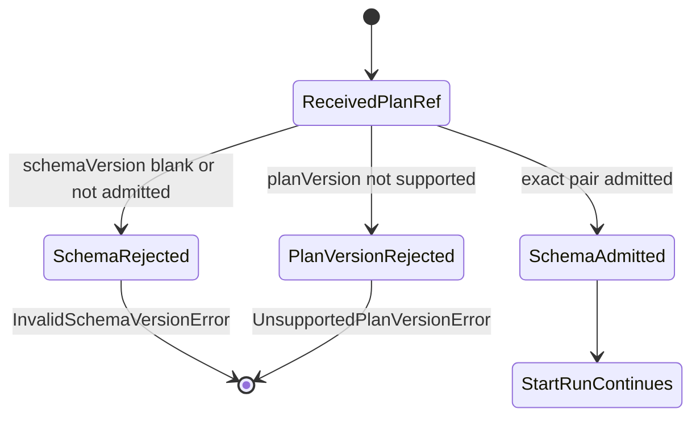
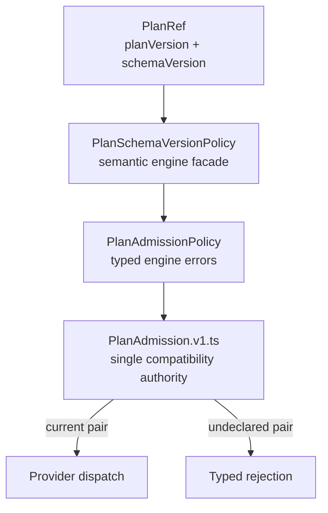
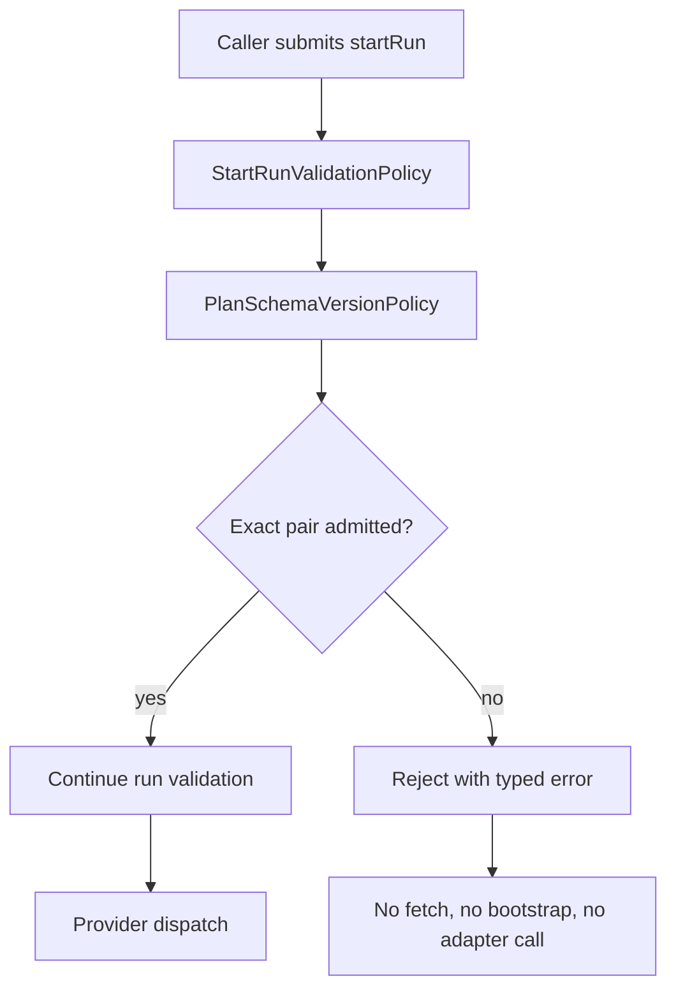

# Plan Schema-Version Admission Component

## Owned Concern

Plan schema-version admission owns the engine ingress decision that an
`ExecutionPlan` schema shape is executable by the current runtime before
provider dispatch.

It does not own plan storage, plan hashing, adapter execution, or matrix data.
Those remain owned by ADR-0012, `PlanAdmission.v1.ts`, and provider adapters.

## Public API

Code surface:

- `packages/@dvt/engine/src/contracts/PlanSchemaVersionPolicy.ts`
- `packages/@dvt/engine/src/contracts/PlanAdmissionPolicy.ts`
- `packages/@dvt/contracts/src/contracts/planner/PlanAdmission.v1.ts`

Exports:

- `PlanSchemaVersionAdmissionInput`
- `assertSupportedPlanSchemaVersion(input)`

The API requires both `planVersion` and `schemaVersion` because ADR-0017 and
ADR-0036 define compatibility as an exact pair, not schema-only semver math.

## Invariants

- The current pair `(1.0, 1.0)` is admitted.
- Blank `schemaVersion` rejects with `InvalidSchemaVersionError`.
- `schemaVersion = 1.future` rejects.
- `schemaVersion = 2.0` rejects.
- Unknown `planVersion` rejects even when `schemaVersion` is current.
- Rejection happens before plan fetch, run bootstrap, or provider dispatch.
- The component delegates to the existing matrix and does not duplicate rows.

## Transitions

## Consumers

- `StartRunValidationPolicy` calls `assertSupportedPlanSchemaVersion` during
  start-run precondition validation.
- `WorkflowEngine` receives the fail-closed behavior through the start-run
  application path.
- Engine contract and architecture tests guard current and negative cases.
- Component docs and mailbox analysis record the Fowler rationale.

## Diagrams

## Drift Guards

- `PlanSchemaVersionPolicy.test.ts` proves current, blank, future, major, and
  unknown-plan-version cases.
- `planSchemaVersionAdmission.architecture.test.ts` proves the semantic policy,
  docs, user stories, and mailbox analysis stay aligned.
- `WorkflowEngine.test.ts` proves unsupported schema versions do not dispatch
  to the adapter and do not create events.

## Command Rail

The governing command rail is `StartRun`. This component is an internal policy
for that command and does not introduce a separate command or query.

## Plan Schema-Version Admission User Stories

### Scope

These stories cover the `StartRun` command precondition that rejects unsupported
plan schema versions before runtime side effects.

### Stories

- `US-EA-20260429-01-001` - As a runtime operator, I want the current
  `(planVersion, schemaVersion)` pair admitted so current plans continue to
  start.
- `US-EA-20260429-01-002` - As a runtime operator, I want blank schema
  versions rejected so malformed references cannot enter runtime.
- `US-EA-20260429-01-003` - As a platform maintainer, I want `1.future`
  rejected so a future schema cannot be treated as compatible by prefix.
- `US-EA-20260429-01-004` - As a platform maintainer, I want `2.0` rejected
  so unsupported major schema lines fail closed.
- `US-EA-20260429-01-005` - As a contract maintainer, I want unknown
  `planVersion` values rejected even with the current schema.
- `US-EA-20260429-01-006` - As an adapter maintainer, I want rejection before
  provider dispatch so adapters never discover unsupported schemas after side
  effects begin.

### Negative Scenarios

| Scenario           | Input                                           | Expected outcome                   |
| ------------------ | ----------------------------------------------- | ---------------------------------- |
| Blank schema       | `planVersion = 1.0`, `schemaVersion = ""`       | `InvalidSchemaVersionError`        |
| Future schema      | `planVersion = 1.0`, `schemaVersion = 1.future` | `InvalidSchemaVersionError`        |
| Major schema drift | `planVersion = 1.0`, `schemaVersion = 2.0`      | `InvalidSchemaVersionError`        |
| Unknown plan line  | `planVersion != 1.0`, `schemaVersion = 1.0`     | `UnsupportedPlanVersionError`      |
| Side-effect guard  | unsupported pair in `startRun`                  | no adapter dispatch, no run events |

### Scenario Flow

### Test Mapping

| Story                   | Test surface                                                |
| ----------------------- | ----------------------------------------------------------- |
| `US-EA-20260429-01-001` | `PlanSchemaVersionPolicy.test.ts`                           |
| `US-EA-20260429-01-002` | `PlanSchemaVersionPolicy.test.ts`                           |
| `US-EA-20260429-01-003` | `PlanSchemaVersionPolicy.test.ts`, `WorkflowEngine.test.ts` |
| `US-EA-20260429-01-004` | `PlanSchemaVersionPolicy.test.ts`                           |
| `US-EA-20260429-01-005` | `PlanSchemaVersionPolicy.test.ts`                           |
| `US-EA-20260429-01-006` | `WorkflowEngine.test.ts`                                    |

> Acceptance scope status: Active. Owner: Architecture / Engine.
