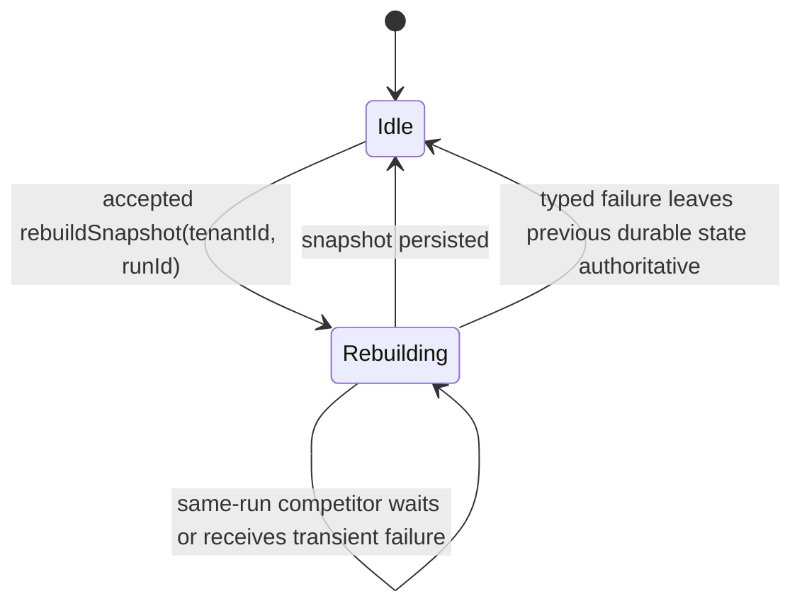
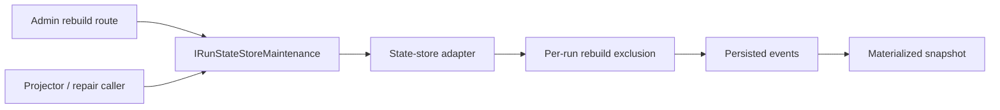

# Snapshot Rebuild Concurrency Component

## Owned Concern

Owns the portable concurrency invariant for
`IRunStateStoreMaintenance.rebuildSnapshot`: rebuilding a materialized snapshot
is a tenant-scoped maintenance command that mutates derived state and must be
serialized per `(tenantId, runId)` across concurrent callers.

## Public API

```ts
interface IRunStateStoreMaintenance {
  rebuildSnapshot(tenantId: string, runId: string): Promise<WorkflowSnapshot>;
}
```

The command:

- validates tenant ownership before replay and mutation;
- replays persisted events in `runSeq ASC` order;
- overwrites or advances the durable materialized snapshot;
- returns the rebuilt `WorkflowSnapshot`;
- rejects missing or cross-tenant runs with `RUN_NOT_FOUND` semantics.

## Invariants

1. For the same `(tenantId, runId)`, only one rebuild may mutate the durable
   snapshot at a time.
2. Competing rebuild commands for the same run must either serialize behind the
   active rebuild or fail with a typed transient concurrency error.
3. The contract does not require PostgreSQL advisory locks; it requires
   equivalent mutual exclusion semantics.
4. Rebuild replay consumes the event log ordered by `runSeq ASC`.
5. Snapshots remain derived state; the append-only event log remains the source
   of truth.
6. Tenant ownership is checked before acquiring rebuild ownership or mutating a
   snapshot row.

## Transitions



## Component Map



## Consumers

- API admin rebuild route: operator repair command.
- Projector and repair workers: background catch-up or recovery.
- State-store adapters: implement the same concurrency invariant with their
  backend-native mechanism.
- Tests and architecture guards: prevent regression to Postgres-only semantics.

## Adapter Guidance

PostgreSQL uses transaction-scoped advisory locks today. Other adapters may use
serializable transactions, backend leases, compare-and-swap on a snapshot
version, or a stored procedure that guarantees one active writer per run. The
implementation choice is private to the adapter as long as the public invariant
holds.

<a id="section-snapshot-rebuild-concurrency-user-stories"></a>

## Snapshot Rebuild Concurrency User Stories

### US-AR-A6-1: Admin rebuild serializes with another rebuild

As an operator, I want a manual snapshot rebuild for a run to serialize with any
other active rebuild for that same `(tenantId, runId)`, so that repair commands
cannot race and leave a stale derived snapshot behind.

Acceptance criteria:

- Given one rebuild is mutating the durable snapshot for `(tenantId, runId)`,
  when a second rebuild starts for the same pair, then it waits behind the first
  rebuild or receives a typed transient concurrency failure.
- The second rebuild must not mutate the snapshot concurrently with the first.

### US-AR-A6-2: Projector rebuild follows the same contract

As a projector worker, I want rebuild concurrency to be owned by the state-store
port, so that worker catch-up and admin repair share the same exclusion rule.

Acceptance criteria:

- Projector callers use `IRunStateStoreMaintenance.rebuildSnapshot`.
- The adapter applies the same per-run exclusion regardless of whether the
  caller is an admin route or background worker.

### US-AR-A6-3: Non-Postgres adapter implements equivalent semantics

As an adapter implementer, I want the contract to describe portable behavior
instead of PostgreSQL advisory locks, so that I can use a backend-native
mechanism while preserving DVT semantics.

Acceptance criteria:

- Adapter documentation names equivalent mutual exclusion semantics.
- The contract does not require `pg_advisory_xact_lock`.
- A Snowflake-style adapter may use a lease, stored procedure, transaction
  posture, or compare-and-swap as long as concurrent same-run rebuild mutation
  cannot occur.

### US-AR-A6-4: Tenant mismatch never acquires rebuild ownership

As a platform owner, I want tenant ownership checked before rebuild ownership,
so that a cross-tenant rebuild cannot acquire locks, leases, or write authority
for a run it does not own.

Acceptance criteria:

- Missing or cross-tenant runs fail with `RUN_NOT_FOUND` semantics.
- Adapter implementation checks tenant ownership before acquiring rebuild
  ownership.
- No snapshot mutation happens for tenant mismatches.

### US-AR-A6-5: Architecture guard validates semantics

As an architect, I want an executable architecture test to validate the semantic
contract, so that future work cannot remove the invariant while keeping the
barrel exports green.

Acceptance criteria:

- The test reads live TypeScript ports and component docs.
- The test requires per `(tenantId, runId)` mutual exclusion wording.
- The test rejects Postgres-only contract wording.

> Acceptance scope status: Active. Owner: Architecture / Engine / State Store.
