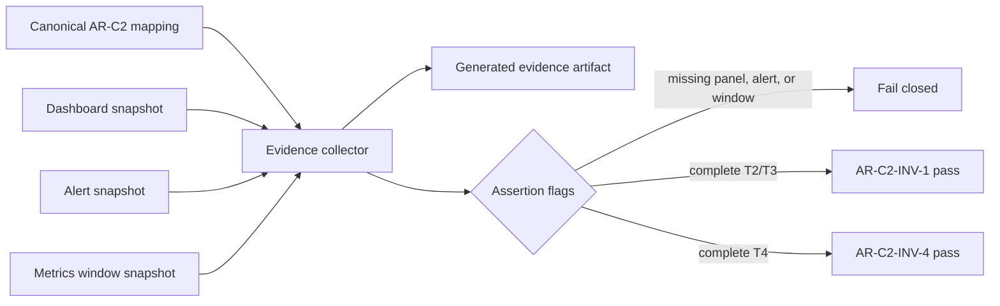
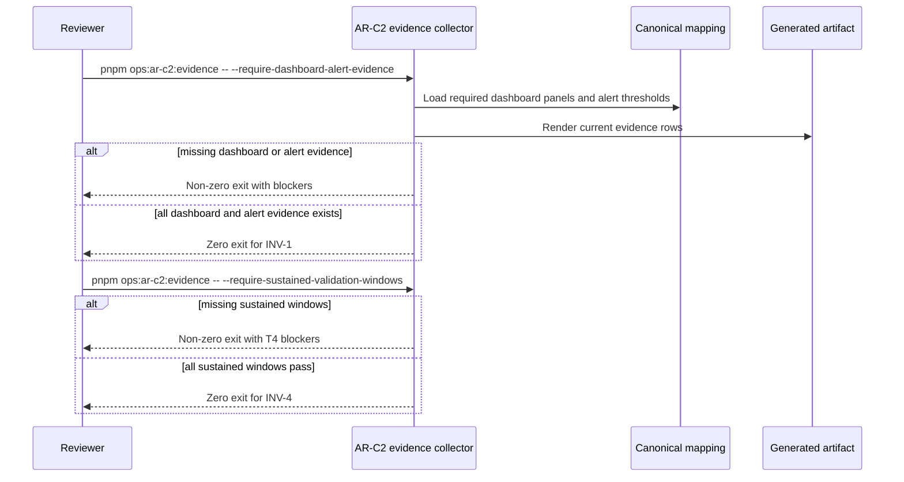
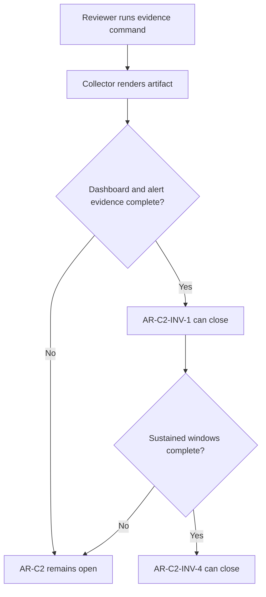

# AR-C2 Immutable Evidence Gate Component

## Owned concern

This component owns the AR-C2 closure assertions that dashboard, alert, and
sustained validation window evidence are complete before AR-C2 can be marked
done.

It does not own metric emission, live Grafana provisioning, Alertmanager
routing, or live Prometheus collection.

## Public API

- Command rail: `AR-C2OperationalEvidenceCommand`.
- CLI surface: `pnpm ops:ar-c2:evidence`.
- Dashboard and alert assertion flag: `--require-dashboard-alert-evidence`.
- Sustained-window assertion flag: `--require-sustained-validation-windows`.
- Optional inputs:
  - `AR_C2_DASHBOARD_SNAPSHOT_FILE`
  - `AR_C2_ALERT_SNAPSHOT_FILE`
  - `AR_C2_METRICS_SNAPSHOT_FILE`
  - `AR_C2_EVIDENCE_OUTPUT_PATH`
- Dashboard snapshot schema:
  - `panels[].panelKey`
  - `panels[].dashboardSystem`
  - `panels[].environment`
  - `panels[].immutableDashboardReference`
  - `panels[].queryExpression`
  - `panels[].capturedAt`
  - `panels[].reviewer`
- Alert snapshot schema:
  - `rules[].thresholdKey`
  - `rules[].alertRuleId`
  - `rules[].expression`
  - `rules[].window`
  - `rules[].severity`
  - `rules[].routingTarget`
  - `rules[].configSource`
  - `rules[].capturedAt`
  - `rules[].reviewer`
- Metrics snapshot schema:
  - `windows[].signalKey`
  - `windows[].window`
  - `windows[].observed`
  - `windows[].expected`
  - `windows[].status`
- Output artifact:
  `docs/runbooks/ar-c2-evidence-generated-latest.md`.

## Invariants

1. The collector must read signal identity from the canonical AR-C2 mapping.
2. Missing dashboard panels are closure blockers.
3. Missing alert rules are closure blockers.
4. Key-only dashboard or alert snapshots are closure blockers because they do
   not prove immutable references, query expressions, capture metadata, or
   reviewer accountability.
5. A generated artifact with blockers is useful evidence, but not closure
   approval.
6. Missing or non-passing sustained windows are closure blockers for
   `AR-C2-INV-4`.
7. The sustained-window assertion validates supplied evidence snapshots; it
   does not collect live metrics.

## Transitions

| State                                  | Input                  | Result                                     |
| -------------------------------------- | ---------------------- | ------------------------------------------ |
| No snapshot                            | assertion flag present | artifact generated, command exits non-zero |
| Partial dashboard snapshot             | assertion flag present | missing panel blockers reported            |
| Partial alert snapshot                 | assertion flag present | missing alert blockers reported            |
| Key-only dashboard and alert snapshots | assertion flag present | incomplete evidence blockers reported      |
| Complete dashboard and alert snapshots | assertion flag present | command exits zero for `AR-C2-INV-1`       |
| Missing sustained windows              | T4 assertion present   | artifact generated, command exits non-zero |
| Complete sustained windows             | T4 assertion present   | command exits zero for `AR-C2-INV-4`       |

## Consumers

- GitHub issue acceptance for `AR-C2` and `AR-C2-INV-1`.
- `docs/runbooks/ar-c2-dashboard-alert-wiring-evidence-20260404.md`.
- `docs/runbooks/ar-c2-evidence-generated-latest.md`.
- `docs/guides/ar-c2-observability-technical-manual-20260404.md`.
- `docs/planning/closeouts/20260404-ar-c2-sla-operational-closure-closeout.md`.

## Diagrams

## AR-C2 Immutable Evidence Gate User Stories

### Stories

#### US-AR-C2-INV-1-001 Missing evidence blocks closure

As a release reviewer, I want `pnpm ops:ar-c2:evidence` to fail closed when
dashboard panels or alert rules are missing, so AR-C2 cannot be marked done from
documentation intent alone.

Acceptance criteria:

- Given no dashboard snapshot, every required panel is reported as missing.
- Given no alert snapshot, every required threshold rule is reported as missing.
- Given `--require-dashboard-alert-evidence`, the command exits non-zero.

#### US-AR-C2-INV-1-002 Complete T2/T3 evidence passes

As an SRE, I want complete dashboard and alert snapshots to satisfy
`AR-C2-INV-1`, so the remaining closure work can focus on sustained validation
windows.

Acceptance criteria:

- Given all mapped panel keys with dashboard system, environment, immutable
  dashboard reference, query expression, capture time, and reviewer, dashboard
  evidence passes.
- Given all mapped threshold rules with rule id, expression, window, severity,
  routing target, config source, capture time, and reviewer, alert evidence
  passes.
- Missing sustained windows do not fail this invariant; they remain
  `AR-C2-INV-4`.

#### US-AR-C2-INV-1-003 Key-only snapshots are not closure evidence

As an architecture reviewer, I want the collector to reject snapshots that only
list panel or threshold keys, so AR-C2 closure cannot hide missing immutable
dashboard and alert proof.

Acceptance criteria:

- Given every dashboard key but no immutable dashboard metadata, the assertion
  exits non-zero.
- Given every alert threshold key but no rule expression, window, routing,
  config source, capture time, or reviewer, the assertion exits non-zero.
- The command reports incomplete evidence counts separately from missing keys.

#### US-AR-C2-INV-1-004 Generated artifact remains inspectable

As an architecture reviewer, I want the generated artifact to be written even
when the assertion fails, so blockers are visible in review.

Acceptance criteria:

- The artifact records `missing_panel` and `missing_alert` rows.
- The command reports blocker counts in stderr.
- The runbook points closure reviewers to the assertion mode.

#### US-AR-C2-INV-4-001 Missing sustained windows block closure

As a release reviewer, I want `pnpm ops:ar-c2:evidence` to fail closed when
sustained validation windows are missing, so AR-C2 cannot be marked done from
one-shot or dashboard-only evidence.

Acceptance criteria:

- Given no metrics snapshot, every required T4 row is reported as a sustained
  validation blocker.
- Given `--require-sustained-validation-windows`, the command exits non-zero.
- The generated artifact remains inspectable and records
  `insufficient_window_data` rows.

#### US-AR-C2-INV-4-002 Complete sustained windows pass

As an SRE, I want complete metrics snapshots to satisfy `AR-C2-INV-4`, so AR-C2
closure can distinguish missing evidence from passing sustained observations.

Acceptance criteria:

- Given one passing metrics window per mapped AR-C2 signal and expected
  threshold, the sustained-window assertion exits zero.
- Duplicate logical signals, such as stale and unknown ratios derived from
  staleness counts, are matched to their distinct expected threshold rows.
- Dashboard and alert evidence remain separately governed by `AR-C2-INV-1`.

### Scenario diagram

> Acceptance scope status: Active. Owner: Runtime / SRE / Docs.
