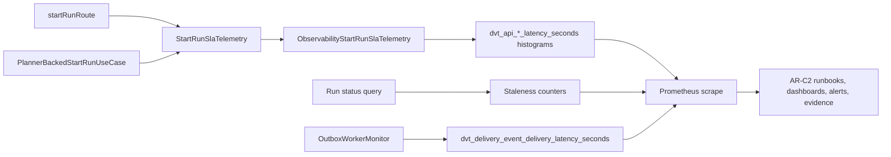
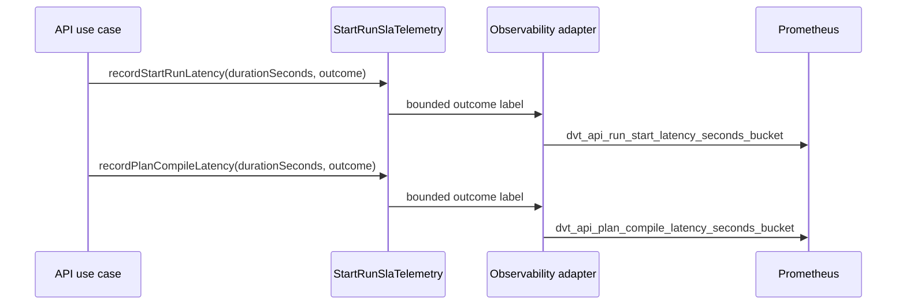
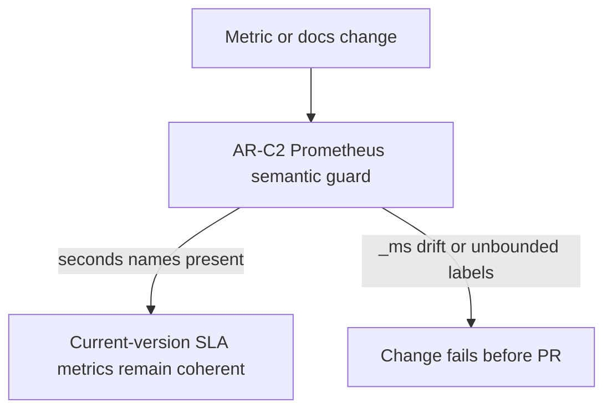

---
title: AR-C2 Prometheus SLA Component
status: Active
owner: Runtime / SRE / Docs
last_reviewed: 2026-05-14
---

# AR-C2 Prometheus SLA Component

## Owned concern

This component owns AR-C2 SLA metric identity, units, bounded-label semantics,
and Prometheus query alignment for API runtime, snapshot freshness, event
delivery, and outbox drain signals.

It does not own OpenLineage lineage events, Grafana provisioning,
Alertmanager routing, or backwards-compatible metric aliases.

## Public API

### API telemetry port

- `StartRunSlaTelemetry.recordStartRunLatency(durationSeconds, outcome)`
- `StartRunSlaTelemetry.recordPlanCompileLatency(durationSeconds, outcome)`
- `StartRunLatencyOutcome`: `accepted`, `rejected`, `unauthenticated`,
  `exception`
- `PlanCompileLatencyOutcome`: `built`, `reused`, `error`

### Prometheus metric identity

| Signal                      | Prometheus metric                                     | Type      | Labels           |
| --------------------------- | ----------------------------------------------------- | --------- | ---------------- |
| Start-run latency           | `dvt_api_run_start_latency_seconds`                   | histogram | `outcome`        |
| Plan compile latency        | `dvt_api_plan_compile_latency_seconds`                | histogram | `outcome`        |
| Snapshot freshness result   | `dvt.api.run_status.snapshot_staleness_result_total`  | counter   | `kind`, `status` |
| Snapshot freshness fallback | `dvt.api.run_status.snapshot_staleness_unknown_total` | counter   | none             |
| Outbox oldest claimed lag   | `dvt_outbox_oldest_claimed_lag_seconds`               | gauge     | none             |
| Outbox drain lag            | `dvt_delivery_outbox_drain_lag_seconds`               | gauge     | none             |
| Event delivery latency      | `dvt_delivery_event_delivery_latency_seconds`         | histogram | none             |

## Invariants

1. AR-C2 latency histograms use seconds as the stored Prometheus unit.
2. No legacy `_ms` AR-C2 latency alias is exported.
3. Human-facing thresholds may remain written in milliseconds when the PromQL
   expression converts seconds explicitly or the threshold value is stated in
   seconds.
4. Exported metric labels must stay bounded; tenant IDs, run IDs, plan IDs,
   workspace IDs, and event IDs are not metric labels.
5. The runbook, component guide, evidence artifact, code constants, and tests
   must name the same current-version metrics.
6. Snapshot freshness ratios are derived from counters and remain documented as
   operational queries rather than separately emitted metrics.

## Transitions

| State                     | Input                                 | Result                                                                           |
| ------------------------- | ------------------------------------- | -------------------------------------------------------------------------------- |
| Run start accepted        | API facade completes admission        | Start-run latency observation is recorded in seconds with `outcome="accepted"`.  |
| Run start rejected        | API facade rejects request            | Start-run latency observation is recorded in seconds with the rejection outcome. |
| Plan compile built        | Planner-backed use case builds a plan | Plan compile latency observation is recorded in seconds with `outcome="built"`.  |
| Plan compile reused       | Existing compiled plan is reused      | Plan compile latency observation is recorded in seconds with `outcome="reused"`. |
| Event delivered or failed | Outbox observer callback completes    | Event delivery latency histogram records elapsed seconds.                        |
| Snapshot stale/unknown    | Status query evaluates freshness      | Staleness counters increment with bounded labels.                                |

## Consumers

- API start-run authorization and planner-backed use cases.
- Outbox worker monitor Prometheus scrape endpoint.
- AR-C2 SLA canonical runbook.
- AR-C2 signal-threshold mapping.
- AR-C2 evidence collector and generated evidence artifact.
- Dashboard and alert authors using the current Prometheus metric version.

## Diagrams

## AR-C2 Prometheus SLA User Stories

### Stories

#### US-AR-C2-PROM-001 Current metrics use Prometheus base units

As an SRE, I want AR-C2 latency histograms to use `_seconds` metric names and
second-valued observations, so dashboards and alerts follow Prometheus
conventions.

Acceptance criteria:

- API start-run latency is exported as
  `dvt_api_run_start_latency_seconds_bucket`.
- API plan compile latency is exported as
  `dvt_api_plan_compile_latency_seconds_bucket`.
- Event delivery latency is exported as
  `dvt_delivery_event_delivery_latency_seconds_bucket`.
- No AR-C2 latency `_ms` alias is exported.

#### US-AR-C2-PROM-002 Labels remain bounded

As an operations owner, I want AR-C2 metric labels to exclude tenant, run,
workspace, event, and plan identifiers, so operational metrics do not create
unbounded cardinality.

Acceptance criteria:

- API latency histograms use only `outcome`.
- Snapshot freshness counters use only `kind` and `status` where needed.
- Event delivery latency has no entity identifier labels.
- The architecture guard fails if AR-C2 telemetry code exports identifier
  labels.

#### US-AR-C2-PROM-003 Docs and code cannot drift silently

As an architecture reviewer, I want a semantic guard to compare AR-C2 metric
identity across docs and code, so future edits cannot update only one surface.

Acceptance criteria:

- The guard reads code, runbooks, evidence docs, and component docs.
- The guard asserts all current AR-C2 metric names are present.
- The guard asserts old AR-C2 `_ms` latency names are absent from current
  surfaces.

#### US-AR-C2-PROM-004 Thresholds stay readable

As a release reviewer, I want human threshold tables to remain readable in
milliseconds while PromQL uses seconds, so review intent is clear without
breaking Prometheus semantics.

Acceptance criteria:

- Threshold tables may say `p99 <= 2500ms`.
- PromQL examples query `_seconds_bucket` series.
- Where a literal threshold is written inside PromQL, it uses seconds.

#### US-AR-C2-PROM-005 Module ownership is explicit

As a maintainer, I want each AR-C2 telemetry module to declare its owned
concern, so later refactors do not mix API telemetry, outbox delivery metrics,
and evidence generation.

Acceptance criteria:

- Start-run SLA metric constants declare the AR-C2 metric identity concern.
- API telemetry adapter declares the recording concern.
- Outbox monitor and delivery telemetry declare the worker metric concern.
- Renderer declares Prometheus text exposition as its concern.

### Scenario Diagram

> Acceptance scope status: Active. Owner: Runtime / SRE / Docs.
