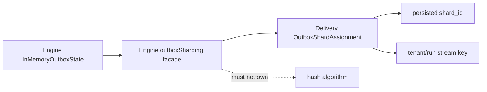
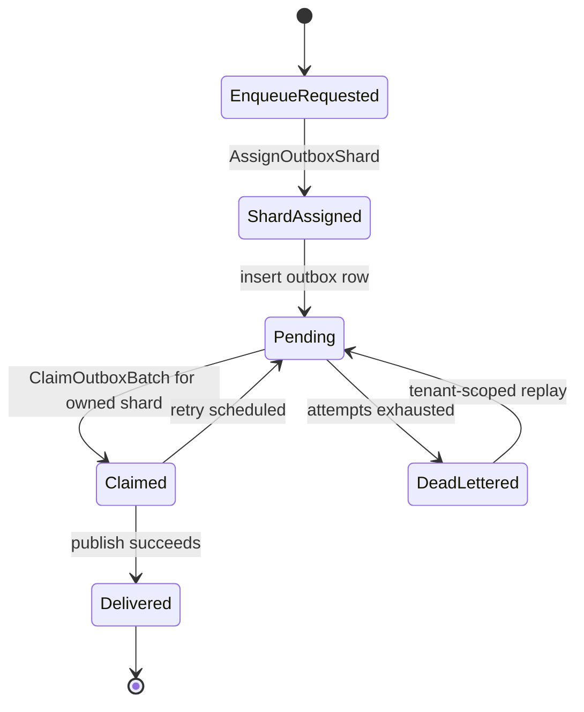
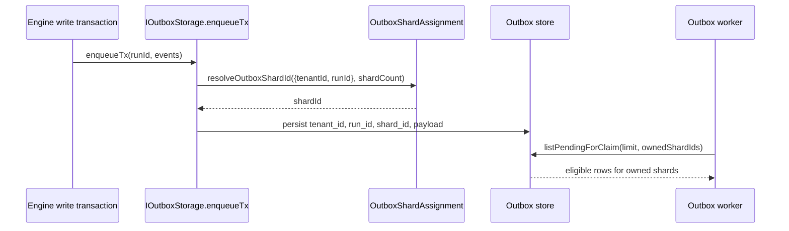
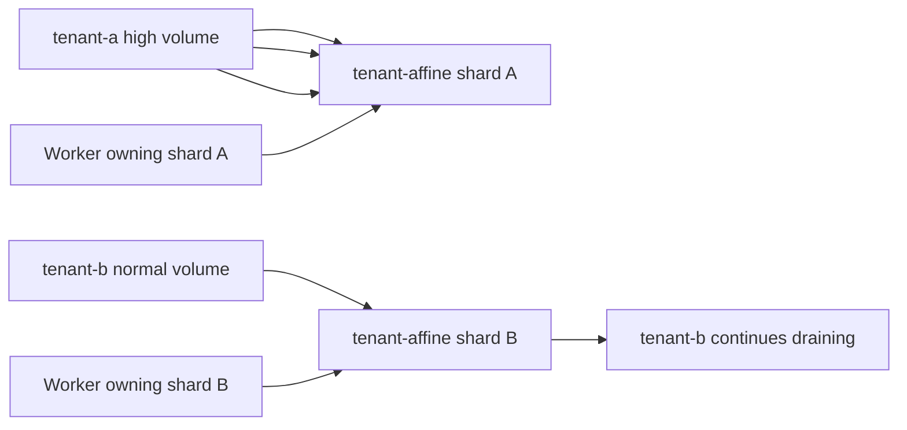

# Tenant-Aware Outbox Sharding Component

## Owned Concern

Tenant-aware outbox sharding owns the policy that assigns new transactional
outbox rows to persisted `shard_id` values before worker claim selection.

It does not own event publication, retry backoff, dead-letter replay, worker
process startup, or PostgreSQL advisory-lock ownership. Those remain separate
delivery runtime and host concerns.

## Public API

| API                                                        | Owner                | Purpose                                                                                                     |
| ---------------------------------------------------------- | -------------------- | ----------------------------------------------------------------------------------------------------------- |
| `OutboxShardAssignmentKey`                                 | `@dvt/delivery`      | Names the tenant/run identity used by the sharding policy.                                                  |
| `buildOutboxStreamOrderingKey(key)`                        | `@dvt/delivery`      | Builds the length-prefixed `(tenantId, runId)` stream key used by in-memory claim and dead-letter ordering. |
| `resolveOutboxShardId(key, shardCount)`                    | `@dvt/delivery`      | Pure query that returns the persisted shard id for a new outbox row.                                        |
| `engine/state/outboxSharding.resolveOutboxShardId`         | `@dvt/engine` facade | Engine-local compatibility API that delegates to the Delivery policy without owning hash semantics.         |
| `engine/state/outboxSharding.buildOutboxStreamOrderingKey` | `@dvt/engine` facade | Engine-local compatibility API for tenant/run stream ordering, backed by Delivery semantics.                |
| `IOutboxStorage.enqueueTx(runId, events)`                  | `@dvt/delivery` port | Adapter entrypoint that applies the policy when rows are persisted.                                         |
| `IOutboxStorage.listPendingForClaim(limit, { shardIds })`  | `@dvt/delivery` port | Existing claim command boundary that filters by worker-owned shards.                                        |

## Engine Compatibility Facade

`packages/@dvt/engine/src/state/outboxSharding.ts` is intentionally a semantic
facade, not a barrel. Engine owns the import shape used by
`InMemoryOutboxState`; Delivery owns the tenant-affine hash and stream-ordering
rules.

The facade exists so Engine tests can keep a local state-store vocabulary while
the runtime policy remains centralized in Delivery. It must expose named
functions, delegate to `@dvt/delivery`, and avoid local `node:crypto` or hash
implementation details.

## Invariants

- `tenantId` is mandatory for shard assignment.
- `shardCount` must be a positive integer.
- New rows are assigned by tenant-affine stable hash, not by run-only hash.
- Same tenant/run stream ordering is preserved by `(tenantId, runId, runSeq)`.
- In-memory ordering keys length-prefix tenant and run identifiers before
  joining them, so delimiter characters inside ids cannot merge streams.
- Dead-letter blocking is scoped to `(tenantId, runId)`.
- Existing rows keep their persisted `shard_id` until delivered, dead-lettered,
  or explicitly migrated.
- Workers claim only their configured shard ids.
- Engine compatibility APIs must delegate to Delivery and must not re-export a
  raw barrel or re-implement hashing.

## Transitions

## Sequence

## Consumers

- `packages/@dvt/delivery/src/testing/InMemoryOutboxStorage.ts`
- `packages/@dvt/engine/src/state/InMemoryOutboxState.ts`
- `packages/@dvt/adapter-postgres/src/PostgresOutboxStore.ts`
- `apps/outbox-worker/src/host/runOutboxWorkerHost.ts` through existing
  `IOutboxStorage` wiring
- `apps/outbox-worker/test/sharding/concurrentWorkerOrdering.test.ts`

## Rollout And Migration

The policy changes assignment for new rows. Existing rows keep their stored
`shard_id`.

Recommended rollout:

1. Keep `DVT_OUTBOX_SHARD_COUNT` unchanged.
2. Drain the current outbox backlog as far as practical.
3. Deploy write-side code and workers with the same shard count.
4. Keep owned shard coverage complete across active workers.
5. Monitor per-shard lag and per-tenant lag during the mixed old/new window.
6. Rebalance `ownedShardIds` only at explicit restart boundaries.

Changing `shardCount` remains a separate topology migration.

## Architecture Guard

`OutboxShardAssignment.architecture.test.ts` validates that:

- delivery owns the policy;
- engine exposes a named compatibility facade and delegates rather than
  re-implements the hash;
- PostgreSQL enqueue SQL includes tenant-aware hash input;
- docs no longer describe run-only shard assignment as current behavior.

## Tenant-Aware Outbox Sharding User Stories

### Stories

| ID        | Actor                 | Story                                                                                                                                | Acceptance Criteria                                                                                                                              |
| --------- | --------------------- | ------------------------------------------------------------------------------------------------------------------------------------ | ------------------------------------------------------------------------------------------------------------------------------------------------ |
| AR-D7-US1 | Platform operator     | As an operator, I need one noisy tenant to stay bounded to its tenant-affine shard so unrelated tenant shards can continue draining. | Many runs for one tenant resolve to one shard; a second tenant mapped to another shard remains claimable by its worker.                          |
| AR-D7-US2 | Delivery developer    | As a developer, I need in-memory and PostgreSQL stores to use the same tenant-aware assignment semantics.                            | Delivery tests and adapter SQL tests prove the same tenant-affine policy; engine delegates instead of duplicating the algorithm.                 |
| AR-D7-US3 | Delivery developer    | As a developer, I need same `runId` values from different tenants to remain independent streams.                                     | A failed or dead-lettered record for tenant A does not block tenant B with the same `runId`.                                                     |
| AR-D7-US4 | Worker operator       | As an operator, I need shard ownership to remain explicit after the policy change.                                                   | Workers still claim by configured `ownedShardIds`; empty or invalid shard selections fail closed.                                                |
| AR-D7-US5 | Release owner         | As a release owner, I need a rollout rule for persisted old rows.                                                                    | Runbook states that existing rows keep stored `shard_id`, new rows use tenant-aware assignment, and shard-count changes are separate migrations. |
| AR-D7-US6 | Architecture reviewer | As a reviewer, I need a semantic guard against returning to run-only hashing.                                                        | Architecture test fails if docs or source reintroduce run-only shard assignment as current behavior.                                             |
| AR-D7-US7 | Engine maintainer     | As a maintainer, I need Engine to expose a semantic compatibility facade instead of a raw barrel.                                    | Engine facade has an owned-concern docblock, named functions, explicit Delivery delegation, and no local hash implementation.                    |

### Scenario Diagram

### Negative Scenarios

- Missing `tenantId` must not silently hash as an unscoped tenant.
- `shardCount <= 0` must fail before routing.
- Dead-letter replay must keep tenant scope and stored shard ownership.
- A worker with no owned shards must claim nothing.
- Documentation that states `stableHash(runId) % shardCount` as current behavior
  must fail the semantic architecture guard.
- Replacing the Engine facade with a raw `export from '@dvt/delivery'` barrel
  must fail the architecture guard.

> Acceptance scope status: Active. Owner: Architecture / Delivery / SRE.
