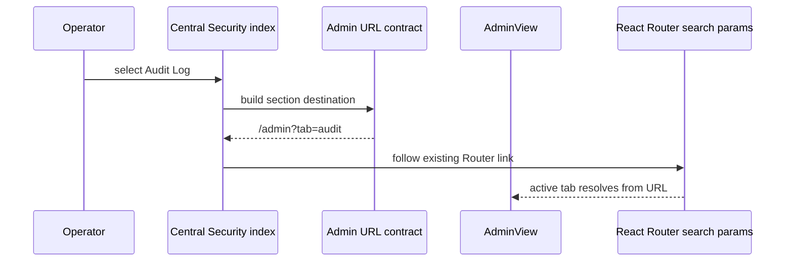
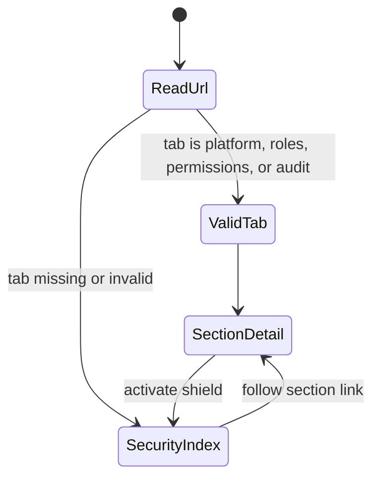

# Admin Route Position Component

## Purpose

The Admin route owns the Security index and the operator's position among
Platform, Roles, Permissions and Audit Log. The URL identifies the index or
section. Existing application ports govern health, capabilities, roles and audit
data. The protected Router boundary governs admission.

## Public API

| API                              | Owner                             | Responsibility                                                              |
| -------------------------------- | --------------------------------- | --------------------------------------------------------------------------- |
| `AdminView`                      | `AdminView.tsx`                   | Present the Security index or section inside the protected workbench.       |
| `adminSectionNavigation`         | `admin/adminRoutePosition.ts`     | Define the identifiers and icons for the four navigable sections.           |
| `resolveActiveAdminTab(...)`     | `admin/adminRoutePosition.ts`     | Resolve a valid Admin section or the Security index from `URLSearchParams`. |
| `buildAdminSectionLocation(...)` | `admin/adminRoutePosition.ts`     | Build the selected `?tab=...` destination, retaining unrelated route state. |
| `useAdminViewData()`             | `views/admin/useAdminViewData.ts` | Supply platform, capabilities, role and audit data to passive tabs.         |

## Invariants

- The Administration shield opens the Security index at `/admin`, including
  when activated from a detail. The shared top bar presents the route heading.
- The central navigation contains four keyboard-accessible Router links. Its
  display needs no health, role, permissions or audit query.
- A valid `tab` opens its detail directly, including on refresh. Missing or
  unknown section identifiers show the index.
- Section navigation and browser history use the URL. Links to a section on
  the same route preserve unrelated search parameters and the hash.
- Detail views consume `useAdminViewData()`. The existing protected route and
  backend services determine session scope and access.

## Transitions

### Tab selection

### Browser refresh

## Consumers

Direct consumers:

- React Router route `/admin`
- `AdminView.test.tsx`
- Admin platform, roles, permissions and audit tab components

Indirect consumers:

- Platform operators who refresh while inspecting Admin state
- PR reviewers validating route-position semantics
- Local protected-runtime debugging where Admin is used to inspect backend
  readiness and capabilities

## Semantic Encapsulation

`adminRoutePosition` owns the four identifiers and durable URL interpretation.
The shell projects its Administration link through `ListShellNavigationItems`
and classifies the route through `ResolveShellNavigationDisposition`.
`AdminView` composes the index and passive detail views. Section data, RBAC
policy and health projection retain their service and presentation owners.

## Negative Coverage

Primary tests:

- `apps/web/src/app/views/AdminView.test.tsx`
- `apps/web/src/app/views/AdminView.architecture.test.ts`
- `apps/web/src/app/views/admin/adminRoutePosition.test.ts`
- `apps/web/cypress/e2e/shell/route-workbench-slots.cy.ts`

The tests cover:

- shield activation opens the central index and returns there from a detail;
- section links open their real destinations and maintain the active location;
- refresh and browser Back restore the selected detail or index;
- missing and unknown section IDs expose the index with its accessible links.

## Drift To Watch

- Do not move tab position into local React state.
- Do not let Admin tabs directly decode auth tokens or call protected endpoints
  outside service/component boundaries.
- Do not promise editable RBAC behavior until the backend route and capability
  contract are verified.
