# App Shell

## Purpose

The App Shell is the persistent runtime frame of the DVT frontend.

It owns app bootstrap, route framing, top-level navigation, health visibility,
and the shared layout around every routed view.

## Current Implementation

Primary code anchors:

- [App.tsx](../../../../../apps/web/src/app/App.tsx)
- [Root.tsx](../../../../../apps/web/src/app/Root.tsx)
- [routes.ts](../../../../../apps/web/src/app/routes.ts)
- [AppShellFrame.tsx](../../../../../apps/web/src/app/components/shell/AppShellFrame.tsx)
- [TopAppBar.tsx](../../../../../apps/web/src/app/components/TopAppBar.tsx)
- [ShellAbout.tsx](../../../../../apps/web/src/app/components/shell/ShellAbout.tsx)
- [ShellActivityRail.tsx](../../../../../apps/web/src/app/components/shell/ShellActivityRail.tsx)
- [appBuildMetadata.ts](../../../../../apps/web/src/app/components/shell/appBuildMetadata.ts)
- [LeftNavigation.tsx](../../../../../apps/web/src/app/components/LeftNavigation.tsx)
- [BottomOperationalDrawer.tsx](../../../../../apps/web/src/app/components/shell/BottomOperationalDrawer.tsx)
- [bottomOperationalDrawerLogModel.ts](../../../../../apps/web/src/app/components/shell/bottomOperationalDrawerLogModel.ts)

The explicit [#3765 navigation direction](https://github.com/dunay2/dvt/issues/3765#issuecomment-6724940225)
uses one direct left rail on all routes. It supersedes the older hidden-rail and
Raven-menu placement without changing route or command authority. Shared visual
roles come from the bounded #3035 foundations delivery.

Current shell regions:

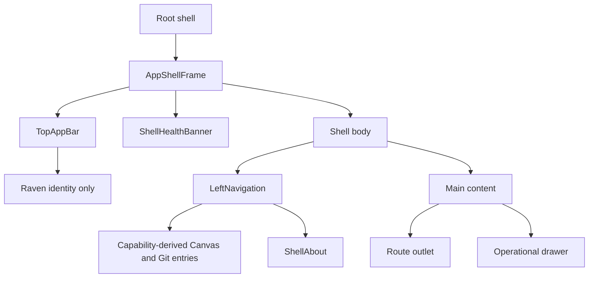

## Protected Route And Shell Lifetime

`AuthRouteGate` owns the existing `GetProtectedRouteSession` admission. Initial
checking renders no Root. Once admitted, protected navigation retains Root,
AppShellFrame and the navigation DOM while `AuthRouteSurface` closes only the
Outlet until the current session and workspace query succeeds. The requested
pathname/search/hash must match the allowed identity during render, so no target
route effects run before revalidation. Missing admission context fails closed.

A current denial removes the protected shell and content in favor of existing
login or project onboarding recovery. This is one admission state machine with
a read-only presentation boundary, not an authentication cache or another store.
Abort cleanup and the resolver's publication receipt still reject stale results.
See the [auth contract](web-auth-project-onboarding-component.md) for the state
diagram, ordering and negative tests.

## Shell Service Composition

The shell is also the composition boundary for frontend service wiring.

`Root` mounts `AppServicesProvider`, which composes API-backed typed service
instances for views and plugins through hooks.

This prevents route-level components from constructing transports or selecting
a second product data authority.

## Brand Identity And About

The Raven brand is noninteractive identity. Global navigation is directly visible
in the left shell rail; About has a separate Info button at its bottom. The
existing dialog opens with keyboard or pointer and restores focus to that button
on dismissal. No menu, metadata endpoint or navigation catalogue is added.

Current command/query rail:

| Rail                             | Type  | Owner         | Surface             |
| -------------------------------- | ----- | ------------- | ------------------- |
| `GetCompiledApplicationMetadata` | query | Web App Shell | `ShellAbout` dialog |

`GetCompiledApplicationMetadata` reads compile-time bundle metadata from
`import.meta.env.VITE_APP_VERSION` and `VITE_APP_BUILD_DATE`. It does not call
the backend `/version` endpoint because the About dialog answers which Raven
bundle is running in the browser, not which API build is reachable.

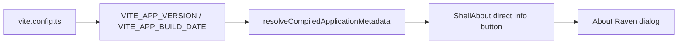

## Shell Navigation Ownership

An existing navigation item may opt into a route heading and concern-owned
section navigation. Root projects the active optional heading from that same
model into ShellTopBar; a route does not publish a second title state.

Admin uses this composition: its title occupies the existing top bar, and the
left Admin icon opens Platform, Roles, Permissions and Audit Log through the
existing Radix menu and Router. The route no longer repeats a large header or a
centered tab list. The Admin URL contract owns valid section IDs, fallback and
search/hash preservation; the shell menu merely presents those destinations.

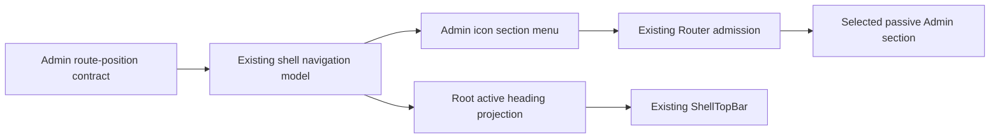

Canvas and Git retain their existing controls and DOM lifetime. Other navigation
items remain direct links; no new registry, route store or permission policy is
introduced. Section menu items are real links, while their trigger is a real
button with menu semantics and existing focus/tooltip/geometry roles.

The current left navigation implementation follows the same boundary rule as
the rest of the shell:

- runtime capability data decides which plugin-contributed views are available;
- the shell normalizes those runtime views into a render-ready navigation model;
- the rail renders plain navigation items and does not know plugin manifest
  structure, label resolution, or shell footer ownership.

Direct rail contract:

- Canvas is the single first entry; Git follows whenever that Canvas capability
  exists in the navigation model, independently of the current route or panel;
- remaining global destinations follow in their model order below a divider;
- About remains at the bottom, with constrained navigation scrolling;
- `Root` supplies the existing capability-derived model once to `LeftNavigation`;
- global links use Router and `aria-current`; on the Canvas route, its unmodified
  primary activation opens Elements idempotently through the existing
  `dispatchCanvasExplorer({ type: 'expand' })` command. Code returns through the
  existing `codeTab.onCanvas` contribution; an active Model remains selected;
- Canvas exposes Elements disclosure without a second Elements button. Git keeps
  its independent disclosure and guarded owner. Modified/new-tab link activation
  retains Router behavior. Collapse uses the panel header and returns focus to Canvas;
- the existing shell footer contributions are not a new permission predicate;
  route/session guards continue to decide authorization;
- the shell owns both entries directly; Explorer does not portal navigation
  from a route whose lifetime can end.

Shell presence is a boolean presentation context. Without it, Explorer retains
its standalone inline controls; with it, there are no duplicate activity controls.
The DOM target, portal and active-surface scope are retired. Explicit Focus mode
still suppresses shell chrome through its existing owner. Graph/editor identity
and existing hidden/inert surface lifetimes remain unchanged.

The [persistent Git entry supplement](https://github.com/dunay2/dvt/issues/3765#issuecomment-6725659498)
reuses `SelectCanvasWorkbenchTab`. On Canvas, Git invokes the published Code
opener directly, avoiding Router navigation through a pending Model guard.
From another route its real `/canvas` link carries the finite Router state
request `canvasWorkbench: 'code'`. Canvas consumes only that request, preserving
other state and the full URL, before its existing owner admits Code. A blocked
replace cannot open Code. Cancelable deferred effects protect StrictMode replay;
changed authority, navigation and stale completion cannot claim admission.
Modified/new-tab activation follows the ordinary Canvas href: history state is
not a cross-window Code deep link. No last-project cache or global intent store
is introduced.

The unified Canvas activation is the explicit exception for layout preference
writes: it opens a collapsed or closed dock at its retained width. Repeating it
does not collapse, close Code, change Model, or create a semantic write. The shell
depends on the existing workspace contribution contract, never a Canvas controller
or another command registry. Standalone Explorer retains its local Elements control.

Use the existing Lucide family at 20px/stroke 2 in 44px targets, with a 52px rail,
4px inline padding and an inset divider. Only consumed navigation control/icon
roles extend the existing spacing scale. Selection, focus and execution health
remain different visual meanings. Preserve forced colors, reduced motion and
hover/focus tooltip equivalence. See the
[disposition contract](../shell-navigation-disposition-component.md) for the
state diagram, active-surface rules and required browser evidence.

Current flow:

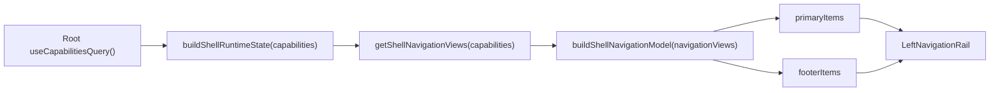

Responsibility split:

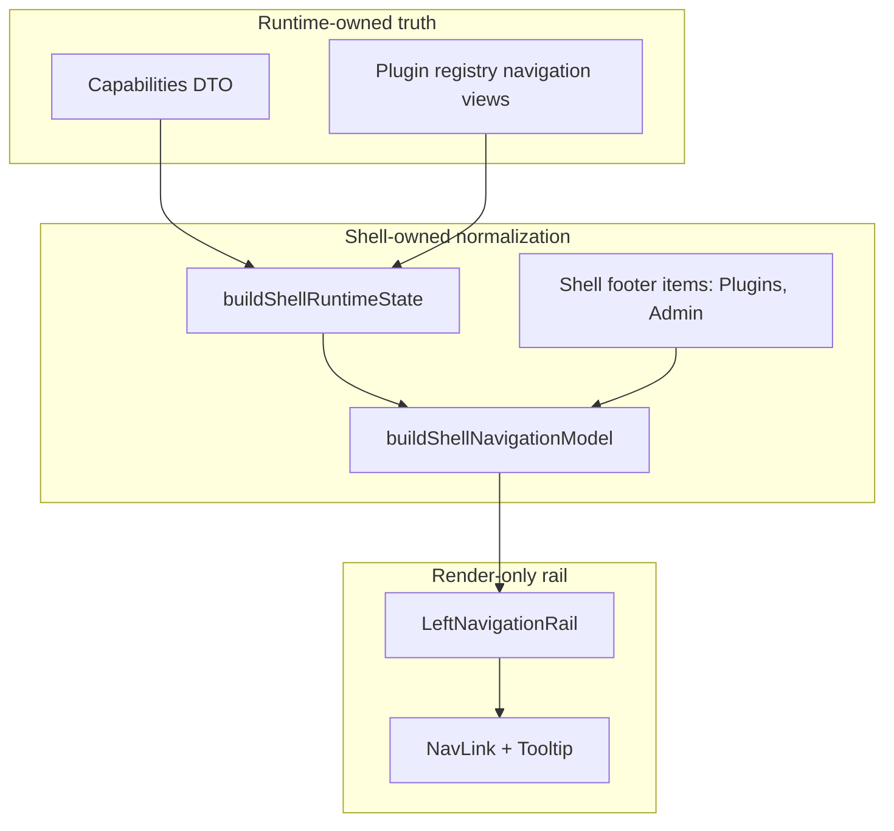

Navigation boundary rules:

- `LeftNavigation.tsx` must not import `resolveString`, plugin manifests, or
  fixed shell footer item definitions;
- only plugin-contributed `placement.kind === 'shell-nav'` views become
  `primaryItems` inside the shell model;
- Canvas owns Code, Lineage, Diff, Artifacts and Canvas Runs sessions. The
  shell Git entry delegates to the existing Code command; it does not own a
  second Code route or workbench session;
- shell-owned routes such as `Plugins` and `Admin` stay in `footerItems`;
- the rail consumes render-ready navigation items and section descriptors,
  preserving navigation chrome and routing as its owned concern.

## Bottom Operational Drawer Ownership

The bottom drawer now follows the same separation rule as the rest of the shell:

- shell copy and shell chrome stay in shell-owned modules;
- the drawer resolves a small, explicit state model before rendering;
- the render surface owns one controls row containing the existing tabs, optional
  run badge and close action, followed directly by the content body;
- the localized drawer title names its accessible region; it does not consume
  a separate visible heading row;
- the close button remains outside the tablist. With no route contribution, the
  controls row contains only the real run badge and close action. Hidden tabs
  remain restorable without rendering an empty tablist;
- the drawer is a shell companion surface, not the durable run workspace authority.

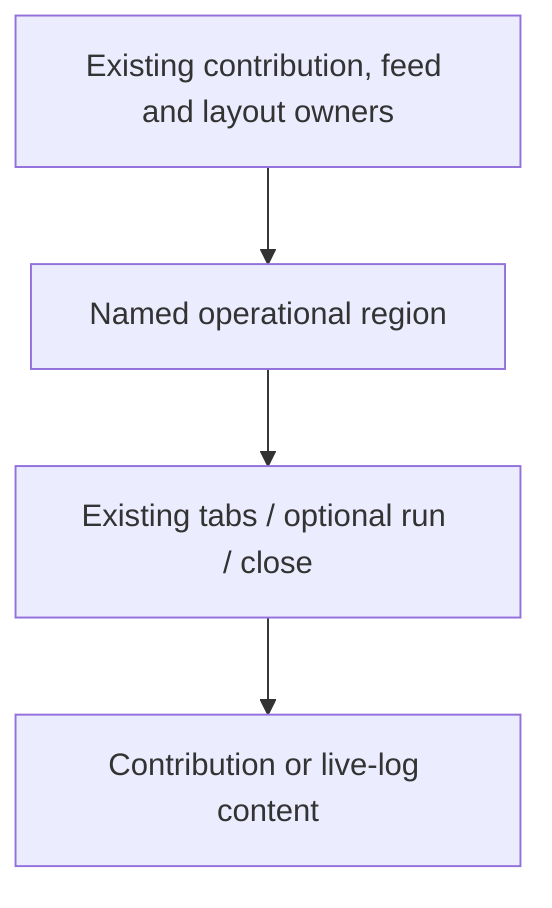

This composition recovers content space at the same drawer height. The shell
frame still owns the resize separator and layout persistence; the drawer keeps
the existing hide command, tab visibility commands and feed subscription.

### Hidden Operational Tab Recovery

When every operational tab is hidden, the compact controls row exposes a visible
Restore tabs button. It opens the standard application dropdown by pointer or
keyboard and delegates to the existing tab visibility command. Visible tabs retain
their contextual restoration menu. Both presentations share one item renderer and
the same restore callback. No browser context-menu shortcut is required to recover
from the all-hidden state; the drawer close control remains separate.

### Operational drawer layout command

| Rail                               | Type    | Owner                | DDD object                             | Application port                                               | Adapter surface                                                                        | Scope and authorization                                                                          | Negative tests                                                                                                                                                                                                                     |
| ---------------------------------- | ------- | -------------------- | -------------------------------------- | -------------------------------------------------------------- | -------------------------------------------------------------------------------------- | ------------------------------------------------------------------------------------------------ | ---------------------------------------------------------------------------------------------------------------------------------------------------------------------------------------------------------------------------------- |
| `ConfigureOperationalDrawerLayout` | command | Web App Shell layout | `OperationalDrawerLayout` value object | Existing `uiLayoutStore` show, hide, toggle and resize actions | `Root`, `AppShellFrame`, `useOperationalDrawerResize`, Preview and Run reveal adapters | Authenticated browser-local preference; no server grant, protected draft or workspace-file write | Ignore non-finite/invalid resize and synchronized echoes; repair legacy zero height; preserve height through close/reopen/reload; no persistence for mount/restoration/container observation; no content remount on height updates |

The existing `bottomDrawerVisible` and `bottomDrawerHeight` fields are one layout
value. A synchronous transition owns `show`, `hide`, `toggle` and `resize`.
Closing changes visibility and retains the last positive height. An implicit
Preview or Run reveal uses `showBottomDrawer()` and preserves that height;
execution adapters do not receive or interpret drawer geometry. An explicit
height request remains supported. The canonical default is 300 CSS pixels and
the minimum preference is 160; the panel library separately bounds the rendered
percentage to the available group space.

Legacy zero or invalid persisted geometry normalizes to the default, including
while hidden. Hydration keeps its explicit allowlist: stored values cannot
replace runtime actions or restore inspector visibility. Explorer transitions
retain their synchronous `get`/transition/identity guard. They deliberately do
not call the persist-wrapped setter for a no-op, because persist can write even
when Zustand would retain the same state object.

The Frame resize adapter measures the actual vertical panel group, rather than
the browser viewport. Pointer dragging and keyboard resize events are the only
geometry observations that publish a preference. Mount, restoration,
programmatic resize, container measurement and matching echoes do not write it.
The adapter uses the existing imperative Panel handle for a changed height
request; it does not key the panel by height or own another saved size/visibility
state. Input, focus and drawer DOM survive resize and unrelated shell renders.
Hide and explicit Focus mode retain their existing unmount semantics; layout
and contribution owners retain their own data across reopening.

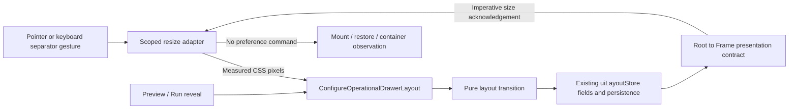

Canvas color preferences use `CanvasHexColor`, the existing hexadecimal string
contract with an intention-revealing name. Persisted keys, normalization and
palette rendering remain unchanged; there is no second color type or alias.

Current state model:

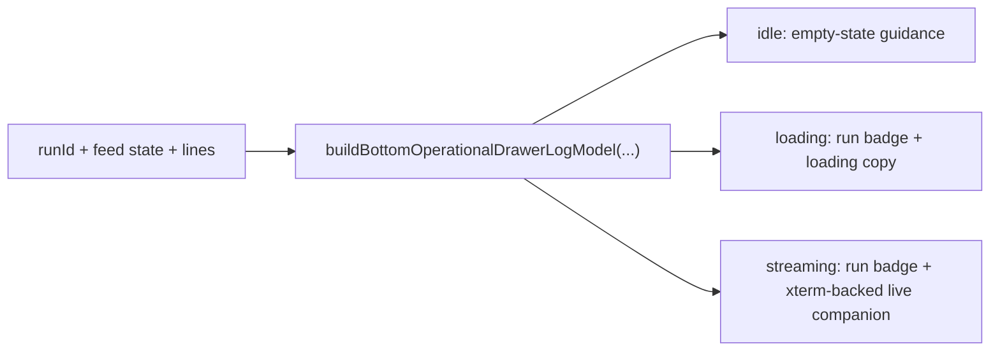

Authority split with the Runs route:

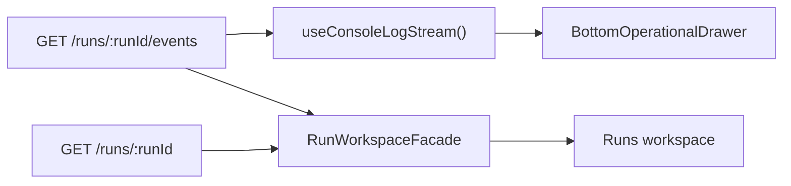

Boundary rules for these two surfaces:

- `BottomOperationalDrawer` mirrors the currently active run as a shell-level
  xterm-backed live companion;
- `BottomOperationalDrawer` does not claim snapshot authority, failure-diagnostics authority, or full run-detail ownership;
- `Runs` owns durable run monitoring through snapshot plus timeline composition;
- `Runs` is the place where degraded timeline state, runtime snapshot truth, result evidence, and failure diagnostics are explained.

Shared event presentation seam:

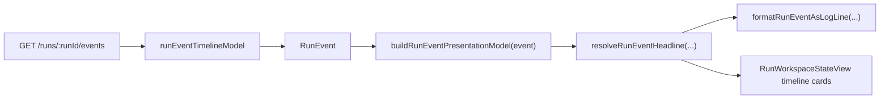

Rules for the shared seam:

- the timeline model owns event ordering, dedupe, cursor, and active-status
  polling decisions;
- the shared model owns event level, headline key, optional detail, and step identity;
- the shared copy resolver owns human-readable event headline text for shared event surfaces;
- the shell drawer renders terminal-style lines through `XtermConsole` from
  that shared semantics plus shared copy;
- the Runs route may render structured timeline cards from the same shared semantics plus shared copy;
- the shared model must not collapse snapshot authority or failure-diagnostics authority back into the drawer.

## Shell Workspace Context Component

The shell workspace context is the bounded replacement for tenant, project, and
environment dropdowns that previously consumed the main top bar.

Workspace context is breadcrumb-style read-only content on the main screen.
Tenant, project, environment, and deployment adapter labels are read-only.
The on-demand workspace menu delegates selection among server-granted scopes to
`SelectWorkspaceScope`; it cannot create grants or construct an unvalidated scope.

The dedicated local component guide is
[Shell Workspace Context Component](./shell-workspace-context-component.md).
Scenario coverage lives in
[Shell Workspace Context User Stories](shell-workspace-context-component.md#section-shell-workspace-context-user-stories).

It uses a Fowler Presentation Model split:

- `buildProjectIdentityBadge(...)` resolves workspace scope into read-only
  labels;
- `ShellProjectIdentityBadge` renders those labels without mutation affordance;
- `ShellWorkspaceContextMenu` owns the on-demand shell context and granted-scope selection
  surface;
- `ShellWorkspaceContextDetails` renders tenant, project, environment, and
  deployment adapter as read-only context fields.

### Public API

| API                            | Kind          | Owner                   | Contract                                                                                          |
| ------------------------------ | ------------- | ----------------------- | ------------------------------------------------------------------------------------------------- |
| `ProjectIdentityBadge`         | read model    | Web shell presentation  | Carries tenant, project, environment, deployment adapter, compact id, slug, and draft-scope label |
| `buildProjectIdentityBadge`    | query adapter | Web shell presentation  | Resolves granted option labels and falls back to raw ids without fabricating                      |
| `ShellProjectIdentityBadge`    | passive view  | Shell top-bar rendering | Displays read-only project identity in the persistent shell bar                                   |
| `ShellWorkspaceContextMenu`    | details UI    | Shell context display   | Exposes read-only details and delegates granted-scope selection                                   |
| `ShellWorkspaceContextDetails` | passive view  | Shell context display   | Displays tenant, project, environment, and deployment adapter without mutation controls           |

### Invariants

- the main top bar renders no `role="combobox"` workspace controls;
- `ProjectIdentityBadge` is read-only and cannot dispatch session commands;
- scope labels are passive; only `SelectWorkspaceScope` may change the validated selection;
- the menu offers existing granted scopes as buttons, not free-form tenant or environment inputs;
- the menu must not create a parallel auth, RBAC, tenant-admin,
  project-selection, or environment-selection rail;
- Git context remains read-only in this slice and does not become a branch
  command surface.

### Transitions

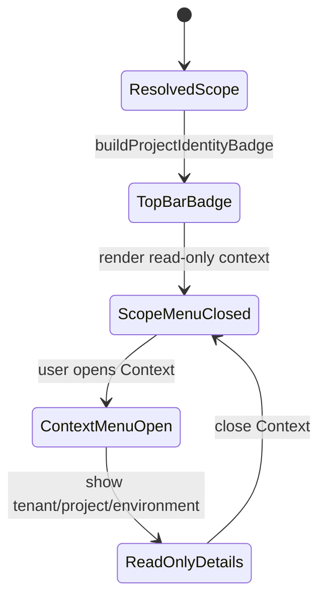

### Consumers

| Consumer                   | Use                                                                 |
| -------------------------- | ------------------------------------------------------------------- |
| `ShellTopBar`              | Composes badge, context menu, health, Git reference, and View menu  |
| Canvas workbench route     | Reads the same session scope through its existing query/controller  |
| Runs and other workbenches | React to session-scope changes through their existing route queries |
| Cypress posture proof      | Verifies badge presence, no comboboxes, and read-only details       |

### Component Flow

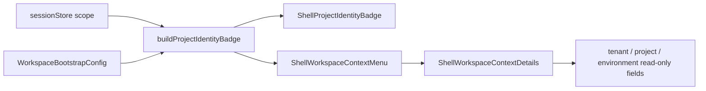

## UX Rules

- the top bar stays visible across all routed views;
- platform-health state must be visible without entering a diagnostic route;
- focus mode hides secondary chrome but keeps the active view intact; an
  explicit card Preview or Properties action exits focus mode to reveal its
  requested data drawer or contextual window;
- route switches should not remount the entire shell frame.

### Keyboard And Route Focus Invariants

- `AppShellFrame` owns exactly one `main` landmark with the stable
  `app-shell-main-content` id and a programmatic focus target;
- the first shell bypass control is an internationalized skip link that points
  to that landmark;
- initial shell mount does not move focus;
- a change to `location.pathname` moves focus to the main landmark exactly
  once with scrolling suppressed;
- rerenders that keep the same pathname, including health polling and route
  bootstrap publication, do not move focus;
- route focus is presentation behavior. It does not create a navigation
  command, focus store, route announcer, or parallel application rail.

## Mature Libraries And References

- base shell primitives:
  [Radix Primitives](https://www.radix-ui.com/primitives),
  [shadcn/ui](https://ui.shadcn.com/)
- workbench precedent:
  [VS Code](https://github.com/microsoft/vscode)

## Current Constraints

- some shell quick actions are placeholders and not yet connected to governed
  behavior;
- the operational drawer now has an explicit shell-owned content model, xterm-backed
  live companion rendering, and typed idle, loading, and streaming states;
- shared event presentation semantics align on ordering, dedupe, cursor,
  active-status polling, level, headline key, shared headline copy, detail, and
  step identity across drawer and Runs workspace surfaces.

## Current-To-Target Mapping

The shell already exists in working form. The current step is to keep making
the extracted primitives honest and small.

- `AppShellFrame`
  Current anchor: [AppShellFrame.tsx](../../../../../apps/web/src/app/components/shell/AppShellFrame.tsx) plus [Root.tsx](../../../../../apps/web/src/app/Root.tsx)
  Decision: keep the extracted shell frame small and behavior-preserving.
- `ShellTopBar`
  Current anchor: [TopAppBar.tsx](../../../../../apps/web/src/app/components/TopAppBar.tsx)
  Decision: keep the global context behavior, narrow the contract, and token-clean it.
- `LeftNavigationRail`
  Current anchor: [LeftNavigation.tsx](../../../../../apps/web/src/app/components/LeftNavigation.tsx) plus [shellNavigationModel.ts](../../../../../apps/web/src/app/shell/shellNavigationModel.ts)
  Decision: keep a render-only rail plus a shell-owned navigation model.
- `ShellHealthBanner`
  Current anchor: [ShellHealthBanner.tsx](../../../../../apps/web/src/app/components/ShellHealthBanner.tsx)
  Decision: keep and restyle through semantic tokens.
- `BottomOperationalDrawer`
  Current anchor: [BottomOperationalDrawer.tsx](../../../../../apps/web/src/app/components/shell/BottomOperationalDrawer.tsx) plus [bottomOperationalDrawerLogModel.ts](../../../../../apps/web/src/app/components/shell/bottomOperationalDrawerLogModel.ts)
  Decision: keep the drawer pattern, with a shell-owned state model and future log hardening.

## Shell Organization Rules

The shell layer should become explicit in code structure:

- `components/ui`: low-level library primitives only;
- `components/shell`: top bar, navigation rail, health banner, operational drawer,
  and shell-only helpers;
- `components/workbench`: route-level shared layout primitives used by multiple
  views;
- `views/<route>`: route composition and route-only components.

This matters because the current shell pieces are real, but they still live as
standalone feature files instead of as an intentional shell package boundary.

## Store Boundary Rule

The shell no longer has an aggregate store surface. Runtime state is split by
owned concern:

- shell store: focus mode, shell drawer visibility, nav state, health display
  preferences;
- canvas/workbench store: route-local selection, viewport, and panel state;
- server state: queries stay in TanStack Query, not in Zustand;
- execution state: current run and run detail should not stay coupled to shell
  layout concerns.

Implementation anchors:

- [`sessionStore.ts`](../../../../../apps/web/src/app/stores/sessionStore.ts)
- [`uiLayoutStore.ts`](../../../../../apps/web/src/app/stores/uiLayoutStore.ts)
- [`executionStore.ts`](../../../../../apps/web/src/app/stores/executionStore.ts)
- [`canvasInteractionStore.ts`](../../../../../apps/web/src/app/stores/canvasInteractionStore.ts)

Do not recreate a root store barrel or a mirror-writing aggregate store. New
state must be placed in the smallest named slice that owns the concern.

## Related Pages

- [Screen Manuals And User Stories](../screen-manuals-and-user-stories.md)
- [UX Implementation Guide](../style-guide.md#section-ux-implementation-guide)
- [Data Source Service Boundary](../frontend-data-boundary-architecture.md#section-data-source-service-boundary)
- [Library And Open-Source Reference Stack](../style-guide.md#section-library-and-open-source-reference-stack)
- [Canvas Workbench Screen Composition](../graph/canvas-shell-component.md#section-canvas-workbench-screen-composition-component)
- [Shell Workspace Context Component](./shell-workspace-context-component.md)
- [Shell Workspace Context User Stories](shell-workspace-context-component.md#section-shell-workspace-context-user-stories)

<a id="section-top-app-bar-user-manual-20260404"></a>

## Top App Bar User Manual

### What It Does

The top app bar controls workspace scope, shows platform connectivity, and
provides shell-level UI actions.

### Granted Workspace Scope Selection

The on-demand context menu presents complete granted tenant/project/environment
scopes as buttons through `ShellWorkspaceScopeSelector`, not independent free-form selectors.

The browser may select only scopes granted by GetEffectiveWorkspaceContext.
The shell displays the validated selection; it cannot create or expand grants.

### Git Reference

The app bar shows current branch and short SHA from bootstrap config.

### Connection Indicator States

- `Checking`: health probe is still in-flight.
- `Healthy`: REST endpoint is available.
- `Offline`: backend is unreachable.
- `Degraded`: backend responds but reports degraded status.

Tooltips show additional detail when available.

### Admin Operational Health Truth

The existing `OperationalReadinessQuery` and `GetRuntimeCapabilities` reads feed
Admin diagnostics. The platform-health query and its publication timestamp are
the observation authority. `adminViewModel` projects that observation once for
both summary cards and endpoint details; components do not infer readiness from
missing data or from transport availability alone. Aggregate connectivity reuses
`buildShellHealthPresentationModel` rather than copying its policy.

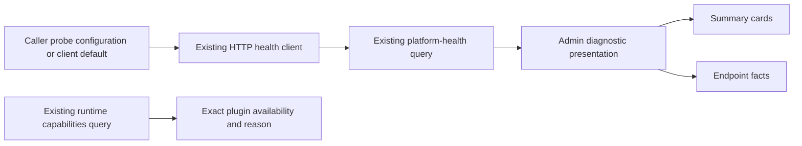

Initial pending is Checking. A probe excluded by client configuration is Not
requested; an observed optional 404/405 is Not exposed. Both are informational,
with neutral presentation. A 401/403, network error, invalid JSON or unexpected
server error is a probe failure. A valid not-ready response preserves the
backend reason. A failed refresh with a cached snapshot explicitly labels the
prior observation historical; it cannot appear as a current successful probe.
Status text and icons accompany semantic tone, so color is not the only signal.

API service version, API compatibility version and Raven bundle version are
independent facts. A disabled `/version` endpoint does not borrow the bundle
version. Disabled plugins preserve their backend-provided reason and remain
distinct from optional probe availability.

The development launcher inherits an explicit caller probe policy and otherwise
leaves the default to the existing client. It does not impose an empty optional
probe set. No diagnostic component creates a polling loop, another health store,
an API route or a run-admission decision.

### Shell Menu Actions

- Toggle Explorer panel
- Toggle Inspector panel
- Toggle Console
- Toggle Focus mode
- Change grid size

These controls update UI layout state only.

### Language Behavior

- The persisted application-language preference controls English or Spanish copy.
- Browser locale supplies the initial fallback only; changing the preference updates the open shell.

`SYS-WEB-CANVAS-COPY` owns the Canvas text catalogue and its read-only resolution
against that existing preference. Its English and Spanish sections contain plain
strings and compose one dictionary per language. `resolveCanvasViewCopy` selects
the existing dictionary; `canvasViewCopy` reads the current preference on each
property access so an open Canvas follows language changes. Regional Spanish
locales select Spanish; other locales retain the English fallback. Only entries
with current consumers belong in the catalogue. Formatting, readiness decisions,
and writes to the language preference retain their existing owners.

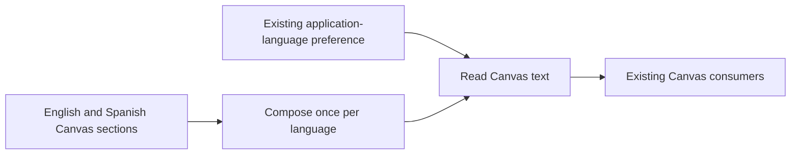

### Troubleshooting

- If selectors appear empty, verify workspace bootstrap options are configured.
- If status is always `Offline`, verify `/healthz` reachability from web app.
- If toggles do not persist, inspect `uiLayoutStore` persistence settings.

### Definition Of Done

- [ ] The workspace menu offers only granted scopes and dispatches `SelectWorkspaceScope`.
- [ ] Connection state indicator transitions correctly.
- [ ] Shell toggles update panels and focus mode.
- [ ] Spanish labels render when the persisted application preference is `es`.
- [ ] English labels render when the persisted application preference is `en`; browser locale is only the initial fallback.

> Section status: Draft. Owner: Web. Colocation does not merge component responsibilities.

<a id="section-top-app-bar-component-technical-manual-20260404"></a>

## Top App Bar Component Technical Manual

### Goal

Define the current technical shape of the top app bar so the UI stays modular,
multi-language ready, and style-consistent.

### Scope

- `apps/web/src/app/components/TopAppBar.tsx`
- `apps/web/src/app/components/shell/*`

### Component Boundary

`TopAppBar.tsx` is a composition root only. It owns store wiring and delegates
rendering to small UI components:

- `ShellWorkspaceContextMenu` and `ShellProjectIdentityBadge`
- `AppBrandMark` as noninteractive identity
- `ShellGitRef`
- `ShellConnectionStatus`
- `ShellMenu`

### Runtime Composition

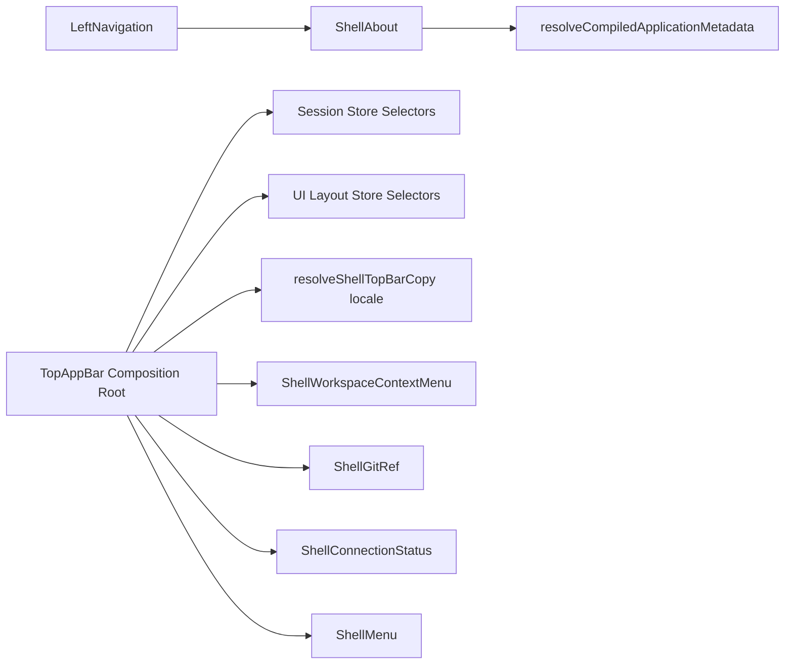

### About

`ShellAbout` owns the direct rail trigger and About dialog, backed by the existing
`GetCompiledApplicationMetadata` query. The logo has no activation lifecycle.
Global links belong to `LeftNavigation`, not this dialog or TopBar.

The About dialog shows the compiled browser bundle version from
`VITE_APP_VERSION` and the optional build date from `VITE_APP_BUILD_DATE`. It
must not call backend `/version`, mutate workspace scope, or become a route.

### Shared Overlay Interaction Authority

Declared Radix primitives whose dependency graph reaches `DismissableLayer` must
resolve to one physical installed layer implementation. Dialogs, alerts, menus,
popovers, selects, hover cards, navigation menus and tooltips compose within the
same browser document; their ordering cannot be split across independent layer
contexts.

A tooltip remains mounted while its closing animation runs. Separate dismissal
implementations can each consider their own layer highest and let that closing
tooltip consume Escape before an active dialog sees it. This prevented About
from closing even though the browser delivered a trusted Escape event. Supported
direct package versions and the governed lock align the existing primitives on
one authority; the fix adds no Escape listener, forced transitive override,
animation removal, timing wait or presentation store.

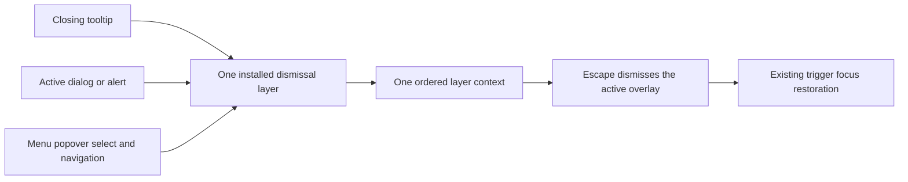

The installed-dependency architecture test includes every declared Radix root
that reaches this authority. The real About consumer also tests Escape while a
tooltip exit animation is retained. Native shell journeys retain trusted
keyboard input and verify dialog dismissal, trigger focus, section-menu Escape
and pending Model edit guards without waiting for animations to finish. This
dependency alignment repairs those existing interactions; it does not integrate
unrelated dependency PRs or alter the governing queries.

### Multi-Language Strategy

- `shell/copy.ts` is the single copy authority for app bar text.
- Current locales:
  - `en` and `es` are selected through `useApplicationLanguageStore`.
  - Browser locale is an initial fallback, not the authority after a user preference.
- No hardcoded UI labels are allowed in app bar subcomponents.

### Styling Strategy

- `shell/chrome.ts` contains reusable shell chrome tokens for recurring visual
  patterns.
- Subcomponents consume these tokens instead of duplicating Tailwind strings.
- `styles/fonts.css` owns the shared dense UI typography roles: `--text-ui`
  (the existing 12 px control scale), `--text-ui-caption` (11 px), and
  `--text-ui-micro` (10 px), with their line-height tokens. Shell chrome and the
  project Explorer consume these roles; the content body/meta/mono scale and
  root font size remain unchanged. Hierarchy uses weight and contrast rather
  than enlarged sidebar text. Existing 14 px content remains on the body role.
  [Shared UI typography decision](https://github.com/dunay2/dvt/issues/3765#issuecomment-6728952540).

### SRP Rules

- Each file in `components/shell/` should keep one shell UI responsibility.
- `TopAppBar.tsx` should not contain menu internals, health rendering branches,
  or selector option rendering loops.

### Negative Test Targets

- Missing locale key fallback must resolve to `en`.
- `connectionStateOverride` must still override store state.
- Menu controls must continue toggling layout flags.
- About metadata must use compile-time app metadata, not API health/version
  probes.
- Shell-owned controls must not import `topAppBar/*` support files.

### Definition Of Done

- [ ] `TopAppBar.tsx` stays as composition root only.
- [ ] App bar labels come from `components/shell/copy.ts`.
- [ ] Reused class tokens come from `components/shell/chrome.ts`.
- [ ] `pnpm --filter @dvt/web typecheck` passes.
- [ ] `pnpm --filter @dvt/web test` passes.
- [ ] `pnpm --filter @dvt/web build` passes.

> Section status: Draft. Owner: Web. Colocation does not merge component responsibilities.

<a id="section-route-workbench-frame-component"></a>

## Route Workbench Frame Component

### Purpose

`RouteWorkbenchFrame` is the shared presentation primitive for route-level
workbenches in `apps/web`. It keeps the shell contract explicit without making
the shell own route domain behavior.

### Public API

```ts
export type RouteWorkbenchFrameSlots = Readonly<{
  leftPanel?: ReactNode;
  primarySurface: ReactNode;
  rightPanel?: ReactNode;
  bottomDrawer?: ReactNode;
}>;
```

`RouteWorkbenchFrame` accepts:

- `header`: route-owned header stack rendered outside the route body scroll.
- `slots`: semantic route body contract for left context, primary surface,
  right context, and route supporting drawer.
- `scroll`: whether the frame owns body scrolling.
- `bodyClassName` and `bodyContainerClassName`: route-level layout overrides.

### Invariants

- The top application shell remains outside this component.
- `header` is never nested inside the scroll body.
- `primarySurface` is required when `slots` are used.
- `leftPanel`, `rightPanel`, and `bottomDrawer` are optional contextual support
  surfaces.
- Anonymous route body `children` are not supported; every direct consumer must
  name its body through `RouteWorkbenchFrameSlots`.
- The frame owns presentation layout only; it does not own route commands,
  queries, loaders, API calls, or domain state.

### Transitions

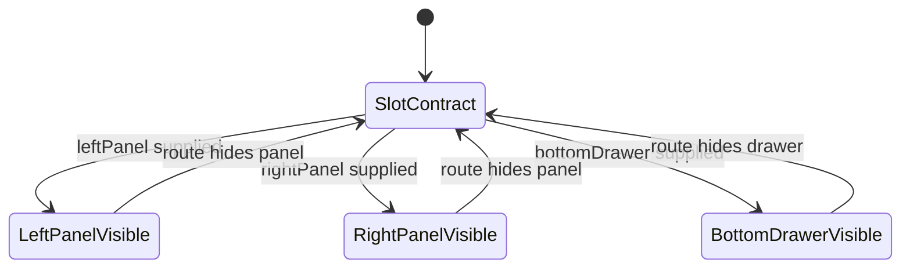

### Consumers

Current and expected consumers:

- `CodeView`, the first adopter of `RouteWorkbenchFrameSlots`
- `DiffView`
- `ArtifactsView`
- `LineageView`
- `PluginsView`
- `AdminView`
- future route workbenches such as `Templates`

`CodeView` maps its file explorer to `leftPanel` and the shared read-only file
session to `primarySurface`. Its optional `rightPanel` shows accepted-file or
reference metadata in project Code, or file history for existing standalone
consumers. It provides no route-level `bottomDrawer`; the shell retains its console.

Canvas can continue using its specialized shell while adopting the same slot
vocabulary through future component extraction.

### Component Diagram

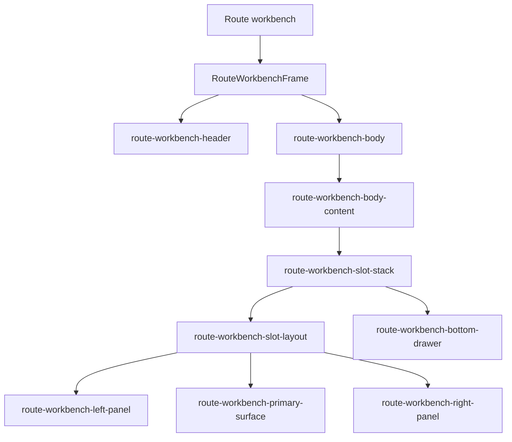

### Command And Query Rail Posture

No new command or query rail is introduced. This component is an internal
presentation primitive. Route commands and queries remain owned by their
bounded contexts.

### Local Traceability

- Task: `F-15`
- Analysis:
  [Historical record](https://github.com/dunay2/dvt/blob/2df68680de46b9104282a58fd203a7eef551ca38/buzon/20260521-codex-fowler-route-workbench-frame-analysis-and-remediation.md)
- Stories:
  `docs/architecture/components/web/appshell/app-shell.md`
- Source:
  `apps/web/src/app/components/workbench/RouteWorkbenchFrame.tsx`
- Tests:
  `apps/web/src/app/components/workbench/RouteWorkbenchFrame.test.tsx`
  `apps/web/src/app/components/workbench/routeWorkbenchFrame.architecture.test.ts`

<a id="section-route-workbench-frame-user-stories"></a>

### Route Workbench Frame User Stories

#### User Stories

##### US-ROUTE-WORKBENCH-FRAME-001

As an operator using a route workbench, I need the primary surface to remain the
center of attention so that supporting panels do not become hidden applications.

Acceptance:

- the route can provide `primarySurface`;
- the primary surface renders in `route-workbench-primary-surface`;
- contextual panels render beside it only when supplied.

##### US-ROUTE-WORKBENCH-FRAME-002

As an operator inspecting context, I need left and right panels to have stable
placement so that explorer and inspector behavior is predictable across routes.

Acceptance:

- `leftPanel` renders in `route-workbench-left-panel`;
- `rightPanel` renders in `route-workbench-right-panel`;
- omitting a panel does not create empty chrome.

##### US-ROUTE-WORKBENCH-FRAME-003

As an operator reviewing supporting detail, I need a route-level bottom drawer
that stays subordinate to the active route surface.

Acceptance:

- `bottomDrawer` renders in `route-workbench-bottom-drawer`;
- the shell console drawer remains owned by `AppShellFrame`;
- the route drawer does not replace route navigation.

##### US-ROUTE-WORKBENCH-FRAME-004

As a maintainer finishing F-15, I need direct route workbench consumers to use
semantic slots only.

Acceptance:

- direct `RouteWorkbenchFrame` route consumers pass `slots`;
- anonymous route body `children` are not part of the public frame API;
- architecture tests fail when a direct route consumer drifts back to anonymous
  body content.

#### Scenario Matrix

| Scenario                                         | Expected result                                                             | Coverage                                   |
| ------------------------------------------------ | --------------------------------------------------------------------------- | ------------------------------------------ |
| Direct route passes anonymous body content       | Architecture guard fails until the route uses `slots.primarySurface`        | `routeWorkbenchFrame.architecture.test.ts` |
| Route passes all slots                           | left, primary, right, and bottom drawer slots render with stable data slots | `RouteWorkbenchFrame.test.tsx`             |
| Route omits side panels                          | no empty left or right panel chrome appears                                 | future route adoption tests                |
| Architecture drift removes docs or owned concern | architecture test fails                                                     | `routeWorkbenchFrame.architecture.test.ts` |

#### Acceptance Coverage

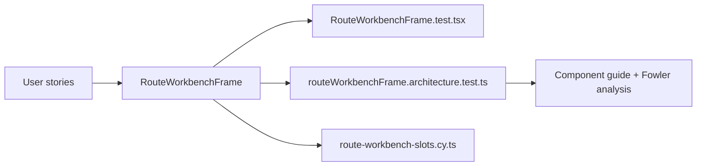

#### Out Of Scope

- Implementing resizable `ContextPanel`.
- Changing shell-level `AppShellFrame` bottom console behavior.
- Adding a new route command or query rail.

> Acceptance scope status: Active. Owner: Frontend / Architecture.
>
> Section status: Active. Owner: Frontend / Architecture. Colocation does not merge component responsibilities.

<a id="section-app-bootstrap-screen-component"></a>

## App Bootstrap Screen Component

### Owned Concern

The app bootstrap screen owns the pre-React Raven startup gate. It keeps a
single visible startup surface alive while the browser shell mounts, services
compose, runtime capabilities settle, platform health resolves, and the active
route publishes operability.

The component is split into a pure Presentation Model and a DOM adapter:

- `appBootstrapPresentation.ts` owns startup copy, step ordering, aggregate
  state transitions, completion rules, progress snapshots, and build-date
  formatting.
- `appBootstrapCopy.ts` owns the locale catalog used by bootstrap presentation
  and shell-publisher command factories.
- `appBootstrapCommands.ts` owns the domain command objects emitted by shell,
  provider, health, capability, and route publishers.
- `appBootstrapDomContract.ts` owns the critical HTML IDs, selectors, and
  static ARIA contract shared by the adapter and tests.
- `appBootstrapScreen.ts` owns DOM lookup, ARIA writes, metadata writes, and
  the exported control API used by the rest of the app.
- `routeBootstrapStartupReadiness.ts` owns the route readiness read model that
  adapts active-route publication and runtime capability cold-start posture into
  one shared route-readiness value. `RootShell` maps that value to the existing
  route-step command accepted by the bootstrap screen.

It does not own route-specific readiness, backend contract semantics, or Canvas
draft truth. Those concerns publish into this component through typed route and
health/bootstrap adapters.

### Public API

| API                               | Owned behavior                                                              |
| --------------------------------- | --------------------------------------------------------------------------- |
| `startBootstrapScreen()`          | Resets step state, writes initial detail copy, metadata, progress, and ARIA |
| `setBootstrapStepStatus(command)` | Applies one typed startup-step command and re-derives aggregate state       |
| `completeBootstrapScreen()`       | Removes the screen only after every step reaches an allowed terminal state  |
| `showBootstrapFailure(command)`   | Converts startup exceptions into the single controlled error screen         |
| `isBootstrapScreenVisible()`      | Allows route error boundaries to avoid stacking a second error surface      |
| `renderBootstrapProgress()`       | Renders progress from an already resolved bootstrap snapshot                |
| `BootstrapStepStatusCommand`      | Public command object for step, status, and optional detail copy            |
| `BootstrapFailureCommand`         | Public command object for controlled startup failure copy                   |

### Route Readiness Policy API

| API                                                  | Owned behavior                                                              |
| ---------------------------------------------------- | --------------------------------------------------------------------------- |
| `RouteBootstrapStartupReadinessState`                | Browser-local read model for same-route stable route posture                |
| `createInitialRouteBootstrapStartupReadinessState()` | Creates an empty route-readiness state before the active route publishes    |
| `resolveRouteBootstrapStartupReadiness(args)`        | Resolves one effective shared readiness value plus the next stability state |

### Domain Command API

| Factory                                        | Domain event represented                                 |
| ---------------------------------------------- | -------------------------------------------------------- |
| `createHydrationCompleteBootstrapCommand()`    | React shell hydration settled                            |
| `createServicesReadyBootstrapCommand()`        | App services and query client are available              |
| `createCapabilitiesPendingBootstrapCommand()`  | Runtime-capability bootstrap is still loading            |
| `createCapabilitiesFallbackBootstrapCommand()` | Runtime capabilities failed and shell fallback is active |
| `createCapabilitiesReadyBootstrapCommand()`    | Runtime capabilities are available                       |
| `createHealthPendingBootstrapCommand()`        | Platform health bootstrap is still loading               |
| `createHealthFailedBootstrapCommand()`         | Platform health failed without blocking route render     |
| `createHealthDegradedBootstrapCommand()`       | Platform health settled in degraded posture              |
| `createHealthReadyBootstrapCommand()`          | Platform health is settled                               |
| `createRouteBootstrapStepCommand()`            | Active route published its bootstrap posture             |
| `createBootstrapFailureCommand()`              | React route startup raised a controlled failure          |

Publishers call these factories instead of assembling localized strings or
positional tuples directly.

### Presentation Model API

| API                                    | Owned behavior                                                                |
| -------------------------------------- | ----------------------------------------------------------------------------- |
| `BOOTSTRAP_STEP_ORDER`                 | Canonical order for startup step rendering and aggregate readiness            |
| `createInitialBootstrapStepState()`    | Produces the initial pending state with default details                       |
| `createBootstrapStepState()`           | Resolves one typed step state with caller detail or default presentation copy |
| `resolveBootstrapScreenPresentation()` | Derives screen copy, announcement state, step presentations, and progress     |
| `canCompleteBootstrapSteps()`          | Validates the terminal-state invariant before DOM removal                     |
| `isBootstrapStepStartupAllowed()`      | Owns the single status-to-startup-allowance rule used by screen and root      |
| `formatBootstrapBuildDate()`           | Normalizes build metadata for the critical startup shell                      |

### Invariants

- The startup screen remains visible while any critical step is `pending`,
  `blocked`, or `error`.
- Application, route, and Canvas startup posture use `BootstrapStepState` as the
  single status/detail value. Completion allowance is derived from status and is
  never stored beside that value.
- `blocked` and `error` states do not reveal the workbench behind the startup
  gate.
- A transport-level health failure is a visible failed startup check, not a
  degraded check. It is non-blocking for shell reveal when the active route can
  render a governed failure state.
- Backend/offline readiness in API runtime blocks unsafe Canvas interactions
  inside the Canvas route, but it does not keep the pre-React startup gate
  visible once the route can render that blocker as its first useful surface.
- Public routes such as `/login` settle the startup gate through
  `PublishAppBootstrapStepStatus` and `CompleteAppBootstrapScreen` without
  resolving workspace runtime capabilities or platform health, and without
  changing protected-route authentication semantics.
- Once a platform-health probe has failed, automatic retries must not demote
  the visible startup posture back to cold-start `pending`; retries update
  detail copy in place while the gate stays settled.
- A route `complete` publication must not appear as route-ready while runtime
  capabilities are still in cold-start `pending`.
- A route `complete` publication suppressed by runtime-capability cold-start
  remains the visible same-route posture if the route republishes its initial
  `pending` state before capabilities settle.
- A same-route stable route posture, including `complete`, `failed`, `blocked`,
  or `error`, must not regress to `pending` just because a route seam republishes
  its initial posture.
- Route-readiness stability is scoped to the active route id. Navigating to a
  different route resets the stable route posture.
- `completeBootstrapScreen()` is a guard, not a command override; it cannot
  remove the screen until all steps are terminally allowed.
- ARIA state is owned by the bootstrap state machine: `aria-busy="true"` before
  completion and `aria-busy="false"` after completion.
- The HTML shell provides critical markup and CSS before React loads; React
  components do not need to mount before users see deterministic startup status.
- Visual posture stays operational: compact brand, ordered status flow,
  readiness segments, and build metadata instead of a decorative hero image or
  a misleading percentage bar.

### Deferred Route Module Settlement

`createDeferredView` owns the shared module load and localized pending surface
for Canvas, Templates, Runs and Cost. Every mounted consumer must observe module
settlement even if another consumer started the import and then unmounted.
Reading a mutable module cache in a passive effect can lose that notification:
the second consumer rendered pending, the import settled before its effect, and
the effect returned without updating React. The route then never mounted its
readiness publisher, leaving `Preparing canvas route` visible indefinitely.

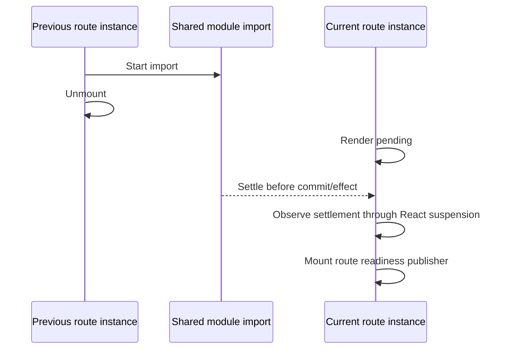

Reuse React's `lazy` and `Suspense` lifecycle rather than maintaining a second
cache/subscription protocol. Keep the existing loading slot, language binding,
live-region semantics and error-boundary propagation. Styles belong to the
loader's CSS module. No route-readiness state, authentication authority, global
timeout, retry or new command/query is introduced. A diagnosed import race is
not proof that every CI transport or CSS-load failure has this cause.

| Scenario                                                   | Opportunity                                        | Fowler pattern                                               | DDD owner                                             | Command/query rail                | Implementation surfaces                      | Unit or package test                                                          | Architecture test                                    | User-flow test                                                   | Out of scope                                                   |
| ---------------------------------------------------------- | -------------------------------------------------- | ------------------------------------------------------------ | ----------------------------------------------------- | --------------------------------- | -------------------------------------------- | ----------------------------------------------------------------------------- | ---------------------------------------------------- | ---------------------------------------------------------------- | -------------------------------------------------------------- |
| Import settles between a replacement render and its effect | Hidden authority and duplicate lifecycle semantics | Replace manual cache notifications with framework suspension | Deferred route module adapter feeding route readiness | ObserveAppBootstrapRouteReadiness | createDeferredView, its tests and CSS module | Controlled settlement, replacement consumers, cached load and rejected import | Existing plugin/bootstrap ownership and style guards | Existing startup readiness and route navigation browser journeys | Transport recovery, global deadlines and authorization changes |

### Transitions

```mermaid
stateDiagram-v2
  [*] --> Loading
  Loading --> Loading: step pending
  Loading --> Loading: step degraded
  Loading --> Loading: non-critical step failed
  Loading --> Loading: route complete suppressed while capabilities pending
  Loading --> Loading: same-route pending demotion ignored after stable route posture
  Loading --> Blocked: any step blocked
  Loading --> Error: any step error
  Blocked --> Loading: blocked step returns pending
  Blocked --> Error: any step error
  Blocked --> Complete: all steps complete, degraded, or non-critical failed
  Error --> Error: controlled startup failure
  Loading --> Complete: all steps complete, degraded, or non-critical failed
  Complete --> [*]: delayed DOM removal
```

### Component Boundary

```mermaid
flowchart LR
  Publishers["main / providers / root / route errors"] --> Screen["appBootstrapScreen.ts\nDOM adapter"]
  Publishers --> Commands["appBootstrapCommands.ts\nDomain commands"]
  Root["RootShell"] --> RouteReadiness["routeBootstrapStartupReadiness.ts\nRoute readiness policy"]
  RouteReadiness --> Readiness["BootstrapStepState\nshared readiness value"]
  Readiness --> Root
  Root --> Commands
  Commands --> Screen
  Commands --> Copy["appBootstrapCopy.ts\nLocale catalog"]
  Screen --> DomContract["appBootstrapDomContract.ts\nDOM contract"]
  Screen --> Presentation["appBootstrapPresentation.ts\nPresentation Model"]
  Presentation --> Copy
  Presentation --> Snapshot["screen + steps + progress snapshot"]
  Screen --> Dom["index.html startup DOM"]
  Screen --> Progress["bootstrapProgressBar.ts"]
  Progress --> Dom
```

### Consumer Topology

```mermaid
flowchart LR
  Html["index.html critical shell"] --> Bootstrap["appBootstrapScreen.ts"]
  Main["main.tsx"] --> Bootstrap
  Providers["AppProviders.tsx"] --> Bootstrap
  Root["Root.tsx"] --> Bootstrap
  RouteErrors["AppRouteErrorBoundary.tsx"] --> Bootstrap
  Bootstrap --> DomContract["appBootstrapDomContract.ts"]
  Bootstrap --> Presentation["appBootstrapPresentation.ts"]
  Root --> RouteBootstrap["routeBootstrapRegistry.ts"]
  Root --> Health["platform-health query"]
  Root --> Capabilities["runtime capabilities query"]
  RouteBootstrap --> Root
  Capabilities --> Root
  Root --> RouteReadiness["routeBootstrapStartupReadiness.ts"]
  RouteReadiness --> Root
  Health --> Bootstrap
  Bootstrap --> Progress["bootstrapProgressBar.ts"]
```

### Consumers

- `apps/web/index.html` owns the critical HTML and CSS shell.
- `apps/web/src/main.tsx` starts the screen and completes the hydration step.
- `apps/web/src/app/AppProviders.tsx` publishes service/provider readiness.
- `apps/web/src/app/Root.tsx` publishes capability, platform health, and active
  route posture.
- `apps/web/src/app/routes.ts` publishes public-route bootstrap completion for
  `/login` before protected workspace runtime concerns are mounted.
- `apps/web/src/app/AppRouteErrorBoundary.tsx` uses visibility state to avoid a
  second failure surface while bootstrap is still visible.

### Test Coverage

- `apps/web/src/app/bootstrap/appBootstrapPresentation.test.ts` covers
  presentation-model defaults, completion rules, blocked/error precedence,
  non-critical health failure, and build metadata formatting.
- `apps/web/src/app/bootstrap/appBootstrapScreen.test.ts` covers blocked,
  failure, production HTML shell contract, centralized DOM contract ownership,
  metadata, completion, and ARIA busy-state semantics.
- `apps/web/src/app/Root.bootstrapFlow.test.tsx` covers root-to-bootstrap
  integration for health, capabilities, route blocks, route completion, and
  route completion suppression while capabilities are pending.
- `apps/web/src/app/routes.test.tsx` covers the public login route completing
  the startup gate without invoking protected route bootstrap publication.
- `apps/web/src/app/bootstrap/routeBootstrapStartupReadiness.test.ts` covers
  policy-level negative paths for capability ordering, same-route pending
  demotion, failure recovery, and route-id reset.
- `apps/web/src/app/bootstrap/routeBootstrapStartupReadiness.architecture.test.ts`
  guards policy ownership, Root wiring, and documentation alignment.
- `apps/web/cypress/e2e/shell/startup-route-readiness.cy.ts` proves the
  user-visible startup gate does not show the fifth check as ready before
  runtime capabilities settle and closes on the public login route.

### Command/Query Rail

| Rail                                | Type    | DDD owner                                        | Consumers               |
| ----------------------------------- | ------- | ------------------------------------------------ | ----------------------- |
| `ObserveAppBootstrapRouteReadiness` | query   | `RouteBootstrapStartupReadinessState` read model | `RootShell`             |
| `PublishAppBootstrapStepStatus`     | command | `BootstrapStepStatusCommand` value object        | `appBootstrapScreen.ts` |
| `CompleteAppBootstrapScreen`        | command | `BootstrapScreenState` presentation aggregate    | `appBootstrapScreen.ts` |

### Governance Drift Guard

- `tools/ci/web-bootstrap-docs.test.mjs` protects the separation between
  component evidence and repository governance checks.

> Section status: Active. Owner: Frontend / Architecture. Colocation does not merge component responsibilities.

<a id="section-canvas-workbench-command-menu-component"></a>

## Canvas Workbench Command Menu Component

### Owned Concern

The existing Canvas workspace contribution publishes project/file capabilities
and handlers without transferring Canvas controller ownership to the shell.
[GH-3622](https://github.com/dunay2/dvt/issues/3622) places those existing actions
in File; it does not add Insert or another application rail.

This component owns contribution registration, capability-gated presentation
and identity-guarded cleanup. It does not own graph truth, draft persistence,
planning, execution, project storage or authorization.

### Public API

- `CanvasWorkspaceMenuContribution`
- `useCanvasWorkspaceMenuContributionStore`
- `CanvasWorkspaceMenuContributionRegistrar`
- `CanvasWorkspaceMenuControls`
- `CanvasWorkspaceTopBarIdentity`

`CanvasShellMainPanel` registers the active contribution. The shell
`ShellFileMenuTemplate` composes `CanvasWorkspaceMenuControls`; the owning
Canvas handlers still execute project import, files/code and snapshots.
`CanvasWorkspaceTopBarIdentity` presents the active Canvas/model tabs separately.

### Invariants

- Canvas file actions exist only while their route contribution is active.
- File menus do not duplicate Canvas controller hooks, stores or command rails.
- Disabled or missing handlers cannot dispatch through menu selection.
- Pointer and keyboard share Radix selection semantics, not raw click callbacks.
- Snapshot selection retains its input until the native chooser produces a
  file; an empty selection does not import or close File. A non-empty selection
  captures the file and clears the input before requesting menu close and
  dispatching the existing import handler. Radix restores focus to File; reopening
  the menu permits the same file to be selected again.
- Project creation reuses its existing dialog and port; it does not require a
  Canvas contribution.
- Code/explorer return focus to File. Granted-scope recovery remains Project.
- Source import registers a source only; dragging creates the graph instance.
- Graph-local insertion and execution retain their existing owners. File does
  not become a second Run or Insert surface.
- Identity-guarded cleanup cannot clear a newer route contribution.

### Transitions

```mermaid
stateDiagram-v2
  [*] --> NoCanvasCommands
  NoCanvasCommands --> CanvasCommandsActive: CanvasShellMainPanel registers
  CanvasCommandsActive --> CanvasCommandsActive: capability or identity changes
  CanvasCommandsActive --> CanvasCommandsActive: stale cleanup ignored
  CanvasCommandsActive --> NoCanvasCommands: active contribution unmounts
```

### Component Flow

```mermaid
flowchart LR
  Panel[CanvasShellMainPanel] --> Registrar[CanvasWorkspaceMenuContributionRegistrar]
  Registrar --> Store[canvasWorkspaceMenuContributionStore]
  Store --> Controls[CanvasWorkspaceMenuControls]
  File[ShellFileMenuTemplate] --> Controls
  Controls --> Handlers[Existing Canvas-owned project and snapshot handlers]
```

### Command And Query Rails

#### Native Snapshot Selection Lifecycle

The retained receiver previously dispatched import without closing the controlled
File menu. Review of [PR-3627](https://github.com/dunay2/dvt/pull/3627) identified
that incomplete presentation transition. Selection now notifies `ShellFileMenu`
through a specific callback passed by its passive template. The controller owns
menu closure; the Canvas contribution retains import admission and dispatch.
Unlike Code and New Project, snapshot import does not transfer focus to another
editor or dialog, so the normal Radix close autofocus remains enabled.
Focus returns when the menu content unmounts, not as a prerequisite to import.

```mermaid
flowchart LR
  Picker[Native picker; menu and receiver retained] --> Choice{File selected?}
  Choice -->|No| Retain[No import; retain receiver]
  Choice -->|Yes| Capture[Capture File and clear input]
  Capture --> Close[Controller requests File closure]
  Close --> Import[Existing ImportProjectSnapshot handler]
```

The presentation reuses `ResolveCanvasProjectSnapshotActions`,
`ImportProjectSnapshot`, `ExportProjectSnapshot`, `ImportDbtProject` and the
existing workspace-file/code queries. Their capability and authorization
checks remain in the owning application ports and route controllers.
Project scope selection remains `SelectWorkspaceScope` in Project.

### Consumers And Evidence

- `CanvasShellMainPanel`
- `ShellFileMenuTemplate`
- `ShellTopBar` (identity only)
- `CanvasWorkspaceMenuControls.test.tsx`
- `TopAppBar.test.tsx`
- `canvas-workbench-screen-composition.cy.ts`
- `canvas-project-snapshot-roundtrip.cy.ts`
- `code-workbench-workspace-files.cy.ts`

### User Stories Covered

See [Workbench UX Canon User Stories](../workbench-ux-canon-component.md#section-workbench-ux-canon-user-stories).

### Fitness Functions

- `pnpm --filter @dvt/web exec vitest run --config vitest.presentation.config.ts src/app/components/TopAppBar.test.tsx src/app/views/canvas/CanvasWorkspaceMenuControls.test.tsx`
- `pnpm --filter @dvt/web exec vitest run --config vitest.architecture.config.ts src/app/shell/shellNavigationDisposition.architecture.test.ts`
- `pnpm --filter @dvt/web typecheck`
- `pnpm docs:feature-mechanization:implementation`
- `pnpm verify:prepush`

### Drift To Prevent

- Reintroducing file commands or global navigation into Project or View.
- Changing granted scope through File or hiding the existing recovery path.
- Closing the native snapshot receiver before a selected file reaches it.
- Leaving File open after a non-empty snapshot selection or suppressing its
  normal focus return when no other surface receives focus.
- Bypassing pending-edit guards or contribution capabilities.
- Claiming implementation of Insert or other absent shell capabilities.

> Section status: Active. Owner: Frontend / Architecture. Colocation does not merge component responsibilities.
