# App Shell

## Purpose

The App Shell is the persistent runtime frame of the DVT frontend.

It owns app bootstrap, route framing, top-level navigation, health visibility,
and the shared layout around every routed view.

## Current Implementation

Primary code anchors:

- [App.tsx](../../../../../apps/web/src/app/App.tsx)
- [Root.tsx](../../../../../apps/web/src/app/Root.tsx)
- [routes.ts](../../../../../apps/web/src/app/routes.ts)
- [AppShellFrame.tsx](../../../../../apps/web/src/app/components/shell/AppShellFrame.tsx)
- [TopAppBar.tsx](../../../../../apps/web/src/app/components/TopAppBar.tsx)
- [ShellAppMenu.tsx](../../../../../apps/web/src/app/components/shell/ShellAppMenu.tsx)
- [appBuildMetadata.ts](../../../../../apps/web/src/app/components/shell/appBuildMetadata.ts)
- [LeftNavigation.tsx](../../../../../apps/web/src/app/components/LeftNavigation.tsx)
- [BottomOperationalDrawer.tsx](../../../../../apps/web/src/app/components/shell/BottomOperationalDrawer.tsx)
- [bottomOperationalDrawerLogModel.ts](../../../../../apps/web/src/app/components/shell/bottomOperationalDrawerLogModel.ts)

`LeftNavigation.tsx` is a current implementation anchor, not the target Canvas
workbench direction. `F-28` governs the next Canvas shell sequence and requires
Canvas to render without a fixed left navigation rail.

Current shell regions:

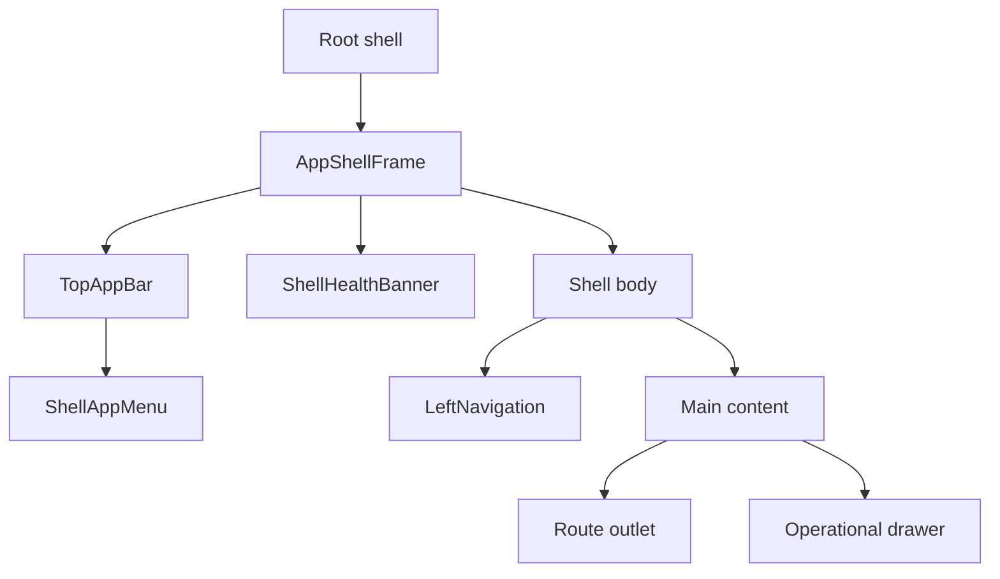

## Shell Service Composition

The shell is also the composition boundary for frontend service wiring.

`Root` mounts `AppServicesProvider`, which composes API-backed typed service
instances for views and plugins through hooks.

This prevents route-level components from constructing transports or selecting
a second product data authority.

## Shell Application Menu

The Raven brand in the top bar is the application-level menu surface. It owns
small app-wide commands that should not consume persistent toolbar width.

Current command/query rail:

| Rail                             | Type  | Owner         | Surface                     |
| -------------------------------- | ----- | ------------- | --------------------------- |
| `GetCompiledApplicationMetadata` | query | Web App Shell | `ShellAppMenu` About dialog |

`GetCompiledApplicationMetadata` reads compile-time bundle metadata from
`import.meta.env.VITE_APP_VERSION` and `VITE_APP_BUILD_DATE`. It does not call
the backend `/version` endpoint because the About dialog answers which Raven
bundle is running in the browser, not which API build is reachable.

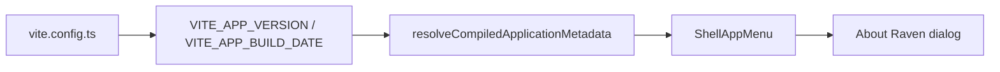

## Shell Navigation Ownership

The current left navigation implementation follows the same boundary rule as
the rest of the shell:

- runtime capability data decides which plugin-contributed views are available;
- the shell normalizes those runtime views into a render-ready navigation model;
- the rail renders plain navigation items and does not know plugin manifest
  structure, label resolution, or shell footer ownership.

Target direction for Canvas workbench:

- top menus and command palette provide command discovery;
- Canvas view strip owns route-local projections;
- fixed left navigation must not occupy the Canvas workbench surface;
- on-demand context surfaces, drawers, and pinned user presentation preferences
  must not become a second permanent navigation rail.

Current flow:

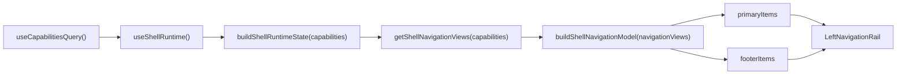

Responsibility split:

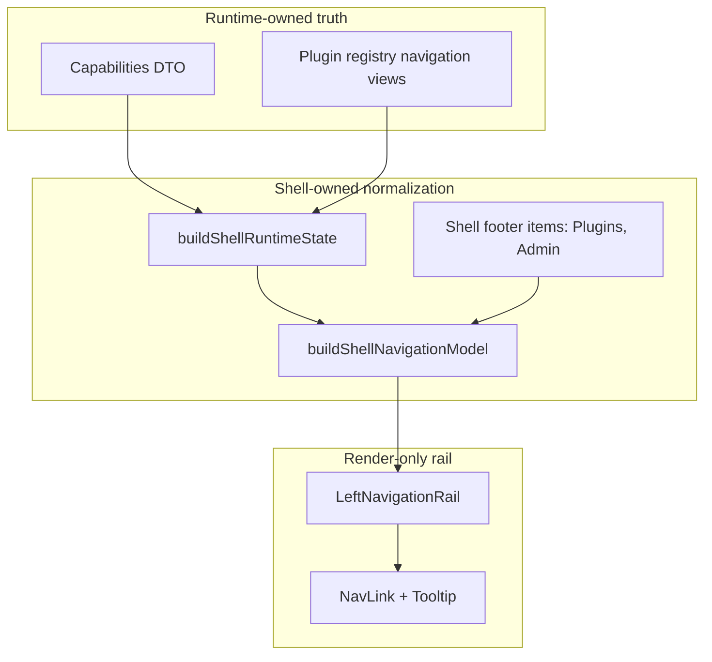

## Bottom Operational Drawer Ownership

The bottom drawer now follows the same separation rule as the rest of the shell:

- shell copy and shell chrome stay in shell-owned modules;
- the drawer resolves a small, explicit state model before rendering;
- the render surface stays focused on header, badges, close action, and body slot ownership.
- the drawer is a shell companion surface, not the durable run workspace authority.

Current state model:

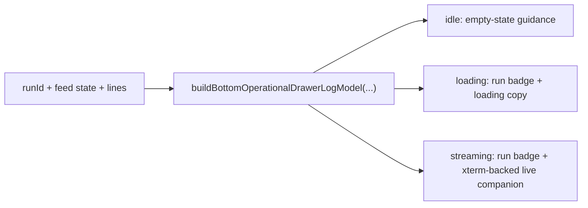

Authority split with the Runs route:

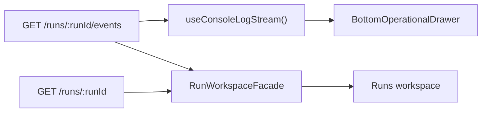

Boundary rules for these two surfaces:

- `BottomOperationalDrawer` mirrors the currently active run as a shell-level
  xterm-backed live companion;
- `BottomOperationalDrawer` does not claim snapshot authority, failure-diagnostics authority, or full run-detail ownership;
- `Runs` owns durable run monitoring through snapshot plus timeline composition;
- `Runs` is the place where degraded timeline state, runtime snapshot truth, result evidence, and failure diagnostics are explained.

Shared event presentation seam:

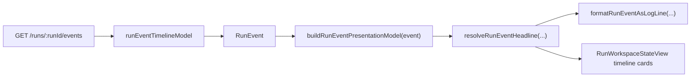

Rules for the shared seam:

- the timeline model owns event ordering, dedupe, cursor, and active-status
  polling decisions;
- the shared model owns event level, headline key, optional detail, and step identity;
- the shared copy resolver owns human-readable event headline text for shared event surfaces;
- the shell drawer renders terminal-style lines through `XtermConsole` from
  that shared semantics plus shared copy;
- the Runs route may render structured timeline cards from the same shared semantics plus shared copy;
- the shared model must not collapse snapshot authority or failure-diagnostics authority back into the drawer.

Rules for this seam:

- `LeftNavigation.tsx` must not import `resolveString`, plugin manifests, or
  fixed shell footer item definitions;
- only plugin-contributed `placement.kind === 'shell-nav'` views become
  `primaryItems` inside the shell model;
- Canvas-scoped Code, Lineage, Diff, Artifacts, and Canvas Runs are owned by
  the Canvas workbench tab rail, not by shell navigation;
- shell-owned routes such as `Plugins` and `Admin` stay in `footerItems`;
- the rail consumes render-ready `{ to, label, icon }` items and stays focused
  on navigation chrome and routing behavior.

## Shell Workspace Context Component

The shell workspace context is the bounded replacement for tenant, project, and
environment dropdowns that previously consumed the main top bar.

Workspace context is breadcrumb-style read-only content on the main screen.
Tenant, project, environment, and deployment adapter scope are read-only inside an active project
context. Project changes belong to a separate governed project-selection
screen, not to the App Shell top bar or Canvas workbench.

The dedicated local component guide is
[Shell Workspace Context Component](./shell-workspace-context-component.md).
Scenario coverage lives in
[Shell Workspace Context User Stories](shell-workspace-context-component.md#section-shell-workspace-context-user-stories).

It uses a Fowler Presentation Model split:

- `buildProjectIdentityBadge(...)` resolves workspace scope into read-only
  labels;
- `ShellProjectIdentityBadge` renders those labels without mutation affordance;
- `ShellWorkspaceContextMenu` owns the on-demand read-only shell context
  surface;
- `ShellWorkspaceContextDetails` renders tenant, project, environment, and
  deployment adapter as read-only context fields.

### Public API

| API                            | Kind          | Owner                   | Contract                                                                                          |
| ------------------------------ | ------------- | ----------------------- | ------------------------------------------------------------------------------------------------- |
| `ProjectIdentityBadge`         | read model    | Web shell presentation  | Carries tenant, project, environment, deployment adapter, compact id, slug, and draft-scope label |
| `buildProjectIdentityBadge`    | query adapter | Web shell presentation  | Resolves granted option labels and falls back to raw ids without fabricating                      |
| `ShellProjectIdentityBadge`    | passive view  | Shell top-bar rendering | Displays read-only project identity in the persistent shell bar                                   |
| `ShellWorkspaceContextMenu`    | details UI    | Shell context display   | Makes read-only workspace context reachable from an on-demand surface                             |
| `ShellWorkspaceContextDetails` | passive view  | Shell context display   | Displays tenant, project, environment, and deployment adapter without mutation controls           |

### Invariants

- the main top bar renders no `role="combobox"` workspace controls;
- `ProjectIdentityBadge` is read-only and cannot dispatch session commands;
- Tenant, project, environment, and deployment adapter scope are read-only
  inside an active project context;
- the menu must not expose tenant, project, or environment comboboxes;
- the menu must not create a parallel auth, RBAC, tenant-admin,
  project-selection, or environment-selection rail;
- Git context remains read-only in this slice and does not become a branch
  command surface.

### Transitions

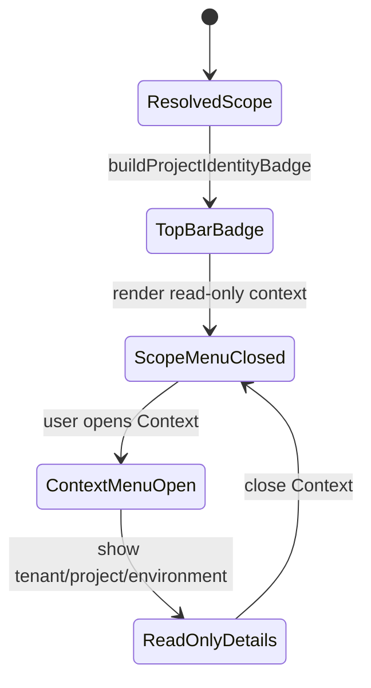

### Consumers

| Consumer                   | Use                                                                 |
| -------------------------- | ------------------------------------------------------------------- |
| `ShellTopBar`              | Composes badge, context menu, health, Git reference, and View menu  |
| Canvas workbench route     | Reads the same session scope through its existing query/controller  |
| Runs and other workbenches | React to session-scope changes through their existing route queries |
| Cypress posture proof      | Verifies badge presence, no comboboxes, and read-only details       |

### Component Flow

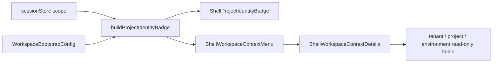

## UX Rules

- the top bar stays visible across all routed views;
- platform-health state must be visible without entering a diagnostic route;
- focus mode hides secondary chrome but keeps the active view intact; an
  explicit card Preview or Properties action exits focus mode to reveal its
  requested data drawer or contextual window;
- route switches should not remount the entire shell frame.

### Keyboard And Route Focus Invariants

- `AppShellFrame` owns exactly one `main` landmark with the stable
  `app-shell-main-content` id and a programmatic focus target;
- the first shell bypass control is an internationalized skip link that points
  to that landmark;
- initial shell mount does not move focus;
- a change to `location.pathname` moves focus to the main landmark exactly
  once with scrolling suppressed;
- rerenders that keep the same pathname, including health polling and route
  bootstrap publication, do not move focus;
- route focus is presentation behavior. It does not create a navigation
  command, focus store, route announcer, or parallel application rail.

## Mature Libraries And References

- base shell primitives:
  [Radix Primitives](https://www.radix-ui.com/primitives),
  [shadcn/ui](https://ui.shadcn.com/)
- workbench precedent:
  [VS Code](https://github.com/microsoft/vscode)

## Current Constraints

- some shell quick actions are placeholders and not yet connected to governed
  behavior;
- the operational drawer now has an explicit shell-owned content model, xterm-backed
  live companion rendering, and typed idle, loading, and streaming states;
- shared event presentation semantics align on ordering, dedupe, cursor,
  active-status polling, level, headline key, shared headline copy, detail, and
  step identity across drawer and Runs workspace surfaces.

## Current-To-Target Mapping

The shell already exists in working form. The current step is to keep making
the extracted primitives honest and small.

- `AppShellFrame`
  Current anchor: [AppShellFrame.tsx](../../../../../apps/web/src/app/components/shell/AppShellFrame.tsx) plus [Root.tsx](../../../../../apps/web/src/app/Root.tsx)
  Decision: keep the extracted shell frame small and behavior-preserving.
- `ShellTopBar`
  Current anchor: [TopAppBar.tsx](../../../../../apps/web/src/app/components/TopAppBar.tsx)
  Decision: keep the global context behavior, narrow the contract, and token-clean it.
- `LeftNavigationRail`
  Current anchor: [LeftNavigation.tsx](../../../../../apps/web/src/app/components/LeftNavigation.tsx) plus [shellNavigationModel.ts](../../../../../apps/web/src/app/shell/shellNavigationModel.ts)
  Decision: keep a render-only rail plus a shell-owned navigation model.
- `ShellHealthBanner`
  Current anchor: [ShellHealthBanner.tsx](../../../../../apps/web/src/app/components/ShellHealthBanner.tsx)
  Decision: keep and restyle through semantic tokens.
- `BottomOperationalDrawer`
  Current anchor: [BottomOperationalDrawer.tsx](../../../../../apps/web/src/app/components/shell/BottomOperationalDrawer.tsx) plus [bottomOperationalDrawerLogModel.ts](../../../../../apps/web/src/app/components/shell/bottomOperationalDrawerLogModel.ts)
  Decision: keep the drawer pattern, with a shell-owned state model and future log hardening.

## Shell Organization Rules

The shell layer should become explicit in code structure:

- `components/ui`: low-level library primitives only;
- `components/shell`: top bar, navigation rail, health banner, operational drawer,
  and shell-only helpers;
- `components/workbench`: route-level shared layout primitives used by multiple
  views;
- `views/<route>`: route composition and route-only components.

This matters because the current shell pieces are real, but they still live as
standalone feature files instead of as an intentional shell package boundary.

## Store Boundary Rule

The shell no longer has an aggregate store surface. Runtime state is split by
owned concern:

- shell store: focus mode, shell drawer visibility, nav state, health display
  preferences;
- canvas/workbench store: route-local selection, viewport, and panel state;
- server state: queries stay in TanStack Query, not in Zustand;
- execution state: current run and run detail should not stay coupled to shell
  layout concerns.

Implementation anchors:

- [`sessionStore.ts`](../../../../../apps/web/src/app/stores/sessionStore.ts)
- [`uiLayoutStore.ts`](../../../../../apps/web/src/app/stores/uiLayoutStore.ts)
- [`executionStore.ts`](../../../../../apps/web/src/app/stores/executionStore.ts)
- [`canvasInteractionStore.ts`](../../../../../apps/web/src/app/stores/canvasInteractionStore.ts)

Do not recreate a root store barrel or a mirror-writing aggregate store. New
state must be placed in the smallest named slice that owns the concern.

## Related Pages

- [Screen Manuals And User Stories](../screen-manuals-and-user-stories.md)
- [UX Implementation Guide](../style-guide.md#section-ux-implementation-guide)
- [Data Source Service Boundary](../frontend-data-boundary-architecture.md#section-data-source-service-boundary)
- [Library And Open-Source Reference Stack](../style-guide.md#section-library-and-open-source-reference-stack)
- [Canvas Workbench Screen Composition](../graph/canvas-shell-component.md#section-canvas-workbench-screen-composition-component)
- [Shell Workspace Context Component](./shell-workspace-context-component.md)
- [Shell Workspace Context User Stories](shell-workspace-context-component.md#section-shell-workspace-context-user-stories)

<a id="section-top-app-bar-user-manual-20260404"></a>

## Top App Bar User Manual

### What It Does

The top app bar controls workspace scope, shows platform connectivity, and
provides shell-level UI actions.

### Workspace Scope Selectors

The selectors control active:

- Tenant
- Project
- Environment

The browser may select only scopes granted by GetEffectiveWorkspaceContext.
The shell displays the validated selection; it cannot create or expand grants.

### Git Reference

The app bar shows current branch and short SHA from bootstrap config.

### Connection Indicator States

- `Checking`: health probe is still in-flight.
- `Healthy`: REST endpoint is available.
- `Offline`: backend is unreachable.
- `Degraded`: backend responds but reports degraded status.

Tooltips show additional detail when available.

### Shell Menu Actions

- Toggle Explorer panel
- Toggle Inspector panel
- Toggle Console
- Toggle Focus mode
- Change grid size

These controls update UI layout state only.

### Language Behavior

- The persisted application-language preference controls English or Spanish copy.
- Browser locale supplies the initial fallback only; changing the preference updates the open shell.

### Troubleshooting

- If selectors appear empty, verify workspace bootstrap options are configured.
- If status is always `Offline`, verify `/healthz` reachability from web app.
- If toggles do not persist, inspect `uiLayoutStore` persistence settings.

### Definition Of Done

- [ ] Scope selectors are visible and selectable.
- [ ] Connection state indicator transitions correctly.
- [ ] Shell toggles update panels and focus mode.
- [ ] Spanish labels render under `es` browser locale.
- [ ] English labels render for non-`es` locale.

> Section status: Draft. Owner: Web. Colocation does not merge component responsibilities.

<a id="section-top-app-bar-component-technical-manual-20260404"></a>

## Top App Bar Component Technical Manual

### Goal

Define the current technical shape of the top app bar so the UI stays modular,
multi-language ready, and style-consistent.

### Scope

- `apps/web/src/app/components/TopAppBar.tsx`
- `apps/web/src/app/components/shell/*`

### Component Boundary

`TopAppBar.tsx` is a composition root only. It owns store wiring and delegates
rendering to small UI components:

- `ShellWorkspaceContextMenu` and `ShellProjectIdentityBadge`
- `ShellAppMenu`
- `ShellGitRef`
- `ShellConnectionStatus`
- `ShellMenu`

### Runtime Composition

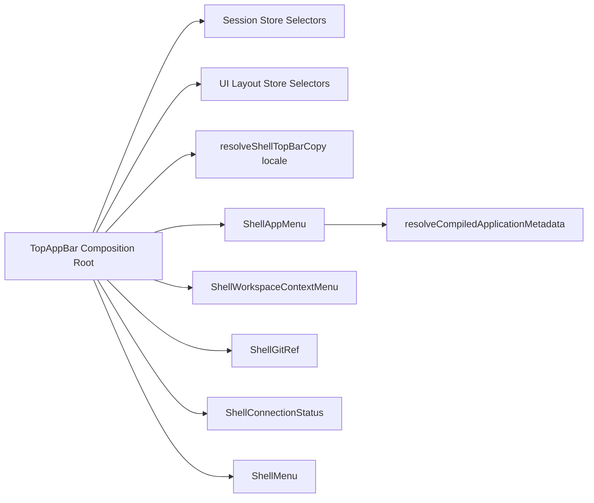

### Application Menu

`ShellAppMenu` owns brand-level application commands. The current command is
`About Raven`, backed by the `GetCompiledApplicationMetadata` query rail.

The About dialog shows the compiled browser bundle version from
`VITE_APP_VERSION` and the optional build date from `VITE_APP_BUILD_DATE`. It
must not call backend `/version`, mutate workspace scope, or become a route.

### Multi-Language Strategy

- `shell/copy.ts` is the single copy authority for app bar text.
- Current locales:
  - `en` and `es` are selected through `useApplicationLanguageStore`.
  - Browser locale is an initial fallback, not the authority after a user preference.
- No hardcoded UI labels are allowed in app bar subcomponents.

### Styling Strategy

- `shell/chrome.ts` contains reusable shell chrome tokens for recurring visual
  patterns.
- Subcomponents consume these tokens instead of duplicating Tailwind strings.

### SRP Rules

- Each file in `components/shell/` should keep one shell UI responsibility.
- `TopAppBar.tsx` should not contain menu internals, health rendering branches,
  or selector option rendering loops.

### Negative Test Targets

- Missing locale key fallback must resolve to `en`.
- `connectionStateOverride` must still override store state.
- Menu controls must continue toggling layout flags.
- About metadata must use compile-time app metadata, not API health/version
  probes.
- Shell-owned controls must not import `topAppBar/*` support files.

### Definition Of Done

- [ ] `TopAppBar.tsx` stays as composition root only.
- [ ] App bar labels come from `components/shell/copy.ts`.
- [ ] Reused class tokens come from `components/shell/chrome.ts`.
- [ ] `pnpm --filter @dvt/web typecheck` passes.
- [ ] `pnpm --filter @dvt/web test` passes.
- [ ] `pnpm --filter @dvt/web build` passes.

> Section status: Draft. Owner: Web. Colocation does not merge component responsibilities.

<a id="section-route-workbench-frame-component"></a>

## Route Workbench Frame Component

### Purpose

`RouteWorkbenchFrame` is the shared presentation primitive for route-level
workbenches in `apps/web`. It keeps the shell contract explicit without making
the shell own route domain behavior.

### Public API

```ts
export type RouteWorkbenchFrameSlots = Readonly<{
  leftPanel?: ReactNode;
  primarySurface: ReactNode;
  rightPanel?: ReactNode;
  bottomDrawer?: ReactNode;
}>;
```

`RouteWorkbenchFrame` accepts:

- `header`: route-owned header stack rendered outside the route body scroll.
- `slots`: semantic route body contract for left context, primary surface,
  right context, and route supporting drawer.
- `scroll`: whether the frame owns body scrolling.
- `bodyClassName` and `bodyContainerClassName`: route-level layout overrides.

### Invariants

- The top application shell remains outside this component.
- `header` is never nested inside the scroll body.
- `primarySurface` is required when `slots` are used.
- `leftPanel`, `rightPanel`, and `bottomDrawer` are optional contextual support
  surfaces.
- Anonymous route body `children` are not supported; every direct consumer must
  name its body through `RouteWorkbenchFrameSlots`.
- The frame owns presentation layout only; it does not own route commands,
  queries, loaders, API calls, or domain state.

### Transitions

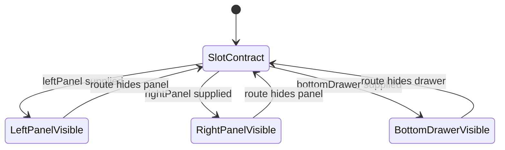

### Consumers

Current and expected consumers:

- `CodeView`, the first adopter of `RouteWorkbenchFrameSlots`
- `DiffView`
- `ArtifactsView`
- `LineageView`
- `PluginsView`
- `AdminView`
- future route workbenches such as `Templates`

`CodeView` maps its file explorer to `leftPanel` and its local-buffer banner
plus Monaco file preview to `primarySurface`. It does not provide `rightPanel`
or `bottomDrawer` yet.

Canvas can continue using its specialized shell while adopting the same slot
vocabulary through future component extraction.

### Component Diagram

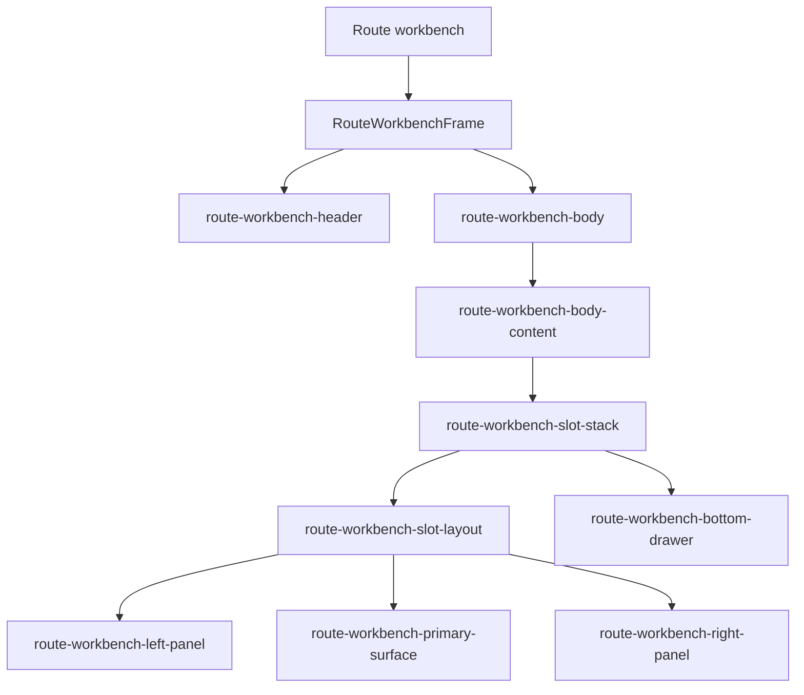

### Command And Query Rail Posture

No new command or query rail is introduced. This component is an internal
presentation primitive. Route commands and queries remain owned by their
bounded contexts.

### Local Traceability

- Task: `F-15`
- Analysis:
  [Historical record](https://github.com/dunay2/dvt/blob/2df68680de46b9104282a58fd203a7eef551ca38/buzon/20260521-codex-fowler-route-workbench-frame-analysis-and-remediation.md)
- Stories:
  `docs/architecture/components/web/appshell/app-shell.md`
- Source:
  `apps/web/src/app/components/workbench/RouteWorkbenchFrame.tsx`
- Tests:
  `apps/web/src/app/components/workbench/RouteWorkbenchFrame.test.tsx`
  `apps/web/src/app/components/workbench/routeWorkbenchFrame.architecture.test.ts`

<a id="section-route-workbench-frame-user-stories"></a>

### Route Workbench Frame User Stories

#### User Stories

##### US-ROUTE-WORKBENCH-FRAME-001

As an operator using a route workbench, I need the primary surface to remain the
center of attention so that supporting panels do not become hidden applications.

Acceptance:

- the route can provide `primarySurface`;
- the primary surface renders in `route-workbench-primary-surface`;
- contextual panels render beside it only when supplied.

##### US-ROUTE-WORKBENCH-FRAME-002

As an operator inspecting context, I need left and right panels to have stable
placement so that explorer and inspector behavior is predictable across routes.

Acceptance:

- `leftPanel` renders in `route-workbench-left-panel`;
- `rightPanel` renders in `route-workbench-right-panel`;
- omitting a panel does not create empty chrome.

##### US-ROUTE-WORKBENCH-FRAME-003

As an operator reviewing supporting detail, I need a route-level bottom drawer
that stays subordinate to the active route surface.

Acceptance:

- `bottomDrawer` renders in `route-workbench-bottom-drawer`;
- the shell console drawer remains owned by `AppShellFrame`;
- the route drawer does not replace route navigation.

##### US-ROUTE-WORKBENCH-FRAME-004

As a maintainer finishing F-15, I need direct route workbench consumers to use
semantic slots only.

Acceptance:

- direct `RouteWorkbenchFrame` route consumers pass `slots`;
- anonymous route body `children` are not part of the public frame API;
- architecture tests fail when a direct route consumer drifts back to anonymous
  body content.

#### Scenario Matrix

| Scenario                                         | Expected result                                                             | Coverage                                   |
| ------------------------------------------------ | --------------------------------------------------------------------------- | ------------------------------------------ |
| Direct route passes anonymous body content       | Architecture guard fails until the route uses `slots.primarySurface`        | `routeWorkbenchFrame.architecture.test.ts` |
| Route passes all slots                           | left, primary, right, and bottom drawer slots render with stable data slots | `RouteWorkbenchFrame.test.tsx`             |
| Route omits side panels                          | no empty left or right panel chrome appears                                 | future route adoption tests                |
| Architecture drift removes docs or owned concern | architecture test fails                                                     | `routeWorkbenchFrame.architecture.test.ts` |

#### Acceptance Coverage

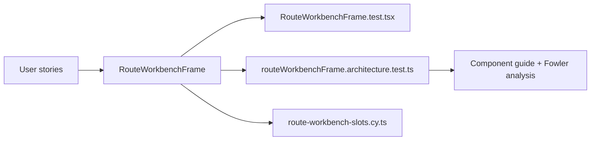

#### Out Of Scope

- Implementing resizable `ContextPanel`.
- Changing shell-level `AppShellFrame` bottom console behavior.
- Adding a new route command or query rail.

> Acceptance scope status: Active. Owner: Frontend / Architecture.
>
> Section status: Active. Owner: Frontend / Architecture. Colocation does not merge component responsibilities.

<a id="section-app-bootstrap-screen-component"></a>

## App Bootstrap Screen Component

### Owned Concern

The app bootstrap screen owns the pre-React Raven startup gate. It keeps a
single visible startup surface alive while the browser shell mounts, services
compose, runtime capabilities settle, platform health resolves, and the active
route publishes operability.

The component is split into a pure Presentation Model and a DOM adapter:

- `appBootstrapPresentation.ts` owns startup copy, step ordering, aggregate
  state transitions, completion rules, progress snapshots, and build-date
  formatting.
- `appBootstrapCopy.ts` owns the locale catalog used by bootstrap presentation
  and shell-publisher command factories.
- `appBootstrapCommands.ts` owns the domain command objects emitted by shell,
  provider, health, capability, and route publishers.
- `appBootstrapDomContract.ts` owns the critical HTML IDs, selectors, and
  static ARIA contract shared by the adapter and tests.
- `appBootstrapScreen.ts` owns DOM lookup, ARIA writes, metadata writes, and
  the exported control API used by the rest of the app.
- `routeBootstrapStartupReadiness.ts` owns the route readiness read model that
  adapts active-route publication and runtime capability cold-start posture into
  one shared route-readiness value. `RootShell` maps that value to the existing
  route-step command accepted by the bootstrap screen.

It does not own route-specific readiness, backend contract semantics, or Canvas
draft truth. Those concerns publish into this component through typed route and
health/bootstrap adapters.

### Public API

| API                               | Owned behavior                                                              |
| --------------------------------- | --------------------------------------------------------------------------- |
| `startBootstrapScreen()`          | Resets step state, writes initial detail copy, metadata, progress, and ARIA |
| `setBootstrapStepStatus(command)` | Applies one typed startup-step command and re-derives aggregate state       |
| `completeBootstrapScreen()`       | Removes the screen only after every step reaches an allowed terminal state  |
| `showBootstrapFailure(command)`   | Converts startup exceptions into the single controlled error screen         |
| `isBootstrapScreenVisible()`      | Allows route error boundaries to avoid stacking a second error surface      |
| `renderBootstrapProgress()`       | Renders progress from an already resolved bootstrap snapshot                |
| `BootstrapStepStatusCommand`      | Public command object for step, status, and optional detail copy            |
| `BootstrapFailureCommand`         | Public command object for controlled startup failure copy                   |

### Route Readiness Policy API

| API                                                  | Owned behavior                                                              |
| ---------------------------------------------------- | --------------------------------------------------------------------------- |
| `RouteBootstrapStartupReadinessState`                | Browser-local read model for same-route stable route posture                |
| `createInitialRouteBootstrapStartupReadinessState()` | Creates an empty route-readiness state before the active route publishes    |
| `resolveRouteBootstrapStartupReadiness(args)`        | Resolves one effective shared readiness value plus the next stability state |

### Domain Command API

| Factory                                        | Domain event represented                                 |
| ---------------------------------------------- | -------------------------------------------------------- |
| `createHydrationCompleteBootstrapCommand()`    | React shell hydration settled                            |
| `createServicesReadyBootstrapCommand()`        | App services and query client are available              |
| `createCapabilitiesPendingBootstrapCommand()`  | Runtime-capability bootstrap is still loading            |
| `createCapabilitiesFallbackBootstrapCommand()` | Runtime capabilities failed and shell fallback is active |
| `createCapabilitiesReadyBootstrapCommand()`    | Runtime capabilities are available                       |
| `createHealthPendingBootstrapCommand()`        | Platform health bootstrap is still loading               |
| `createHealthFailedBootstrapCommand()`         | Platform health failed without blocking route render     |
| `createHealthDegradedBootstrapCommand()`       | Platform health settled in degraded posture              |
| `createHealthReadyBootstrapCommand()`          | Platform health is settled                               |
| `createRouteBootstrapStepCommand()`            | Active route published its bootstrap posture             |
| `createBootstrapFailureCommand()`              | React route startup raised a controlled failure          |

Publishers call these factories instead of assembling localized strings or
positional tuples directly.

### Presentation Model API

| API                                    | Owned behavior                                                                |
| -------------------------------------- | ----------------------------------------------------------------------------- |
| `BOOTSTRAP_STEP_ORDER`                 | Canonical order for startup step rendering and aggregate readiness            |
| `createInitialBootstrapStepState()`    | Produces the initial pending state with default details                       |
| `createBootstrapStepState()`           | Resolves one typed step state with caller detail or default presentation copy |
| `resolveBootstrapScreenPresentation()` | Derives screen copy, announcement state, step presentations, and progress     |
| `canCompleteBootstrapSteps()`          | Validates the terminal-state invariant before DOM removal                     |
| `isBootstrapStepStartupAllowed()`      | Owns the single status-to-startup-allowance rule used by screen and root      |
| `formatBootstrapBuildDate()`           | Normalizes build metadata for the critical startup shell                      |

### Invariants

- The startup screen remains visible while any critical step is `pending`,
  `blocked`, or `error`.
- Application, route, and Canvas startup posture use `BootstrapStepState` as the
  single status/detail value. Completion allowance is derived from status and is
  never stored beside that value.
- `blocked` and `error` states do not reveal the workbench behind the startup
  gate.
- A transport-level health failure is a visible failed startup check, not a
  degraded check. It is non-blocking for shell reveal when the active route can
  render a governed failure state.
- Backend/offline readiness in API runtime blocks unsafe Canvas interactions
  inside the Canvas route, but it does not keep the pre-React startup gate
  visible once the route can render that blocker as its first useful surface.
- Public routes such as `/login` settle the startup gate through
  `PublishAppBootstrapStepStatus` and `CompleteAppBootstrapScreen` without
  resolving workspace runtime capabilities or platform health, and without
  changing protected-route authentication semantics.
- Once a platform-health probe has failed, automatic retries must not demote
  the visible startup posture back to cold-start `pending`; retries update
  detail copy in place while the gate stays settled.
- A route `complete` publication must not appear as route-ready while runtime
  capabilities are still in cold-start `pending`.
- A route `complete` publication suppressed by runtime-capability cold-start
  remains the visible same-route posture if the route republishes its initial
  `pending` state before capabilities settle.
- A same-route stable route posture, including `complete`, `failed`, `blocked`,
  or `error`, must not regress to `pending` just because a route seam republishes
  its initial posture.
- Route-readiness stability is scoped to the active route id. Navigating to a
  different route resets the stable route posture.
- `completeBootstrapScreen()` is a guard, not a command override; it cannot
  remove the screen until all steps are terminally allowed.
- ARIA state is owned by the bootstrap state machine: `aria-busy="true"` before
  completion and `aria-busy="false"` after completion.
- The HTML shell provides critical markup and CSS before React loads; React
  components do not need to mount before users see deterministic startup status.
- Visual posture stays operational: compact brand, ordered status flow,
  readiness segments, and build metadata instead of a decorative hero image or
  a misleading percentage bar.

### Transitions

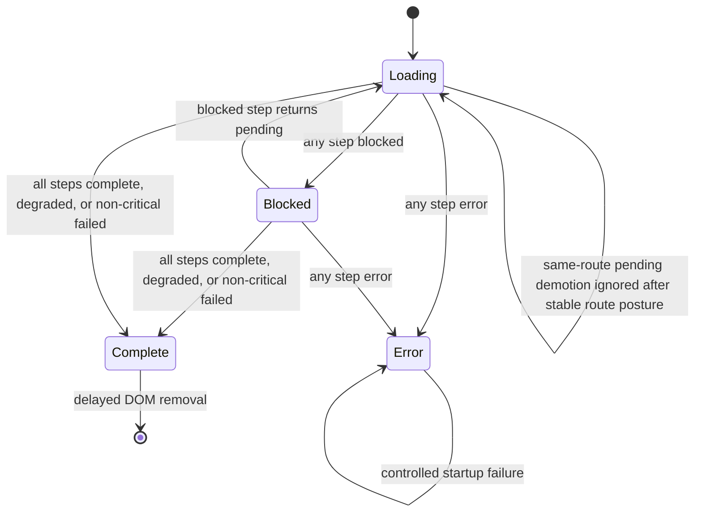

### Component Boundary

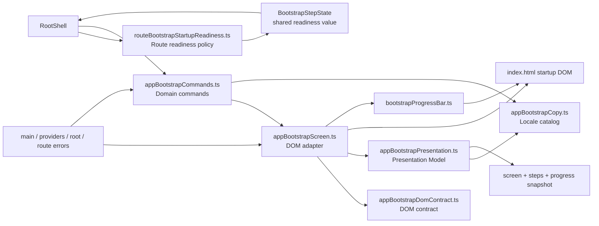

### Consumer Topology

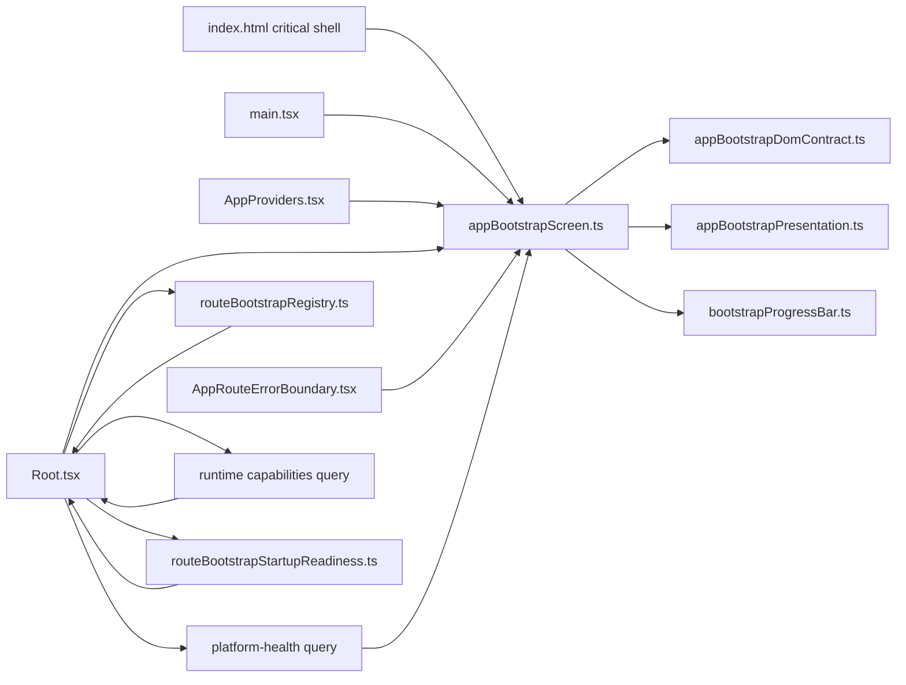

### Consumers

- `apps/web/index.html` owns the critical HTML and CSS shell.
- `apps/web/src/main.tsx` starts the screen and completes the hydration step.
- `apps/web/src/app/AppProviders.tsx` publishes service/provider readiness.
- `apps/web/src/app/Root.tsx` publishes capability, platform health, and active
  route posture.
- `apps/web/src/app/routes.ts` publishes public-route bootstrap completion for
  `/login` before protected workspace runtime concerns are mounted.
- `apps/web/src/app/AppRouteErrorBoundary.tsx` uses visibility state to avoid a
  second failure surface while bootstrap is still visible.

### Test Coverage

- `apps/web/src/app/bootstrap/appBootstrapPresentation.test.ts` covers
  presentation-model defaults, completion rules, blocked/error precedence,
  non-critical health failure, and build metadata formatting.
- `apps/web/src/app/bootstrap/appBootstrapScreen.test.ts` covers blocked,
  failure, production HTML shell contract, centralized DOM contract ownership,
  metadata, completion, and ARIA busy-state semantics.
- `apps/web/src/app/Root.bootstrapFlow.test.tsx` covers root-to-bootstrap
  integration for health, capabilities, route blocks, route completion, and
  route completion suppression while capabilities are pending.
- `apps/web/src/app/routes.test.tsx` covers the public login route completing
  the startup gate without invoking protected route bootstrap publication.
- `apps/web/src/app/bootstrap/routeBootstrapStartupReadiness.test.ts` covers
  policy-level negative paths for capability ordering, same-route pending
  demotion, failure recovery, and route-id reset.
- `apps/web/src/app/bootstrap/routeBootstrapStartupReadiness.architecture.test.ts`
  guards policy ownership, Root wiring, and documentation alignment.
- `apps/web/cypress/e2e/shell/startup-route-readiness.cy.ts` proves the
  user-visible startup gate does not show the fifth check as ready before
  runtime capabilities settle and closes on the public login route.

### Command/Query Rail

| Rail                                | Type    | DDD owner                                        | Consumers               |
| ----------------------------------- | ------- | ------------------------------------------------ | ----------------------- |
| `ObserveAppBootstrapRouteReadiness` | query   | `RouteBootstrapStartupReadinessState` read model | `RootShell`             |
| `PublishAppBootstrapStepStatus`     | command | `BootstrapStepStatusCommand` value object        | `appBootstrapScreen.ts` |
| `CompleteAppBootstrapScreen`        | command | `BootstrapScreenState` presentation aggregate    | `appBootstrapScreen.ts` |

### Governance Drift Guard

- `tools/ci/web-bootstrap-docs.test.mjs` protects the separation between
  component evidence and repository governance checks.

> Section status: Active. Owner: Frontend / Architecture. Colocation does not merge component responsibilities.

<a id="section-canvas-workbench-command-menu-component"></a>

## Canvas Workbench Command Menu Component

### Purpose

Define the transient Canvas contribution that lets the global shell render
Canvas-aware `File` and `Insert` commands without making the shell own Canvas
controller behavior.

This component owns:

- Canvas route registration for active workbench command capabilities;
- shell rendering of Canvas File and Insert menu groups;
- identity-guarded cleanup when the Canvas route unmounts or rerenders;
- keeping project snapshot import/export and node insertion out of the primary
  Canvas workflow toolbar.

It does not own graph truth, draft persistence, execution planning, run start,
project file storage semantics, or backend command/query rails.

### Public API

- `CanvasWorkbenchCommandMenuContribution`
- `useCanvasWorkbenchCommandMenuContributionStore`
- `CanvasWorkbenchCommandMenuContributionRegistrar`
- `CanvasWorkbenchCommandMenus`

`CanvasToolbar` registers one `CanvasWorkbenchCommandMenuContribution` while
mounted. `ShellMenu` renders `CanvasWorkbenchCommandMenus` in the global top bar
when a contribution exists.

### Invariants

- Canvas File and Insert commands are available only while a Canvas route
  contribution is active.
- The shell must consume the contribution through the published interface; it
  must not import Canvas controller hooks.
- The route toolbar must not duplicate project snapshot import/export or node
  insertion once those actions are contributed to the top menu.
- Project snapshot import/export stay under File.
- Node-kind creation stays under Insert.
- Plan and Execute remain visible workflow actions in the route toolbar.
- Cleanup is identity-guarded so a stale route cleanup cannot clear a newer
  contribution.

### Transitions

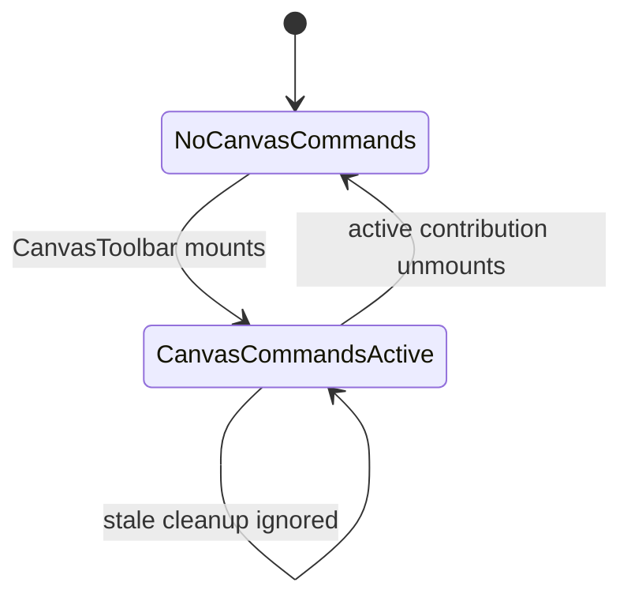

### Component Flow

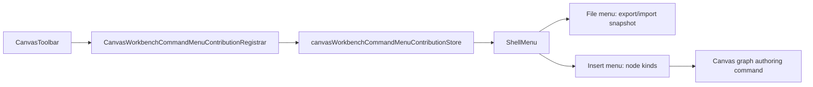

### Consumers

- `CanvasToolbar`
- `CanvasToolbarPrimaryControls`
- `ShellMenu`
- `TopAppBar`
- `CanvasToolbar.test.tsx`
- `CanvasToolbar.architecture.test.tsx`
- `TopAppBar.test.tsx`

### User Stories Covered

See [Workbench UX Canon User Stories](../workbench-ux-canon-component.md#section-workbench-ux-canon-user-stories).

### Fitness Functions

- `pnpm --filter @dvt/web exec vitest run --config vitest.presentation.config.ts src/app/components/TopAppBar.test.tsx src/app/views/canvas/CanvasToolbar.test.tsx src/app/views/canvas/CanvasToolbarPrimaryControls.test.tsx`
- `pnpm --filter @dvt/web exec vitest run --config vitest.unit.config.ts src/app/views/canvas/CanvasToolbar.architecture.test.tsx`
- `pnpm --filter @dvt/web typecheck`
- `pnpm docs:feature-mechanization:implementation`

### Drift To Watch

- if `Insert` or `Project` returns as a loose Canvas toolbar button, the command
  taxonomy has regressed;
- if `ShellMenu` imports Canvas controller hooks, the shell has absorbed route
  behavior;
- if File menu actions start execution or graph mutation, File has crossed into
  Run or Insert ownership;
- if Insert starts importing files, Insert has crossed into File ownership.

> Section status: Active. Owner: Frontend / Architecture. Colocation does not merge component responsibilities.
