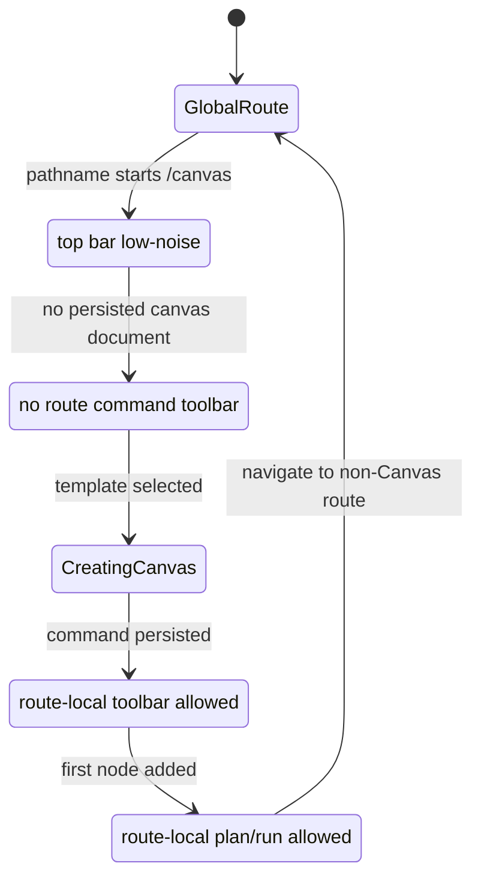
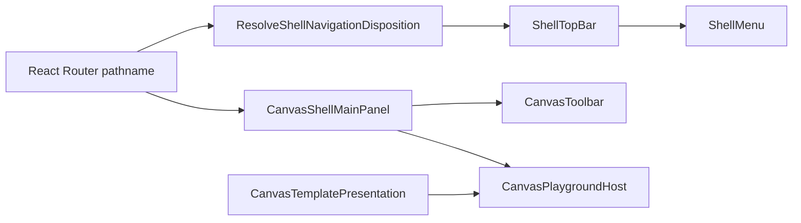
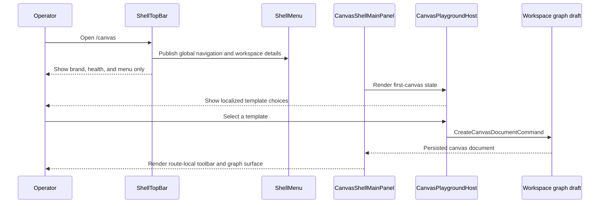

# Canvas Workbench Screen Composition Component

## Owned Concern

This component owns the whole `/canvas` workbench screen composition at the
boundary between persistent shell chrome and Canvas route chrome. It decides
where global navigation, workspace context, Canvas commands, first-document
copy, and visual preferences are presented.

It does not own graph persistence, protected draft semantics, Admin route
behavior, Plugins route behavior, or backend contracts.

## Public API

| API                          | Kind                   | Responsibility                                                                                                  |
| ---------------------------- | ---------------------- | --------------------------------------------------------------------------------------------------------------- |
| `ShellTopBar`                | shell renderer         | Renders low-noise global chrome and delegates hidden route-family controls to `ShellMenu`.                      |
| `ShellMenu`                  | shell renderer         | Renders global navigation, workspace context, view controls, and active Canvas view contributions.              |
| `CanvasShellMainPanel`       | Canvas route renderer  | Places Canvas tabs, route-local toolbar, banners, viewport, and center-surface states.                          |
| `CanvasToolbar`              | Canvas route renderer  | Renders graph/document commands only inside the Canvas workbench.                                               |
| `CanvasTemplatePresentation` | presentation model     | Resolves route-visible first-canvas template title and description from a `CanvasKindRegistration` plus locale. |
| `CanvasPlaygroundHost`       | Canvas host controller | Builds `CreateCanvasDocumentCommand` from the selected template presentation.                                   |

## Invariants

- Canvas workbench routes do not mount a permanent left navigation rail.
- Canvas route commands must not render inside the persistent global top bar.
- `ShellTopBar` may show global health and the menu trigger; route-local Canvas
  command controls belong in Canvas workbench chrome.
- `Admin` and `Plugins` remain reachable when the rail is hidden.
- The first-canvas state must not show disabled Plan, Run, Export, or Import
  controls before a canvas document exists.
- Workspace context is read-only on the Canvas entry screen. Switching project,
  tenant, or environment belongs to a separate governed flow.
- Visible first-canvas template title and description are resolved by a
  presentation model, not by leaking raw plugin registry strings directly into
  the route.
- The selected first-canvas command continues through `CreateCanvasDocumentCommand`;
  no parallel first-canvas rail is introduced.
- Shell copy and Canvas entry copy must not mix locale families on the same
  first viewport.

## Transitions

## Shell And Route Flow

## Sequence

## Consumers

| Consumer                              | Use                                                                     |
| ------------------------------------- | ----------------------------------------------------------------------- |
| `RootShell`                           | Resolves route family and passes shell navigation model to the top bar. |
| `ShellTopBar`                         | Applies low-noise Canvas posture and owns the menu trigger.             |
| `ShellMenu`                           | Provides hidden-rail global navigation and workspace details.           |
| `CanvasShellMainPanel`                | Applies Canvas route-local command placement.                           |
| `CanvasPlaygroundHost`                | Resolves first-canvas template presentation and command title.          |
| `CanvasToolbar.architecture.test.tsx` | Guards route-local toolbar ownership.                                   |
| `Root.shellChrome.test.tsx`           | Guards no-rail and hidden-rail global navigation.                       |

## Command And Query Rails

| Rail                                 | Type    | Owner                     | Use                                                             |
| ------------------------------------ | ------- | ------------------------- | --------------------------------------------------------------- |
| `ResolveShellNavigationDisposition`  | query   | Frontend shell            | Decides whether Canvas hides the rail.                          |
| `ListShellNavigationItems`           | query   | Frontend shell            | Supplies global route destinations for rail and menu rendering. |
| `GetEffectiveWorkspaceContext`       | query   | Frontend shell            | Supplies read-only workspace and draft posture labels.          |
| `CreateCanvasDocumentCommand`        | command | Canvas document           | Persists the first canvas document after template selection.    |
| `RenderCanvasContextualGraphSurface` | query   | Canvas graph presentation | Proves screen composition without creating product behavior.    |

No backend command/query rail changes are introduced by this component.

## Drift To Prevent

- Reintroducing `shell-top-bar-canvas-controls`.
- Rendering `CanvasToolbar` through a global top-bar portal.
- Showing disabled Canvas route commands in the first-canvas state.
- Hiding Admin or Plugins when the Canvas rail is hidden.
- Rendering raw English plugin template copy inside a Spanish Canvas route.
- Replacing command/query rails with component-local ad hoc actions.

## Canvas Workbench Screen Composition User Stories

### Story Map

#### US-CANVAS-SCREEN-001: First Canvas Screen Uses A Low-Noise Shell

As an operator opening `/canvas` in an active workspace, I want the persistent
top bar to stay low-noise so that the first meaningful action is choosing or
working with a canvas, not reading disabled route commands.

Acceptance:

- Given `/canvas` has no persisted canvas document, then the global top bar does
  not show Plan, Run, Export, Import, read-only workflow badges, or a Canvas
  toolbar portal.
- The first viewport shows the first-canvas decision inside the Canvas
  workbench body.
- Workspace context remains visible in the Canvas body or shell menu as
  read-only information.

#### US-CANVAS-SCREEN-002: Global Navigation Survives Hidden Rail Mode

As an operator on a Canvas workbench route, I want to reach `Admin` and
`Plugins` after the left rail is hidden so that no global destination is lost.

Acceptance:

- Given the Canvas rail is hidden, when I open the shell menu, then Canvas,
  Runs, Plugins, and Admin are visible in the first navigation group.
- Plugins and Admin links navigate to `/plugins` and `/admin`.
- No Canvas workbench tab replaces those global destinations.

#### US-CANVAS-SCREEN-003: Canvas Commands Are Route Local

As an operator editing a canvas document, I want graph and execution commands in
the Canvas workbench so that global shell chrome remains stable.

Acceptance:

- Plan, Run, Export, Import, draft status, and reload actions render in the
  Canvas route-local toolbar after a canvas document or graph-operable state
  exists.
- Those controls never render in `ShellTopBar`.
- Canvas visual preferences remain in the shell `View` menu contribution.

#### US-CANVAS-SCREEN-004: First Canvas Template Copy Is Locale-Coherent

As an operator using a Spanish browser locale, I want first-canvas choices to
use Spanish visible copy so that the screen does not mix route Spanish with
English plugin labels.

Acceptance:

- With locale `es-*`, first-canvas template titles and descriptions render in
  Spanish for built-in `dbt` and `transformation` templates.
- The adapter label is localized.
- The command still goes through `CreateCanvasDocumentCommand`; no new create
  rail is added.

#### US-CANVAS-SCREEN-005: Workspace Context Is Read Only On The Entry Screen

As an operator, I want the current tenant, project, environment, and adapter to
be clear without turning the first Canvas screen into a project selector.

Acceptance:

- The first-canvas card shows tenant, project, environment, and adapter as
  text.
- The shell menu exposes the same context as read-only details.
- No combobox or selector appears in the Canvas top bar or first-canvas card.

### Scenario Matrix

| Scenario                     | Expected Shell      | Expected Canvas Body                          | Expected Menu                     |
| ---------------------------- | ------------------- | --------------------------------------------- | --------------------------------- |
| `/canvas` needs first canvas | Brand, health, menu | First-canvas template card, no route toolbar  | Navigation plus workspace context |
| `/canvas` empty typed canvas | Brand, health, menu | Route-local toolbar plus empty graph action   | Navigation plus view controls     |
| `/canvas` ready graph        | Brand, health, menu | Route-local toolbar plus graph viewport       | Navigation plus view controls     |
| `/canvas` read-only          | Brand, health, menu | Read-only banner and local inspection surface | Navigation plus view controls     |
| `/plugins`                   | Global rail allowed | Plugins route                                 | Menu remains supplemental         |
| `/admin`                     | Global rail allowed | Admin route                                   | Menu remains supplemental         |

### Negative Stories

- The first-canvas screen must not show a disabled Run button in the global top
  bar.
- The shell menu must not hide Admin and Plugins below route-local controls.
- The first-canvas card must not call `dbt` or `Transformation` project types.
- The template component must not construct `CreateCanvasDocumentCommand`
  directly.
- The top bar must not own Canvas route command semantics.

> Acceptance scope status: Active. Owner: Frontend / Shell / Canvas.
