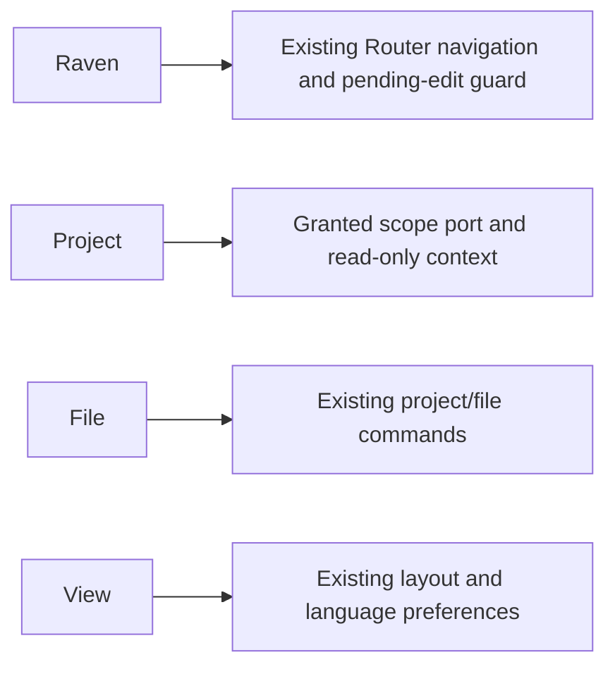
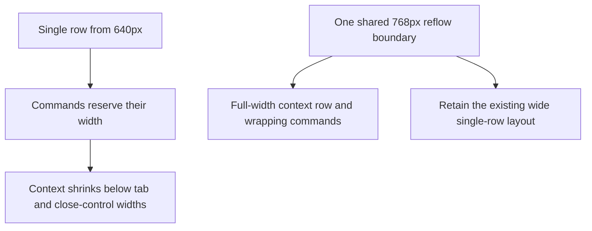
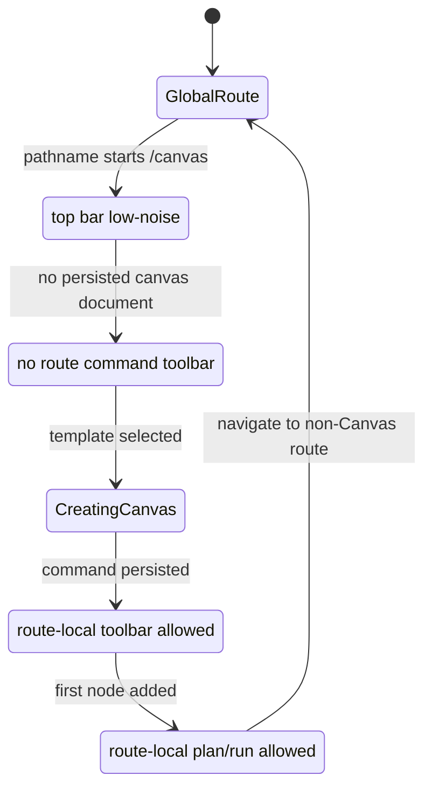
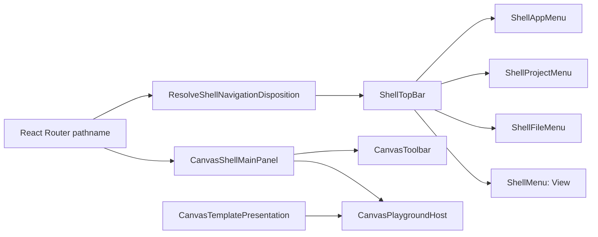
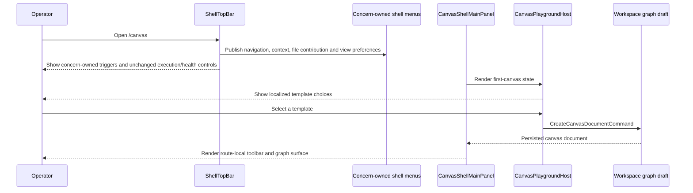

# Canvas Workbench Screen Composition Component

## Owned Concern

This component owns the whole `/canvas` workbench screen composition at the
boundary between persistent shell chrome and Canvas route chrome. It decides
where global navigation, workspace context, Canvas commands, first-document
copy, and visual preferences are presented.

It does not own graph persistence, protected draft semantics, Admin route
behavior, Plugins route behavior, or backend contracts.

## Approved Menu Responsibility Contract

[The bounded menu cut](https://github.com/dunay2/dvt/issues/3622), approved under
issue #3296, replaces the older mixed `ShellMenu` placement. It does
not accept the entire Figma migration or introduce another application rail.

| Surface                | Owned concern                                                 | Existing authority                                           |
| ---------------------- | ------------------------------------------------------------- | ------------------------------------------------------------ |
| Raven application menu | Global destinations when the navigation rail is hidden; About | `ListShellNavigationItems`, `GetCompiledApplicationMetadata` |
| Project menu           | Granted project/environment selection, context and Git        | `GetEffectiveWorkspaceContext`, `SelectWorkspaceScope`       |
| File menu              | New Project and active project import/export, files and code  | `CreateProject`, existing Canvas workspace contribution      |
| View menu              | Explorer/drawer recovery, focus mode and ES/EN preference     | Existing layout commands, `ConfigureApplicationLanguage`     |
| Execution controls     | Existing explicit execution intent/readiness                  | Unchanged operational contribution                           |

Each action has one menu owner. Controllers retain lifecycle and dispatch;
concern-specific templates own passive markup and shared chrome styles. No
generic menu framework, new store or second command catalog is introduced.
Menu opening does not execute data queries or change graph authoring state.

Focus ownership follows the selected intent: code/explorer and project creation
return to File; granted-scope recovery remains Project. A menu closing to open
an editor/dialog must not steal the receiving surface's focus. Router navigation
must preserve the existing unapplied-edit guard.

Source import still registers only; dragging creates an instance. This contract
does not add Source double-click/Insert creation, change JOIN output, or expose
unimplemented Edit/Undo/Insert/Run/Help capabilities.

## Compact Header Reflow

The real workbench viewport proof exposed a regression at 640 x 450 CSS pixels:
the added File trigger reserved command width while the single-row header
compressed the Canvas/model identity below its tab and close-control widths.
The existing geometry assertion must remain intact; hiding labels, clipping
controls or forcing clicks would not correct the layout.

The shell bar and its two named cluster class contracts belong together in
`shell/chrome.ts`. All three switch to the wide layout at the same `md`
breakpoint. Below it, the existing full-width groups wrap and the header takes
its natural height; the workbench's existing flex allocation retains the footer
and inspector inside the viewport. No new layout store, JavaScript resize
handler, command/query rail or permanent shell-height assumption is introduced.

| CSS viewport width | Header posture                                   | Required evidence                                      |
| ------------------ | ------------------------------------------------ | ------------------------------------------------------ |
| 390, 640, 767 px   | Full-width context and wrapping command rows     | Visible tabs/close controls; no command overflow       |
| 768, 960, 1366 px  | Existing single-row context and command clusters | Unchanged menu ownership, execution and focus behavior |

Unit evidence checks the shared class boundary, not simulated geometry. The
existing native browser viewport proof checks actual tab/close containment at
640 x 450, inspector/footer containment and absence of graph writes. Provider
menu evidence must wait for the existing startup overlay to disappear before
interacting with the shell; a mounted trigger alone does not prove route
readiness. This is an observable precondition, not an arbitrary delay or a
forced-click workaround.

## Public API

| API                          | Kind                   | Responsibility                                                                                                  |
| ---------------------------- | ---------------------- | --------------------------------------------------------------------------------------------------------------- |
| `ShellTopBar`                | shell renderer         | Composes concern-owned menus and unchanged execution/connection controls.                                       |
| `ShellAppMenu`               | shell controller       | Coordinates guarded global navigation and About.                                                                |
| `ShellProjectMenu`           | shell controller       | Coordinates granted scope selection, context and Git.                                                           |
| `ShellFileMenu`              | shell controller       | Coordinates project creation and the existing Canvas file contribution.                                         |
| `ShellMenu`                  | shell controller       | Coordinates View preferences only.                                                                              |
| `ShellMenu.templates`        | passive presentation   | Presents navigation, Project, File and View through existing Radix primitives.                                  |
| `CanvasShellMainPanel`       | Canvas route renderer  | Places Canvas tabs, route-local toolbar, banners, viewport, and center-surface states.                          |
| `CanvasToolbar`              | Canvas route renderer  | Renders graph/document commands only inside the Canvas workbench.                                               |
| `CanvasTemplatePresentation` | presentation model     | Resolves route-visible first-canvas template title and description from a `CanvasKindRegistration` plus locale. |
| `CanvasPlaygroundHost`       | Canvas host controller | Builds `CreateCanvasDocumentCommand` from the selected template presentation.                                   |

## Invariants

- Canvas workbench routes do not mount a permanent left navigation rail.
- Canvas graph/document editing commands remain route-local. The existing
  project/file contribution is rendered only inside File, not as loose top-bar
  controls.
- `ShellTopBar` shows concern-owned menu triggers, health and the unchanged
  execution controls; it does not import Canvas controller hooks.
- `Admin` and `Plugins` remain reachable when the rail is hidden.
- The first-canvas state must not show disabled Plan, Run, Export, or Import
  controls before a canvas document exists.
- Identity details remain read-only. Granted scope selection reuses
  `SelectWorkspaceScope` in Project; menu presentation does not grant access.
- Visible first-canvas template title and description are resolved by a
  presentation model, not by leaking raw plugin registry strings directly into
  the route.
- The selected first-canvas command continues through `CreateCanvasDocumentCommand`;
  no parallel first-canvas rail is introduced.
- Shell copy and Canvas entry copy must not mix locale families on the same
  first viewport.

## Transitions

## Shell And Route Flow

## Sequence

## Consumers

| Consumer                              | Use                                                                       |
| ------------------------------------- | ------------------------------------------------------------------------- |
| `RootShell`                           | Resolves route family and passes shell navigation model to the top bar.   |
| `ShellTopBar`                         | Applies low-noise Canvas posture and owns the menu trigger.               |
| `ShellAppMenu`                        | Coordinates hidden-rail navigation without bypassing pending-edit guards. |
| `ShellProjectMenu`                    | Composes the existing granted scope selector and context read model.      |
| `ShellFileMenu`                       | Reuses project creation and Canvas file commands; owns focus transfer.    |
| `ShellMenu`                           | Coordinates View preferences without navigation or project actions.       |
| `CanvasShellMainPanel`                | Applies Canvas route-local command placement.                             |
| `CanvasPlaygroundHost`                | Resolves first-canvas template presentation and command title.            |
| `CanvasToolbar.architecture.test.tsx` | Guards route-local toolbar ownership.                                     |
| `Root.shellChrome.test.tsx`           | Guards no-rail and hidden-rail global navigation.                         |

## Command And Query Rails

| Rail                                 | Type    | Owner                     | Use                                                             |
| ------------------------------------ | ------- | ------------------------- | --------------------------------------------------------------- |
| `ResolveShellNavigationDisposition`  | query   | Frontend shell            | Decides whether Canvas hides the rail.                          |
| `ListShellNavigationItems`           | query   | Frontend shell            | Supplies global route destinations for rail and menu rendering. |
| `GetEffectiveWorkspaceContext`       | query   | Frontend shell            | Supplies read-only workspace and draft posture labels.          |
| `CreateCanvasDocumentCommand`        | command | Canvas document           | Persists the first canvas document after template selection.    |
| `RenderCanvasContextualGraphSurface` | query   | Canvas graph presentation | Proves screen composition without creating product behavior.    |

No backend command/query rail changes are introduced by this component.

## Drift To Prevent

- Reintroducing `shell-top-bar-canvas-controls`.
- Rendering `CanvasToolbar` through a global top-bar portal.
- Showing disabled Canvas route commands in the first-canvas state.
- Hiding Admin or Plugins when the Canvas rail is hidden.
- Rendering raw English plugin template copy inside a Spanish Canvas route.
- Replacing command/query rails with component-local ad hoc actions.
