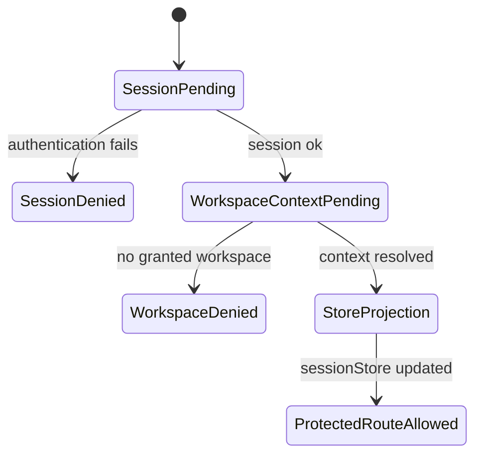
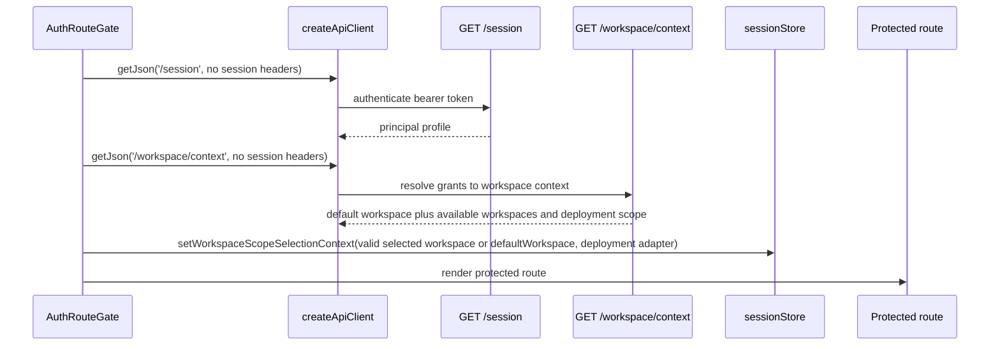
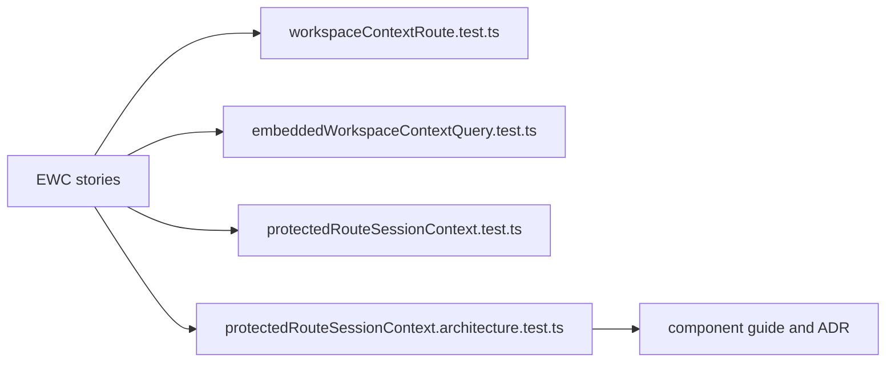

# Effective Workspace Context Component

## Purpose

The workspace context component gives API-mode web routes a server-owned set of
granted tenant, project, and environment scopes plus a deterministic default
before they render protected product surfaces. The browser selects only within
that set.

It complements the shell workspace context component. The shell component
renders the active validated selection. This component resolves the
authoritative grant projection and default that the shell and runtime services
may display or send back to protected routes.

## Owned Concern

Owns server-granted workspace context resolution and deterministic defaulting
for protected web routes. The browser owns only its validated selected scope.

It does not own authentication, login, tenant administration, project creation,
server-persisted workspace preferences, graph draft persistence, run execution, or
workspace-file content.

## Public API

| API                                              | Kind                    | Rail                                                    | Responsibility                                                                          |
| ------------------------------------------------ | ----------------------- | ------------------------------------------------------- | --------------------------------------------------------------------------------------- |
| `GET /workspace/context`                         | HTTP query              | `GetEffectiveWorkspaceContext`                          | Return granted workspaces, deterministic default, and deployment scope.                 |
| `IWorkspaceContextQuery`                         | API port                | `GetEffectiveWorkspaceContext`                          | Resolve granted workspaces from backend grant storage.                                  |
| `EmbeddedWorkspaceContextQuery`                  | API adapter             | `GetEffectiveWorkspaceContext`                          | Read one normalized grant snapshot and project names using one set query.               |
| `resolveProtectedRouteSessionContext`            | web application service | `GetRuntimeSession` then `GetEffectiveWorkspaceContext` | Resolve session and context before protected route render.                              |
| `sessionStore.setWorkspaceScopeSelectionContext` | projection update       | `GetEffectiveWorkspaceContext`                          | Store a selected granted scope and deployment adapter for downstream headers and views. |

## Invariants

- `GET /session` does not return workspace context.
- `GET /workspace/context` requires authentication.
- `GET /workspace/context` fails closed when no workspace is granted.
- Protected route rendering waits for both session and workspace
  context.
- `sessionStore` is a browser selection projection, not grant authority.
- The deployment adapter used by plan/run comes from the protected runtime
  adapter registry through `/workspace/context`; the web client must not infer
  it from local storage.
- `availableWorkspaces` is sorted deterministically by tenant, project, and
  environment; `defaultWorkspace` is its first entry.
- When `availableWorkspaces` contains the browser-selected scope, the resolver
  preserves that scope.
- When the selected scope is absent from `availableWorkspaces`, the resolver
  falls back to `defaultWorkspace` and still fails closed on context denial.
- `createApiClient` may send session headers only after the protected route
  gate has applied server-owned context, and those headers include tenant,
  project, environment, and target adapter.
- Mock mode may keep local demo scope, but must not be documented as product
  authority.

## Transitions

## Sequence

## Consumers

| Consumer                | Rule                                                                                                         |
| ----------------------- | ------------------------------------------------------------------------------------------------------------ |
| `AuthRouteGate`         | Resolves session and granted workspace context before rendering protected routes.                            |
| `sessionStore`          | Stores validated browser selection and deployment adapter, not grants or authorization.                      |
| `createApiClient`       | Reads projected scope for `X-Tenant-Id`, `X-Project-Id`, `X-Environment-Id`, and `X-Target-Adapter` headers. |
| Canvas                  | Reads session context through existing route/controller seams after gate resolution.                         |
| Runs                    | Reads session context through existing route/controller seams after gate resolution.                         |
| Shell workspace context | Displays current scope read-only.                                                                            |

## Semantic Fitness Function

The architecture guard in
`apps/web/src/app/services/session/protectedRouteSessionContext.architecture.test.ts`
validates:

- session and workspace context remain separate rails;
- `AuthRouteGate` delegates route startup semantics to the resolver;
- the resolver calls `/session` before `/workspace/context`;
- `/workspace/context` is applied to `sessionStore`;
- an already selected scope is preserved only when it appears in
  `availableWorkspaces`;
- `/session` does not import or mention workspace context.

## Drift Guard

Update this guide and the user stories when a change alters:

- the route surface for granted workspace context;
- the session/workspace responsibility split;
- when protected routes are allowed to render;
- how granted workspace options are represented;
- how deployment adapter scope is represented;
- whether local storage may influence API-mode scope.
- whether multiple available workspaces are collapsed or selectable during
  protected route startup.

## Effective Workspace Context User Stories

### Purpose

These stories cover protected web API-mode workspace context resolution.

### Scenario Matrix

| Scenario | User intent                                       | Expected behavior                                               | Guard                   |
| -------- | ------------------------------------------------- | --------------------------------------------------------------- | ----------------------- |
| EWC-1    | Enter a protected route with a valid session      | UI resolves granted workspaces and default before rendering     | Unit, route             |
| EWC-2    | Enter with no authenticated session               | UI redirects to login and does not use local workspace defaults | Unit                    |
| EWC-3    | Enter with valid session but no granted workspace | UI denies protected route startup instead of inventing scope    | API route, web resolver |
| EWC-4    | Work after context resolution                     | Downstream API calls use the granted tenant/project scope       | Web resolver            |
| EWC-5    | Preserve session boundary                         | `/session` stays authentication-only                            | Architecture            |
| EWC-6    | Preserve local demo mode                          | Mock mode may use demo scope but remains outside API authority  | Documentation           |

### User Stories

#### EWC-1: Resolve Granted Workspace Before Route Render

As an operator opening Canvas, I want the application to load the
workspace context granted by the backend before the route renders, so the UI
does not display a tenant/project/environment that the backend has not granted.

Acceptance:

- given `/session` succeeds;
- and `/workspace/context` returns granted workspaces and a deterministic default;
- when a protected route is entered;
- then `sessionStore` retains its selection only when it remains granted, otherwise it uses the default;
- and only then does the protected route render.

#### EWC-2: Do Not Use Local Defaults As Protected Authority

As a platform owner, I want local env and localStorage values to be ignored as
authority in API-mode route startup, so stale browser state cannot present an
ungranted workspace.

Acceptance:

- given localStorage contains a different tenant/project/environment;
- when that identity is absent from `availableWorkspaces`;
- then `defaultWorkspace` replaces the stale local projection.

#### EWC-3: Deny Startup Without Granted Workspace

As an operator without workspace grants, I want the app to stop at protected
route startup, so I do not see a workspace that I cannot use.

Acceptance:

- given `/session` succeeds;
- and `/workspace/context` returns forbidden;
- when a protected route is entered;
- then the route is not rendered;
- and the user sees the existing protected-route denial posture.

#### EWC-4: Keep Session Endpoint Narrow

As an API maintainer, I want `GET /session` to remain a principal profile query,
so authentication does not absorb workspace-selection responsibilities.

Acceptance:

- given the API route files are inspected;
- then `sessionRoute.ts` does not return or import workspace context;
- and `workspaceContextRoute.ts` owns `GET /workspace/context`.

#### EWC-5: Expose Granted Options For Future Selection

As a project selector, I want the backend to return the granted workspace
options and deterministic default, so I can choose only valid scopes.

Acceptance:

- given multiple workspaces are granted;
- when `/workspace/context` is called;
- then the response includes `defaultWorkspace` and `availableWorkspaces`;
- and the default is the first deterministically sorted granted option.

### Coverage Map

> Acceptance scope status: Active. Owner: Web / API / Architecture.
