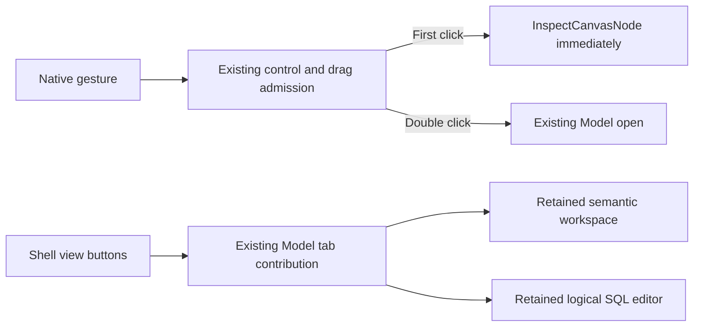

# Model View Navigation

## Ownership and reason to change

The existing Shell presentation family renders Model view shortcuts. The Model
workspace owns the selected Model, semantic transaction, SQL visibility and SQL
buffer. Shell receives only presentation posture and callbacks through the
existing Model tab contribution. It receives no semantic document, SQL text,
connection configuration or query client.

The native design is `GH-3944-MODEL-VIEW-NAVIGATION`, recorded under
[the governing issue](https://github.com/dunay2/dvt/issues/3944#issuecomment-6957606183).
It reuses `InspectCanvasNode` and `SelectCanvasWorkbenchTab`; SQL context,
compilation, row execution and Apply keep their existing ports and guards.

## Current state and decision

The previous pointer arbiter deferred inspection by 500 ms so a double-click
sequence could suppress inspection altogether. This made an ordinary inspection
wait even when the catalog had no double-click open action. The browser's native
sequence already distinguishes `click` and `dblclick`, but the first click occurs
before the browser knows whether another click will follow.

Inspect on the first admitted click immediately. A subsequent native `dblclick`
invokes a genuine Model-open callback once. Its first click may inspect. Sources
and catalog definitions without an open capability retain inspection and never
acquire a fallback creation or Code action. This supersedes the delayed,
mutually exclusive pointer policy in the previous catalog revision.

No timeout or document-wide pending-click listener is needed. Consumed drag
clicks, default-prevented gestures, secondary buttons and embedded controls remain
excluded. Native keyboard activation keeps the existing open/inspect capability.
Catalog drag/drop remains the only placement gesture; inspection creates no
instance and performs no semantic write.

Immediate inspection can cover a card near the right edge. One Canvas-scoped
capture adapter retains the first admitted card's DOM shell, capability and
Canvas identity. If the native second mousedown has `detail=2` and targets the
newly covering inspector, it prevents accidental field activation. Native
`dblclick` delegates once to the existing eligible Model-open callback. An
ordinary same-card double click retains its existing handler. New first clicks,
keyboard, context menus and drag clear the transient record. Changed Canvas,
disconnected or hidden cards cannot receive a late entry. Sources gain no open
fallback. The adapter owns only this native event handoff.

## Model view shortcuts

The left rail exposes Semantic view and SQL with distinct shared glyphs, localized
accessible labels/tooltips and common navigation tokens. Exactly one destination
is active: Canvas, project Code/Git, semantic Model or Model SQL. An unavailable
Model or an in-progress Apply of a SQL proposal disables the Model shortcuts.
Visual Apply retains its existing lifecycle while presentation switches without
unmounting the semantic workspace.

Semantic view selects the existing Model workspace and collapses SQL. SQL selects
that workspace and expands its existing logical editor. The Model publishes both
callbacks; Shell delegates without introducing a second navigation or draft owner.
Presentation switching retains the SQL buffer, current Model and lower data
results. It never implicitly compiles, executes, applies, saves or discards.
Expanding SQL may prepare the existing protected logical-input context. SQL
generation, validation, row execution and Model Apply remain explicit actions.

## Physical responsibilities

| Surface                      | Responsibility                                                      |
| ---------------------------- | ------------------------------------------------------------------- |
| `useCanvasNodeActivation`    | Admit native card inspection and Model-open gestures                |
| `useCanvasNativeNodeEntry`   | Preserve a native pair when inspection covers its second target     |
| `CanvasNodeShell`            | Compose the admitted node gesture with its existing menu and ports  |
| `ShellModelViewNavigation`   | Render the two view controls from published posture                 |
| `LeftNavigationRail`         | Compose direct destinations and exclusive active presentation       |
| `useCanvasModelWorkspaceTab` | Publish current Model navigation callbacks                          |
| `CanvasModelEditor`          | Own semantic/SQL presentation and delegate existing draft lifecycle |

These responsibilities extend existing families and ports. They create no new
domain aggregate, backend endpoint or persistence schema.

## Corners and validation

- Immediate pointer inspection is observable before advancing a fake clock.
- Native click/click/dblclick inspects once and opens an eligible Model once.
- Embedded controls, cancelled/default-prevented clicks and consumed drag clicks
  dispatch neither inspection nor open. Drag retains its existing payload.
- Catalog activation and double click never create an occurrence.
- Model shortcuts are unavailable without a current owner; callbacks cannot target
  an obsolete owner after registration changes.
- One active destination follows current Model/Code/SQL visibility. Keyboard and
  pointer invoke the same callbacks, with visible focus and accessible names.
- Switching views retains the actual SQL buffer and data, with no implicit
  compilation, row query, Apply or save.
- The reported inspector layout shift requires rendered evidence before changing
  hidden-form retention. Closing must still discard local uncommitted inputs,
  reset edit mode, restore focus safely and prevent hidden query activity.

Use the existing card, catalog, Model navigation and SQL browser proofs. Keep
meaningful negative assertions and remove timer-specific assertions superseded by
the immediate native-event contract.
