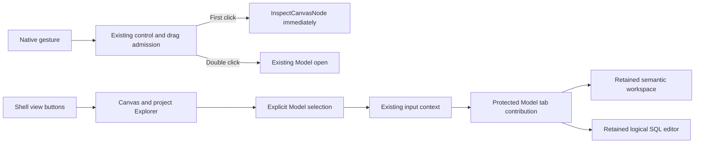

# Model View Navigation

## Ownership and reason to change

The existing Shell presentation family renders Model view shortcuts. The Model
workspace owns the selected Model, semantic transaction, SQL visibility and SQL
buffer. Shell receives only presentation posture and callbacks through the
existing Model tab contribution. It receives no semantic document, SQL text,
connection configuration or query client.

The native design is `GH-3944-MODEL-VIEW-NAVIGATION`, recorded under
[the governing issue](https://github.com/dunay2/dvt/issues/3944#issuecomment-6957606183).
It reuses `InspectCanvasNode` and `SelectCanvasWorkbenchTab`; SQL context,
compilation, row execution and Apply keep their existing ports and guards.

## Current state and decision

The previous pointer arbiter deferred inspection by 500 ms so a double-click
sequence could suppress inspection altogether. This made an ordinary inspection
wait even when the catalog had no double-click open action. The browser's native
sequence already distinguishes `click` and `dblclick`, but the first click occurs
before the browser knows whether another click will follow.

Inspect on the first admitted click immediately. A subsequent native `dblclick`
invokes a genuine Model-open callback once. Its first click may inspect. Sources
and catalog definitions without an open capability retain inspection and never
acquire a fallback creation or Code action. This supersedes the delayed,
mutually exclusive pointer policy in the previous catalog revision.

No timeout or document-wide pending-click listener is needed. Consumed drag
clicks, default-prevented gestures, secondary buttons and embedded controls remain
excluded. Native keyboard activation keeps the existing open/inspect capability.
Catalog drag/drop remains the only placement gesture; inspection creates no
instance and performs no semantic write.

Immediate inspection can cover a card near the right edge. One Canvas-scoped
capture adapter retains the first admitted card's DOM shell, capability and
Canvas identity. If the native second mousedown has `detail=2` and targets the
newly covering inspector, it prevents accidental field activation. Native
`dblclick` delegates once to the existing eligible Model-open callback. An
ordinary same-card double click retains its existing handler. New first clicks,
keyboard, context menus and drag clear the transient record. Changed Canvas,
disconnected or hidden cards cannot receive a late entry. Sources gain no open
fallback. The adapter owns only this native event handoff.

## Model view shortcuts

The left rail exposes Semantic view and SQL with distinct shared glyphs, localized
accessible labels/tooltips and common navigation tokens. Exactly one destination
is active: Canvas, project Code/Git, semantic Model or Model SQL. An unavailable
Canvas disables the Model shortcuts. An in-progress Apply of a SQL proposal
retains the existing protected Model replacement decision.
Visual Apply retains its existing lifecycle while presentation switches without
unmounting the semantic workspace.

Both icons reveal the existing project Model list in the left Explorer and leave
the Canvas visible until the user selects a block. They do not open the last
active Model or introduce a popup picker. The selected block then determines the
central content, using the requested semantic or SQL view when its existing
capability admits that editor. Other resources retain their real inspection or
Code capability; the view mode grants no new authoring permission.

The catalog identity is the shared definition. Resolve a real existing instance
for its input context before entering the editor: reuse a matching current
session, use the sole instance, or ask the user to choose when several exist.
An unplaced Model remains its definition and retains its real incomplete-input
state. Never create an instance or silently choose the first of several contexts.
This distinction is required by the existing SQL query port and shared-definition
contract; display names do not determine identity.

The registered Model projection, shared search, result counts, Source facet and
file-publication adapter remain unchanged. Selection never creates an occurrence;
placement remains a drag operation. The project list remains accessible while a
Model is open. The Model-local input palette remains reachable through a compact
Inputs control, with its existing inspection and occurrence actions.

One presentation owner retains search, Models disclosure and expanded Model
details across the Canvas and Model views. Both surfaces consume the shared
Explorer's controlled presentation contract; placement and selection callbacks
remain with their existing owners. Workspace scope, Canvas and project-root
changes reset that presentation and reject obsolete callbacks. Keep only the
current scoped state, without a growing map of past projects. Opening a Model
or receiving its file projection must not clear the current filter.

`SelectCanvasWorkbenchTab` delegates protected replacement to the current Model
session. A fresh session receives its initial view atomically; selecting the same
session reuses its published view callback. Semantic view collapses SQL and SQL
expands its retained logical editor. Shell receives presentation mode and callbacks
only, without owning SQL text, semantic drafts or authorization.
Focused local alias text remains pending when focus moves to a declared
workbench navigation control. Navigation and hiding a retained surface cannot
accept that alias through blur. Ordinary field blur retains its existing
acceptance behavior; explicit Close still discards the local input.
Presentation switching retains the SQL buffer, current Model and lower data
results. It never implicitly compiles, executes, applies, saves or discards.
Expanding SQL may prepare the existing protected logical-input context. SQL
generation, validation, row execution and Model Apply remain explicit actions.

## Physical responsibilities

| Surface                      | Responsibility                                                      |
| ---------------------------- | ------------------------------------------------------------------- |
| `useCanvasNodeActivation`    | Admit native card inspection and Model-open gestures                |
| `useCanvasNativeNodeEntry`   | Preserve a native pair when inspection covers its second target     |
| `CanvasNodeShell`            | Compose the admitted node gesture with its existing menu and ports  |
| `ShellModelViewNavigation`   | Render the two view controls from published posture                 |
| `LeftNavigationRail`         | Compose direct destinations and exclusive active presentation       |
| `useCanvasModelWorkspaceTab` | Publish current Model navigation callbacks                          |
| `CanvasModelEditor`          | Own semantic/SQL presentation and delegate existing draft lifecycle |

These responsibilities extend existing families and ports. They create no new
domain aggregate, backend endpoint or persistence schema.

## Native ownership reconciliation

The follow-up source is this committed component guide, admitted locally as
`GH-3944-PERSISTENT-MODEL-BROWSER`. Keep metadata updates bounded to the existing
Shell presentation, Canvas shell chrome, viewport and relational workbench
families. Source bindings must enumerate the actual implemented symbols and
their behavioral proof. Retired timer declarations must be removed rather than
kept as nonexistent evidence. Existing command/query identities and authorities
remain unchanged.

The global command/query catalog also changes the content digest of its existing
11 local and 16 imported declarations. Reconcile only those provenance leaves
through `CatalogReconciliation`, retaining all manifests and rail identities.
Its native storage scope is `planning_query_store.feature_mechanization_local_rails`,
`planning_query_store.command_query_rails` and
`planning_query_store.feature_mechanization_local_operations`. Component and rail
writes use their existing revision and binding-hash
compare-and-swap operators. No Planning DB import, rebuild or product schema
change is part of this slice.

## Corners and validation

- Immediate pointer inspection is observable before advancing a fake clock.
- Native click/click/dblclick inspects once and opens an eligible Model once.
- Embedded controls, cancelled/default-prevented clicks and consumed drag clicks
  dispatch neither inspection nor open. Drag retains its existing payload.
- Catalog activation and double click never create an occurrence.
- Model shortcuts are unavailable without a current owner; callbacks cannot target
  an obsolete owner after registration changes.
- Opening a view reveals the existing left Explorer and Canvas without selecting
  or creating a block. Selecting a current Model opens the requested view. The
  shared project list remains visible; cancelled replacement retains the current
  session and dirty buffer. Empty, no-match, loading and error states reuse the
  actual project catalog state.
- One active destination follows current Model/Code/SQL visibility. Keyboard and
  pointer invoke the same callbacks, with visible focus and accessible names.
- Filter text, result counts and detail disclosure survive Model entry and view
  switching; another workspace or Canvas cannot inherit them.
- Switching views retains the actual SQL buffer and data, with no implicit
  compilation, row query, Apply or save.
- The reported inspector layout shift requires rendered evidence before changing
  hidden-form retention. Closing must still discard local uncommitted inputs,
  reset edit mode, restore focus safely and prevent hidden query activity.

Use the existing card, catalog, Model navigation and SQL browser proofs. Keep
meaningful negative assertions and remove timer-specific assertions superseded by
the immediate native-event contract.
