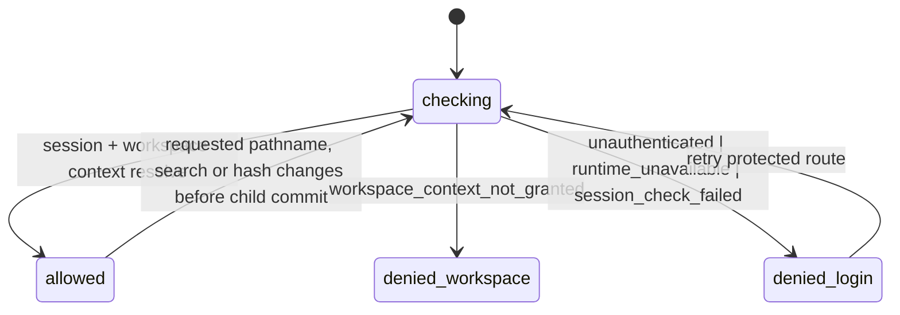

# Protected Route Session Gate Component

## Purpose

`AuthRouteGate` and `resolveProtectedRouteSessionContext` own protected-route
session admission in web bootstrap. The component verifies authenticated session
and granted workspace context through canonical runtime queries, then decides
route access posture.

This component does not authenticate users itself and does not bypass API
authorization. It maps runtime outcomes to route-level recovery vocabulary.

## Public API

| API                                   | Kind               | Owned concern                                                                                              |
| ------------------------------------- | ------------------ | ---------------------------------------------------------------------------------------------------------- |
| `resolveProtectedRouteSessionContext` | query orchestrator | Load `/session` and `/workspace/context` in canonical order.                                               |
| `classifyProtectedRouteSessionError`  | mapper             | Map recognized denials and missing runtime routes explicitly; other exceptions use `session_check_failed`. |
| `AuthRouteGate`                       | route gate         | Allow protected route render or route to login/workspace-denied posture.                                   |

## Invariants

- `/session` query always resolves before `/workspace/context`.
- `404` on `/session` is mapped to `runtime_unavailable`, not generic transport.
- `401/403` remain `unauthenticated` unless the explicit workspace denial shape
  is returned.
- No local dev flag can convert unauthorized responses into allowed posture.
- Session and workspace context ownership stays in API rails.
- Admission belongs to the requested pathname, search and hash. A changed route
  begins in `checking` before its protected children can commit; it cannot reuse
  the previous route's `allowed` state until a passive effect resets it.
- Navigating to the identical route identity retains the current admission.
- Unknown failures use `session_check_failed`. An HTTP server response, invalid
  workspace schema, request-preparation error or local exception must not be
  labelled as a proven transport failure. Recovery copy never exposes raw
  exceptions or response data.

## Transitions

## Recovery Vocabulary (Source-Owned)

| Failure source                             | Route state        | Recovery copy key               |
| ------------------------------------------ | ------------------ | ------------------------------- |
| `/session` returns `401` or `403`          | `denied_login`     | `unauthenticated`               |
| `/session` returns `404`                   | `denied_login`     | `runtime_unavailable`           |
| other query, validation or local failure   | `denied_login`     | `session_check_failed`          |
| `/workspace/context` returns denied reason | `denied_workspace` | `workspace_context_not_granted` |

`session_check_failed` describes the failed operation, not its unproven cause.
The login view offers the existing deep-link retry. Older browser-history
entries with `transport_error` use the same neutral copy; the gate no longer
produces that label. This recovery mapping does not diagnose the historical
intermittent browser failure or turn a failed query into admission.

## Plan/Run Readiness Rail Mapping

Protected-route admission is upstream of plan/run controls and must fail closed
before any run intent surface appears.

| Route gate rail           | Downstream rail dependency | Rule                                                                  |
| ------------------------- | -------------------------- | --------------------------------------------------------------------- |
| `ObserveWorkspaceContext` | `ObservePlanRunReadiness`  | readiness cannot render without a validated granted workspace context |
| `ObserveWorkspaceContext` | `SaveWorkspaceGraphDraft`  | authoring mutations blocked if scope is not admitted                  |
| `ObserveWorkspaceContext` | `ListWorkspaceFiles`       | code workbench must remain scope-bound                                |

## Consumers

- `apps/web/src/app/bootstrap/AuthRouteGate.tsx`
- `apps/web/src/app/views/LoginView.tsx`
- Web route bootstrap and F-27 acceptance matrix

## Semantic Fitness Function

- Architecture tests assert resolver-order invariants and route-level
  documentation coverage.
- Route tests assert `runtime_unavailable` copy when `/session` rail is missing.

## Protected Route Session Gate User Stories

- `PRSG-1`: as an internal tester, I need protected routes to admit only after
  `/session` and `/workspace/context` succeed in canonical order.
- `PRSG-2`: as an operator, I need missing protected runtime mount (`404
/session`) to produce explicit `runtime_unavailable` guidance.
- `PRSG-3`: as a user, I need missing workspace grant to show a distinct
  workspace access denial instead of login fallback.
- `PRSG-4`: as a security reviewer, I need `401/403` to remain fail-closed and
  never become route admission.
- `PRSG-5`: as a frontend maintainer, I need recovery vocabulary to be
  source-owned and reused by gate/login surfaces.

> Acceptance scope status: Review. Owner: Frontend / Runtime Safety.
