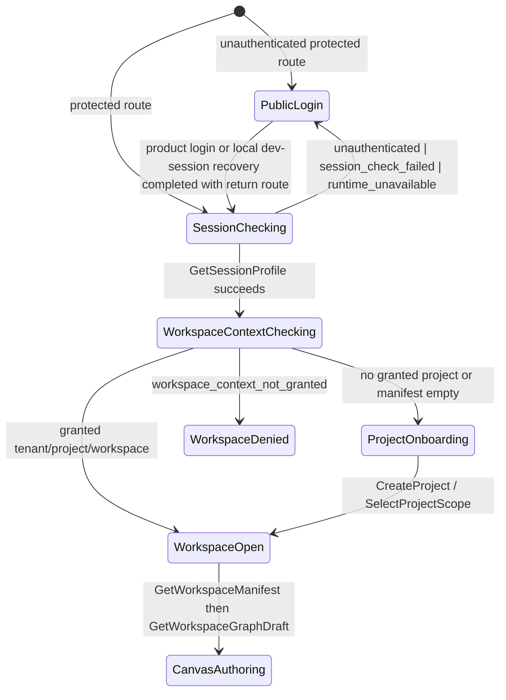
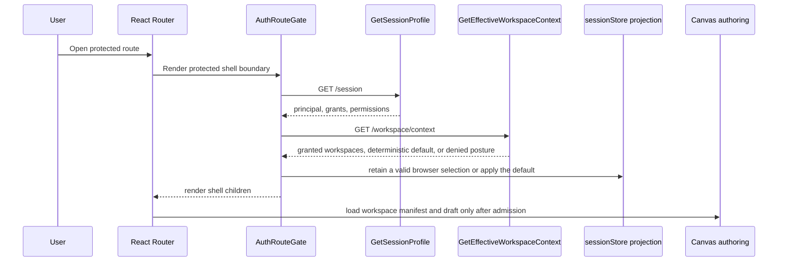
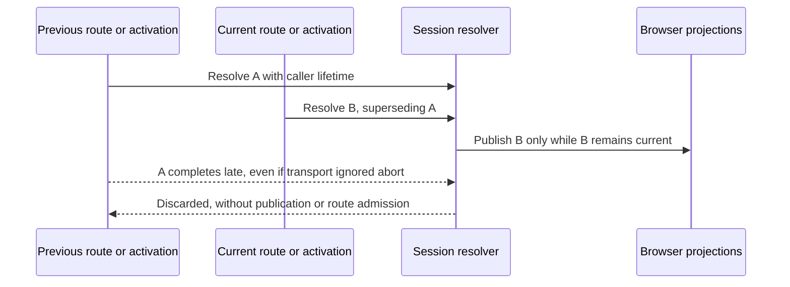

# Web Auth Project Onboarding Component

## Purpose

This component owns the semantic admission boundary for web identity, granted
workspace scope, and project-first startup. It canonizes the accepted web-auth
proposal into the current app shell: `/login` is the public recovery route,
`AuthRouteGate` protects product routes, and server-owned session plus granted
workspace context resolve before route children can render project data.

The component does not own external identity-provider configuration, API
authorization policy, Canvas graph mutation, or tenant-admin implementation.
Those remain behind their existing API, protected-runtime, and Canvas authoring
rails. `F-31` adds the first project-onboarding implementation slice for
authenticated users who have tenant scope but no effective project/workspace.

## Public API

| API                                              | Kind               | Owned concern                                                                  |
| ------------------------------------------------ | ------------------ | ------------------------------------------------------------------------------ |
| `/login`                                         | public route       | Public recovery surface for unauthenticated product navigation.                |
| `RecoverLocalApiBearerSession`                   | command            | Dev-only local session recovery through the API auth component.                |
| `AuthRouteGate`                                  | route gate         | Admit protected shell routes only after session and workspace context resolve. |
| `resolveProtectedRouteSessionContext`            | query orchestrator | Query `/session`, then `/workspace/context`, then update browser projections.  |
| `classifyProtectedRouteSessionError`             | mapper             | Convert API failures to source-owned route recovery vocabulary.                |
| `sessionStore.setWorkspaceScopeSelectionContext` | projection command | Store granted workspace scope as projection, not independent authority.        |
| `useAuthorizationStore`                          | projection command | Store granted UI permissions from the authenticated session profile.           |

## Invariants

- No product route may render tenant/project graph data before authentication
  and granted workspace context resolve.
- Each requested pathname, search and hash owns its admission lifetime. Changing
  that identity starts a fresh checking boundary before protected child effects
  run; navigating to the identical identity retains the current boundary.
- `/session` resolves before `/workspace/context`; workspace context is scoped by
  the authenticated principal.
- Recovery distinguishes recognized denials and a missing session route from
  `session_check_failed`. The latter includes unknown query, validation and local
  errors without claiming a transport cause or exposing raw exception data.
- The session resolver owns publication eligibility across all of its callers,
  including project activation. Only the latest non-cancelled attempt may update
  browser workspace and permission projections. A newer denial also supersedes
  older successes; transport cancellation is not the publication guarantee.
- Publication is admitted once for the complete synchronous workspace/permission
  snapshot. A subscriber starting a new query during publication cannot leave
  that snapshot half-written. The receipt is checked again afterward, so the
  superseded caller cannot continue route admission or project activation.
- Route and project-admission lifetimes invalidate their pending queries on
  cleanup. A cancelled or superseded attempt cannot admit route children or
  select a workspace. Callers recheck the resolver's currentness receipt before
  continuing after an asynchronous boundary.
- Project creation and browser activation are distinct: a server-created project
  remains real after its initiating view closes, but its late response must not
  activate a workspace in the abandoned view. Lifetime is captured before the
  creation request, not when its response arrives.
- sessionStore is a projection of backend-granted scope; it is not
  the authority for tenant, project, environment, or authorization.
- Browser `localStorage` and `dvt-web-session` may hydrate selector convenience
  only after the value is still present in server grants.
- The fixture nodes `src_orders`, `model_orders`, and `orders_dashboard` are
  Cypress/demo evidence only; they are not clean-start product seed data.
- `GetWorkspaceGraphDraft` and Canvas authoring commands remain downstream of
  project/workspace admission.
- Disabled or unavailable actions must name a story, capability, and contract
  instead of terminal "pending backend" copy.

## Transitions

## Sequence

### Publication Ordering

This is a publication policy inside the existing application service, not a new
session store, authentication authority, global lifecycle manager, or retry
mechanism. Genuine current failures retain the recovery vocabulary above.

The synchronous pair guarantees completion of an admitted publication, not a
general atomic transaction across two stores. Existing query consumers observe
workspace changes through the session context port, after the permission
projection has been written. Cross-store observation requirements must be proven
at the consuming port before replacing this publication boundary.

## Consumers

- `apps/web/src/app/routes.ts` mounts `/login` outside the protected shell and
  wraps `/` product children in `AuthRouteGate`.
- `apps/web/src/app/bootstrap/AuthRouteGate.tsx` owns route admission and
  recovery navigation.
- `apps/web/src/app/services/session/protectedRouteSessionContext.ts` owns the
  session/workspace query order and projection update.
- `apps/web/src/app/stores/sessionStore.ts` holds granted scope projection for
  downstream API headers.
- `apps/web/src/app/views/canvas/**` consumes the admitted scope before draft
  read/write rails.
- `apps/web/cypress/support/canvasDraftAuthoring.ts` remains fixture support,
  not product startup authority.

## Command/Query Rail

| Rail                           | Type    | DDD owner                        | Application port / adapter surface                                 | Negative tests                                                       |
| ------------------------------ | ------- | -------------------------------- | ------------------------------------------------------------------ | -------------------------------------------------------------------- |
| `StartLogin`                   | command | `ReturnRoute` value object       | `/login` route                                                     | protected deep link without session redirects with return route      |
| `RecoverLocalApiBearerSession` | command | `ReturnRoute` value object       | `/login` route via API auth component                              | missing refresh URL or unusable token leaves user on public recovery |
| `GetSessionProfile`            | query   | `SessionProfile` read model      | `resolveProtectedRouteSessionContext` via `GET /session`           | missing, expired, malformed, or unauthorized session fails closed    |
| `GetEffectiveWorkspaceContext` | query   | `SelectedScope` read model       | `resolveProtectedRouteSessionContext` via `GET /workspace/context` | revoked tenant, deleted project, stale browser storage, denied scope |
| `ListProjects`                 | query   | `ProjectDescriptor` read model   | project onboarding catalog                                         | empty tenant returns onboarding, not sample graph data               |
| `CreateProject`                | command | `Project` aggregate              | project onboarding command port                                    | duplicate project and unauthorized tenant are rejected               |
| `GetWorkspaceManifest`         | query   | `WorkspaceManifest` read model   | workspace manifest query                                           | no selected project does not call `GetWorkspaceGraphDraft`           |
| `GetWorkspaceGraphDraft`       | query   | `WorkspaceGraphDraft` read model | protected Canvas draft repository                                  | draft query is downstream of session and project admission           |
| `EnableDemoProjectSeed`        | command | `DemoSeedPolicy`                 | explicit demo/test seed command                                    | fixture nodes cannot appear in clean startup without explicit seed   |

## Fowler Analysis

- Pattern improved: `AuthRouteGate` plus
  `resolveProtectedRouteSessionContext` behaves like an Application Service
  boundary instead of a route-level transaction script.
- Pattern improved: browser stores are projections, matching Fowler's
  separation between domain authority and presentation state.
- Pattern improved: the Application Service owns asynchronous publication
  ordering; route and project-admission controllers supply their lifetime and
  passive views do not decide freshness or grant authority.
- Anti-pattern resisted: Active Record style route components that fetch,
  authorize, mutate browser state, and decide product seed data inline.
- Anti-pattern resisted: fixture data promoted to product truth.
- Grouping opportunity: future implementation should group identity/session,
  project onboarding, tenant admin, and capability-gap code by owned component
  rather than scattering it under generic `views` and `services`.

## Semantic Fitness Function

- `apps/web/src/app/bootstrap/webAuthProjectOnboarding.architecture.test.ts`
  verifies the protected shell is gated by session and granted workspace
  rails, validates this component guide and user stories, and binds the accepted
  proposal to the current canonical slice.
- `apps/web/src/app/services/session/protectedRouteSessionContext.architecture.test.ts`
  verifies session and workspace context rails remain separate.
- Cypress coverage for future implementation must cover login-required,
  stale-storage rejection, empty tenant/project onboarding, project creation,
  first empty Canvas, explicit demo seed, and disabled-action capability copy.

## Web Auth Project Onboarding User Stories

### WAPO-1: Protected Routes Require Identity

As an unauthenticated operator, I want protected product routes to send me to
login so that tenant and project data never render without identity.

Acceptance:

- Opening `/`, `/canvas`, `/plugins`, or `/admin` without a valid session
  resolves through `/login`.
- The return route is preserved.
- No workspace graph draft request occurs before session admission.

### WAPO-2: Runtime Missing Is Not Treated As Login Success

As an operator, I want missing session runtime to show recovery posture so that
the shell does not reveal protected UI behind a broken backend.

Acceptance:

- `/session` returning `404` maps to `runtime_unavailable`.
- `AuthRouteGate` sends the user to login/recovery rather than rendering `Root`.
- The route bootstrap gate can complete because the public recovery route owns
  its own startup posture.

### WAPO-3: Workspace Denial Is Distinct From Authentication Failure

As an authenticated user without workspace grants, I want a specific denied
workspace posture so that I do not retry login for a permission problem.

Acceptance:

- `/workspace/context` denial with `workspace_context_not_granted` renders the
  workspace access required state.
- The UI does not call Canvas authoring or run-start rails.
- The denial remains tenant/project scoped.

### WAPO-4: Stale Browser Scope Cannot Invent Authority

As a security owner, I want persisted browser scope ignored when grants change
so that `localStorage` cannot resurrect deleted or revoked projects.

Acceptance:

- `dvt-web-session` is only a projection cache.
- The selected workspace is replaced with the server default workspace when
  the persisted scope is absent from grants.
- Negative tests cover revoked tenant, deleted project, and changed environment.

### WAPO-5: Empty Tenant Opens Project Onboarding

As a first-time user, I want an empty tenant to show project onboarding so that
the product starts honestly instead of showing sample graph data.

Acceptance:

- [Task: F-31] `ListProjects` can return an empty list.
- Empty state does not call `GetWorkspaceGraphDraft`.
- `src_orders`, `model_orders`, and `orders_dashboard` are absent unless an
  explicit demo seed or fixture rail created them.

### WAPO-6: Project Creation Starts With An Empty Canvas

As a data engineer, I want to create a project and then create an empty typed
canvas so that my graph starts from my own resources.

Acceptance:

- [Task: F-31] `CreateProject` is tenant scoped.
- `GetWorkspaceManifest` returns an honest empty project manifest.
- [Task: F-31] `CreateCanvas` creates the first canvas without hidden sample nodes.

### WAPO-7: Disabled Actions Are Backlog-Linked

As a product owner, I want unavailable UI actions to name their story,
capability, and backend contract so that incomplete product surfaces are not
hidden behind vague copy.

Acceptance:

- Each disabled action maps to `RegisterDisabledActionGap`.
- Copy avoids "pending backend" as a terminal explanation.
- Negative tests cover missing story, missing capability, and missing contract.

### WAPO-8: Fixture Seed Remains Test/Demo Only

As a maintainer, I want Cypress seed helpers to stay outside product startup so
that tests cannot silently define the user onboarding model.

Acceptance:

- `apps/web/cypress/support/canvasDraftAuthoring.ts` remains the fixture seed
  owner.
- Product startup docs state that fixture nodes are not product seed data.
- Architecture tests fail if clean startup documentation stops naming the
  fixture-node boundary.

> Acceptance scope status: Review. Owner: Frontend / Product Architecture.
