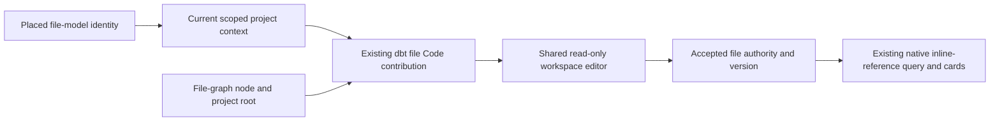
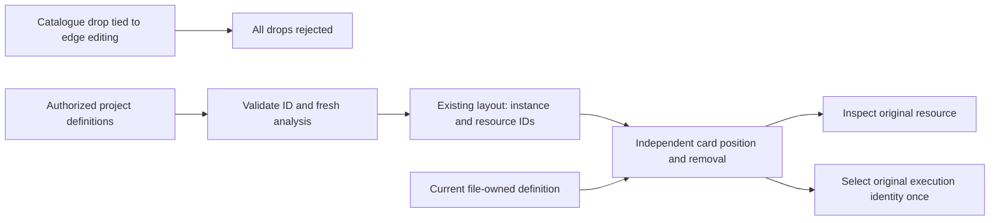
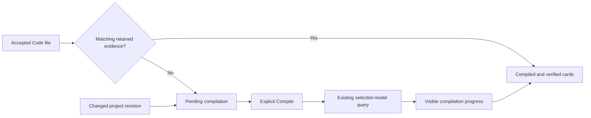
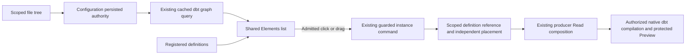
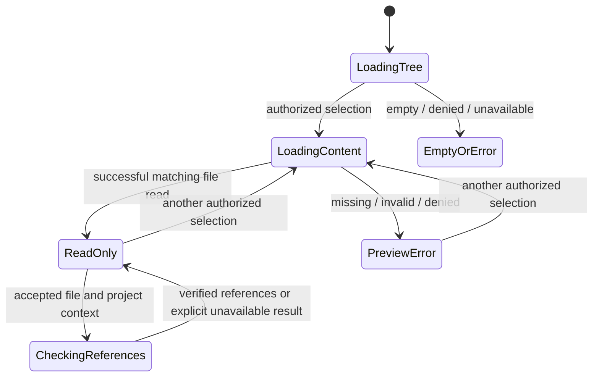
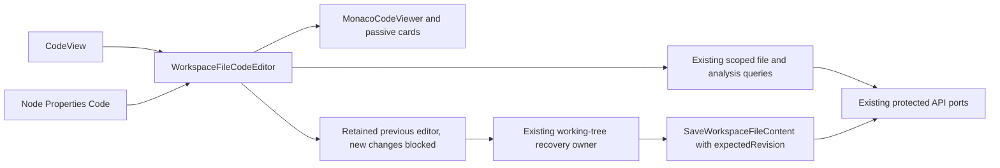

# Code Workbench Workspace Files Component

## Purpose

Properties Code for a placed dbt model reference uses the existing file-authority
contribution and `WorkspaceFileCodeEditor`, including its inline reference cards.
Placement does not make the referenced SQL graph-owned. Such references are
excluded from graph-owned path discovery; actual graph-generated paths retain
their existing conflict guard. The classifier validates the existing typed model
reference schema; malformed metadata retains graph-owned protection. It does not
infer ownership from a shared SQL path. See the [real-admission correction](https://github.com/dunay2/dvt/issues/3747#issuecomment-6658545036).
A placed reference is resolved by its file-owner Canvas ID and model unique ID.
Its captured workspace path is display metadata, not permanent file authority.
Elements and Properties Code share the current project-context query composition:
the authorized file tree identifies the configuration, its accepted binding must
match the reference owner, and the fresh project projection supplies the model's
current `originalFilePath`. The shared qualifier combines that relative path
with the current root. A missing, ambiguous, stale or different-owner context
cannot fall back to the captured path. Opening the file neither rewrites the
native definition nor invokes selected-model compilation.
While the file tree, configuration or graph is revalidated, reference Code waits
for the current context rather than authorizing a file through cached authority.
The catalogue retains its definitions during that read; the query cache and keys
remain shared.

Code presents authorized project files, verified model references and accepted-file
metadata through the existing shared Monaco surface. Project Code and node
Properties Code request explicit read-only access. Canvas forms remain the editing
surface for native transformations; imported dbt files retain their file authority.

The same component also owns recovery of an already mounted working-tree session.
Applying read-only access must not discard its text, history or pending conditional
write. New read-only sessions use `MonacoCodeViewer` and do not save or reconcile
files merely by opening, browsing or inspecting them.

Governing sources:

- [Command And Query Rail Governance](../../command-query-rail-governance.md).
- [Fowler Opportunity Planning Governance](../../fowler-opportunity-planning-governance.md).
- [ADR-0060](../../../adr/ADR-0060-dbt-project-authoring-authority.md).
- [ADR-0064](../../../adr/ADR-0064-substrait-semantic-reference-and-bounded-logical-profile.md).
- [Read-only scope, current/proposed diagrams and finite implementation matrix](https://github.com/dunay2/dvt/issues/3747#issuecomment-6528396133).

## Owned Concern

### Resource placements in Canvas

`PersistCanvasLayout` and `GetCanvasLayout` own repeated visual placements of
file-owned Sources and Models. Each placement contains a secure instance ID and
the referenced resource ID; coordinates remain in the existing position map.
The scoped, fresh project query supplies the definition. Local persistence
contains no copied SQL, metadata, edges or executable graph.

The former adapter rejected every drop because it treated layout placement as
semantic graph editing. Placement admission now has its own capability within
the existing layout rail. It never enables `canEditEdges`. Source and Model
placements resolve inspection and execution to the original definition. Removing
a placement preserves its definition, sibling placements and files. Missing
references are not rendered, and stale analysis, incomplete hydration, unknown
IDs and resources outside Sources/Models reject new drops. Layout keys retain
workspace, Canvas, authority and project-root scope.

The store owns atomic reference/position persistence. A bounded placement
adapter owns drop validation and reference projection; the file controller only
composes it. Existing node menus and keyboard interaction remove admitted
placements through that adapter. File-defined lineage remains file-owned.
The shared catalogue envelope carries the resource ID and, for file placements,
the scoped layout identity. A namesake resource in another project cannot accept
an earlier drag. Layout setters use one patch constructor to preserve all other
layout fields when viewport, coordinates, freeze state or list order change.

The component owns accepted scoped file selection, the shared Code file surface,
reference inspection and presentation access. It does not own authorization,
project creation, native semantic editing, Git lifecycle or analysis semantics.
The existing `SaveWorkspaceFileContent` rail remains available to artifact
publication and recovery of edits accepted before the read-only restriction.

## Public API

### Queries

Native dbt `original_file_path` values and their Canvas node projections are
project-relative. The shared path qualifier prepends the project root once to
those values; matching directory names are preserved. A project named `models`
can therefore contain `models/orders.sql` at workspace path
`models/models/orders.sql`. Initial Code selection accepts an already qualified
preference only through exact membership in the authorized workspace file tree,
before trying a project-relative preference. A string prefix cannot establish a
path's base or authorization.

| Query                     | Input                              | Read model           | Negative paths                                                |
| ------------------------- | ---------------------------------- | -------------------- | ------------------------------------------------------------- |
| `ListWorkspaceFiles`      | tenantId, projectId, environmentId | WorkspaceFileTree    | Missing/denied scope, unavailable repository                  |
| `GetWorkspaceFileContent` | Same scope and WorkspacePath       | WorkspaceFileContent | Denied scope, invalid path, unsupported/oversize/missing file |
| `GetWorkspaceFileHistory` | Same scope and WorkspacePath       | File history         | Missing/denied scope, unavailable history                     |

### Commands

`SaveWorkspaceFileContent` accepts scoped path, content and mandatory
`expectedRevision`; its receipt reports saved/unchanged content and its SHA.
Stale revisions are rejected. The read-only Code entry points do not accept new
edits or invoke this command from browsing. Existing artifact publishers and
previously accepted pending edits retain their command boundary. There is no Save
button or second persistence lifecycle.

`useDbtProjectFileWorkbenchSession` owns the refs and guarded handoff between
project Code and node inspection. Unknown identities are refused before either
editor is touched; a refused flush preserves the existing workbench. The shell's
existing `useCanvasCodeWorkbench` owns tabs and focus, rather than another file
session. The file-authority controller composes these owners with its projection
and layout. Execution selection and recovery belong to the existing
`useDbtProjectFileExecution`, which reuses the shared recovery query, command and
fresh-authority adapter. Neither presentation boundary generates SQL or creates
a second semantic graph.

### HTTP Adapter

| Route                       | Rail                     |
| --------------------------- | ------------------------ |
| GET /workspace/files        | ListWorkspaceFiles       |
| GET /workspace/files/:path  | GetWorkspaceFileContent  |
| POST /workspace/files/:path | SaveWorkspaceFileContent |

Every route requires tenant/project/environment scope and the protected runtime
authorization boundary. Query reads do not grant write authority. Canonical
HttpErrorEnvelope.v1 reasons distinguish missing file, invalid path and denial.

### Web Port

The existing capability-specific ports in `app/ports/workspace.ts` remain:

- IWorkspaceFilesQueryPort: listFiles and getFileContent.
- IWorkspaceFileContentCommandPort: saveFileContent with expectedRevision.
- IWorkspaceFileHistoryQueryPort: scoped file history.

The API adapters build endpoints from the current session scope. A mock adapter
does not define live authorization or persistence semantics.

### Web Presentation API

| Surface                      | Responsibility                                                                                                     |
| ---------------------------- | ------------------------------------------------------------------------------------------------------------------ |
| CodeView                     | Accepted scoped file selection, frame slots, metadata and existing history presentation                            |
| WorkspaceFileCodeEditor      | One file session shared by CodeView and node Code; explicit access, verified references and prior-session recovery |
| CodeWorkspaceFileAccess      | Read-only or editable presentation request, independent of authoring authority                                     |
| CodeWorkspaceFileEditPosture | Composes access with real authority and graph-owned file policy                                                    |
| CodeWorkspaceFileSurface     | One Monaco surface; cold read-only viewer or retained previous editor with new edits blocked                       |
| MonacoCodeViewer             | Read-only shared surface with passive cards and inspection; no change or mutable mount callback                    |
| CodeWorkingTreeSync          | Sole owner of conditional writes/recovery for a session that already accepted edits                                |
| CodeWorkingTreeStatus        | Honest read-only or pending-session status; no persistence decision                                                |

`editable` remains an internal component capability for existing live-session
recovery and its tests. The current CodeView and file-backed node Code callers
request `read-only`; they expose no alternate user switch to edit project files.
The shared Monaco editor remains usable by other admitted editing surfaces.

### Initial Selection Policy

CodeFileSelection prefers workflow artifacts under pipelines/ before generic
project configuration, then the first reachable authorized file. DBT project
selection uses its actual bound root and existing preferred-path policy.
Generated model paths reuse the dbt plugin's normalizeDbtIdentifier policy.

## Inline Model References

### Explicit compilation

Opening an eligible template SQL file does not start selected-model compilation.
Code and Properties Code share the existing `WorkspaceFileCodeEditor` action:
**Compile** invokes `AnalyzeSelectedDbtModel`, with visible pending, compiling,
compiled and failure states. Matching retained query evidence is reused on return
and after a full browser reload. The selected-model resolver uses native dbt parse
and semantic-region analysis; this action does not introduce a Jinja compiler.
A changed accepted project revision withholds old cards and waits for an explicit
request. Ordinary SQL without template references and YAML remain passive text.

The controlled Code browser spec and presentation unit tests share the pure,
schema-validated `codeWorkspaceFileContext.test-support.ts` fixture. The public
browser journey checks pending/progress/compiled states, scope, single-request
compilation, retained cards across navigation and zero file writes. It uses the
existing controlled transport; native dbt compilation remains covered by the
analyzer tests and real-system evidence.

The existing scope/root/selection/revision query key and native analyzer evidence
remain the sole owners. A SQL AST alone cannot establish equivalence after a
macro, Jinja, profile or environment change; this cut retains conservative full
input identities and adds no parser, compiler or persisted status authority.
`dbtSelectedModelAnalysisCache` is the bounded durable backing of the existing
selected-model query: at most eight ready results / 4 MiB in browser storage,
without a time-based expiry. It stores evidence, never a compiled boolean, other
query data, row samples or credentials. Schema, binding, selection and revision
must match the complete scoped query key on write and recovery. Fresh authorized
file/project reads and the existing byte/hash projector still admit every card;
storage cannot grant authority or revive stale evidence. Corrupt, unsupported or
unavailable storage is a cache miss. The
[reload rationale](https://github.com/dunay2/dvt/issues/3747#issuecomment-6663362701)
defines the negative paths and full reload proof.
Preview remains its existing explicit protected sampling query, sharing native
compilation evidence. See the [prospective rationale and negative test matrix](https://github.com/dunay2/dvt/issues/3747#issuecomment-6657808041).

### Project Models In Elements

Elements presents registered definitions by category, excluding placed source
instances. Catalogue clicks and drops reuse the same guarded placement command;
clicks use the visible Canvas center without changing its camera. Sources create
fresh identities referencing the same definition. Models use that same
definition-reference mechanism, retaining their own name and position without
copying operations or creating a dependency on the original card. Query-time
input context resolves from the definition; no automatic connection is drawn or
persisted for an instance. References exclude occurrences from the
definition catalogue. File-owned placements use the
existing scoped local reference command.
Main Canvas and the Model editor share the single Elements activity. Fuentes /
Models are independently collapsible categories, each with an accessible addition
action even before definitions exist. The source action reuses the existing
importer; the model action filters the existing node-kind creation catalogue to
transformations. Menu anchoring and placement at the visible Canvas center are
separate coordinates. Read-only capabilities cannot enable these actions. The
Model editor reuses its existing occurrence actions. The obsolete
placed-row projection and its automatic
scroll-on-selection behavior are removed.

File-owned model rows come from the existing file-authoritative project graph.
Click and drag create independent native instances through `CreateCanvasNode`.
A registered definition retains the scoped file Canvas, dbt unique ID,
connection reference and assigned output identities. Placements retain their
own identity, name and position. They neither copy SQL nor connect the original
Model to the new card. Code's file explorer remains the file-navigation surface.
File-defined inputs and SQL remain under their original authority; the native
semantic editor cannot replace them.
The bounded project-elements adapter enables
the existing scoped queries only while Elements is open. It discovers the actual
configuration in ListWorkspaceFiles, reads its persisted authority through
GetWorkspaceFileContent, then reuses ProjectDbtGraphFromFiles and its cache.
Filenames never establish model identity. Missing or ambiguous configuration,
unresolved authority, errors and stale analysis cannot admit external model rows.

`PreviewCanvasTransformRows` and protected `PreviewPlan` resolve external
producers through the existing native analyzer and its revision cache. The
application port checks file-view permission independently of graph-view
permission and revalidates current authority, revision, output schema and
connection. Compilation is selected and shared across repeated instances of the
same model within a request. Placement and rendering do not compile models.
The provider projection binds the compiled read-only SELECT to the existing
producer graph; a logical model name is never treated as a physical table.
Missing bindings, changed fields/types, stale revisions and non-read-only SQL
fail before a data probe. PostgreSQL remains responsible for execution and
availability of the model's compiled upstream relations.

Model-only samples carry `modelRefs` with the actual file Canvas, dbt identity
and analyzed revision, while `sourceRefs` contains only real physical Sources.
New response readers and writers must be deployed together: older strict
readers do not accept this provenance extension. Source sample contracts retain
their existing nonempty physical-source requirement.

Rows are deduplicated by node identity, preserving distinct same-name elements.
Properties Code navigation uses the existing workbench handoff guards and shared
project path resolver. It does not
copy models into GraphDraft or change semantic ownership. The passive list retains
the shared typography, search and selection behavior. The split Sources panel,
card-only variant and their unused styles are retired; no transport, analyzer or
parallel authoring command is introduced.

Connection availability, project definitions and placed instances are separate:
a definition may have no uses, while each source placement has its own identity.
The categories list project definitions; they do not infer definitions from every
placed card. See the [single-catalogue design](https://github.com/dunay2/dvt/issues/3747#issuecomment-6605746494).

The prospective scope, rationale and negative tests are recorded in
[GH-3747](https://github.com/dunay2/dvt/issues/3747#issuecomment-6588421440).

Code consumes ProjectDbtGraphFromFiles and AnalyzeSelectedDbtModel through their
existing scoped ports. codeInlineReferences owns projection policy;
useCodeInlineReferences joins it to accepted file evidence. There is no frontend
SQL parser, second analyzer or authority inferred from SQL text, node labels or
directory names.

### Inspection Eligibility And Stable Status

The shared predicate in codeInlineReferences admits project-context discovery and
the explicit Compile action only for accepted SQL content containing a Jinja
opening (`{{` or `{%`). Selected-model analysis does not run on mount. Plain or empty SQL, YAML, JSON and
Markdown remain readable without either inline reference query, cards or a
reference-verification message. Custom model paths and case-insensitive SQL
language names retain their existing scope, revision, hash and range checks.

The literal opening check identifies candidates, not references or dependencies.
It preserves macro expressions, statement blocks, whitespace control and Jinja in
dependency comments. Only the existing dbt analysis can authorize a supported
region. Canvas, lineage, Preview and Run retain their own analysis behavior;
plain SQL is not a claim of dependency absence or SQL validity.

The flow separates eligibility from authority and uses the existing status band.
Read-only pending, compiling, unavailable and ready messages share CodeWorkingTreeStatus;
they do not create an extra layout row. Its existing global text utilities keep
the band stable at narrow widths while retaining the full accessible message and
title. File loading must not relabel old content as the newly requested file.

Eligibility bounds context discovery and explicit compilation. The accepted binding and
explicit reconciliation callback remain available for recovery of a previously
accepted edit, including YAML or plain SQL. Navigating to noncandidate content
must ignore late or cached reference evidence even when cache keys share a
content hash; returning to candidate SQL reuses only matching retained analysis.

This correction removes unused analysis and presentation movement. It introduces
no parser, timer, stylesheet, cache or project-admission workflow. Global analysis
reuse belongs to the [native API analyzer](../api/dbt-project-analysis-component.md),
separately from this bounded inspection rule. The
[stable-status design](https://github.com/dunay2/dvt/issues/3747#issuecomment-6530524643)
and [plain-SQL refinement](https://github.com/dunay2/dvt/issues/3747#issuecomment-6532334252)
govern its implementation and validation.

The existing project-graph and selected-model query hooks set `retry: false`:
a transport rejection reaches the query error state after one attempt instead of
inheriting the application's automatic retry. Existing explicit refetch,
invalidation and later admitted reads remain available. A successful response
carrying typed `unavailable` data keeps its existing meaning. This policy changes
neither query identity, freshness nor authorization, and does not shorten the
first native parse. The [bounded retry design](https://github.com/dunay2/dvt/issues/3747#issuecomment-6562423355)
governs the real-QueryClient failure and explicit-recovery tests.

File-authoritative Canvas supplies its confirmed DbtProjectGraphProjection.
Normal project Code resolves optional authoringAuthority from the accepted
GetWorkspaceFileContent read. The API matches persisted roots within the granted
scope and revalidates their unique binding through CanvasAuthoringAuthorityPolicy.
Missing, overlapping, mixed or revoked bindings cannot select a project. File
context neither changes the active Canvas nor grants write access.

References require a successful, non-fetching read for the requested path, a fresh
matching project/binding/revision/analysis identity, matching complete file and
reference hashes, and valid UTF-8 byte ranges. Conversion to Monaco uses UTF-16
coordinates only after those checks. Pending or failed revalidation cannot reuse
another file's cards or definition. A previous dirty session remains textual until
its saved revision is verified; an old analysis cannot authorize a changed buffer.

The admitted capability is supported file-backed dbt model/source references.
Unsupported syntax, ambiguous identities, external package paths and native
Substrait objects without a file correspondence remain textual. Declared columns
and types are labelled as declared; missing metadata is not inferred. Recognized
references do not certify complete SQL validity or provider execution readiness.

CodeReferenceDetails reads the exact identity-bound path through
GetWorkspaceFileContent and verifies its content hash. A source YAML definition
is its verified complete file because the contract has no per-resource ranges.
Inspection uses the fixed metadata panel or an overlay in the existing Code host;
it neither selects a different file nor resizes/recreates the editor. Closing
inspection restores its connected opener. Card styles retain one global definition.

## Canvas Project Files Entry — Issue 3743

CanvasProjectFilesExplorer reuses FileTreePanel and ListWorkspaceFiles. Preserve
hierarchy, ordering, cap, supported paths and tenant/project/environment isolation.
Empty/error/denied reads do not fall back to fixtures. CodeViewFileScope controls
tree membership, not edit authority:

| Input             | Tree                             |
| ----------------- | -------------------------------- |
| Default route     | Existing graph-scoped projection |
| workspace-files   | Full authorized workspace tree   |
| dbt-project-files | Actual bound project root        |

An explicit path must be an authorized tree member. Repeated immutable selection
requests can readmit the same path after internal navigation. A no-path reveal
keeps the current file. Superseded requests cannot override a later selection.
Clean browsing sends no file saves or graph writes and establishes no Git status.

## Main Canvas Code Workspace — Issue 3747

Git, the top Code tab and File > Project Code share the existing guarded opener
on /canvas. Canvas, Code and Models remain sibling retained surfaces; their tree,
camera, file selection and disclosure keep their owners. Existing RouteWorkbenchFrame
slots present one file surface and accepted-file metadata on the right. The
workspace presentation does not add a second file tree or a new route/store.

The Code tab represents an open project-code session, not the capability to
open one. File and Git remain its entry points while it is closed. Accepted close
removes the tab and its surface; the shell does not retain an empty Code host.
Selecting Canvas or Model keeps an already-open Code session mounted and its tab
available. Existing flush and current-intent guards decide whether close commits.

Metadata follows only the accepted path and successful file read. An unavailable
new read cannot relabel the previous file. Modified time describes the loaded
version. Hashes, size, author, Git state and node properties are not inferred or
displayed as if supplied. Metadata can collapse to recover width.

The existing source/element/Git activity rail remains usable in Code. A denied
node flush preserves the current tab; a later Canvas/Model selection supersedes
asynchronous Code entry. Native node/form guards remain intact.

## Existing Pending-Session Recovery

Changing presentation access must block new editor changes immediately, including
stray callbacks. A previously mounted editable Monaco surface remains mounted in
read-only mode so its model, bytes and history are retained. A clean new read-only
session uses the existing viewer. Never reload, reset the cache or replace text
merely to impose read-only.

The existing useCodeWorkingTreeSync remains the single writer for an already
accepted pending edit. Its timer or in-flight CAS may finish; failures/conflicts
remain visible and recoverable, and the existing flush handoff preserves the
buffer when persistence fails. Re-entering Code must remain possible for recovery.
The controller does not wait for long semantic analysis once bytes are persisted.
No flush implementation may fabricate success instead of consulting this owner.

Every actual synchronization supplies the last accepted content SHA. Edits already
queued during a write retain ordering. An explicit Reload replaces content only
after a successful read of the same requested path. Cached data on an error cannot
discard a pending buffer. Synchronized means only that the working tree matches
the buffer; it does not mean staged, committed, pushed or SQL-validated.

## DDD Model

| Object                                             | Kind                 | Responsibility                                                         |
| -------------------------------------------------- | -------------------- | ---------------------------------------------------------------------- |
| WorkspaceFileTree / WorkspaceFileContent           | Read models          | Authorized hierarchy and revision-bearing file content                 |
| WorkspacePath / WorkspaceFileRevision              | Value objects        | Normalized path and content SHA precondition                           |
| WorkspaceFileReadPolicy / WorkspaceFileWritePolicy | Policies             | Protected scope and access checks                                      |
| WorkspaceFileRepository                            | Outbound port        | Scoped list/read and conditional mutation                              |
| CodeFileSelection                                  | Read-model projector | Selection without owning authorization or tree traversal in the route  |
| CodeWorkingTreeSync                                | Presentation model   | Existing pending-edit lifecycle, independent of read-only presentation |

## Invariants

- Read-only presentation never fabricates missing or graph authority.
- Read queries never mutate state; clean Code opens and inspection send no saves.
- All file queries and mutations keep protected tenant/project/environment scope.
- Native semantic forms and artifact publication retain their admitted writers.
- Directory membership grants neither editing nor file-authority transitions.
- One component owns file session, recovery and reference inspection across callers.
- Model/card views do not rewrite text or infer executable ports/schemas.
- Existing dirty text, pending writes, failures and undo history survive access restriction.
- New requests cannot bypass current file membership, selection or node flush guards.
- Copy resolves through resolveCodeViewCopy; no fixed-language route strings or new CSS.
- Filesystem browsing and working-tree reads are not proof of a real project Git repository.

## Transitions

## Component Diagram

## Strict Live Vertical

The current browser proof opens normal /canvas, enters Code through its public
tab or menu, reads the scoped tree/content, sees read-only Monaco, attempts input
without changing bytes, inspects verified references and returns to the same
Canvas/camera. Record actual request counts and file revisions; no saves or
post-save reconciliation are produced by these actions. A stubbed Cypress flow
proves presentation, not live authorization, Git or native publication.
Real file-snapshot proofs check unknown HTTP bodies through runtime assertions
and require an actual SHA-256 revision before comparing the subsequent reread.

Project Code evidence uses the selected Code tab and its central
`canvas-code-workspace-surface`. Returning through the Canvas tab keeps Code
mounted but hidden, restores the visible Canvas and leaves focus on its active
tab. Closing through the Code tab's X removes both the tab and its surface;
the browser proof then reopens through File or Git and verifies one read-only
session without file writes. Browser checks retain full-content copy, read-only input, accessibility and
workspace bounds at narrow viewports. Publication/compilation rejection checks
retain their file-refresh and diagnostic assertions. The old Project Code overlay
and its close/resize controls are not the navigation contract. Native node and
output-expression contextual workbenches keep their existing contracts.

Legacy pending-session recovery additionally proves modified/in-flight/failed
states retain bytes/model and use the real existing conditional command boundary.
Mock tests are not evidence that a real file mutation or Git operation occurred.

## Architecture Test Requirement

Use semantic import/dependency guards for existing module boundaries and runtime
tests for access, revision, inspection and navigation behavior. Do not check prose,
CSS strings, JSX formatting or Cypress test titles as substitutes for behavior.
The API route remains thin and owns no filesystem/path/authorization policy.
CodeView composes the existing selection/file-session owners and no second writer.

Browser evidence admission belongs to the canonical Cypress catalog. The existing
AST dependency graph identifies actual fixture and protected-transport consumers;
do not maintain another list of non-fixture exceptions. Registered specs must
exist and remain unique, fixture consumers must be registered, and live transport
outside the catalog must be rejected. Shared-frame guards inspect semantic slots;
Code behavior is proved by component and browser tests, without mirroring private
comments or removed editing controls in their source. The
[evidence-closure scope](https://github.com/dunay2/dvt/issues/3747#issuecomment-6534231837)
records these obligations and the retired assertions.

Required negatives include revoked/failed/pending reads with cached data, stale
model evidence, unsupported syntax, scope/path mismatch, denied opener, failed
pending-edit flush and unsuccessful Reload. Shared Monaco editing tests remain
valid for other editing surfaces; current CodeView tests must not fabricate an
editable entry point that the product does not expose.

## Code Workbench Workspace Files User Stories

### Scope

These stories describe read-only project and node Code, plus safe handoff of a
session that already contained edits. They do not admit project onboarding, Git
lifecycle, native publication, folder migration or new semantic analysis engines.

### Stories

#### CODE-FILES-1: Load Workspace File Tree

Show the scoped ListWorkspaceFiles tree or honest empty/denied/unavailable state,
without fixture fallback. The web adapter and API route preserve scope.

#### CODE-FILES-2: Inspect A Workspace File In Monaco

GetWorkspaceFileContent opens the accepted file in read-only Monaco with localized
status. Browsing, attempted input and reference inspection produce no new file
writes or reconciliation. File selection, copy, accepted metadata and reference
definitions remain available. Previous dirty sessions retain their recovery guard.
Proofs: CodeView and workspace-file behavioral suites, real shared browser and the
existing central Code Cypress flow; there is no Save UI.

#### CODE-FILES-3: Missing File Does Not Break Explorer

Canonical workspace_file_not_found yields a precise preview error while keeping
the tree usable. An unrelated404 is not inferred to mean a missing workspace file.

#### CODE-FILES-4: Invalid Paths Fail Closed

WorkspacePath/repository rules reject traversal, absolute paths, unsupported types
and oversized files. UI code does not duplicate that policy.

#### CODE-FILES-5: Unauthorized Reads Fail Closed

Missing bearer scope or denied workspace:files:view stops before repository reads.
Failed revalidation cannot display a previous file's definition or reference cards.

#### CODE-FILES-6: Code Is Reachable Before First Canvas Document

Existing Canvas actions open project Code before a document exists. Active Canvas
exposes the top Code tab while its Code session is open. The same /canvas route retains graph context;
Code reads files in a viewer. Other surfaces retain their own readiness gates.

### Scenario Matrix

| Story        | Rail                    | DDD owner               | Happy path                     | Negative path                               |
| ------------ | ----------------------- | ----------------------- | ------------------------------ | ------------------------------------------- |
| CODE-FILES-1 | ListWorkspaceFiles      | WorkspaceFileTree       | Scoped tree                    | Missing/denied scope                        |
| CODE-FILES-2 | GetWorkspaceFileContent | WorkspaceFileContent    | Read-only inspection, no saves | Failed/stale read and previous pending edit |
| CODE-FILES-3 | GetWorkspaceFileContent | WorkspaceFileReadPolicy | Explorer preserved             | Canonical missing file                      |
| CODE-FILES-4 | GetWorkspaceFileContent | WorkspacePath           | Valid relative path            | Traversal/unsupported path                  |
| CODE-FILES-5 | Both read queries       | WorkspaceFileReadPolicy | Authorized read                | 401/403 and no repository call              |
| CODE-FILES-6 | Both read queries       | Accepted Code session   | Contextual viewer              | No Canvas document                          |

## Historical Provenance

Earlier file-editing behavior is preserved in Git, not as an alternative current
Code entry point. [CODECOMP1.1](https://github.com/dunay2/dvt/issues/3751#issuecomment-6510144467)
records the original reference-integration capability boundary. The current
read-only admission above governs caller access while retaining that read evidence.
