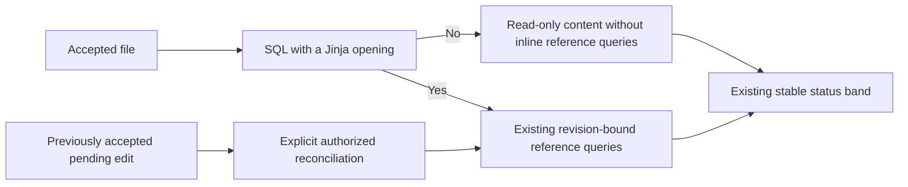
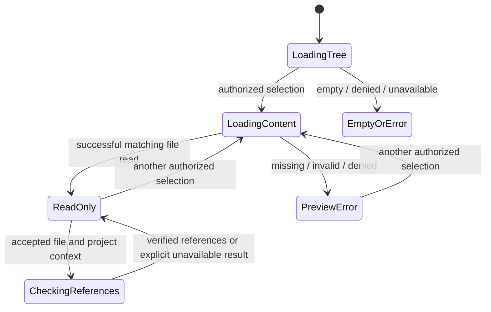
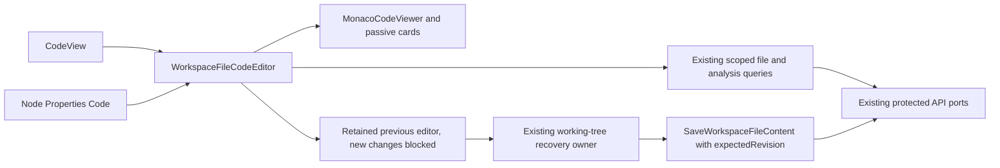

# Code Workbench Workspace Files Component

## Purpose

Code presents authorized project files, verified model references and accepted-file
metadata through the existing shared Monaco surface. Project Code and node
Properties Code request explicit read-only access. Canvas forms remain the editing
surface for native transformations; imported dbt files retain their file authority.

The same component also owns recovery of an already mounted working-tree session.
Applying read-only access must not discard its text, history or pending conditional
write. New read-only sessions use `MonacoCodeViewer` and do not save or reconcile
files merely by opening, browsing or inspecting them.

Governing sources:

- [Command And Query Rail Governance](../../command-query-rail-governance.md).
- [Fowler Opportunity Planning Governance](../../fowler-opportunity-planning-governance.md).
- [ADR-0060](../../../adr/ADR-0060-dbt-project-authoring-authority.md).
- [ADR-0064](../../../adr/ADR-0064-substrait-semantic-reference-and-bounded-logical-profile.md).
- [Read-only scope, current/proposed diagrams and finite implementation matrix](https://github.com/dunay2/dvt/issues/3747#issuecomment-6528396133).

## Owned Concern

The component owns accepted scoped file selection, the shared Code file surface,
reference inspection and presentation access. It does not own authorization,
project creation, native semantic editing, Git lifecycle or analysis semantics.
The existing `SaveWorkspaceFileContent` rail remains available to artifact
publication and recovery of edits accepted before the read-only restriction.

## Public API

### Queries

| Query                     | Input                              | Read model           | Negative paths                                                |
| ------------------------- | ---------------------------------- | -------------------- | ------------------------------------------------------------- |
| `ListWorkspaceFiles`      | tenantId, projectId, environmentId | WorkspaceFileTree    | Missing/denied scope, unavailable repository                  |
| `GetWorkspaceFileContent` | Same scope and WorkspacePath       | WorkspaceFileContent | Denied scope, invalid path, unsupported/oversize/missing file |
| `GetWorkspaceFileHistory` | Same scope and WorkspacePath       | File history         | Missing/denied scope, unavailable history                     |

### Commands

`SaveWorkspaceFileContent` accepts scoped path, content and mandatory
`expectedRevision`; its receipt reports saved/unchanged content and its SHA.
Stale revisions are rejected. The read-only Code entry points do not accept new
edits or invoke this command from browsing. Existing artifact publishers and
previously accepted pending edits retain their command boundary. There is no Save
button or second persistence lifecycle.

### HTTP Adapter

| Route                       | Rail                     |
| --------------------------- | ------------------------ |
| GET /workspace/files        | ListWorkspaceFiles       |
| GET /workspace/files/:path  | GetWorkspaceFileContent  |
| POST /workspace/files/:path | SaveWorkspaceFileContent |

Every route requires tenant/project/environment scope and the protected runtime
authorization boundary. Query reads do not grant write authority. Canonical
HttpErrorEnvelope.v1 reasons distinguish missing file, invalid path and denial.

### Web Port

The existing capability-specific ports in `app/ports/workspace.ts` remain:

- IWorkspaceFilesQueryPort: listFiles and getFileContent.
- IWorkspaceFileContentCommandPort: saveFileContent with expectedRevision.
- IWorkspaceFileHistoryQueryPort: scoped file history.

The API adapters build endpoints from the current session scope. A mock adapter
does not define live authorization or persistence semantics.

### Web Presentation API

| Surface                      | Responsibility                                                                                                     |
| ---------------------------- | ------------------------------------------------------------------------------------------------------------------ |
| CodeView                     | Accepted scoped file selection, frame slots, metadata and existing history presentation                            |
| WorkspaceFileCodeEditor      | One file session shared by CodeView and node Code; explicit access, verified references and prior-session recovery |
| CodeWorkspaceFileAccess      | Read-only or editable presentation request, independent of authoring authority                                     |
| CodeWorkspaceFileEditPosture | Composes access with real authority and graph-owned file policy                                                    |
| CodeWorkspaceFileSurface     | One Monaco surface; cold read-only viewer or retained previous editor with new edits blocked                       |
| MonacoCodeViewer             | Read-only shared surface with passive cards and inspection; no change or mutable mount callback                    |
| CodeWorkingTreeSync          | Sole owner of conditional writes/recovery for a session that already accepted edits                                |
| CodeWorkingTreeStatus        | Honest read-only or pending-session status; no persistence decision                                                |

`editable` remains an internal component capability for existing live-session
recovery and its tests. The current CodeView and file-backed node Code callers
request `read-only`; they expose no alternate user switch to edit project files.
The shared Monaco editor remains usable by other admitted editing surfaces.

### Initial Selection Policy

CodeFileSelection prefers workflow artifacts under pipelines/ before generic
project configuration, then the first reachable authorized file. DBT project
selection uses its actual bound root and existing preferred-path policy.
Generated model paths reuse the dbt plugin's normalizeDbtIdentifier policy.

## Inline Model References

Code consumes ProjectDbtGraphFromFiles and AnalyzeSelectedDbtModel through their
existing scoped ports. codeInlineReferences owns projection policy;
useCodeInlineReferences joins it to accepted file evidence. There is no frontend
SQL parser, second analyzer or authority inferred from SQL text, node labels or
directory names.

### Inspection Eligibility And Stable Status

The shared predicate in codeInlineReferences admits automatic reference work only
for accepted SQL content containing a Jinja opening (`{{` or `{%`). Both
file-context and selected-model hooks use it. Plain or empty SQL, YAML, JSON and
Markdown remain readable without either inline reference query, cards or a
reference-verification message. Custom model paths and case-insensitive SQL
language names retain their existing scope, revision, hash and range checks.

The literal opening check identifies candidates, not references or dependencies.
It preserves macro expressions, statement blocks, whitespace control and Jinja in
dependency comments. Only the existing dbt analysis can authorize a supported
region. Canvas, lineage, Preview and Run retain their own analysis behavior;
plain SQL is not a claim of dependency absence or SQL validity.

The previous flow started project analysis for every accepted file and inserted
or removed a checking paragraph above Monaco:

The admitted flow separates eligibility from authority and uses the existing
status band:

Read-only checking, unavailable and ready messages share CodeWorkingTreeStatus;
they do not create an extra layout row. Its existing global text utilities keep
the band stable at narrow widths while retaining the full accessible message and
title. File loading must not relabel old content as the newly requested file.

Eligibility disables only automatic reference work. The accepted binding and
explicit reconciliation callback remain available for recovery of a previously
accepted edit, including YAML or plain SQL. Navigating to noncandidate content
must ignore late or cached reference evidence even when cache keys share a
content hash; returning to candidate SQL retains revalidation.

This correction removes unused analysis and presentation movement. It introduces
no parser, timer, stylesheet, cache or project-admission workflow. Global analysis
reuse remains separate from this bounded inspection rule. The
[stable-status design](https://github.com/dunay2/dvt/issues/3747#issuecomment-6530524643)
and [plain-SQL refinement](https://github.com/dunay2/dvt/issues/3747#issuecomment-6532334252)
govern its implementation and validation.

File-authoritative Canvas supplies its confirmed DbtProjectGraphProjection.
Normal project Code resolves optional authoringAuthority from the accepted
GetWorkspaceFileContent read. The API matches persisted roots within the granted
scope and revalidates their unique binding through CanvasAuthoringAuthorityPolicy.
Missing, overlapping, mixed or revoked bindings cannot select a project. File
context neither changes the active Canvas nor grants write access.

References require a successful, non-fetching read for the requested path, a fresh
matching project/binding/revision/analysis identity, matching complete file and
reference hashes, and valid UTF-8 byte ranges. Conversion to Monaco uses UTF-16
coordinates only after those checks. Pending or failed revalidation cannot reuse
another file's cards or definition. A previous dirty session remains textual until
its saved revision is verified; an old analysis cannot authorize a changed buffer.

The admitted capability is supported file-backed dbt model/source references.
Unsupported syntax, ambiguous identities, external package paths and native
Substrait objects without a file correspondence remain textual. Declared columns
and types are labelled as declared; missing metadata is not inferred. Recognized
references do not certify complete SQL validity or provider execution readiness.

CodeReferenceDetails reads the exact identity-bound path through
GetWorkspaceFileContent and verifies its content hash. A source YAML definition
is its verified complete file because the contract has no per-resource ranges.
Inspection uses the fixed metadata panel or an overlay in the existing Code host;
it neither selects a different file nor resizes/recreates the editor. Closing
inspection restores its connected opener. Card styles retain one global definition.

## Canvas Project Files Entry — Issue 3743

CanvasProjectFilesExplorer reuses FileTreePanel and ListWorkspaceFiles. Preserve
hierarchy, ordering, cap, supported paths and tenant/project/environment isolation.
Empty/error/denied reads do not fall back to fixtures. CodeViewFileScope controls
tree membership, not edit authority:

| Input             | Tree                             |
| ----------------- | -------------------------------- |
| Default route     | Existing graph-scoped projection |
| workspace-files   | Full authorized workspace tree   |
| dbt-project-files | Actual bound project root        |

An explicit path must be an authorized tree member. Repeated immutable selection
requests can readmit the same path after internal navigation. A no-path reveal
keeps the current file. Superseded requests cannot override a later selection.
Clean browsing sends no file saves or graph writes and establishes no Git status.

## Main Canvas Code Workspace — Issue 3747

Git, the top Code tab and File > Project Code share the existing guarded opener
on /canvas. Canvas, Code and Models remain sibling retained surfaces; their tree,
camera, file selection and disclosure keep their owners. Existing RouteWorkbenchFrame
slots present one file surface and accepted-file metadata on the right. The
workspace presentation does not add a second file tree or a new route/store.

Metadata follows only the accepted path and successful file read. An unavailable
new read cannot relabel the previous file. Modified time describes the loaded
version. Hashes, size, author, Git state and node properties are not inferred or
displayed as if supplied. Metadata can collapse to recover width.

The existing source/element/Git activity rail remains usable in Code. A denied
node flush preserves the current tab; a later Canvas/Model selection supersedes
asynchronous Code entry. Native node/form guards remain intact.

## Existing Pending-Session Recovery

Changing presentation access must block new editor changes immediately, including
stray callbacks. A previously mounted editable Monaco surface remains mounted in
read-only mode so its model, bytes and history are retained. A clean new read-only
session uses the existing viewer. Never reload, reset the cache or replace text
merely to impose read-only.

The existing useCodeWorkingTreeSync remains the single writer for an already
accepted pending edit. Its timer or in-flight CAS may finish; failures/conflicts
remain visible and recoverable, and the existing flush handoff preserves the
buffer when persistence fails. Re-entering Code must remain possible for recovery.
The controller does not wait for long semantic analysis once bytes are persisted.
No flush implementation may fabricate success instead of consulting this owner.

Every actual synchronization supplies the last accepted content SHA. Edits already
queued during a write retain ordering. An explicit Reload replaces content only
after a successful read of the same requested path. Cached data on an error cannot
discard a pending buffer. Synchronized means only that the working tree matches
the buffer; it does not mean staged, committed, pushed or SQL-validated.

## DDD Model

| Object                                             | Kind                 | Responsibility                                                         |
| -------------------------------------------------- | -------------------- | ---------------------------------------------------------------------- |
| WorkspaceFileTree / WorkspaceFileContent           | Read models          | Authorized hierarchy and revision-bearing file content                 |
| WorkspacePath / WorkspaceFileRevision              | Value objects        | Normalized path and content SHA precondition                           |
| WorkspaceFileReadPolicy / WorkspaceFileWritePolicy | Policies             | Protected scope and access checks                                      |
| WorkspaceFileRepository                            | Outbound port        | Scoped list/read and conditional mutation                              |
| CodeFileSelection                                  | Read-model projector | Selection without owning authorization or tree traversal in the route  |
| CodeWorkingTreeSync                                | Presentation model   | Existing pending-edit lifecycle, independent of read-only presentation |

## Invariants

- Read-only presentation never fabricates missing or graph authority.
- Read queries never mutate state; clean Code opens and inspection send no saves.
- All file queries and mutations keep protected tenant/project/environment scope.
- Native semantic forms and artifact publication retain their admitted writers.
- Directory membership grants neither editing nor file-authority transitions.
- One component owns file session, recovery and reference inspection across callers.
- Model/card views do not rewrite text or infer executable ports/schemas.
- Existing dirty text, pending writes, failures and undo history survive access restriction.
- New requests cannot bypass current file membership, selection or node flush guards.
- Copy resolves through resolveCodeViewCopy; no fixed-language route strings or new CSS.
- Filesystem browsing and working-tree reads are not proof of a real project Git repository.

## Transitions

## Component Diagram

## Strict Live Vertical

The current browser proof opens normal /canvas, enters Code through its public
tab or menu, reads the scoped tree/content, sees read-only Monaco, attempts input
without changing bytes, inspects verified references and returns to the same
Canvas/camera. Record actual request counts and file revisions; no saves or
post-save reconciliation are produced by these actions. A stubbed Cypress flow
proves presentation, not live authorization, Git or native publication.
Real file-snapshot proofs check unknown HTTP bodies through runtime assertions
and require an actual SHA-256 revision before comparing the subsequent reread.

Project Code evidence uses the selected Code tab and its central
`canvas-code-workspace-surface`. Returning through the Canvas tab keeps Code
mounted but hidden, restores the visible Canvas and leaves focus on its active
tab. Browser checks retain full-content copy, read-only input, accessibility and
workspace bounds at narrow viewports. Publication/compilation rejection checks
retain their file-refresh and diagnostic assertions. The old Project Code overlay
and its close/resize controls are not the navigation contract. Native node and
output-expression contextual workbenches keep their existing contracts.

Legacy pending-session recovery additionally proves modified/in-flight/failed
states retain bytes/model and use the real existing conditional command boundary.
Mock tests are not evidence that a real file mutation or Git operation occurred.

## Architecture Test Requirement

Use semantic import/dependency guards for existing module boundaries and runtime
tests for access, revision, inspection and navigation behavior. Do not check prose,
CSS strings, JSX formatting or Cypress test titles as substitutes for behavior.
The API route remains thin and owns no filesystem/path/authorization policy.
CodeView composes the existing selection/file-session owners and no second writer.

Browser evidence admission belongs to the canonical Cypress catalog. The existing
AST dependency graph identifies actual fixture and protected-transport consumers;
do not maintain another list of non-fixture exceptions. Registered specs must
exist and remain unique, fixture consumers must be registered, and live transport
outside the catalog must be rejected. Shared-frame guards inspect semantic slots;
Code behavior is proved by component and browser tests, without mirroring private
comments or removed editing controls in their source. The
[evidence-closure scope](https://github.com/dunay2/dvt/issues/3747#issuecomment-6534231837)
records these obligations and the retired assertions.

Required negatives include revoked/failed/pending reads with cached data, stale
model evidence, unsupported syntax, scope/path mismatch, denied opener, failed
pending-edit flush and unsuccessful Reload. Shared Monaco editing tests remain
valid for other editing surfaces; current CodeView tests must not fabricate an
editable entry point that the product does not expose.

## Code Workbench Workspace Files User Stories

### Scope

These stories describe read-only project and node Code, plus safe handoff of a
session that already contained edits. They do not admit project onboarding, Git
lifecycle, native publication, folder migration or new semantic analysis engines.

### Stories

#### CODE-FILES-1: Load Workspace File Tree

Show the scoped ListWorkspaceFiles tree or honest empty/denied/unavailable state,
without fixture fallback. The web adapter and API route preserve scope.

#### CODE-FILES-2: Inspect A Workspace File In Monaco

GetWorkspaceFileContent opens the accepted file in read-only Monaco with localized
status. Browsing, attempted input and reference inspection produce no new file
writes or reconciliation. File selection, copy, accepted metadata and reference
definitions remain available. Previous dirty sessions retain their recovery guard.
Proofs: CodeView and workspace-file behavioral suites, real shared browser and the
existing central Code Cypress flow; there is no Save UI.

#### CODE-FILES-3: Missing File Does Not Break Explorer

Canonical workspace_file_not_found yields a precise preview error while keeping
the tree usable. An unrelated404 is not inferred to mean a missing workspace file.

#### CODE-FILES-4: Invalid Paths Fail Closed

WorkspacePath/repository rules reject traversal, absolute paths, unsupported types
and oversized files. UI code does not duplicate that policy.

#### CODE-FILES-5: Unauthorized Reads Fail Closed

Missing bearer scope or denied workspace:files:view stops before repository reads.
Failed revalidation cannot display a previous file's definition or reference cards.

#### CODE-FILES-6: Code Is Reachable Before First Canvas Document

Existing Canvas actions open project Code before a document exists. Active Canvas
also exposes the top Code tab. The same /canvas route retains graph context;
Code reads files in a viewer. Other surfaces retain their own readiness gates.

### Scenario Matrix

| Story        | Rail                    | DDD owner               | Happy path                     | Negative path                               |
| ------------ | ----------------------- | ----------------------- | ------------------------------ | ------------------------------------------- |
| CODE-FILES-1 | ListWorkspaceFiles      | WorkspaceFileTree       | Scoped tree                    | Missing/denied scope                        |
| CODE-FILES-2 | GetWorkspaceFileContent | WorkspaceFileContent    | Read-only inspection, no saves | Failed/stale read and previous pending edit |
| CODE-FILES-3 | GetWorkspaceFileContent | WorkspaceFileReadPolicy | Explorer preserved             | Canonical missing file                      |
| CODE-FILES-4 | GetWorkspaceFileContent | WorkspacePath           | Valid relative path            | Traversal/unsupported path                  |
| CODE-FILES-5 | Both read queries       | WorkspaceFileReadPolicy | Authorized read                | 401/403 and no repository call              |
| CODE-FILES-6 | Both read queries       | Accepted Code session   | Contextual viewer              | No Canvas document                          |

## Historical Provenance

Earlier file-editing behavior is preserved in Git, not as an alternative current
Code entry point. [CODECOMP1.1](https://github.com/dunay2/dvt/issues/3751#issuecomment-6510144467)
records the original reference-integration capability boundary. The current
read-only admission above governs caller access while retaining that read evidence.
