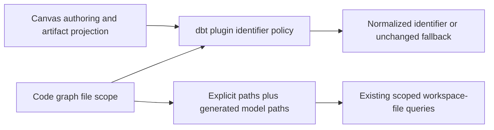
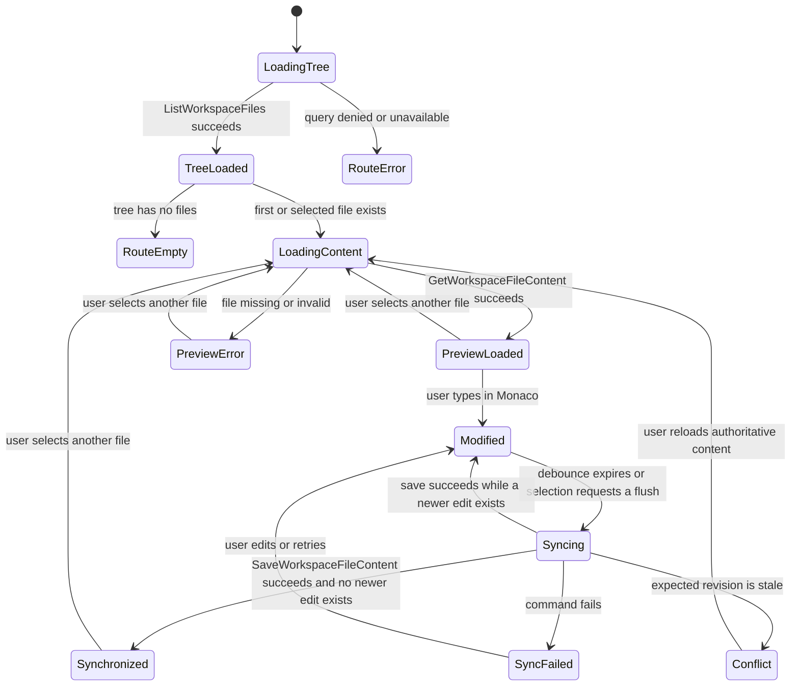
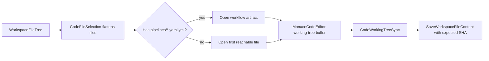
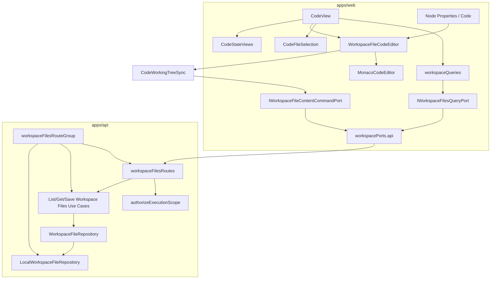
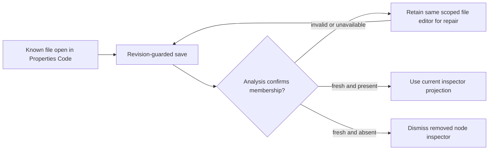
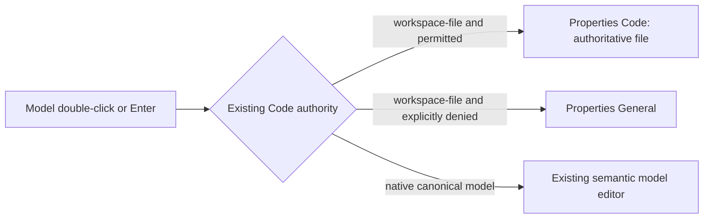

# Code Workbench Workspace Files Component

## Purpose

This component governs the Code workbench file explorer, file content query
flow, Monaco working-tree buffer, and the shared workspace-file mutation rail
used by both editor synchronization and product workflows that publish project
artifacts before preview or execution.

The component exists because the web Code route consumes workspace file queries
and product workflows can persist generated workspace artifacts through the live
command rail. The component closes the old read/write drift by naming the public
API, invariants, transitions, consumers, and tests.

Use with:

- [Command And Query Rail Governance](../../command-query-rail-governance.md)
- [Fowler Opportunity Planning Governance](../../fowler-opportunity-planning-governance.md)
- [Screen Manuals And User Stories](./screen-manuals-and-user-stories.md)
- [Web Auth, Project Onboarding, And Actionable Product Gaps](../../../planning/proposals/mandatory/frontend-and-ux/web-auth-project-onboarding-and-actionable-gaps-20260501.md)

## Historical provenance

These inputs explain earlier implementation decisions; they are not current
governing sources. Current contracts and the authorities above remain in force.

- [Fowler analysis and plan for Code tab workspace files](https://github.com/dunay2/dvt/blob/6dab0fe76db1fac675744b9b1dbe3af1ad8f1de1/buzon/20260504-codex-fowler-code-tab-workspace-files-analysis-and-plan.md)

## Owned Concern

Owned concern: expose tenant/project-scoped workspace files as operational
evidence for the Code workbench, synchronize selected-file edits into the
project working tree through revision-guarded writes, and provide the governed
`SaveWorkspaceFileContent` command for internal file mutations that must be
persisted before backend admission.

The component does not own project creation, graph draft mutation, or
authorization policy design. It consumes the protected runtime authorization
boundary, returns read models, and routes persistence through the governed
workspace file command rail.

## Public API

### Queries

| Query                     | Type  | Input                                                     | Output                 | Failure states                                                             |
| ------------------------- | ----- | --------------------------------------------------------- | ---------------------- | -------------------------------------------------------------------------- |
| `ListWorkspaceFiles`      | query | `tenantId`, `projectId`, `environmentId`                  | `WorkspaceFileTree`    | unauthenticated, unauthorized, missing scope                               |
| `GetWorkspaceFileContent` | query | `tenantId`, `projectId`, `environmentId`, `WorkspacePath` | `WorkspaceFileContent` | unauthenticated, unauthorized, missing scope, invalid path, file not found |

### Commands

| Command                    | Type    | Input                                                                                    | Output                     | Failure states                                                                      |
| -------------------------- | ------- | ---------------------------------------------------------------------------------------- | -------------------------- | ----------------------------------------------------------------------------------- |
| `SaveWorkspaceFileContent` | command | `tenantId`, `projectId`, `environmentId`, `WorkspacePath`, `content`, `expectedRevision` | `WorkspaceFileSaveReceipt` | unauthenticated, unauthorized, missing scope, invalid path, size, revision conflict |

### HTTP Adapter

| Route                         | Implements                 | Scope                                                                    |
| ----------------------------- | -------------------------- | ------------------------------------------------------------------------ |
| `GET /workspace/files`        | `ListWorkspaceFiles`       | query params: `tenantId`, `projectId`, `environmentId`                   |
| `GET /workspace/files/:path`  | `GetWorkspaceFileContent`  | encoded path plus query params: `tenantId`, `projectId`, `environmentId` |
| `POST /workspace/files/:path` | `SaveWorkspaceFileContent` | encoded path, query params: `tenantId`, `projectId`, `environmentId`     |

### Web Port

`apps/web/src/app/ports/workspace.ts` keeps queries and commands separate:

- `IWorkspaceFilesQueryPort.listFiles(): Promise<WorkspaceFileEntry[]>`
- `IWorkspaceFilesQueryPort.getFileContent(path: string): Promise<FileContent>`
- `IWorkspaceFileContentCommandPort.saveFileContent(input: SaveWorkspaceFileContentInput): Promise<WorkspaceFileSaveReceipt>`

The command input contains `path`, `content` and the mandatory `expectedRevision`;
the receipt distinguishes saved content from an unchanged write.

The API adapter must build scoped endpoints from the active session store. The
mock adapter may remain a test/demo adapter, but it must not define live API
semantics.

### Web Presentation API

| Surface                   | Type                   | Responsibility                                                                                                                         |
| ------------------------- | ---------------------- | -------------------------------------------------------------------------------------------------------------------------------------- |
| `CodeWorkingTreeSync`     | presentation model     | Holds editor text and synchronizes the latest revision-guarded value per selected workspace path.                                      |
| `CodeWorkingTreeStatus`   | presentation view      | Renders honest modified, syncing, synchronized, conflict, failed, or read-only posture without a Save action.                          |
| `CodeFileSelection`       | read-model projector   | Resolves the first selectable file from the authorized workspace tree.                                                                 |
| `WorkspaceFileCodeEditor` | presentation component | Renders one known authoritative workspace file with the shared query, Monaco, synchronization, revision and navigation-guard behavior. |
| `MonacoCodeEditor`        | presentation gateway   | Opens the shared Monaco surface in editable mode for Code.                                                                             |
| `MonacoCodeViewer`        | presentation gateway   | Opens the shared Monaco surface in read-only mode for Artifacts/review.                                                                |

### Initial Selection Policy

Without an admitted requested path, `CodeFileSelection` prefers
`pipelines/*.yaml|yml` workflow artifacts over root project configuration files
such as `dbt_project.yml`. If no workflow
artifact exists, it falls back to the first reachable file in the workspace
tree.

For graph-authored dbt models, `CodeGraphFileScope` derives the generated
`models/<name>.sql` path with the same `normalizeDbtIdentifier` plugin policy used
by Canvas artifact projection. The policy lives in
`plugins/dbt/dbtIdentifier.ts`, has no imports, and preserves the caller's fallback
when normalization produces an empty value. Code imports it directly without
depending on Canvas artifact rendering. Explicit node paths remain in scope;
non-dbt model paths continue to use their node identity. File-backed project
roots, authorization and file-content query behavior retain their existing owners.



### Canvas Project Files Entry — Issue 3743

[Issue #3743](https://github.com/dunay2/dvt/issues/3743#issuecomment-6459144110)
reuses `FileTreePanel` and the `ListWorkspaceFiles` scoped query/cache for Canvas
Git and project Code. Preserve tenant/project/environment isolation, supported
paths, hierarchy, ordering and the existing response cap. Empty/error/denied
reads retain their existing states without fixture fallback or new transport.

`CodeViewFileScope` distinguishes tree presentation from edit authority:

| Input                                    | Tree presented                 | Authority retained                                       |
| ---------------------------------------- | ------------------------------ | -------------------------------------------------------- |
| No scope: default Code route             | Existing graph projection      | Existing graph query and generated-file read-only policy |
| `workspace-files`: internal project Code | Full authorized workspace tree | Graph query and authority checks remain active           |
| `dbt-project-files`                      | Actual bound DBT project root  | Existing DBT binding, reconciliation and node flush      |

Internal project Code always uses `workspace-files`, with or without a requested
path; path presence never chooses the scope. The default Code route stays
unchanged. Explicit scope or tree membership cannot grant DBT edit authority or
make generated files editable. DBT uses its existing actual-root projector,
never a guessed root or a truthy-scope shortcut.

The existing project-Code opener sends explicit paths through `fileSelectionRequest`
to the same mounted CodeView. A fresh immutable request also represents a repeated
path after the editor's own selection changed; `initialPath` remains compatible
initial configuration. A no-path reveal keeps the open editor's current selection.
Require authorized tree membership and the existing current-request,
flush and revision guards before changing selection. Failure/conflict retains
the current file and buffer; requesting another path must not remount them away.
The rail owns no speculative selection state or second selection controller.
A request may flush already modified content through `SaveWorkspaceFileContent`;
it does not author content. `GetWorkspaceFileContent` remains the content query.
Clean browsing/expansion sends no file saves or graph writes and grants no VCS
status or commands. The Model editor, shared controls and ES/EN copy retain their
existing owners.

### Main Canvas Code Workspace — Issue 3747

[Issue #3747](https://github.com/dunay2/dvt/issues/3747#issuecomment-6473478671)
uses the existing top workspace tabs for Canvas, Code and open Models on
`/canvas`. Git, Code and the Main Canvas File menu share one admitted opener and
one retained Project Code host. The explicit workspace presentation omits CodeView's internal file tree
because `CanvasProjectFilesExplorer` already supplies the single left tree.
The existing `RouteWorkbenchFrame` primary and right slots present the editor
and collapsible file metadata. This is application-area layout, not browser or
operating-system fullscreen. The default Code route/history and other embedded
consumers keep their existing presentation.

Metadata is a passive projection of `GetWorkspaceFileContent` for CodeView's
accepted `resolvedPath`: name, path, language and last-modified metadata when
available. It never follows a requested path before selection flush succeeds.
An unavailable new read cannot relabel the previous file's metadata. A date is
identified as belonging to the loaded version; generic autosave does not itself
prove the query was refreshed. Technical hashes are not shown by default, and
size, author, Git status and node properties are not inferred. No history query,
new endpoint, file policy or editor controller is introduced for metadata.

Git and top-Code activation consume the existing opener's actual admission
result. A denied DBT node flush preserves the current tab; it is not discarded by
a void adapter. A later Canvas or Model selection invalidates pending Code
activation. Canvas, Code and Model are sibling retained surfaces; Canvas ↔ Code
does not move the file tree or editor between React parents, preserving the file
session and pending buffer. The graph Explorer only requests Code and owns no
second workspace-selection state. No new route or navigation store is introduced.

Node inspection is a separate lifetime handoff. The existing DBT controller owns
both editor refs and must flush the actual project Code editor before closing it
for `InspectCanvasNode`, as well as retaining the existing node-editor flush.
A conflict rejects that handoff and preserves the project buffer. Re-entering Git
must remain available to repair that buffer; opening the already retained project
editor does not require flushing itself. The same ref reaches the existing Code
builder, so this adds no parallel synchronization or save policy.

Proofs cover default-route versus internal-project scope, repeated requests in
a mounted editor, flush/conflict retention, generated-file denial, actual DBT
root/path forwarding and scope isolation. Architecture guards retain the query/
port boundary; the existing Canvas viewport flow proves public file opening,
retained camera/disclosure and no writes from clean browsing. Workspace proofs
also cover direct Git entry, a single visible tree, accepted-file metadata,
metadata collapse, stale activation rejection, accessible top-tab navigation and
return to the same graph. These file-flow proofs do not establish a real project
Git repository or native-model file publication; both remain pending separately.

## DDD Model

| Object                     | Kind               | Responsibility                                                                            |
| -------------------------- | ------------------ | ----------------------------------------------------------------------------------------- |
| `WorkspaceFileTree`        | read model         | File hierarchy under an authorized workspace root.                                        |
| `WorkspaceFileContent`     | read model         | Text content, language, path, name, revision, and last modified metadata.                 |
| `WorkspaceFileRevision`    | value object       | Content SHA used as the mandatory compare-and-swap precondition.                          |
| `WorkspacePath`            | value object       | Normalized relative path; rejects absolute paths and parent traversal.                    |
| `WorkspaceFileReadPolicy`  | policy             | Allows only authenticated, tenant/project/environment-scoped reads.                       |
| `WorkspaceFileWritePolicy` | policy             | Allows only authenticated, tenant/project/environment-scoped writes.                      |
| `WorkspaceFileRepository`  | outbound port      | Lists files and reads content from the configured backing store.                          |
| `CodeFileSelection`        | read model         | Keeps file-tree traversal out of route rendering components.                              |
| `CodeWorkingTreeSync`      | presentation model | Serializes debounced file mutations and preserves later edits while a write is in flight. |

## Invariants

- File reads are queries; they must not mutate workspace state.
- Every live API file query requires tenant, project, and environment scope.
- The API returns canonical `HttpErrorEnvelope.v1` errors.
- Missing file maps to `workspace_file_not_found`, not generic `404` inference.
- Invalid path maps to `invalid_workspace_path`.
- The repository adapter rejects parent traversal, absolute paths, unsupported
  file types, and oversized files.
- The Code workbench automatically synchronizes edited content through
  `SaveWorkspaceFileContent`; it must not expose a second manual Save lifecycle
  or bypass the scoped command rail.
- Node Properties Code and the project Code workbench must compose the same
  `WorkspaceFileCodeEditor`; node inspection must not create a second editor
  state, save command, or contextual node-code workbench.
- Card File, node double-click, and node keyboard Enter converge on
  `InspectCanvasNode(nodeId, 'code')`. Project Code remains a distinct
  project-tree and history workflow.
- A dbt project file is editable through the existing synchronization rail. A
  graph-owned generated file is an explicitly read-only projection.
- Every synchronization supplies the SHA returned by
  `GetWorkspaceFileContent`; stale writes become an explicit conflict and never
  overwrite the current workspace file.
- Edits made while a write is in flight remain modified and are synchronized in
  a subsequent serialized write.
- Selecting another file flushes the current modified buffer before changing
  selection. A failed or conflicting flush keeps the current file selected.
- `synchronized` means working-tree content matches the editor. It does not mean
  staged, committed, pushed, or remotely synchronized.
- Initial Code file selection must prioritize workflow artifacts under
  `pipelines/` so the Code tab opens the artifact that matches the visible graph
  before lower-context project configuration files.
- Code route copy resolves through `resolveCodeViewCopy(locale)`; route,
  bootstrap, error, and Monaco surfaces must not own fixed-language strings.
- Canvas preview provenance may persist generated graph artifacts through
  `SaveWorkspaceFileContent` before calling `PreviewExecutionPlan`.
- Cypress must not seed `/workspace/files` by intercepting the route when proving
  the live happy path.

## Transitions



## Selection Flow



## Component Diagram



## Consumers

| Consumer                  | Uses                                                                      | Rule                                                                                |
| ------------------------- | ------------------------------------------------------------------------- | ----------------------------------------------------------------------------------- |
| `CodeView`                | file tree, content queries, working-tree sync, `RouteWorkbenchFrameSlots` | May render loading, empty, error, edit, synchronization, and history states.        |
| `WorkspaceFileCodeEditor` | known workspace path, query and command ports, edit posture               | Owns the shared Monaco file session used by project Code and Node Properties Code.  |
| Node Properties Code      | `InspectCanvasNode`, known-file editor contribution                       | Embeds the authoritative backing file; never launches a second node-code workbench. |
| `useCodeWorkingTreeSync`  | selected file content and workspace command port                          | Owns debounced serialized synchronization, conflict posture, and selection flush.   |
| `CodeWorkingTreeStatus`   | synchronization presentation model                                        | Renders status only and owns no command or persistence decision.                    |
| `FileTreePanel`           | localized title, selected path, entries                                   | Must render tree controls only; it does not own Code copy or queries.               |
| `resolveCodeViewCopy`     | locale                                                                    | Supplies Code route copy; Spanish text exists only in the locale map.               |
| `Diff` views              | selected file content                                                     | Must keep read-only posture and canonical error handling.                           |
| Artifact views            | workspace tree                                                            | Must not infer authorization from file presence.                                    |
| Canvas preview/run path   | `SaveWorkspaceFileContent`                                                | Must persist graph artifacts before protected plan preview.                         |
| Cypress Code happy path   | browser proof                                                             | Must prove real route behavior in live API mode.                                    |

## Strict Live Vertical

The stubbed Code Cypress spec proves presentation and request orchestration, but
it is not sufficient evidence for the workspace-file vertical. The required
live proof is:

```text
Monaco edit
  -> CodeWorkingTreeSync
  -> IWorkspaceFileContentCommandPort
  -> POST /workspace/files/:path with expected content SHA
  -> SaveWorkspaceFileContentUseCase
  -> scoped WorkspaceFileRepository
  -> atomic filesystem mutation
  -> GET /workspace/files/:path
  -> browser reload and Code reopen
```

The proof MUST run against the protected API and an isolated workspace root. It
MUST NOT intercept workspace-file routes, seed the edited content directly, or
use filesystem inspection as a substitute for `GetWorkspaceFileContent`. The
runner may reuse the selected-closure live stack, but the chosen Cypress spec is
a validated command input rather than a second process-orchestration copy.

## Architecture Test Requirement

Add a semantic architecture test that checks:

- component docs list `ListWorkspaceFiles`, `GetWorkspaceFileContent`, and
  `SaveWorkspaceFileContent`;
- global API route registration delegates to `registerProtectedWorkspaceFilesRouteGroup`;
- `registerProtectedRuntimeRoutes.ts` does not construct
  `LocalWorkspaceFileRepository`, `ListWorkspaceFilesUseCase`, or
  `GetWorkspaceFileContentUseCase`;
- web API adapter does not call bare `/workspace/files` without scope;
- no route component imports a concrete filesystem adapter;
- `CodeView` delegates initial file selection to `CodeFileSelection` instead
  of owning file-tree traversal logic, and `CodeFileSelection` prefers
  `pipelines/*.yaml|yml` workflow artifacts before generic project config
  files;
- `CodeView` delegates edit state and command orchestration to
  `CodeWorkingTreeSync` instead of owning timers, revisions, or mutation state
  inline;
- `CodeView` and Node Properties Code delegate their known-file session to
  `WorkspaceFileCodeEditor`;
- no node-only code launcher, workbench identifier, return reference, callback,
  or orphaned copy remains;
- File, double-click, and Enter use `InspectCanvasNode` with Code selected;
- the synchronization model proves that edits arriving during an in-flight
  write are not lost and stale revisions stop automatic writes;
- the presentation contains no Save button and does not label a working-tree
  write as a Git commit or push;
- `CodeView` delegates route frame semantics to `RouteWorkbenchFrameSlots` so
  file navigation is `leftPanel` and the revision-guarded editor is
  `primarySurface`;
- Code bootstrap/error tests assert resolved copy objects, not fixed-language
  literals outside the locale catalog tests;
- `saveFileContent` is wired only to the scoped live API write route.

This guard must validate semantics, not only barrel thinness.

## Implementation Boundary

### Invalid-analysis repair continuity — issue 3614

Saving invalid file content is not evidence that its file has been deleted. The
existing `SaveWorkspaceFileContent` reconciliation may report invalid or unavailable
analysis; that blocks Preview/Run but must not unmount the authoritative file editor
needed to repair the saved SQL. `InspectCanvasNode` retains only the already-open
file's inspector identity while analysis cannot confirm graph membership.



Previously an empty invalid-analysis projection cleared the inspector and destroyed
the editor session. The correction retains a transient inspector snapshot only for
a previously admitted file, matched by full layout/authority key and node identity.
Closing the inspector or fresh confirmed removal discards it. Close hides the
inspector without clearing its stored node ID: visibility is therefore an explicit
snapshot fence. Reopening that same ID while analysis remains unavailable must
not resurrect the closed snapshot. A different authority,
different node or native node without a file never uses the snapshot. Graph nodes,
execution membership, capabilities and reconciliation status still consume the
actual query; the snapshot is not a graph fallback or execution admission. Valid
repair must return the same editor to synchronized state, with real API content,
fresh graph analysis and the original Run/YAML assertions intact.

### File-backed model entry — issue 3610

The existing `InspectCanvasNode` command owns file-backed model entry. A model's
`dvt:transform` presentation kind does not establish a canonical semantic-document
authority. Its existing `workspace-file` Code capability takes precedence over
the native-model editor action; no dbt/provider-name dispatch is introduced.



Before this correction, the shared presentation kind and model identity caused
file-authoritative models to enter a semantic editor with no canonical tree.
Code capability and its explicit denial must select the existing inspector action
before native-model routing. A missing inspector callback must not fabricate an
editor. Source/operation entry, Preview, scope, file CAS and native-model authoring
remain unchanged. Unit tests cover each dispatch and denial; real file-authority
browser proofs retain Code writes, selection recovery, YAML preservation and Run.

Allowed surfaces:

- `apps/api/src/application/ports/**`
- `apps/api/src/application/services/**`
- `apps/api/src/entrypoints/http/**`
- `apps/api/src/infrastructure/workspaceFiles/**`
- `apps/api/test/entrypoints/http/**`
- `apps/api/test/architecture/**`
- `apps/web/src/app/services/workspace/**`
- `apps/web/src/app/views/CodeView.test.tsx`
- `apps/web/src/app/views/code/WorkspaceFileCodeEditor.tsx`
- `apps/web/src/app/views/code/WorkspaceFileCodeEditor.test.tsx`
- `apps/web/src/app/views/code/codeWorkingTreeSyncModel.ts`
- `apps/web/src/app/views/code/useCodeWorkingTreeSync.ts`
- `apps/web/src/app/views/code/CodeWorkingTreeStatus.tsx`
- `apps/web/src/app/views/canvas/dbtWorkspaceFileCodeContribution.tsx`
- `apps/web/src/app/views/canvas/graphDraftWorkspaceFileCodeContribution.tsx`
- `apps/web/src/app/views/canvas/useDbtProjectFilesAuthorityController.ts`
- `apps/web/src/app/views/canvas/useDbtProjectFileInspector.ts`
- `apps/web/src/app/views/canvas/useDbtProjectFileInspector.test.tsx`
- `apps/web/cypress/e2e/code/**` or existing Cypress workbench path
- this component doc and associated generated governance docs

Forbidden in this slice:

- changing Canvas graph draft semantics;
- adding fixture fallback for API mode;
- relaxing authorization or scope requirements;
- introducing a second workspace file query name;
- presenting local Monaco edits as persisted changes.

<a id="section-code-workbench-workspace-files-user-stories"></a>

## Code Workbench Workspace Files User Stories

### Scope

These stories govern the Code workbench workspace-files slice. They are
intentionally narrower than project onboarding, lineage, diff, or persisted
file editing: Code may hold a local Monaco buffer, but it does not save file
content in this slice.

### Stories

#### CODE-FILES-1: Load Workspace File Tree

As a project user, I want the Code tab to show the files available for my
selected tenant, project, and environment so that I can inspect source material
without leaving the workbench.

Acceptance criteria:

- opening the Code tab calls `ListWorkspaceFiles`;
- the query includes `tenantId`, `projectId`, and `environmentId`;
- a successful response renders the file tree;
- an empty tree renders the governed empty state;
- missing or invalid scope fails closed and does not render mock data.

Tests:

- API route test: scoped request returns `WorkspaceFileTree`;
- web adapter test: endpoint includes selected scope;
- architecture test: adapter does not call bare `/workspace/files`;
- Cypress: Code tab displays the file tree in live mode.

#### CODE-FILES-2: Open And Synchronize A Workspace File In Monaco

As a project user, I want the Code tab to open the first available file in
Monaco and synchronize accepted edits into the project working tree so that
the graph and project files retain one revision-guarded authority.

Acceptance criteria:

- after the tree loads, the first file is previewed;
- selecting a file calls `GetWorkspaceFileContent`;
- the query includes scope and encoded `WorkspacePath`;
- successful response renders Monaco in editable working-tree mode;
- typing transitions the file through `modified`, `syncing`, and
  `synchronized` states;
- synchronization calls the existing `SaveWorkspaceFileContent` command with
  the last authoritative content SHA;
- selecting another file flushes the current edit before changing selection;
- a stale revision stops automatic writes and exposes an explicit reload path;
- the workbench has no user-facing Save action and never represents a
  working-tree write as a Git stage, commit, push, or remote sync.

Tests:

- API route test: scoped file request returns content and language;
- web adapter test: file-content endpoint includes scope;
- synchronization-model test: in-flight edits serialize without data loss;
- CodeView test: typing synchronizes through the command rail and file
  selection waits for the pending write;
- Cypress: contextual project Code accepts an edit, reaches synchronized
  state, and sends a revision-guarded command without a Save button.

#### CODE-FILES-3: Missing File Does Not Break Explorer

As a reviewer, I want a missing selected file to show a precise preview error
while keeping the explorer visible so that I can pick another file.

Acceptance criteria:

- API emits `HttpErrorEnvelope.v1` with reason `workspace_file_not_found`;
- web adapter maps only that canonical reason to `WorkspaceFileLoadError`;
- Code preview pane shows selected-file unavailable state;
- file tree remains visible.

Tests:

- API route test: missing file returns 404 `workspace_file_not_found`;
- web adapter test: unrelated 404 remains a generic `ApiError`;
- CodeView test: explorer remains visible when selected preview is missing.

#### CODE-FILES-4: Invalid Paths Fail Closed

As a platform owner, I want invalid or traversal paths rejected so that the Code
tab cannot read outside the workspace root.

Acceptance criteria:

- parent traversal is rejected;
- absolute paths are rejected;
- unsupported extensions are rejected;
- oversized files are rejected as invalid/unavailable;
- invalid path returns `invalid_workspace_path`.

Tests:

- API route test: `../package.json` returns 400 `invalid_workspace_path`;
- repository unit test: absolute and parent paths are rejected;
- architecture test: route delegates path rules to the value object/policy
  surface, not ad hoc string checks in the UI.

#### CODE-FILES-5: Unauthorized Reads Fail Closed

As a tenant admin, I want file reads to require explicit project authorization
so that users cannot inspect another tenant or project.

Acceptance criteria:

- missing bearer token returns unauthorized;
- denied `workspace:files:view` returns forbidden;
- rejected reads do not call the repository;
- UI shows the governed route error state.

Tests:

- API route test: unauthenticated request returns 401;
- API route test: denied authorization returns 403 and repository is not called;
- Cypress negative path is optional until the auth harness can express denied
  workspace file scope without intercepting the file route.

#### CODE-FILES-6: Code Is Reachable Before First Canvas Document

As a user entering a workspace without a persisted canvas document, I want Code
to open from Canvas so I can inspect and update workspace files
before choosing a canvas template.

Acceptance criteria:

- project Code opens through the existing Canvas actions; an active Canvas also
  exposes Code beside Canvas in the existing workspace tab strip;
- Code activation preserves the graph context on the same `/canvas` route;
- the project workbench loads `ListWorkspaceFiles` and
  `GetWorkspaceFileContent`;
- Monaco edits synchronize through `SaveWorkspaceFileContent`;
- Lineage, Diff, Artifacts, and Runs remain hidden until their scopes are ready.

Tests:

- component/presenter tests preserve admitted Code entry and top-tab navigation;
- Cypress: Code entry retains the Graph context and Monaco accepts
  typed text.

### Scenario Matrix

| Story        | Rail                                                  | DDD owner                 | Happy path                 | Negative path          | Architecture guard                      |
| ------------ | ----------------------------------------------------- | ------------------------- | -------------------------- | ---------------------- | --------------------------------------- |
| CODE-FILES-1 | `ListWorkspaceFiles`                                  | `WorkspaceFileTree`       | file tree renders          | missing scope          | no unscoped endpoint                    |
| CODE-FILES-2 | `GetWorkspaceFileContent`; `SaveWorkspaceFileContent` | `WorkspaceFileContent`    | revision-guarded sync      | revision conflict      | one internal command; no Save UI        |
| CODE-FILES-3 | `GetWorkspaceFileContent`                             | `WorkspaceFileReadPolicy` | explorer preserved         | canonical missing file | strict reason mapping                   |
| CODE-FILES-4 | `GetWorkspaceFileContent`                             | `WorkspacePath`           | valid relative path        | traversal rejected     | policy owns validation                  |
| CODE-FILES-5 | both read queries                                     | `WorkspaceFileReadPolicy` | authorized read            | 401/403                | repository not called on denial         |
| CODE-FILES-6 | both read queries; `SaveWorkspaceFileContent`         | `CodeWorkingTreeSync`     | contextual Monaco autosync | canvas draft missing   | no duplicate command or Git-state claim |

> Acceptance scope status: Proposed. Owner: Web / Product.
